# Gravelstar Mining Consortium — `Gravelstar.Lakehouse`

> We dig the belt so you don't have to — drill rigs, refineries and freighters working three rings of very grumpy rocks.

*A fictional dataset generated by the Lumen dataset generator — every company, person, place and number here is made up.*

## The story

Gravelstar Mining Consortium holds claims on asteroids with names like *Grumbleton*, *Potato Prime* and
*Sir Rocksalot*, spread across three rings — the **Inner Gravel Ring**, the **Middle Ring** and the
**Outer Rubble Belt**. Its drill rigs (*Old Rattler*, *Core Blimey*, *Shale We Dance*…) cut ore three
shifts a day, shuttle it to the belt's refinery, and its freighters (*Long Haul Linda*, *Bulk Bertha*…)
deliver refined Nickel-Iron, Cobalt, Platinum, Iridium, Water Ice, Ammonia, Rare Earths and the
glowing exotic **Lumenite** to shipyards, fuel depots, fabricators and habitats.

What makes the numbers move:

- **Physics of wear.** Every operating hour wears drill heads and drives; vibration and bearing temperature
  creep up, fault codes appear, and if maintenance is deferred the breakdown hazard explodes.
  *Old Rattler*'s crew keeps postponing its service — watch what happens.
- **Geology.** Grades vary run to run and **deplete** as a claim is mined; harder M- and X-type rocks cut slower.
  Mid-history a newly registered claim, *Old Crumble*, turns out to hide a **Lumenite seam** three times richer than expected.
- **Markets.** Prices follow a mean-reverting index with an **Iridium spike** (a shipyard boom) and a
  **Water Ice crash** (a comet harvest flooded the market). Fixed contracts protect — or hurt — depending on timing.
- **Customers.** Contracts are fixed-price, index-linked with a premium, or spot via the Belt Commodity Exchange.
  One habitat co-op pays later and later.
- **People and safety.** Crews rotate through vessels on tours of duty (a many-to-many roster). Night (Gamma)
  shifts and worn equipment raise incident risk, and a **decompression cluster** hit Sector 7 for two months.

## At a glance

| | |
|---|---|
| Analytic shapes | IoT telemetry & predictive maintenance · Production & geology · Supply chain / logistics · Commodity pricing & contracts · Safety (HSE) · SCD2 assets |
| Gold star schema | 4 facts, 10 dimensions, 1 bridge (103,179 rows) |
| Silver | 18 conformed tables (388,930 rows) |
| Bronze | 13 sources, 2,317 raw files, 18 planted data-quality issues |
| Semantic model | 18 tables, 22 relationships, 39 measures, 11 time-intelligence items |
| History | 2024-01-01 … 2026-11-30 · fiscal year starts in month 4 |
| This build | scale `small`, seed `42` (same seed ⇒ byte-identical output) |

## Layout

```text
gravelstar/
├── Gravelstar.Lakehouse/
│   ├── Files/bronze/        raw landing files (CSV / JSON / NDJSON / XLSX) with planted issues
│   └── Tables/              Delta tables: silver_* (cleaned) and gold_* (star schema)
├── Gravelstar.SemanticModel/  TMDL semantic model (import mode, reads gold Parquet)
├── Gravelstar.Report/         PBIR starter report
├── Gravelstar.pbip            open this in Power BI Desktop or Lumen
├── csv/                     plain CSV export of every silver/gold table (with --formats csv)
└── README.md
```

## Gold star schema

```mermaid
erDiagram
    gold_dim_vessel ||--o{ gold_bridge_vessel_crew : "vessel_sk, both"
    gold_dim_crew ||--o{ gold_bridge_vessel_crew : "crew_key"
    gold_dim_customer ||--o{ gold_dim_contract : "customer_key"
    gold_dim_mineral ||--o{ gold_dim_contract : "mineral_key"
    gold_dim_date ||--o{ gold_fact_extraction_run : "date_key"
    gold_dim_claim ||--o{ gold_fact_extraction_run : "claim_key"
    gold_dim_vessel ||--o{ gold_fact_extraction_run : "vessel_sk"
    gold_dim_mineral ||--o{ gold_fact_extraction_run : "primary_mineral_key"
    gold_dim_run_profile ||--o{ gold_fact_extraction_run : "run_profile_key"
    gold_dim_date ||--o{ gold_fact_equipment_day : "date_key"
    gold_dim_vessel ||--o{ gold_fact_equipment_day : "vessel_sk"
    gold_dim_date ||--o{ gold_fact_cargo_haul : "Loaded Date"
    gold_dim_date ||--o{ gold_fact_cargo_haul : "Delivered Date, inactive"
    gold_dim_date ||--o{ gold_fact_cargo_haul : "Paid Date, inactive"
    gold_dim_station ||--o{ gold_fact_cargo_haul : "Origin"
    gold_dim_station ||--o{ gold_fact_cargo_haul : "Destination, inactive"
    gold_dim_vessel ||--o{ gold_fact_cargo_haul : "vessel_sk"
    gold_dim_customer ||--o{ gold_fact_cargo_haul : "customer_key"
    gold_dim_contract ||--o{ gold_fact_cargo_haul : "contract_key"
    gold_dim_mineral ||--o{ gold_fact_cargo_haul : "mineral_key"
    gold_dim_date ||--o{ gold_fact_safety_incident : "date_key"
    gold_dim_vessel ||--o{ gold_fact_safety_incident : "vessel_sk"
    gold_dim_station ||--o{ gold_fact_safety_incident : "station_key"
    gold_dim_incident_type ||--o{ gold_fact_safety_incident : "incident_type_key"
    gold_dim_station {
        int station_key PK
    }
    gold_dim_claim {
        int claim_key PK
    }
    gold_dim_mineral {
        int mineral_key PK
    }
    gold_dim_vessel {
        int vessel_sk PK
    }
    gold_dim_crew {
        int crew_key PK
    }
    gold_bridge_vessel_crew {
        int vessel_sk PK,FK
        int crew_key PK,FK
    }
    gold_dim_customer {
        int customer_key PK
    }
    gold_dim_contract {
        int contract_key PK
        int customer_key FK
        int mineral_key FK
    }
    gold_dim_run_profile {
        int run_profile_key PK
    }
    gold_dim_incident_type {
        int incident_type_key PK
    }
    gold_fact_extraction_run {
        string run_id PK
        int date_key FK
        int claim_key FK
        int vessel_sk FK
        int primary_mineral_key FK
        int run_profile_key FK
    }
    gold_fact_equipment_day {
        string vessel_id PK
        int date_key PK,FK
        int vessel_sk FK
    }
    gold_fact_cargo_haul {
        string haul_id PK
        int manifest_line PK
        int loaded_date_key FK
        int delivered_date_key FK
        int paid_date_key FK
        int origin_station_key FK
        int destination_station_key FK
        int vessel_sk FK
        int customer_key FK
        int contract_key FK
        int mineral_key FK
    }
    gold_fact_safety_incident {
        string incident_id PK
        int date_key FK
        int vessel_sk FK
        int station_key FK
        int incident_type_key FK
    }
    gold_dim_date {
        int date_key PK
    }
```



## Table catalog

| Table | Layer | Type | Grain | Rows |
|---|---|---|---|---:|
| `gold_dim_station` | gold | dim | One row per station. | 9 |
| `gold_dim_claim` | gold | dim | One row per claim. | 16 |
| `gold_dim_mineral` | gold | dim | One row per mineral. | 8 |
| `gold_dim_vessel` | gold | dim (SCD2) | One row per vessel configuration version. | 126 |
| `gold_dim_crew` | gold | dim | One row per crew member. | 331 |
| `gold_bridge_vessel_crew` | gold | bridge | One row per vessel version × crew member who served during it. | 2,149 |
| `gold_dim_customer` | gold | dim | One row per customer. | 14 |
| `gold_dim_contract` | gold | dim | One row per contract. | 90 |
| `gold_dim_run_profile` | gold | dim | One row per shift × mode. | 6 |
| `gold_dim_incident_type` | gold | dim | One row per category × severity. | 28 |
| `gold_fact_extraction_run` | gold | fact (transaction) | One row per extraction run (rig × shift). | 66,871 |
| `gold_fact_equipment_day` | gold | fact (periodic snapshot) | One row per vessel per day in service. | 31,215 |
| `gold_fact_cargo_haul` | gold | fact (accumulating snapshot) | One row per haul manifest line (haul × mineral). | 1,094 |
| `gold_fact_safety_incident` | gold | fact (factless) | One row per reported incident. | 126 |
| `gold_dim_date` | gold | dim | One row per calendar day (full calendar years). | 1,096 |
| `silver_stations` | silver | entity | One row per station. | 9 |
| `silver_claims` | silver | entity | One row per claim. | 16 |
| `silver_claim_minerals` | silver | entity | One row per claim × mineral. | 40 |
| `silver_minerals` | silver | entity | One row per mineral. | 8 |
| `silver_customers` | silver | entity | One row per customer. | 14 |
| `silver_contracts` | silver | entity | One row per contract. | 90 |
| `silver_vessel_registry` | silver | entity | One row per vessel per month-end snapshot. | 1,027 |
| `silver_crew` | silver | entity | One row per crew member. | 331 |
| `silver_crew_tours` | silver | entity | One row per tour. | 1,762 |
| `silver_extraction_runs` | silver | entity | One row per run. | 66,871 |
| `silver_ore_assays` | silver | entity | One row per run × mineral. | 164,639 |
| `silver_refinery_batches` | silver | entity | One row per refinery per day with feed. | 3,195 |
| `silver_refinery_output` | silver | entity | One row per batch × mineral. | 15,948 |
| `silver_equipment_telemetry` | silver | entity | One row per vessel per reading. | 124,860 |
| `silver_work_orders` | silver | entity | One row per work order. | 380 |
| `silver_commodity_prices` | silver | entity | One row per mineral per day. | 8,520 |
| `silver_cargo_manifests` | silver | entity | One row per manifest line. | 1,094 |
| `silver_safety_incidents` | silver | entity | One row per incident. | 126 |

### Gold

#### `gold_dim_station` → model table **Station**

Orbital stations: refineries, depots, habitats and customer ports, placed in belts and sectors.

- **Type:** dim · **Grain:** One row per station.
- **Key:** `station_key` · **Rows:** 9 · **Size:** 4.8 KB

<details><summary>Columns</summary>

| Column | Type | Model name | Description |
|---|---|---|---|
| `station_key` | int | Station Key | Surrogate key. |
| `station_code` | string | Station Code | Business key, e.g. "STN-03". |
| `station_name` | string | Station Name | Station name. |
| `station_type` | string | Station Type | Refinery / Depot / Habitat / Shipyard / Fuel Depot. |
| `belt` | string | Belt | Belt (ring) the station orbits in. |
| `sector` | string | Sector | Sector within the belt. |
| `orbit_radius_au` | double | Orbit Radius (AU) | Mean orbital radius (AU). |
| `docking_bays` | int | Docking Bays | Docking bays. |
| `population` | int | Population | Residents and crew on station. |
| `is_consortium_owned` | bool | Is Consortium Owned | Operated by Gravelstar (refineries & depots). |

</details>

#### `gold_dim_claim` → model table **Claim**

Registered asteroid mining claims with spectral class, reserves and the refinery that processes their ore.

- **Type:** dim · **Grain:** One row per claim.
- **Key:** `claim_key` · **Rows:** 16 · **Size:** 6.7 KB

<details><summary>Columns</summary>

| Column | Type | Model name | Description |
|---|---|---|---|
| `claim_key` | int | Claim Key | Surrogate key. |
| `claim_code` | string | Claim Code | Business key, e.g. "CLM-104". |
| `asteroid_name` | string | Asteroid Name | Nickname of the asteroid (prospectors are not serious people). |
| `designation` | string | Designation | Catalogue designation. |
| `spectral_class` | string | Spectral Class | C-type (volatiles) / S-type (silicate) / M-type (metallic) / X-type (exotic). |
| `belt` | string | Belt | Belt. |
| `sector` | string | Sector | Sector. |
| `primary_mineral` | string | Primary Mineral | Main mineral targeted. |
| `estimated_reserves_t` | double | Estimated Reserves (t) | Estimated ore reserves at registration (tonnes). |
| `hardness_index` | double | Hardness Index | Drilling hardness (1 = soft regolith, 2 = solid metal). |
| `refinery_name` | string | Refinery Name | Refinery that receives the ore. |
| `registered_date` | date | Registered Date | Claim registration date. |
| `claim_status` | string | Claim Status | Active / Exhausted / Prospecting. |

</details>

#### `gold_dim_mineral` → model table **Mineral**

Saleable minerals and their commodity groups.

- **Type:** dim · **Grain:** One row per mineral.
- **Key:** `mineral_key` · **Rows:** 8 · **Size:** 3.3 KB

<details><summary>Columns</summary>

| Column | Type | Model name | Description |
|---|---|---|---|
| `mineral_key` | int | Mineral Key | Surrogate key. |
| `mineral_code` | string | Mineral Code | Business key, e.g. "PT". |
| `mineral_name` | string | Mineral Name | Mineral name. |
| `mineral_group` | string | Mineral Group | Base Metals / Precious Metals / Volatiles / Exotics. |
| `base_price_usd_per_kg` | decimal | Base Price (USD/kg) | Long-run reference price (USD/kg). |
| `typical_grade` | double | Typical Grade | Typical ore grade (fraction of ore mass). |

</details>

#### `gold_dim_vessel` → model table **Vessel**

Drill rigs and freighters with full configuration history (SCD Type 2): claim reassignments, drill-head upgrades, home-station moves and refits each open a new version.

- **Type:** dim (SCD2) · **Grain:** One row per vessel configuration version.
- **Key:** `vessel_sk` · **Rows:** 126 · **Size:** 9.0 KB
- **SCD Type 2:** business key `vessel_id`, validity `valid_from` … `valid_to`, current flag `is_current`

<details><summary>Columns</summary>

| Column | Type | Model name | Description |
|---|---|---|---|
| `vessel_sk` | int | Vessel Sk | Surrogate key of the version. |
| `vessel_id` | string | Vessel ID | Business key, e.g. "RIG-07". |
| `vessel_name` | string | Vessel Name | Ship name. |
| `vessel_class` | string | Vessel Class | Drill Rig / Freighter. |
| `hull_series` | string | Hull Series | Shipyard hull series. |
| `assigned_claim_code` | string | Assigned Claim Code | Claim the rig works in this version (freighters: blank). |
| `home_station` | string | Home Station | Home station in this version. |
| `drill_head` | string | Drill Head | Drill head model fitted (freighters: n/a). |
| `cargo_capacity_t` | double | Cargo Capacity (t) | Cargo capacity (tonnes). |
| `commissioned_date` | date | Commissioned Date | Date the vessel entered service. |
| `valid_from` | date | Valid From | Version start (inclusive). |
| `valid_to` | date | Valid To | Version end (inclusive; 9999-12-31 = open). |
| `is_current` | bool | Is Current | Current version flag. |
| `version` | int | Version | Version number per vessel. |

</details>

#### `gold_dim_crew` → model table **Crew**

Crew members (pilots, drillers, engineers, geologists, medics).

- **Type:** dim · **Grain:** One row per crew member.
- **Key:** `crew_key` · **Rows:** 331 · **Size:** 10.9 KB

<details><summary>Columns</summary>

| Column | Type | Model name | Description |
|---|---|---|---|
| `crew_key` | int | Crew Key | Surrogate key. |
| `crew_id` | string | Crew ID | Business key, e.g. "CR-0042". |
| `full_name` | string | Full Name | Name (fictional). |
| `crew_role` | string | Crew Role | Pilot / Driller / Engineer / Geologist / Medic. |
| `certification_level` | string | Certification Level | Cadet / Certified / Senior / Master. |
| `certification_rank` | int | Certification Rank | Certification order 1-4. |
| `home_station` | string | Home Station | Home station. |
| `hire_date` | date | Hire Date | Hire date. |
| `is_active` | bool | Is Active | Still with the consortium. |

</details>

#### `gold_bridge_vessel_crew` → model table **Crew Roster**

Crew rosters: which crew members served aboard each vessel configuration version (many-to-many between Vessel and Crew).

- **Type:** bridge · **Grain:** One row per vessel version × crew member who served during it.
- **Key:** `vessel_sk`, `crew_key` · **Rows:** 2,149 · **Size:** 10.9 KB
- **Foreign keys:** `vessel_sk` → `gold_dim_vessel` (bidirectional), `crew_key` → `gold_dim_crew`

<details><summary>Columns</summary>

| Column | Type | Model name | Description |
|---|---|---|---|
| `vessel_sk` | int | Vessel Sk | Vessel version. |
| `crew_key` | int | Crew Key | Crew member. |
| `days_aboard` | int | Days Aboard | Days the crew member was aboard during the version. |

</details>

#### `gold_dim_customer` → model table **Customer**

Buyers of refined product: shipyards, fuel depots, fabricators, habitats and the spot exchange.

- **Type:** dim · **Grain:** One row per customer.
- **Key:** `customer_key` · **Rows:** 14 · **Size:** 4.2 KB

<details><summary>Columns</summary>

| Column | Type | Model name | Description |
|---|---|---|---|
| `customer_key` | int | Customer Key | Surrogate key. |
| `customer_code` | string | Customer Code | Business key. |
| `customer_name` | string | Customer Name | Name (fictional). |
| `segment` | string | Segment | Shipyard / Fuel Depot / Fabricator / Habitat / Exchange. |
| `home_station` | string | Home Station | Station where deliveries are made. |
| `payment_terms_days` | int | Payment Terms Days | Contractual payment terms. |
| `credit_rating` | string | Credit Rating | AAA … B (blank = unrated). |

</details>

#### `gold_dim_contract` → model table **Contract**

Offtake contracts: fixed-price, index-linked (with premium) or spot.

- **Type:** dim · **Grain:** One row per contract.
- **Key:** `contract_key` · **Rows:** 90 · **Size:** 8.4 KB
- **Foreign keys:** `customer_key` → `gold_dim_customer`, `mineral_key` → `gold_dim_mineral`

<details><summary>Columns</summary>

| Column | Type | Model name | Description |
|---|---|---|---|
| `contract_key` | int | Contract Key | Surrogate key. |
| `contract_code` | string | Contract Code | Business key, e.g. "K-2025-014". |
| `customer_key` | int | — | Customer (kept for lineage; not a model relationship to avoid ambiguous paths). |
| `customer_name` | string | Customer Name | Customer (denormalised). |
| `mineral_key` | int | — | Mineral (lineage only). |
| `mineral_name` | string | Mineral Name | Mineral (denormalised). |
| `contract_type` | string | Contract Type | Fixed / Index-Linked / Spot. |
| `fixed_price_usd_per_kg` | decimal | Fixed Price (USD/kg) | Fixed price (Fixed contracts). |
| `index_premium_pct` | double | Index Premium % | Premium over index (Index-Linked). |
| `volume_commitment_kg` | double | Volume Commitment kg | Committed volume over the term. |
| `start_date` | date | Start Date | Term start. |
| `end_date` | date | End Date | Term end. |

</details>

#### `gold_dim_run_profile` → model table **Run Profile**

Junk dimension for extraction runs: shift × operating mode.

- **Type:** dim · **Grain:** One row per shift × mode.
- **Key:** `run_profile_key` · **Rows:** 6 · **Size:** 2.4 KB

<details><summary>Columns</summary>

| Column | Type | Model name | Description |
|---|---|---|---|
| `run_profile_key` | int | Run Profile Key | Surrogate key. |
| `shift` | string | Shift | Alpha (00-08) / Beta (08-16) / Gamma (16-24) — Coordinated Belt Time. |
| `shift_order` | int | Shift Order | Shift order. |
| `operating_mode` | string | Operating Mode | Crewed / Autonomous. |

</details>

#### `gold_dim_incident_type` → model table **Incident Type**

Junk dimension for safety incidents: category × severity.

- **Type:** dim · **Grain:** One row per category × severity.
- **Key:** `incident_type_key` · **Rows:** 28 · **Size:** 3.0 KB

<details><summary>Columns</summary>

| Column | Type | Model name | Description |
|---|---|---|---|
| `incident_type_key` | int | Incident Type Key | Surrogate key. |
| `category` | string | Category | Decompression / Tether Failure / Equipment Strike / Radiation Exposure / Fire / Collision / Chemical. |
| `severity` | string | Severity | Near Miss / First Aid / Lost Time / Major. |
| `severity_rank` | int | Severity Rank | Severity order 1-4. |
| `is_recordable` | bool | Is Recordable | Counts towards recordable incident rates (First Aid and worse). |

</details>

#### `gold_fact_extraction_run` → model table **Extraction**

One drilling shift on a claim: ore and waste moved, drill hours, energy, and the assayed grade of the primary mineral.

- **Type:** fact (transaction) · **Grain:** One row per extraction run (rig × shift).
- **Key:** `run_id` · **Rows:** 66,871 · **Size:** 2.3 MB
- **Foreign keys:** `date_key` → `gold_dim_date`, `claim_key` → `gold_dim_claim`, `vessel_sk` → `gold_dim_vessel`, `primary_mineral_key` → `gold_dim_mineral`, `run_profile_key` → `gold_dim_run_profile`
- **Partitioned by:** `year` (year of `run_date`)

<details><summary>Columns</summary>

| Column | Type | Model name | Description |
|---|---|---|---|
| `run_id` | string | Run ID | Run id, e.g. "RUN-RIG07-20250314-B". |
| `run_date` | date | — | Run date (partition source). |
| `date_key` | int | Date Key | Run date. |
| `claim_key` | int | Claim Key | Claim drilled. |
| `vessel_sk` | int | Vessel Sk | Rig (configuration version in effect). |
| `primary_mineral_key` | int | Primary Mineral Key | Primary mineral of the claim. |
| `run_profile_key` | int | Run Profile Key | Shift × operating mode. |
| `ore_tonnes` | double | Ore Tonnes | Ore delivered to the shuttle (t). |
| `waste_tonnes` | double | Waste Tonnes | Waste rock moved (t). |
| `drill_hours` | double | Drill Hours | Hours the drill head was cutting. |
| `energy_mwh` | double | Energy MWh | Reactor energy drawn (MWh). |
| `primary_grade` | double | Primary Grade | Assayed grade of the primary mineral (fraction). |
| `contained_primary_kg` | double | Contained Primary kg | Primary mineral contained in the ore (kg) = ore × grade. |
| `estimated_value_usd` | decimal | Estimated Value USD | Contained primary mineral at the day's index price. |

</details>

#### `gold_fact_equipment_day` → model table **Equipment Day**

Daily health and utilisation snapshot per vessel from the telemetry downlink and the maintenance system. Wear and vibration climb before breakdowns.

- **Type:** fact (periodic snapshot) · **Grain:** One row per vessel per day in service.
- **Key:** `vessel_id`, `date_key` · **Rows:** 31,215 · **Size:** 422.5 KB
- **Foreign keys:** `date_key` → `gold_dim_date`, `vessel_sk` → `gold_dim_vessel`
- **Partitioned by:** `year` (year of `snapshot_date`)

<details><summary>Columns</summary>

| Column | Type | Model name | Description |
|---|---|---|---|
| `vessel_id` | string | Vessel ID | Vessel business key. |
| `snapshot_date` | date | — | Snapshot date (partition source). |
| `date_key` | int | Date Key | Snapshot date. |
| `vessel_sk` | int | Vessel Sk | Vessel version in effect. |
| `operating_hours` | double | Operating Hours | Hours operating (drilling or under thrust). |
| `downtime_hours` | double | Downtime Hours | Hours down for maintenance or breakdown. |
| `crew_hours` | double | Crew Hours | Crew hours aboard (exposure for safety rates). |
| `avg_vibration_mm_s` | double | Avg Vibration (mm/s) | Mean vibration velocity (mm/s) of valid readings. |
| `max_bearing_temp_c` | double | Max Bearing Temp (°C) | Highest valid bearing temperature (°C). |
| `drill_wear_pct` | double | Drill Wear % | Drill-head / drive wear at end of day (0-100). |
| `power_draw_mw` | double | Power Draw MW | Mean reactor power draw (MW). |
| `fault_codes` | int | Fault Codes | Fault codes raised. |
| `is_failure` | bool | Is Failure | An unplanned breakdown started this day. |
| `is_planned_maintenance` | bool | Is Planned Maintenance | A planned maintenance window started this day. |
| `maintenance_cost_usd` | decimal | Maintenance Cost USD | Work-order cost booked this day (parts + labor). |

</details>

#### `gold_fact_cargo_haul` → model table **Cargo**

Refined-product hauls from refineries to customer stations through their lifecycle (loaded → delivered → paid), priced per contract.

- **Type:** fact (accumulating snapshot) · **Grain:** One row per haul manifest line (haul × mineral).
- **Key:** `haul_id`, `manifest_line` · **Rows:** 1,094 · **Size:** 59.6 KB
- **Foreign keys:** `loaded_date_key` → `gold_dim_date`, `delivered_date_key` → `gold_dim_date` (inactive), `paid_date_key` → `gold_dim_date` (inactive), `origin_station_key` → `gold_dim_station`, `destination_station_key` → `gold_dim_station` (inactive), `vessel_sk` → `gold_dim_vessel`, `customer_key` → `gold_dim_customer`, `contract_key` → `gold_dim_contract`, `mineral_key` → `gold_dim_mineral`
- **Partitioned by:** `year` (year of `loaded_date`)

<details><summary>Columns</summary>

| Column | Type | Model name | Description |
|---|---|---|---|
| `haul_id` | string | Haul ID | Haul id. |
| `manifest_line` | int | Manifest Line | Manifest line. |
| `loaded_date` | date | — | Loading date (partition source). |
| `loaded_date_key` | int | Loaded Date Key | Loaded at the refinery (active date). |
| `delivered_date_key` | int | Delivered Date Key | Delivered to the customer (inactive role). |
| `paid_date_key` | int | Paid Date Key | Customer payment received (inactive role). |
| `origin_station_key` | int | Origin Station Key | Refinery of origin. |
| `destination_station_key` | int | Destination Station Key | Customer station (inactive role-playing station). |
| `vessel_sk` | int | Vessel Sk | Freighter (version in effect). |
| `customer_key` | int | Customer Key | Customer. |
| `contract_key` | int | Contract Key | Contract. |
| `mineral_key` | int | Mineral Key | Mineral carried. |
| `loaded_kg` | double | Loaded kg | Quantity loaded (kg). |
| `delivered_kg` | double | Delivered kg | Quantity delivered (kg); blank while in transit. |
| `transit_loss_kg` | double | Transit Loss kg | Lost in transit (micrometeoroid breaches, venting). |
| `index_price_usd_per_kg` | decimal | Index Price (USD/kg) | Exchange index on the pricing date. |
| `unit_price_usd_per_kg` | decimal | Unit Price (USD/kg) | Price charged per kg under the contract. |
| `revenue_usd` | decimal | Revenue USD | delivered_kg × unit price (blank until delivered). |
| `transit_days` | int | Transit Days | Days from loading to delivery. |
| `days_to_pay` | int | Days To Pay | Days from delivery to payment. |
| `status` | string | Status | In Transit / Delivered / Paid. |

</details>

#### `gold_fact_safety_incident` → model table **Safety Incidents**

Safety events (near misses to major incidents) aboard vessels and on stations. Event fact: count rows; injuries and lost days add context.

- **Type:** fact (factless) · **Grain:** One row per reported incident.
- **Key:** `incident_id` · **Rows:** 126 · **Size:** 11.1 KB
- **Foreign keys:** `date_key` → `gold_dim_date`, `vessel_sk` → `gold_dim_vessel`, `station_key` → `gold_dim_station`, `incident_type_key` → `gold_dim_incident_type`
- **Partitioned by:** `year` (year of `incident_date`)

<details><summary>Columns</summary>

| Column | Type | Model name | Description |
|---|---|---|---|
| `incident_id` | string | Incident ID | Incident id. |
| `incident_date` | date | — | Date (partition source). |
| `date_key` | int | Date Key | Incident date. |
| `vessel_sk` | int | Vessel Sk | Vessel involved (blank = station incident). |
| `station_key` | int | Station Key | Nearest / home station. |
| `incident_type_key` | int | Incident Type Key | Category × severity. |
| `injuries` | int | Injuries | People injured. |
| `lost_time_days` | int | Lost Time Days | Work days lost. |
| `root_cause` | string | Root Cause | Equipment / Procedure / Human Factors / Environment. |

</details>

#### `gold_dim_date` → model table **Date**

Conformed calendar with fiscal periods, holidays and offsets relative to "today". Marked as the date table.

- **Type:** dim · **Grain:** One row per calendar day (full calendar years).
- **Key:** `date_key` · **Rows:** 1,096 · **Size:** 32.6 KB

<details><summary>Columns</summary>

| Column | Type | Model name | Description |
|---|---|---|---|
| `date_key` | int | Date Key | Surrogate key yyyymmdd. |
| `date` | date | Date | Calendar date. |
| `year` | int | Year | Calendar year. |
| `quarter` | int | Quarter | Calendar quarter number 1-4. |
| `quarter_label` | string | Quarter Label | Quarter label, e.g. "Q3". |
| `year_quarter` | string | Year Quarter | Year and quarter, e.g. "2026 Q3". |
| `year_quarter_key` | int | Year Quarter Key | Sortable year*10+quarter. |
| `month` | int | Month | Month number 1-12. |
| `month_name` | string | Month Name | Month name. |
| `month_short` | string | Month Short | Three-letter month name. |
| `year_month` | string | Year Month | Year-month, e.g. "2026-03". |
| `year_month_key` | int | Year Month Key | Sortable year*100+month. |
| `month_start` | date | Month Start | First day of the month (handy for monthly line charts). |
| `week_of_year` | int | Week Of Year | ISO week number. |
| `iso_year` | int | ISO Year | ISO week-numbering year. |
| `week_start` | date | Week Start | Monday of the ISO week. |
| `day_of_month` | int | Day Of Month | Day of month. |
| `day_of_year` | int | Day Of Year | Day of year 1-366. |
| `day_of_week` | int | Day Of Week | ISO weekday 1 = Monday ... 7 = Sunday. |
| `day_name` | string | Day Name | Weekday name. |
| `day_short` | string | Day Short | Three-letter weekday name. |
| `is_weekend` | bool | Is Weekend | Saturday or Sunday. |
| `is_holiday` | bool | Is Holiday | Company holiday. |
| `holiday_name` | string | Holiday Name | Holiday name (blank on ordinary days). |
| `is_working_day` | bool | Is Working Day | Weekday that is not a holiday. |
| `fiscal_year` | int | Fiscal Year | Fiscal year number (named after the calendar year it ends in). |
| `fiscal_year_label` | string | Fiscal Year Label | Fiscal year label, e.g. "FY27". |
| `fiscal_quarter` | int | Fiscal Quarter | Fiscal quarter 1-4. |
| `fiscal_quarter_label` | string | Fiscal Quarter Label | Fiscal quarter label, e.g. "FY27 Q2". |
| `fiscal_quarter_key` | int | Fiscal Quarter Key | Sortable fiscal_year*10+fiscal_quarter. |
| `fiscal_month` | int | Fiscal Month | Fiscal month 1-12. |
| `is_past` | bool | Is Past | On or before "today" (the last day of generated history). |
| `day_offset` | int | Day Offset | Days relative to today (0 = today, -1 = yesterday). |
| `month_offset` | int | Month Offset | Months relative to the current month. |
| `year_offset` | int | Year Offset | Years relative to the current year. |

</details>

### Silver

#### `silver_stations`

Station registry.

- **Type:** entity · **Grain:** One row per station.
- **Key:** `station_code` · **Rows:** 9 · **Size:** 4.0 KB

<details><summary>Columns</summary>

| Column | Type | Description |
|---|---|---|
| `station_code` | string | Code. |
| `station_name` | string | Name. |
| `station_type` | string | Type. |
| `belt` | string | Belt. |
| `sector` | string | Sector. |
| `orbit_radius_au` | double | Orbit radius. |
| `docking_bays` | int | Bays. |
| `population` | int | Population. |

</details>

#### `silver_claims`

Claim register (whitespace trimmed).

- **Type:** entity · **Grain:** One row per claim.
- **Key:** `claim_code` · **Rows:** 16 · **Size:** 5.6 KB

<details><summary>Columns</summary>

| Column | Type | Description |
|---|---|---|
| `claim_code` | string | Code. |
| `asteroid_name` | string | Name. |
| `designation` | string | Designation. |
| `spectral_class` | string | Class. |
| `belt` | string | Belt. |
| `sector` | string | Sector. |
| `primary_mineral_code` | string | Primary mineral. |
| `estimated_reserves_t` | double | Reserves. |
| `hardness_index` | double | Hardness. |
| `refinery_code` | string | Refinery station. |
| `registered_date` | date | Registered. |

</details>

#### `silver_claim_minerals`

Block-model mineral content per claim.

- **Type:** entity · **Grain:** One row per claim × mineral.
- **Key:** `claim_code`, `mineral_code` · **Rows:** 40 · **Size:** 2.7 KB

<details><summary>Columns</summary>

| Column | Type | Description |
|---|---|---|
| `claim_code` | string | Claim. |
| `mineral_code` | string | Mineral. |
| `mean_grade` | double | Block-model mean grade (fraction). |
| `is_primary` | bool | Primary mineral. |

</details>

#### `silver_minerals`

Mineral master.

- **Type:** entity · **Grain:** One row per mineral.
- **Key:** `mineral_code` · **Rows:** 8 · **Size:** 2.5 KB

<details><summary>Columns</summary>

| Column | Type | Description |
|---|---|---|
| `mineral_code` | string | Code. |
| `mineral_name` | string | Name. |
| `mineral_group` | string | Group. |
| `base_price_usd_per_kg` | decimal | Reference price. |

</details>

#### `silver_customers`

Customer master (segment casing normalised; unrated customers keep a null rating).

- **Type:** entity · **Grain:** One row per customer.
- **Key:** `customer_code` · **Rows:** 14 · **Size:** 3.6 KB

<details><summary>Columns</summary>

| Column | Type | Description |
|---|---|---|
| `customer_code` | string | Code. |
| `customer_name` | string | Name. |
| `segment` | string | Segment. |
| `home_station_code` | string | Delivery station. |
| `payment_terms_days` | int | Terms. |
| `credit_rating` | string | Rating (null = unrated). |

</details>

#### `silver_contracts`

Contracts with dates parsed from mixed formats.

- **Type:** entity · **Grain:** One row per contract.
- **Key:** `contract_code` · **Rows:** 90 · **Size:** 6.3 KB

<details><summary>Columns</summary>

| Column | Type | Description |
|---|---|---|
| `contract_code` | string | Code. |
| `customer_code` | string | Customer. |
| `mineral_code` | string | Mineral. |
| `contract_type` | string | Type. |
| `fixed_price_usd_per_kg` | decimal | Fixed price. |
| `index_premium_pct` | double | Premium. |
| `volume_commitment_kg` | double | Commitment. |
| `start_date` | date | Start. |
| `end_date` | date | End. |

</details>

#### `silver_vessel_registry`

Month-end fleet registry snapshots (names trimmed) — the input for the SCD2 vessel dimension.

- **Type:** entity · **Grain:** One row per vessel per month-end snapshot.
- **Key:** `snapshot_date`, `vessel_id` · **Rows:** 1,027 · **Size:** 13.1 KB
- **Partitioned by:** `year` (year of `snapshot_date`)

<details><summary>Columns</summary>

| Column | Type | Description |
|---|---|---|
| `snapshot_date` | date | Snapshot date. |
| `vessel_id` | string | Vessel. |
| `vessel_name` | string | Name. |
| `vessel_class` | string | Class. |
| `assigned_claim_code` | string | Claim. |
| `home_station_code` | string | Home station. |
| `drill_head` | string | Drill head. |
| `cargo_capacity_t` | double | Capacity. |

</details>

#### `silver_crew`

Crew register.

- **Type:** entity · **Grain:** One row per crew member.
- **Key:** `crew_id` · **Rows:** 331 · **Size:** 9.2 KB

<details><summary>Columns</summary>

| Column | Type | Description |
|---|---|---|
| `crew_id` | string | Crew id. |
| `full_name` | string | Name. |
| `crew_role` | string | Role. |
| `certification_level` | string | Level. |
| `home_station_code` | string | Home station. |
| `hire_date` | date | Hired. |
| `leave_date` | date | Left (null = active). |

</details>

#### `silver_crew_tours`

Crew tours of duty aboard vessels.

- **Type:** entity · **Grain:** One row per tour.
- **Key:** `tour_id` · **Rows:** 1,762 · **Size:** 23.3 KB

<details><summary>Columns</summary>

| Column | Type | Description |
|---|---|---|
| `tour_id` | string | Tour id. |
| `crew_id` | string | Crew. |
| `vessel_id` | string | Vessel. |
| `tour_start` | date | Boarded. |
| `tour_end` | date | Disembarked (inclusive). |

</details>

#### `silver_extraction_runs`

Shift reports, deduplicated; vessel ids upper-cased, claim codes trimmed, scale glitches repaired from the shuttle weighbridge.

- **Type:** entity · **Grain:** One row per run.
- **Key:** `run_id` · **Rows:** 66,871 · **Size:** 1.1 MB
- **Partitioned by:** `year` (year of `run_date`)

<details><summary>Columns</summary>

| Column | Type | Description |
|---|---|---|
| `run_id` | string | Run id. |
| `run_date` | date | Date. |
| `shift` | string | Shift. |
| `operating_mode` | string | Mode. |
| `vessel_id` | string | Rig. |
| `claim_code` | string | Claim. |
| `ore_tonnes` | double | Ore. |
| `waste_tonnes` | double | Waste. |
| `drill_hours` | double | Drill hours. |
| `energy_mwh` | double | Energy. |

</details>

#### `silver_ore_assays`

Lab assays per run and mineral (calibration samples without a run removed; dates normalised).

- **Type:** entity · **Grain:** One row per run × mineral.
- **Key:** `run_id`, `mineral_code` · **Rows:** 164,639 · **Size:** 3.0 MB
- **Partitioned by:** `year` (year of `run_date`)

<details><summary>Columns</summary>

| Column | Type | Description |
|---|---|---|
| `assay_id` | string | Assay id. |
| `run_id` | string | Run. |
| `run_date` | date | Run date. |
| `mineral_code` | string | Mineral. |
| `grade` | double | Grade (fraction of ore mass). |
| `assayed_at` | timestamp | Assay timestamp. |
| `lab` | string | Lab. |

</details>

#### `silver_refinery_batches`

Daily refinery batches (feed).

- **Type:** entity · **Grain:** One row per refinery per day with feed.
- **Key:** `batch_id` · **Rows:** 3,195 · **Size:** 54.8 KB
- **Partitioned by:** `year` (year of `batch_date`)

<details><summary>Columns</summary>

| Column | Type | Description |
|---|---|---|
| `batch_id` | string | Batch id. |
| `refinery_code` | string | Refinery. |
| `batch_date` | date | Date. |
| `feed_ore_tonnes` | double | Ore fed. |
| `energy_mwh` | double | Energy. |

</details>

#### `silver_refinery_output`

Refinery output per mineral: contained in feed vs recovered.

- **Type:** entity · **Grain:** One row per batch × mineral.
- **Key:** `batch_id`, `mineral_code` · **Rows:** 15,948 · **Size:** 251.8 KB
- **Partitioned by:** `year` (year of `batch_date`)

<details><summary>Columns</summary>

| Column | Type | Description |
|---|---|---|
| `batch_id` | string | Batch. |
| `batch_date` | date | Date. |
| `refinery_code` | string | Refinery. |
| `mineral_code` | string | Mineral. |
| `feed_contained_kg` | double | Mineral contained in the feed (assay-weighted). |
| `recovered_kg` | double | Refined product recovered. |

</details>

#### `silver_equipment_telemetry`

Telemetry readings (every 6 h), retransmits removed, -9999 sensor dropouts nulled, firmware field rename unified.

- **Type:** entity · **Grain:** One row per vessel per reading.
- **Key:** `vessel_id`, `reading_at` · **Rows:** 124,860 · **Size:** 1.6 MB
- **Partitioned by:** `year` (year of `reading_at`)

<details><summary>Columns</summary>

| Column | Type | Description |
|---|---|---|
| `vessel_id` | string | Vessel. |
| `reading_at` | timestamp | Reading time (Coordinated Belt Time). |
| `vibration_mm_s` | double | Vibration. |
| `bearing_temp_c` | double | Bearing temperature (null = dropout). |
| `power_draw_mw` | double | Power draw. |
| `wear_pct` | double | Wear estimate. |
| `fault_code` | string | Fault code raised (null = none). |
| `hull_temp_c` | double | Hull temperature (firmware ≥ 4.2 only). |

</details>

#### `silver_work_orders`

Maintenance work orders (CMMS), deduplicated.

- **Type:** entity · **Grain:** One row per work order.
- **Key:** `work_order_id` · **Rows:** 380 · **Size:** 19.0 KB

<details><summary>Columns</summary>

| Column | Type | Description |
|---|---|---|
| `work_order_id` | string | WO id. |
| `vessel_id` | string | Vessel. |
| `work_type` | string | Planned / Breakdown. |
| `failure_mode` | string | Failure mode (breakdowns). |
| `opened_at` | timestamp | Opened. |
| `closed_at` | timestamp | Closed (null = open). |
| `downtime_hours` | double | Downtime. |
| `parts_cost_usd` | decimal | Parts. |
| `labor_hours` | double | Technician hours. |
| `total_cost_usd` | decimal | Parts + labor. |

</details>

#### `silver_commodity_prices`

Daily exchange index per mineral (text prices parsed).

- **Type:** entity · **Grain:** One row per mineral per day.
- **Key:** `mineral_code`, `price_date` · **Rows:** 8,520 · **Size:** 43.7 KB
- **Partitioned by:** `year` (year of `price_date`)

<details><summary>Columns</summary>

| Column | Type | Description |
|---|---|---|
| `mineral_code` | string | Mineral. |
| `price_date` | date | Date. |
| `index_price_usd_per_kg` | decimal | Index price. |

</details>

#### `silver_cargo_manifests`

Haul manifests with their latest lifecycle state.

- **Type:** entity · **Grain:** One row per manifest line.
- **Key:** `haul_id`, `manifest_line` · **Rows:** 1,094 · **Size:** 44.5 KB
- **Partitioned by:** `year` (year of `loaded_date`)

<details><summary>Columns</summary>

| Column | Type | Description |
|---|---|---|
| `haul_id` | string | Haul. |
| `manifest_line` | int | Line. |
| `vessel_id` | string | Freighter. |
| `origin_code` | string | Refinery. |
| `destination_code` | string | Customer station. |
| `contract_code` | string | Contract. |
| `mineral_code` | string | Mineral. |
| `loaded_date` | date | Loaded. |
| `delivered_date` | date | Delivered. |
| `paid_date` | date | Paid. |
| `loaded_kg` | double | Loaded. |
| `delivered_kg` | double | Delivered. |
| `unit_price_usd_per_kg` | decimal | Price. |
| `revenue_usd` | decimal | Revenue. |

</details>

#### `silver_safety_incidents`

Incident reports (blank lost-time days = 0).

- **Type:** entity · **Grain:** One row per incident.
- **Key:** `incident_id` · **Rows:** 126 · **Size:** 7.5 KB

<details><summary>Columns</summary>

| Column | Type | Description |
|---|---|---|
| `incident_id` | string | Id. |
| `incident_date` | date | Date. |
| `vessel_id` | string | Vessel (null = station). |
| `station_code` | string | Station. |
| `category` | string | Category. |
| `severity` | string | Severity. |
| `injuries` | int | Injured. |
| `lost_time_days` | int | Days lost. |
| `root_cause` | string | Root cause. |
| `summary` | string | Short narrative. |

</details>

## Bronze sources

| Source | Upstream system | Format | Path pattern | Cadence | Files | Rows |
|---|---|---|---|---|---:|---:|
| `telemetry` | DeepLink fleet telemetry downlink | ndjson | `telemetry/YYYY/MM/DD/downlink_YYYYMMDD.ndjson` | daily | 1,065 | 125,252 |
| `shift_reports` | RigBoss shift reporting | csv | `operations/runs/YYYY/MM/shift_reports_YYYYMMDD.csv` | daily | 1,065 | 67,066 |
| `assays` | Crucible assay lab LIMS | csv | `assay_lab/YYYY/assays_YYYYMM.csv` | monthly | 35 | 164,715 |
| `refinery` | Smeltwise refinery MES API | json | `refinery/YYYY/batches_YYYYMM.json` | monthly | 35 | 3,195 |
| `prices` | Belt Commodity Exchange price sheet | xlsx | `market/commodity_prices_YYYY.xlsx` | yearly workbook | 3 | 8,520 |
| `customers` | LedgerLoop CRM | json | `sales/customers.json` | snapshot | 1 | 14 |
| `contracts` | LedgerLoop contracts | csv | `sales/contracts.csv` | snapshot | 1 | 90 |
| `logistics` | HaulTrack dispatch | csv | `logistics/YYYY/manifests_YYYYMM.csv` | monthly | 35 | 1,094 |
| `maintenance` | WrenchWorks CMMS | ndjson | `maintenance/YYYY/work_orders_YYYYMM.ndjson` | monthly | 35 | 389 |
| `fleet` | Fleet registry | csv | `fleet/registry_YYYYMM.csv` | monthly snapshot | 35 | 1,027 |
| `crew` | Bunkhouse HR | csv | `hr/{crew,tours}.csv` | snapshot | 2 | 2,093 |
| `claims` | Belt Claims Registry | csv | `claims/{stations,claims,claim_minerals,minerals}.csv` | snapshot | 4 | 73 |
| `safety` | SafeOrbit incident reporting | json | `safety/incident_reports.json` | snapshot | 1 | 126 |

- **telemetry** — One JSON packet per vessel reading (every 6 h). Packets delayed by comms blackouts land in later days' files; firmware 4.2 renamed `vib_rms` → `vibration_mm_s` and added `hull_temp_c`.
- **shift_reports** — One row per extraction run, typed by rig crews.
- **assays** — Assay results per run sample and mineral (semicolon-delimited).
- **refinery** — Batch records with a nested `outputs` array per mineral, wrapped in an API envelope.
- **prices** — Daily index prices per mineral; title rows above the header; prices typed as text.
- **customers** — Customer master export.
- **contracts** — Offtake contracts.
- **logistics** — Haul manifest lines loaded in the month, re-exported with their latest status.
- **maintenance** — Work orders opened in the month.
- **fleet** — Month-end vessel registry — diff consecutive snapshots to rebuild the SCD2 history.
- **crew** — Crew register and tours of duty.
- **claims** — Stations, claims, block-model mineral content and the mineral list.
- **safety** — All incident reports.

## Planted data-quality issues (bronze)

Bronze is deliberately messy so you can practise Power Query / Spark cleaning. Silver shows the cleaned result.

| Code | Source | Column | Issue | Planted | How silver fixes it |
|---|---|---|---|---:|---|
| GS01 | `telemetry` | — | **duplicates** — Packet retransmits: identical readings appear twice. | 392 | Deduplicate on (vessel_id, reading time). |
| GS02 | `telemetry` | `ts` | **late arriving** — Comms blackouts: packets land 2-9 days after they were recorded. | 1,512 | Use the packet timestamp, not the file date; union all days. |
| GS03 | `telemetry` | `bearing_temp_c` | **sentinel values** — Sensor dropouts reported as -9999. | 1,471 | Null them; exclude from daily max. |
| GS04 | `telemetry` | — | **schema drift** — Firmware 4.2 renamed vib_rms to vibration_mm_s and added hull_temp_c. | 1 | Coalesce the two vibration fields; hull_temp_c null before the upgrade. |
| GS05 | `shift_reports` | `vessel_id` | **casing** — Rig ids typed in lower/mixed case ("rig-07"). | 2,015 | UPPER(vessel_id). |
| GS06 | `shift_reports` | `claim_code` | **whitespace** — Claim codes padded with spaces/tabs. | 1,331 | TRIM. |
| GS07 | `shift_reports` | `ore_t` | **outliers** — Weighbridge scale glitch reports ore ×1000 (kg typed as tonnes). | 124 | Values > 10× the rig median are divided by 1000. |
| GS08 | `shift_reports` | — | **duplicates** — Some shift reports were submitted twice. | 195 | Deduplicate on run_id. |
| GS09 | `assays` | `run_id` | **orphan keys** — Calibration and test-core samples reference run ids that never existed. | 76 | Drop assays whose run_id is not in the shift reports. |
| GS10 | `assays` | `assayed_at` | **mixed date formats** — Lab timestamps in ISO, US and EU formats. | 16,472 | Parse with a format list. |
| GS11 | `prices` | `Price (USD/kg)` | **formatted numbers** — Index prices typed as text: "$26,410.00", "26.410,00", "26410.00 USD". | 852 | Strip symbols/codes, detect the decimal separator, cast to decimal. |
| GS12 | `customers` | `creditRating` | **nulls** — Unrated customers have no credit rating (null, "", "N/A"). | 3 | Normalise placeholders to null (= unrated). |
| GS13 | `customers` | `segment` | **casing** — Segment names in inconsistent case. | 4 | Map to canonical segment names. |
| GS14 | `contracts` | `start_date` | **mixed date formats** — Contract start dates typed in several formats. | 27 | Parse with a format list. |
| GS15 | `maintenance` | — | **duplicates** — CMMS exports re-send some work orders. | 9 | Deduplicate on work_order_id. |
| GS16 | `fleet` | `vessel_name` | **whitespace** — Trailing spaces in vessel names break SCD2 change detection (false "changes"). | 52 | TRIM before comparing snapshots. |
| GS17 | `safety` | `lost_time_days` | **nulls** — Lost-time days left blank when no time was lost. | 101 | Blank = 0. |
| GS18 | `logistics` | `contract` | **orphan keys** — Spot loads booked against an ad-hoc "SPOT-ADHOC" code that is not in the contract register. | 196 | Map to the mineral's exchange spot contract. |

## Semantic model

`Gravelstar.SemanticModel` is an import-mode model over the gold tables. Each table's partition reads its Parquet file(s) through the `LakehousePath` parameter (`expressions.tmdl`) — set it to the absolute path of `Gravelstar.Lakehouse` on your machine.

- Model tables: **Date**, **Station**, **Claim**, **Mineral**, **Vessel**, **Crew**, **Customer**, **Contract**, **Run Profile**, **Incident Type**, **Crew Roster**, **Extraction**, **Equipment Day**, **Cargo**, **Safety Incidents**, **_Measures**, **Time Intelligence**, **Production Breakdown**
- Inactive (role-playing) relationships: Cargo[Delivered Date Key] → Date[Date Key]; Cargo[Paid Date Key] → Date[Date Key]; Cargo[Destination Station Key] → Station[Station Key] — activate with `USERELATIONSHIP`.
- Bidirectional relationships: Crew Roster[Vessel Sk] ↔ Vessel[Vessel Sk].
- Calculation group **Time Intelligence**: Current, MTD, QTD, YTD, Fiscal YTD, PY, PY YTD, YoY, YoY %, Rolling 3M, Rolling 12M.
- Field parameter **Production Breakdown**: Belt, Claim, Spectral Class, Rig, Drill Head, Shift, Mode, Mineral.

### Measures

| Folder | Measure | Format | What it means |
|---|---|---|---|
| Production | **Ore Mined (t)** | `#,0` | Ore delivered to shuttles. |
| Production | **Waste Rock (t)** | `#,0` | Waste rock moved. |
| Production | **Strip Ratio** | `0.00` | Waste tonnes per ore tonne. |
| Production | **Extraction Runs** | `#,0` | Drilling shifts completed. |
| Production | **Drill Hours** | `#,0` | Hours the drill heads were cutting. |
| Production | **Ore per Drill Hour (t)** | `#,0.0` | Cutting productivity. |
| Production | **Energy per Tonne (MWh/t)** | `0.000` | Reactor energy per ore tonne. |
| Production | **Contained Primary (kg)** | `#,0` | Primary mineral contained in mined ore. |
| Production | **Head Grade %** | `0.0000%` | Tonnage-weighted primary grade (filter to one mineral for a meaningful number). |
| Production | **Estimated Ore Value** | `$#,0` | Contained primary mineral at the day's index price. |
| Time Intelligence | **Ore Mined 30D Avg (t)** | `#,0` | Rolling 30-day average of daily ore mined. |
| Equipment | **Operating Hours** | `#,0` | Hours operating. |
| Equipment | **Downtime Hours** | `#,0` | Hours down for maintenance or breakdowns. |
| Equipment | **Availability %** | `0.0%` | Operating share of operating + down hours. |
| Equipment | **Breakdowns** | `#,0` | Unplanned breakdowns. |
| Equipment | **MTBF (h)** | `#,0` | Mean operating hours between breakdowns. |
| Equipment | **Planned Maintenance %** | `0.0%` | Planned work orders as a share of all maintenance events. |
| Equipment | **Maintenance Cost** | `$#,0` | Parts and labor. |
| Equipment | **Avg Vibration (mm/s)** | `0.00` | Mean vibration velocity. |
| Equipment | **Wear % (Latest)** | `0.0` | Semi-additive: average wear on the last date in context. |
| Sales | **Revenue** | `$#,0` | Delivered quantity × contract price (by loading date). |
| Sales | **Revenue (Smart Units)** | dynamic | Revenue with a dynamic format string ($1.2B / $3.4M / $56.7K). |
| Sales | **Revenue by Delivery Date** | `$#,0` | Revenue dated by delivery (role-playing date via USERELATIONSHIP). |
| Sales | **Delivered (kg)** | `#,0` | Quantity delivered. |
| Sales | **Transit Loss %** | `0.00%` | Share of loaded product lost in transit (delivered hauls). |
| Sales | **Avg Realized Price (USD/kg)** | `$#,0.00` | Revenue per delivered kg. |
| Sales | **Price vs Index %** | `0.0%;-0.0%;0.0%` | Realized revenue versus the same volume at the index price. |
| Sales | **Receivables Outstanding** | `$#,0` | Delivered but not yet paid. |
| Sales | **Avg Days to Pay** | `0.0` | Average days from delivery to payment. |
| Time Intelligence | **Revenue YTD** | `$#,0` | Calendar year-to-date revenue. |
| Time Intelligence | **Revenue FYTD** | `$#,0` | Fiscal year-to-date (fiscal year starts 1 April). |
| Time Intelligence | **Revenue PY** | `$#,0` | Same period last year. |
| Time Intelligence | **Revenue YoY %** | `0.0%;-0.0%;0.0%` | Growth versus last year. |
| Sales | **Customer Rank** | `0` | Rank of the customer by revenue. |
| Safety | **Incidents** | `#,0` | All reported incidents incl. near misses. |
| Safety | **Lost Time Injuries** | `#,0` | Incidents with at least one lost work day. |
| Safety | **LTIFR** | `0.00` | Lost-time injuries per million crew hours. |
| Safety | **Days Lost** | `#,0` | Work days lost. |
| Safety | **Crew Who Served** | `#,0` | Distinct crew aboard the vessels in context (many-to-many roster bridge). |

## Suggested analyses

1. **Predictive maintenance** — How many days of rising vibration and bearing temperature precede a breakdown? *How:* Line chart of Avg Vibration (mm/s) and Wear % (Latest) by date for one rig with Breakdowns as markers; compare the 14 days before each Is Failure day with normal days.
2. **Old Rattler** — Which rig defers maintenance, and what did it cost in breakdowns, downtime and incidents? *How:* Planned Maintenance %, MTBF (h), Maintenance Cost and Incidents by Vessel; drill into RIG-01.
3. **The Lumenite seam** — When did the jackpot claim come online and how much did it change the product mix and revenue? *How:* Estimated Ore Value and Head Grade % for Mineral = Lumenite by month and claim; Revenue by Mineral before/after.
4. **Grade depletion** — Are older claims mining poorer ore? Should rigs be reassigned? *How:* Head Grade % by claim over time (filter one mineral); the Vessel SCD2 history shows each reassignment.
5. **Iridium spike & ice crash** — Who won and who lost from the price shocks — fixed, index-linked or spot? *How:* Price vs Index % and Avg Realized Price by Contract Type over Date; silver_commodity_prices for the curve.
6. **Loaded vs delivered revenue** — How different does the revenue trend look by loading date vs delivery date, and how long are hauls in transit? *How:* Revenue vs Revenue by Delivery Date (USERELATIONSHIP); average Transit Days by destination (inactive role-playing station).
7. **Slow payer** — Which customer is paying later and later, and how much cash is tied up? *How:* Avg Days to Pay by customer by quarter; Receivables Outstanding.
8. **Shift & autonomy** — Do autonomous Gamma shifts cut as much ore as crewed ones — and are they safer? *How:* Ore per Drill Hour and Incidents by Run Profile[Shift] × [Operating Mode].
9. **Decompression cluster** — Find the two-month safety cluster. Where was it and what category dominated? *How:* Incidents by month × Station/Claim sector and Incident Type[Category]; LTIFR trend.
10. **Drill-head upgrade ROI** — Did Mk III Augerheads raise productivity and slow wear? *How:* Ore per Drill Hour (t) and MTBF (h) by Vessel[Drill Head] (SCD2 version in effect).
11. **Refinery recovery** — Which refinery recovers the least of what it is fed? *How:* silver_refinery_output: SUM(recovered_kg) / SUM(feed_contained_kg) by refinery and mineral.
12. **Crew exposure** — Which crew members served on the vessels with the most incidents? *How:* Crew Who Served and Incidents through the Crew Roster bridge (bidirectional many-to-many).
13. **Energy intensity** — Does energy per tonne rise with wear and hardness? *How:* Scatter of Energy per Tonne vs Wear % by rig-month; split by Claim[Spectral Class].

## Units & time

All timestamps are **Coordinated Belt Time** (stored as UTC). Masses are in tonnes for ore and kilograms for refined
product; money is in US dollars. Grades are fractions of ore mass (0.14 = 14 %, 0.00002 = 20 ppm).

## Volume note

The fleet size scales with `--scale`: `small` is one operating division (about 22 rigs and 8 freighters), `large`
the whole consortium. Per-vessel physics are identical, so rates (availability, MTBF, LTIFR, grades) do not depend on scale.

## Regenerate

```bash
node datasets/src/node/cli.ts generate gravelstar --scale small --seed 42 --today 2026-11-30
```

See [the datasets README](../README.md) for loading into Lumen, Power BI Desktop, Fabric, DuckDB and Spark.
