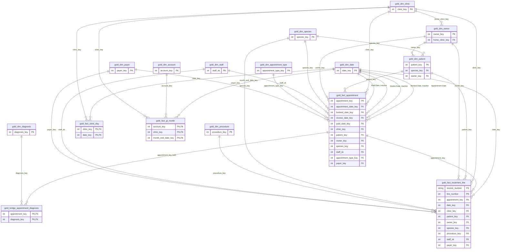

# Griffin & Gecko Creature Care — `GriffinGecko.Lakehouse`

> Veterinary care for creatures great, small and occasionally on fire — eight clinics, one very nervous accountant.

*A fictional dataset generated by the Lumen dataset generator — every company, person, place and number here is made up.*

## The story

Griffin & Gecko began as a two-vet practice that would see *anything*: a moon gecko with a cough, a griffin with a
sprained wing, a dragon who had swallowed (most of) a treasure chest. Today it is a network of **creature hospitals,
neighbourhood clinics, an Aerie with a landing deck for large flyers and an Aquatic Center with kraken tanks**, run
from a small head office whose finance team would like everyone to stop setting the exam rooms on fire.

The data tells the whole story of a healthcare business:

- **Appointments** are booked by phone, online or walk-in, then seen, invoiced and paid — or not: online bookings
  no-show more, and one clinic's reminder system clearly broke after online booking launched.
- **Every visit has diagnoses** (a many-to-many bridge) and billed lines whose prices scale with the creature's size —
  an Emberback dragon's dental is a *lot* more than a gecko's.
- **Seasons matter.** Every winter brings **Ember Flu** to phoenixes and dragons; one winter it became an outbreak
  in the Highlands. Spring is molting season; summer brings sprained wings.
- **Insurers pay late.** Four fictional creature insurers cover part of the bill — and *Talon & Claw Assurance* takes
  longer to pay every quarter.
- **People and money are linked.** Staff are hired, promoted, certified, transferred and leave (SCD2); payroll flows
  from that history into the **general ledger**, alongside rents, fireproofing, repairs and marketing. Every journal
  balances, and a **budget** planned from the prior fiscal year lets you hunt for variances — like the winter the
  flagship hospital's fireproofing bill blew through budget.

## At a glance

| | |
|---|---|
| Analytic shapes | Healthcare operations · Finance (GL & budget vs actual) · HR / payroll (SCD2) · Receivables & insurance · Seasonal outbreaks |
| Gold star schema | 4 facts, 11 dimensions, 1 bridge (145,751 rows) |
| Silver | 17 conformed tables (194,190 rows) |
| Bronze | 12 sources, 1,315 raw files, 19 planted data-quality issues |
| Semantic model | 19 tables, 26 relationships, 38 measures, 11 time-intelligence items |
| History | 2024-01-01 … 2026-11-30 · fiscal year starts in month 4 |
| This build | scale `small`, seed `42` (same seed ⇒ byte-identical output) |

## Layout

```text
griffingecko/
├── GriffinGecko.Lakehouse/
│   ├── Files/bronze/        raw landing files (CSV / JSON / NDJSON / XLSX) with planted issues
│   └── Tables/              Delta tables: silver_* (cleaned) and gold_* (star schema)
├── GriffinGecko.SemanticModel/  TMDL semantic model (import mode, reads gold Parquet)
├── GriffinGecko.Report/         PBIR starter report
├── GriffinGecko.pbip            open this in Power BI Desktop or Lumen
├── csv/                     plain CSV export of every silver/gold table (with --formats csv)
└── README.md
```

## Gold star schema



## Table catalog

| Table | Layer | Type | Grain | Rows |
|---|---|---|---|---:|
| `gold_dim_clinic` | gold | dim | One row per clinic / cost center. | 9 |
| `gold_dim_species` | gold | dim | One row per breed. | 26 |
| `gold_dim_owner` | gold | dim | One row per owner (plus the unknown owner). | 2,401 |
| `gold_dim_patient` | gold | dim | One row per patient (plus the unknown patient). | 3,297 |
| `gold_dim_staff` | gold | dim (SCD2) | One row per staff member version. | 351 |
| `gold_dim_procedure` | gold | dim | One row per billing code. | 35 |
| `gold_dim_diagnosis` | gold | dim | One row per diagnosis code. | 22 |
| `gold_dim_account` | gold | dim | One row per GL account. | 22 |
| `gold_dim_appointment_type` | gold | dim | One row per visit type × booking channel. | 20 |
| `gold_dim_payer` | gold | dim | One row per payer. | 5 |
| `gold_bridge_appointment_diagnosis` | gold | bridge | One row per appointment × diagnosis. | 28,458 |
| `gold_fact_appointment` | gold | fact (accumulating snapshot) | One row per appointment. | 26,649 |
| `gold_fact_treatment_line` | gold | fact (transaction) | One row per invoice line. | 68,031 |
| `gold_fact_clinic_day` | gold | fact (periodic snapshot) | One row per patient-facing clinic per calendar day. | 8,201 |
| `gold_fact_gl_month` | gold | fact (periodic snapshot) | One row per account × cost center × month (month-end date). | 7,128 |
| `gold_dim_date` | gold | dim | One row per calendar day (full calendar years). | 1,096 |
| `silver_clinics` | silver | entity | One row per clinic / cost center. | 9 |
| `silver_species` | silver | entity | One row per breed. | 26 |
| `silver_owners` | silver | entity | One row per owner. | 2,400 |
| `silver_patients` | silver | entity | One row per patient. | 3,296 |
| `silver_procedures` | silver | entity | One row per billing code. | 35 |
| `silver_diagnoses` | silver | entity | One row per diagnosis. | 22 |
| `silver_accounts` | silver | entity | One row per account. | 22 |
| `silver_payers` | silver | entity | One row per payer. | 5 |
| `silver_staff_snapshots` | silver | entity | One row per staff member per month-end. | 1,437 |
| `silver_appointments` | silver | entity | One row per appointment. | 26,649 |
| `silver_appointment_diagnoses` | silver | entity | One row per appointment × diagnosis. | 28,458 |
| `silver_invoice_lines` | silver | entity | One row per invoice line. | 68,031 |
| `silver_payments` | silver | entity | One row per payment. | 35,657 |
| `silver_insurance_claims` | silver | entity | One row per claim. | 12,912 |
| `silver_payroll_monthly` | silver | entity | One row per staff member per pay month. | 1,437 |
| `silver_gl_journal_lines` | silver | entity | One row per journal line. | 7,827 |
| `silver_budget` | silver | entity | One row per fiscal year × cost center × P&L account × month. | 5,967 |

### Gold

#### `gold_dim_clinic` → model table **Clinic**

Clinics, hospitals, aeries and aquatic centers — plus the Head Office cost center (which sees no patients).

- **Type:** dim · **Grain:** One row per clinic / cost center.
- **Key:** `clinic_key` · **Rows:** 9 · **Size:** 5.6 KB

<details><summary>Columns</summary>

| Column | Type | Model name | Description |
|---|---|---|---|
| `clinic_key` | int | Clinic Key | Surrogate key. |
| `clinic_code` | string | Clinic Code | Business key, e.g. "GG-03" (GG-HQ = Head Office). |
| `clinic_name` | string | Clinic Name | Clinic name. |
| `clinic_type` | string | Clinic Type | Creature Hospital / Creature Clinic / Aerie / Aquatic Center / Head Office. |
| `region` | string | Region | Region. |
| `district` | string | District | District within the region. |
| `city` | string | City | Town (fictional). |
| `opened_date` | date | Opened Date | Opening date. |
| `exam_rooms` | int | Exam Rooms | Exam rooms. |
| `has_flight_deck` | bool | Has Flight Deck | Landing deck for large flyers (dragons, griffins, pegasi). |
| `has_tank_wing` | bool | Has Tank Wing | Saltwater tank wing for krakens and sea serpents (as of today). |
| `tank_wing_opened` | date | Tank Wing Opened | Date the tank wing opened (blank if none). |
| `is_patient_facing` | bool | Is Patient Facing | False for the Head Office cost center. |

</details>

#### `gold_dim_species` → model table **Species**

Creature taxonomy: Class → Species → Breed, with size class and typical lifespan.

- **Type:** dim · **Grain:** One row per breed.
- **Key:** `species_key` · **Rows:** 26 · **Size:** 5.6 KB

<details><summary>Columns</summary>

| Column | Type | Model name | Description |
|---|---|---|---|
| `species_key` | int | Species Key | Surrogate key. |
| `breed_code` | string | Breed Code | Business key, e.g. "BR-07". |
| `creature_class` | string | Creature Class | Dragons / Griffins & Hippogriffs / Phoenixes & Firebirds / Basilisks / Sea Beasts / Garden Reptiles / Small Familiars / Legendary Equines. |
| `species` | string | Species | Species. |
| `breed` | string | Breed | Breed. |
| `size_class` | string | Size Class | Tiny / Small / Large / Colossal — drives prices and visit length. |
| `size_rank` | int | Size Rank | Size order 1-4. |
| `typical_lifespan_years` | int | Typical Lifespan Years | Typical lifespan in years. |
| `is_aquatic` | bool | Is Aquatic | Needs a tank wing. |
| `is_flyer` | bool | Is Flyer | Needs a flight deck when Large or bigger. |
| `is_fire_breathing` | bool | Is Fire Breathing | Breathes fire (fireproof exam room required). |

</details>

#### `gold_dim_owner` → model table **Owner**

Owners and households (wizard guilds and royal menageries included). Key -1 = Good Samaritan (strays brought in by the public).

- **Type:** dim · **Grain:** One row per owner (plus the unknown owner).
- **Key:** `owner_key` · **Rows:** 2,401 · **Size:** 52.2 KB
- **Foreign keys:** `home_clinic_key` → `gold_dim_clinic`

<details><summary>Columns</summary>

| Column | Type | Model name | Description |
|---|---|---|---|
| `owner_key` | int | Owner Key | Surrogate key (-1 = Good Samaritan). |
| `owner_id` | string | Owner ID | Business key, e.g. "OW-000123". |
| `household_name` | string | Household Name | Household / organisation name. |
| `owner_type` | string | Owner Type | Household / Wizard Guild / Farm / Royal Menagerie / Sanctuary. |
| `city` | string | City | Town. |
| `care_plan` | string | Care Plan | None / Hatchling Plan / Hoard Plan (10% off services). |
| `payer_name` | string | Payer Name | Creature insurance provider (or Self-Pay). |
| `join_date` | date | Join Date | First registration. |
| `home_clinic_key` | int | Home Clinic Key | Clinic the household usually visits. |
| `email_opt_in` | bool | Email Opt In | Reminder e-mail consent. |

</details>

#### `gold_dim_patient` → model table **Patient**

Creature patients. Key -1 = unregistered stray.

- **Type:** dim · **Grain:** One row per patient (plus the unknown patient).
- **Key:** `patient_key` · **Rows:** 3,297 · **Size:** 87.0 KB
- **Foreign keys:** `species_key` → `gold_dim_species`, `owner_key` → `gold_dim_owner`

<details><summary>Columns</summary>

| Column | Type | Model name | Description |
|---|---|---|---|
| `patient_key` | int | Patient Key | Surrogate key (-1 = unregistered stray). |
| `patient_id` | string | Patient ID | Business key, e.g. "PT-000042". |
| `patient_name` | string | Patient Name | Name. |
| `species_key` | int | Species Key | Breed (also on the facts). |
| `owner_key` | int | Owner Key | Owner (also on the facts). |
| `sex` | string | Sex | Female / Male / Unknown (some creatures decline to say). |
| `birth_date` | date | Birth Date | Hatch / birth date. |
| `weight_kg` | double | Weight kg | Last recorded weight (blank when the scale reported a sentinel). |
| `temperament` | string | Temperament | Gentle / Skittish / Grumpy / Incendiary. |
| `is_rune_tagged` | bool | Is Rune Tagged | Identification rune applied (like a microchip). |
| `registered_date` | date | Registered Date | Registration date. |

</details>

#### `gold_dim_staff` → model table **Staff**

Veterinarians, nurses, handlers and admin staff with full history (SCD Type 2): raises, promotions, specialty certifications, transfers, terminations.

- **Type:** dim (SCD2) · **Grain:** One row per staff member version.
- **Key:** `staff_sk` · **Rows:** 351 · **Size:** 14.9 KB
- **SCD Type 2:** business key `staff_id`, validity `valid_from` … `valid_to`, current flag `is_current`

<details><summary>Columns</summary>

| Column | Type | Model name | Description |
|---|---|---|---|
| `staff_sk` | int | Staff Sk | Surrogate key of the version. |
| `staff_id` | string | Staff ID | Business key, e.g. "ST-0042". |
| `full_name` | string | Full Name | Name (fictional). |
| `role` | string | Role | Veterinarian / Senior Veterinarian / Vet Nurse / Creature Handler / Receptionist / Clinic Manager / Head Office. |
| `role_group` | string | Role Group | Veterinary / Nursing & Handling / Admin — maps to the payroll GL accounts. |
| `specialty` | string | Specialty | Draconic Medicine / Avian & Griffin / Aquatic / Herpetology / General. |
| `clinic_code` | string | Clinic Code | Clinic in this version. |
| `clinic_name` | string | Clinic Name | Clinic name in this version. |
| `salary_band` | string | Salary Band | Band 1-7. |
| `annual_salary` | decimal | Annual Salary | Annual salary in this version (USD). |
| `employment_status` | string | Employment Status | Active / Terminated. |
| `hire_date` | date | Hire Date | Original hire date. |
| `valid_from` | date | Valid From | Version start (inclusive). |
| `valid_to` | date | Valid To | Version end (inclusive; 9999-12-31 = open). |
| `is_current` | bool | Is Current | Current version flag. |
| `version` | int | Version | Version number per staff member. |

</details>

#### `gold_dim_procedure` → model table **Procedure**

Billable services, procedures and medications with list price (for a Small creature) and revenue account.

- **Type:** dim · **Grain:** One row per billing code.
- **Key:** `procedure_key` · **Rows:** 35 · **Size:** 5.3 KB

<details><summary>Columns</summary>

| Column | Type | Model name | Description |
|---|---|---|---|
| `procedure_key` | int | Procedure Key | Surrogate key. |
| `procedure_code` | string | Procedure Code | Billing code, e.g. "PX-204". |
| `procedure_name` | string | Procedure Name | Name. |
| `procedure_group` | string | Procedure Group | Consultation / Vaccination / Diagnostics / Surgery / Fang & Beak / Medication / Boarding & Care. |
| `item_category` | string | Item Category | Service / Medication. |
| `revenue_account_code` | string | Revenue Account Code | GL revenue account the line posts to. |
| `base_price` | decimal | Base Price | List price for a Small creature today (Tiny ×0.6, Large ×2.6, Colossal ×5.5). |
| `cost_ratio` | double | Cost Ratio | Standard cost as a share of price. |

</details>

#### `gold_dim_diagnosis` → model table **Diagnosis**

Diagnoses with clinical grouping and severity.

- **Type:** dim · **Grain:** One row per diagnosis code.
- **Key:** `diagnosis_key` · **Rows:** 22 · **Size:** 3.7 KB

<details><summary>Columns</summary>

| Column | Type | Model name | Description |
|---|---|---|---|
| `diagnosis_key` | int | Diagnosis Key | Surrogate key. |
| `diagnosis_code` | string | Diagnosis Code | Code, e.g. "DX-014". |
| `diagnosis_name` | string | Diagnosis Name | Name. |
| `diagnosis_group` | string | Diagnosis Group | Routine / Infectious / Parasitic / Injury / Dental / Behavioral / Gastro / Chronic / Aquatic / Reproductive. |
| `severity` | string | Severity | Mild / Moderate / Severe. |
| `is_seasonal` | bool | Is Seasonal | Has a seasonal pattern. |

</details>

#### `gold_dim_account` → model table **Account**

Chart of accounts with statement / type / group hierarchy.

- **Type:** dim · **Grain:** One row per GL account.
- **Key:** `account_key` · **Rows:** 22 · **Size:** 5.3 KB

<details><summary>Columns</summary>

| Column | Type | Model name | Description |
|---|---|---|---|
| `account_key` | int | Account Key | Surrogate key. |
| `account_code` | string | Account Code | GL account number. |
| `account_name` | string | Account Name | Account name. |
| `statement` | string | Statement | Profit & Loss / Balance Sheet. |
| `account_type` | string | Account Type | Revenue / Cost of Sales / Operating Expense / Asset / Liability. |
| `account_group` | string | Account Group | Reporting group (e.g. Payroll, Facilities). |
| `normal_balance` | string | Normal Balance | Debit / Credit. |
| `pl_sign` | int | P&L Sign | +1 for revenue, -1 for costs (multiply P&L amounts to get profit). |
| `sort_order` | int | Sort Order | Statement order. |
| `type_order` | int | Type Order | Type order. |

</details>

#### `gold_dim_appointment_type` → model table **Appointment Type**

Junk dimension: every combination of visit type and booking channel.

- **Type:** dim · **Grain:** One row per visit type × booking channel.
- **Key:** `appointment_type_key` · **Rows:** 20 · **Size:** 2.8 KB

<details><summary>Columns</summary>

| Column | Type | Model name | Description |
|---|---|---|---|
| `appointment_type_key` | int | Appointment Type Key | Surrogate key. |
| `visit_type` | string | Visit Type | Wellness / Sick Visit / Emergency / Surgery / Follow-up. |
| `booking_channel` | string | Booking Channel | Phone / Online / Walk-in / Referral. |
| `is_emergency` | bool | Is Emergency | Emergency visit. |
| `is_scheduled` | bool | Is Scheduled | Booked in advance (not walk-in). |

</details>

#### `gold_dim_payer` → model table **Payer**

Creature insurance providers (fictional) and Self-Pay.

- **Type:** dim · **Grain:** One row per payer.
- **Key:** `payer_key` · **Rows:** 5 · **Size:** 3.1 KB

<details><summary>Columns</summary>

| Column | Type | Model name | Description |
|---|---|---|---|
| `payer_key` | int | Payer Key | Surrogate key. |
| `payer_code` | string | Payer Code | Business key. |
| `payer_name` | string | Payer Name | Payer name. |
| `payer_type` | string | Payer Type | Insurer / Self-Pay. |
| `coverage_pct` | double | Coverage % | Share of the invoice the insurer covers. |
| `contract_days_to_pay` | int | Contract Days To Pay | Contractual claim payment days. |

</details>

#### `gold_bridge_appointment_diagnosis` → model table **Appointment Diagnosis**

Diagnoses recorded per appointment (many-to-many). Filter appointments by diagnosis through this bridge (bidirectional).

- **Type:** bridge · **Grain:** One row per appointment × diagnosis.
- **Key:** `appointment_key`, `diagnosis_key` · **Rows:** 28,458 · **Size:** 140.0 KB
- **Foreign keys:** `appointment_key` → `gold_fact_appointment` (bidirectional), `diagnosis_key` → `gold_dim_diagnosis`
- **Partitioned by:** `year` (year of `appointment_date`)

<details><summary>Columns</summary>

| Column | Type | Model name | Description |
|---|---|---|---|
| `appointment_key` | int | Appointment Key | Appointment. |
| `diagnosis_key` | int | Diagnosis Key | Diagnosis. |
| `appointment_date` | date | — | Appointment date (partition source). |
| `is_primary` | bool | Is Primary | Primary diagnosis of the visit. |
| `diagnosis_rank` | int | Diagnosis Rank | 1 = primary. |

</details>

#### `gold_fact_appointment` → model table **Appointments**

Appointments through their lifecycle: booked → seen (or no-show / cancelled) → invoiced → paid, with one date key per milestone.

- **Type:** fact (accumulating snapshot) · **Grain:** One row per appointment.
- **Key:** `appointment_key` · **Rows:** 26,649 · **Size:** 907.3 KB
- **Foreign keys:** `appointment_date_key` → `gold_dim_date`, `booked_date_key` → `gold_dim_date` (inactive), `invoice_date_key` → `gold_dim_date` (inactive), `paid_date_key` → `gold_dim_date` (inactive), `clinic_key` → `gold_dim_clinic`, `patient_key` → `gold_dim_patient`, `owner_key` → `gold_dim_owner`, `species_key` → `gold_dim_species`, `staff_sk` → `gold_dim_staff`, `appointment_type_key` → `gold_dim_appointment_type`, `payer_key` → `gold_dim_payer`
- **Partitioned by:** `year` (year of `appointment_date`)

<details><summary>Columns</summary>

| Column | Type | Model name | Description |
|---|---|---|---|
| `appointment_key` | int | Appointment Key | Surrogate key. |
| `appointment_id` | string | Appointment ID | Practice-management id. |
| `appointment_date` | date | — | Appointment date (partition source). |
| `appointment_date_key` | int | Appointment Date Key | Appointment date (active relationship). |
| `booked_date_key` | int | Booked Date Key | Booking date (inactive; blank if booked before the history window). |
| `invoice_date_key` | int | Invoice Date Key | Invoice date (inactive; blank if not seen). |
| `paid_date_key` | int | Paid Date Key | Fully-paid date (inactive; blank while money is outstanding). |
| `clinic_key` | int | Clinic Key | Clinic. |
| `patient_key` | int | Patient Key | Patient (-1 = stray). |
| `owner_key` | int | Owner Key | Owner (-1 = Good Samaritan). |
| `species_key` | int | Species Key | Breed. |
| `staff_sk` | int | Staff Sk | Attending veterinarian (SCD2 version in effect). |
| `appointment_type_key` | int | Appointment Type Key | Visit type × booking channel. |
| `payer_key` | int | Payer Key | Payer. |
| `appointment_hour` | int | Appointment Hour | Scheduled hour (0-23). |
| `status` | string | Status | Paid / Invoiced / No-Show / Cancelled. |
| `is_no_show` | bool | Is No Show | Patient did not arrive. |
| `is_seen` | bool | Is Seen | Patient was seen (invoiced). |
| `lead_time_days` | int | Lead Time Days | Days between booking and appointment. |
| `wait_minutes` | int | Wait Minutes | Minutes from check-in to being seen. |
| `duration_minutes` | int | Duration Minutes | Vet time spent. |
| `diagnosis_count` | int | Diagnosis Count | Diagnoses recorded. |
| `invoice_amount` | decimal | Invoice Amount | Invoice total (= Σ treatment lines). |
| `owner_paid_amount` | decimal | Owner Paid Amount | Paid by the owner so far. |
| `insurer_paid_amount` | decimal | Insurer Paid Amount | Paid by the insurer so far. |
| `outstanding_amount` | decimal | Outstanding Amount | Still owed as of today. |
| `days_to_pay` | int | Days To Pay | Invoice → fully paid, in days. |

</details>

#### `gold_fact_treatment_line` → model table **Treatments**

Invoice lines: every service, procedure and medication billed. Lines sum exactly to the appointment invoice.

- **Type:** fact (transaction) · **Grain:** One row per invoice line.
- **Key:** `invoice_number`, `line_number` · **Rows:** 68,031 · **Size:** 1.0 MB
- **Foreign keys:** `date_key` → `gold_dim_date`, `appointment_key` → `gold_fact_appointment`, `clinic_key` → `gold_dim_clinic`, `patient_key` → `gold_dim_patient`, `owner_key` → `gold_dim_owner`, `species_key` → `gold_dim_species`, `procedure_key` → `gold_dim_procedure`, `staff_sk` → `gold_dim_staff`, `payer_key` → `gold_dim_payer`
- **Partitioned by:** `year` (year of `service_date`)

<details><summary>Columns</summary>

| Column | Type | Model name | Description |
|---|---|---|---|
| `invoice_number` | string | Invoice Number | Invoice number. |
| `line_number` | int | Line Number | Line within the invoice. |
| `appointment_key` | int | Appointment Key | Appointment (degenerate link to the accumulating snapshot). |
| `service_date` | date | — | Service date (partition source). |
| `date_key` | int | Date Key | Service / invoice date. |
| `clinic_key` | int | Clinic Key | Clinic. |
| `patient_key` | int | Patient Key | Patient. |
| `owner_key` | int | Owner Key | Owner. |
| `species_key` | int | Species Key | Breed. |
| `procedure_key` | int | Procedure Key | Billing code. |
| `staff_sk` | int | Staff Sk | Staff member who performed / dispensed it. |
| `payer_key` | int | Payer Key | Payer. |
| `quantity` | int | Quantity | Units (doses, nights, procedures). |
| `unit_price` | decimal | Unit Price | Price per unit after the size multiplier. |
| `gross_amount` | decimal | Gross Amount | quantity × unit_price. |
| `discount_amount` | decimal | Discount Amount | Care-plan discount. |
| `net_amount` | decimal | Net Amount | gross − discount (revenue). |
| `cost_amount` | decimal | Cost Amount | Standard cost (medications & supplies). |

</details>

#### `gold_fact_clinic_day` → model table **Clinic Day**

Daily clinic scorecard: vets on duty, capacity, booked minutes, visits, no-shows, waits and revenue.

- **Type:** fact (periodic snapshot) · **Grain:** One row per patient-facing clinic per calendar day.
- **Key:** `clinic_key`, `date_key` · **Rows:** 8,201 · **Size:** 83.8 KB
- **Foreign keys:** `date_key` → `gold_dim_date`, `clinic_key` → `gold_dim_clinic`

<details><summary>Columns</summary>

| Column | Type | Model name | Description |
|---|---|---|---|
| `clinic_key` | int | Clinic Key | Clinic. |
| `date_key` | int | Date Key | Date. |
| `is_open` | bool | Is Open | Clinic open for scheduled visits (hospitals take emergencies every day). |
| `vets_on_duty` | int | Vets On Duty | Veterinarians rostered. |
| `available_minutes` | int | Available Minutes | Vet capacity (vets × 480 minutes). |
| `booked_minutes` | int | Booked Minutes | Vet minutes spent with patients. |
| `appointments` | int | Appointments | Appointments scheduled for the day. |
| `visits_seen` | int | Visits Seen | Patients seen. |
| `no_shows` | int | No Shows | No-shows. |
| `cancellations` | int | Cancellations | Cancellations. |
| `emergencies` | int | Emergencies | Emergency visits seen. |
| `total_wait_minutes` | int | Total Wait Minutes | Sum of waits (divide by visits for the average). |
| `revenue` | decimal | Revenue | Invoiced revenue (= Σ treatment lines of the day). |

</details>

#### `gold_fact_gl_month` → model table **GL**

Monthly GL activity and balances per account and cost center, with the budget for P&L accounts. Months after today carry budget only.

- **Type:** fact (periodic snapshot) · **Grain:** One row per account × cost center × month (month-end date).
- **Key:** `account_key`, `clinic_key`, `month_end_date_key` · **Rows:** 7,128 · **Size:** 110.5 KB
- **Foreign keys:** `month_end_date_key` → `gold_dim_date`, `account_key` → `gold_dim_account`, `clinic_key` → `gold_dim_clinic`

<details><summary>Columns</summary>

| Column | Type | Model name | Description |
|---|---|---|---|
| `account_key` | int | Account Key | GL account. |
| `clinic_key` | int | Clinic Key | Cost center (clinic or Head Office). |
| `month_end_date_key` | int | Month End Date Key | Last day of the month. |
| `debit_amount` | decimal | Debit Amount | Debits posted in the month. |
| `credit_amount` | decimal | Credit Amount | Credits posted in the month. |
| `net_change` | decimal | Net Change | Debits − credits. |
| `closing_balance` | decimal | Closing Balance | Balance-sheet accounts: cumulative balance at month end (debit positive). Blank for P&L. |
| `actual_amount` | decimal | Actual Amount | P&L accounts: activity in natural sign (revenue = credits − debits, costs = debits − credits). Blank for balance-sheet accounts and future months. |
| `budget_amount` | decimal | Budget Amount | P&L budget for the month (natural sign). |

</details>

#### `gold_dim_date` → model table **Date**

Conformed calendar with fiscal periods, holidays and offsets relative to "today". Marked as the date table.

- **Type:** dim · **Grain:** One row per calendar day (full calendar years).
- **Key:** `date_key` · **Rows:** 1,096 · **Size:** 32.6 KB

<details><summary>Columns</summary>

| Column | Type | Model name | Description |
|---|---|---|---|
| `date_key` | int | Date Key | Surrogate key yyyymmdd. |
| `date` | date | Date | Calendar date. |
| `year` | int | Year | Calendar year. |
| `quarter` | int | Quarter | Calendar quarter number 1-4. |
| `quarter_label` | string | Quarter Label | Quarter label, e.g. "Q3". |
| `year_quarter` | string | Year Quarter | Year and quarter, e.g. "2026 Q3". |
| `year_quarter_key` | int | Year Quarter Key | Sortable year*10+quarter. |
| `month` | int | Month | Month number 1-12. |
| `month_name` | string | Month Name | Month name. |
| `month_short` | string | Month Short | Three-letter month name. |
| `year_month` | string | Year Month | Year-month, e.g. "2026-03". |
| `year_month_key` | int | Year Month Key | Sortable year*100+month. |
| `month_start` | date | Month Start | First day of the month (handy for monthly line charts). |
| `week_of_year` | int | Week Of Year | ISO week number. |
| `iso_year` | int | ISO Year | ISO week-numbering year. |
| `week_start` | date | Week Start | Monday of the ISO week. |
| `day_of_month` | int | Day Of Month | Day of month. |
| `day_of_year` | int | Day Of Year | Day of year 1-366. |
| `day_of_week` | int | Day Of Week | ISO weekday 1 = Monday ... 7 = Sunday. |
| `day_name` | string | Day Name | Weekday name. |
| `day_short` | string | Day Short | Three-letter weekday name. |
| `is_weekend` | bool | Is Weekend | Saturday or Sunday. |
| `is_holiday` | bool | Is Holiday | Company holiday. |
| `holiday_name` | string | Holiday Name | Holiday name (blank on ordinary days). |
| `is_working_day` | bool | Is Working Day | Weekday that is not a holiday. |
| `fiscal_year` | int | Fiscal Year | Fiscal year number (named after the calendar year it ends in). |
| `fiscal_year_label` | string | Fiscal Year Label | Fiscal year label, e.g. "FY27". |
| `fiscal_quarter` | int | Fiscal Quarter | Fiscal quarter 1-4. |
| `fiscal_quarter_label` | string | Fiscal Quarter Label | Fiscal quarter label, e.g. "FY27 Q2". |
| `fiscal_quarter_key` | int | Fiscal Quarter Key | Sortable fiscal_year*10+fiscal_quarter. |
| `fiscal_month` | int | Fiscal Month | Fiscal month 1-12. |
| `is_past` | bool | Is Past | On or before "today" (the last day of generated history). |
| `day_offset` | int | Day Offset | Days relative to today (0 = today, -1 = yesterday). |
| `month_offset` | int | Month Offset | Months relative to the current month. |
| `year_offset` | int | Year Offset | Years relative to the current year. |

</details>

### Silver

#### `silver_clinics`

Clinic master from the practice-management API.

- **Type:** entity · **Grain:** One row per clinic / cost center.
- **Key:** `clinic_code` · **Rows:** 9 · **Size:** 4.4 KB

<details><summary>Columns</summary>

| Column | Type | Description |
|---|---|---|
| `clinic_code` | string | Code. |
| `clinic_name` | string | Name. |
| `clinic_type` | string | Type. |
| `region` | string | Region. |
| `district` | string | District. |
| `city` | string | Town. |
| `opened_date` | date | Opened. |
| `exam_rooms` | int | Exam rooms. |
| `has_flight_deck` | bool | Flight deck. |
| `tank_wing_opened` | date | Tank wing opening. |

</details>

#### `silver_species`

Creature taxonomy reference.

- **Type:** entity · **Grain:** One row per breed.
- **Key:** `breed_code` · **Rows:** 26 · **Size:** 4.6 KB

<details><summary>Columns</summary>

| Column | Type | Description |
|---|---|---|
| `breed_code` | string | Breed code. |
| `creature_class` | string | Class. |
| `species` | string | Species. |
| `breed` | string | Breed. |
| `size_class` | string | Size class. |
| `typical_lifespan_years` | int | Lifespan. |
| `is_aquatic` | bool | Aquatic. |
| `is_flyer` | bool | Flyer. |
| `is_fire_breathing` | bool | Fire-breathing. |

</details>

#### `silver_owners`

Owners, de-duplicated, e-mail placeholders nulled, town names title-cased.

- **Type:** entity · **Grain:** One row per owner.
- **Key:** `owner_id` · **Rows:** 2,400 · **Size:** 60.8 KB

<details><summary>Columns</summary>

| Column | Type | Description |
|---|---|---|
| `owner_id` | string | Owner id. |
| `household_name` | string | Household. |
| `owner_type` | string | Type. |
| `city` | string | Town. |
| `email` | string | E-mail (blank = not provided). |
| `care_plan` | string | Care plan. |
| `payer_code` | string | Insurer. |
| `home_clinic_code` | string | Home clinic. |
| `join_date` | date | Joined. |
| `email_opt_in` | bool | Consent. |

</details>

#### `silver_patients`

Patients with parsed birth dates; sentinel weights (-1, 9999) nulled.

- **Type:** entity · **Grain:** One row per patient.
- **Key:** `patient_id` · **Rows:** 3,296 · **Size:** 74.5 KB

<details><summary>Columns</summary>

| Column | Type | Description |
|---|---|---|
| `patient_id` | string | Patient id. |
| `patient_name` | string | Name. |
| `breed_code` | string | Breed. |
| `owner_id` | string | Owner. |
| `sex` | string | Sex. |
| `birth_date` | date | Birth / hatch date. |
| `weight_kg` | double | Weight. |
| `temperament` | string | Temperament. |
| `is_rune_tagged` | bool | Rune-tagged. |
| `registered_date` | date | Registered. |

</details>

#### `silver_procedures`

Billing catalogue (procedure groups case-normalised).

- **Type:** entity · **Grain:** One row per billing code.
- **Key:** `procedure_code` · **Rows:** 35 · **Size:** 4.6 KB

<details><summary>Columns</summary>

| Column | Type | Description |
|---|---|---|
| `procedure_code` | string | Code. |
| `procedure_name` | string | Name. |
| `procedure_group` | string | Group. |
| `item_category` | string | Service / Medication. |
| `revenue_account_code` | string | Revenue account. |
| `base_price` | decimal | Price today (Small creature). |
| `cost_ratio` | double | Cost ratio. |

</details>

#### `silver_diagnoses`

Diagnosis reference.

- **Type:** entity · **Grain:** One row per diagnosis.
- **Key:** `diagnosis_code` · **Rows:** 22 · **Size:** 3.1 KB

<details><summary>Columns</summary>

| Column | Type | Description |
|---|---|---|
| `diagnosis_code` | string | Code. |
| `diagnosis_name` | string | Name. |
| `diagnosis_group` | string | Group. |
| `severity` | string | Severity. |
| `is_seasonal` | bool | Seasonal. |

</details>

#### `silver_accounts`

Chart of accounts.

- **Type:** entity · **Grain:** One row per account.
- **Key:** `account_code` · **Rows:** 22 · **Size:** 3.7 KB

<details><summary>Columns</summary>

| Column | Type | Description |
|---|---|---|
| `account_code` | string | Account. |
| `account_name` | string | Name. |
| `statement` | string | Statement. |
| `account_type` | string | Type. |
| `account_group` | string | Group. |
| `normal_balance` | string | Debit / Credit. |

</details>

#### `silver_payers`

Insurance providers.

- **Type:** entity · **Grain:** One row per payer.
- **Key:** `payer_code` · **Rows:** 5 · **Size:** 2.4 KB

<details><summary>Columns</summary>

| Column | Type | Description |
|---|---|---|
| `payer_code` | string | Payer. |
| `payer_name` | string | Name. |
| `coverage_pct` | double | Coverage. |
| `contract_days_to_pay` | int | Contract days. |

</details>

#### `silver_staff_snapshots`

Month-end HR roster snapshots (hire dates parsed) — the input for the SCD2 staff dimension.

- **Type:** entity · **Grain:** One row per staff member per month-end.
- **Key:** `snapshot_date`, `staff_id` · **Rows:** 1,437 · **Size:** 20.1 KB
- **Partitioned by:** `year` (year of `snapshot_date`)

<details><summary>Columns</summary>

| Column | Type | Description |
|---|---|---|
| `snapshot_date` | date | Month-end. |
| `staff_id` | string | Staff id. |
| `full_name` | string | Name. |
| `role` | string | Role. |
| `specialty` | string | Specialty. |
| `clinic_code` | string | Clinic. |
| `salary_band` | string | Band. |
| `annual_salary` | decimal | Salary. |
| `employment_status` | string | Status. |
| `hire_date` | date | Hire date. |

</details>

#### `silver_appointments`

Appointments (deduplicated, latest status, statuses title-cased, PMS v4 field renames merged).

- **Type:** entity · **Grain:** One row per appointment.
- **Key:** `appointment_id` · **Rows:** 26,649 · **Size:** 488.0 KB
- **Partitioned by:** `year` (year of `appointment_date`)

<details><summary>Columns</summary>

| Column | Type | Description |
|---|---|---|
| `appointment_id` | string | Appointment id. |
| `clinic_code` | string | Clinic. |
| `patient_id` | string | Patient (STRAY-* ids are unregistered strays). |
| `vet_id` | string | Attending vet (renamed clinician_id in PMS v4). |
| `visit_type` | string | Visit type. |
| `booking_channel` | string | Channel. |
| `booked_date` | date | Booked. |
| `scheduled_at` | timestamp | Scheduled start. |
| `appointment_date` | date | Appointment date. |
| `status` | string | Completed / No-Show / Cancelled. |
| `wait_minutes` | int | Wait. |
| `duration_minutes` | int | Duration. |
| `is_telehealth` | bool | Scrying-glass consultation (PMS v4 only). |

</details>

#### `silver_appointment_diagnoses`

Diagnoses per appointment.

- **Type:** entity · **Grain:** One row per appointment × diagnosis.
- **Key:** `appointment_id`, `diagnosis_code` · **Rows:** 28,458 · **Size:** 161.1 KB
- **Partitioned by:** `year` (year of `appointment_date`)

<details><summary>Columns</summary>

| Column | Type | Description |
|---|---|---|
| `appointment_id` | string | Appointment. |
| `diagnosis_code` | string | Diagnosis. |
| `appointment_date` | date | Date. |
| `diagnosis_rank` | int | Rank (1 = primary). |

</details>

#### `silver_invoice_lines`

Invoice lines (amount text parsed, codes trimmed, fat-finger quantities repaired from the line total).

- **Type:** entity · **Grain:** One row per invoice line.
- **Key:** `invoice_number`, `line_number` · **Rows:** 68,031 · **Size:** 758.1 KB
- **Partitioned by:** `year` (year of `service_date`)

<details><summary>Columns</summary>

| Column | Type | Description |
|---|---|---|
| `invoice_number` | string | Invoice. |
| `line_number` | int | Line. |
| `appointment_id` | string | Appointment. |
| `service_date` | date | Date. |
| `clinic_code` | string | Clinic. |
| `procedure_code` | string | Billing code. |
| `staff_id` | string | Performed by. |
| `quantity` | int | Quantity. |
| `unit_price` | decimal | Unit price. |
| `discount_amount` | decimal | Discount. |
| `line_total` | decimal | Net line total. |
| `cost_amount` | decimal | Standard cost. |

</details>

#### `silver_payments`

Cash received against invoices (owner at the desk, insurer remittances).

- **Type:** entity · **Grain:** One row per payment.
- **Key:** `payment_id` · **Rows:** 35,657 · **Size:** 520.9 KB
- **Partitioned by:** `year` (year of `payment_date`)

<details><summary>Columns</summary>

| Column | Type | Description |
|---|---|---|
| `payment_id` | string | Payment id. |
| `appointment_id` | string | Appointment. |
| `clinic_code` | string | Clinic. |
| `payer_code` | string | Who paid (SELF = owner). |
| `payment_date` | date | Date received. |
| `amount` | decimal | Amount. |

</details>

#### `silver_insurance_claims`

Insurance claims (negative resubmission amounts made positive).

- **Type:** entity · **Grain:** One row per claim.
- **Key:** `claim_id` · **Rows:** 12,912 · **Size:** 218.3 KB
- **Partitioned by:** `year` (year of `submitted_date`)

<details><summary>Columns</summary>

| Column | Type | Description |
|---|---|---|
| `claim_id` | string | Claim id. |
| `appointment_id` | string | Appointment. |
| `payer_code` | string | Insurer. |
| `submitted_date` | date | Submitted. |
| `claim_amount` | decimal | Claimed. |
| `paid_date` | date | Paid (blank = pending). |
| `status` | string | Paid / Pending. |

</details>

#### `silver_payroll_monthly`

Payroll register (gross pay parsed from text).

- **Type:** entity · **Grain:** One row per staff member per pay month.
- **Key:** `pay_month`, `staff_id` · **Rows:** 1,437 · **Size:** 16.0 KB
- **Partitioned by:** `year` (year of `pay_month`)

<details><summary>Columns</summary>

| Column | Type | Description |
|---|---|---|
| `pay_month` | date | Month-end of the pay period. |
| `staff_id` | string | Staff id. |
| `clinic_code` | string | Cost center charged. |
| `role_group` | string | Veterinary / Nursing & Handling / Admin. |
| `days_paid` | int | Days employed in the month. |
| `gross_pay` | decimal | Gross pay. |
| `employer_benefits` | decimal | Employer taxes & benefits (22%). |

</details>

#### `silver_gl_journal_lines`

Posted GL journal lines (posting dates normalised). Every journal balances.

- **Type:** entity · **Grain:** One row per journal line.
- **Key:** `journal_id`, `line_number` · **Rows:** 7,827 · **Size:** 68.9 KB
- **Partitioned by:** `year` (year of `posting_date`)

<details><summary>Columns</summary>

| Column | Type | Description |
|---|---|---|
| `journal_id` | string | Journal id. |
| `line_number` | int | Line. |
| `posting_date` | date | Posting date (month end). |
| `journal_type` | string | REV / CASH / COGS / PURCH / PAYROLL / EXPENSE / AP-PAY. |
| `clinic_code` | string | Cost center. |
| `account_code` | string | Account. |
| `debit` | decimal | Debit. |
| `credit` | decimal | Credit. |
| `description` | string | Line description. |

</details>

#### `silver_budget`

Budget unpivoted from the wide finance workbooks (one per fiscal year).

- **Type:** entity · **Grain:** One row per fiscal year × cost center × P&L account × month.
- **Key:** `clinic_code`, `account_code`, `budget_month` · **Rows:** 5,967 · **Size:** 28.5 KB

<details><summary>Columns</summary>

| Column | Type | Description |
|---|---|---|
| `fiscal_year` | int | Fiscal year (April start, named after the year it ends). |
| `clinic_code` | string | Cost center. |
| `account_code` | string | Account (trimmed). |
| `budget_month` | date | Month end. |
| `budget_amount` | decimal | Budget (natural sign). |

</details>

## Bronze sources

| Source | Upstream system | Format | Path pattern | Cadence | Files | Rows |
|---|---|---|---|---|---:|---:|
| `pms_appointments` | ClawSoft PMS API | json | `pms/appointments/YYYY/MM/DD/appointments_YYYYMMDD.json` | daily | 1,059 | 26,806 |
| `pms_reference` | ClawSoft PMS API | json | `pms/reference/{clinics,procedures,diagnoses,species}.json` | snapshot | 4 | 92 |
| `billing` | ClawSoft billing export | csv | `billing/YYYY/invoice_lines_YYYYMM.csv` | monthly | 35 | 68,031 |
| `diagnoses` | ClawSoft clinical notes | csv | `clinical/YYYY/appointment_diagnoses_YYYYMM.csv` | monthly | 35 | 28,458 |
| `payments` | TillTalon card terminals + insurer remittances | csv | `billing/payments/YYYY/payments_YYYYMM.csv` | monthly | 35 | 35,657 |
| `patients` | Creature registry | ndjson | `registry/patients.ndjson` | snapshot | 1 | 3,296 |
| `owners` | Creature registry | csv | `registry/owners.csv` | snapshot | 1 | 2,429 |
| `claims` | ScaleClaim insurer gateway | ndjson | `insurance/YYYY/claims_YYYYMM.ndjson` | monthly | 35 | 12,912 |
| `hr` | PawRoll HR | csv | `hr/staff/staff_YYYYMM.csv` | monthly snapshot | 35 | 1,437 |
| `payroll` | PawRoll payroll | csv | `hr/payroll/YYYY/payroll_YYYYMM.csv` | monthly | 35 | 1,437 |
| `gl` | LedgerLair GL | csv | `finance/gl/YYYY/journal_lines_YYYYMM.csv` | monthly | 36 | 7,849 |
| `budget` | Finance planning workbooks | xlsx | `finance/budget/budget_FYyy.xlsx` | yearly | 4 | 612 |

- **pms_appointments** — Daily API page of appointment records (envelope with `results`). The PMS v4 upgrade renamed `vet_id` → `clinician_id` and added `telehealth`. Re-sent and late records are common.
- **pms_reference** — Reference lists (clinics, billing codes, diagnoses, taxonomy).
- **billing** — Invoice lines; amounts exported as display text by older terminals.
- **diagnoses** — Diagnosis codes per appointment.
- **payments** — Payments received.
- **patients** — Patient export; weights from the clinic scales (which send sentinels when a dragon sits on them).
- **owners** — Owner export: quoted CSV with CRLF line endings.
- **claims** — Insurance claims with nested payer object.
- **hr** — Month-end staff roster snapshots — diff them to rebuild the SCD2 history.
- **payroll** — Payroll register.
- **gl** — Posted journal lines plus the chart of accounts (finance/gl/chart_of_accounts.csv).
- **budget** — One wide workbook per fiscal year: a row per cost center × account, a column per month (Apr … Mar), title lines on top.

## Planted data-quality issues (bronze)

Bronze is deliberately messy so you can practise Power Query / Spark cleaning. Silver shows the cleaned result.

| Code | Source | Column | Issue | Planted | How silver fixes it |
|---|---|---|---|---:|---|
| GG01 | `pms_appointments` | — | **duplicates** — The API re-sends some appointment records (exact duplicates). | 157 | Deduplicate on appointment_id. |
| GG02 | `pms_appointments` | `scheduled_at` | **late arriving** — Records synced from the mobile dragon-call van land 2-7 days late. | 391 | Union all daily pages; use scheduled_at as the business date. |
| GG03 | `pms_appointments` | — | **schema drift** — PMS v4: `vet_id` renamed `clinician_id`, new `telehealth` flag. | 1 | Coalesce vet_id / clinician_id; telehealth = false before the upgrade. |
| GG04 | `pms_appointments` | `status` | **casing** — Status values in mixed case ("COMPLETED", "no-show"). | 822 | Map to the canonical status list. |
| GG05 | `pms_appointments` | `patient_id` | **orphan keys** — Strays brought in by the public get temporary STRAY-* ids that never reach the registry. | 406 | Keep the visit; map to patient -1 (Unregistered Stray) and owner -1 in gold. |
| GG06 | `billing` | `line_total` | **formatted numbers** — Line totals as display text ("$1,234.50", "1.234,50", "86.00 USD"). | 3,401 | Strip currency symbols/codes and parse with the right decimal separator. |
| GG07 | `billing` | `procedure_code` | **whitespace** — Padded billing codes. | 1,363 | TRIM before joining to the catalogue. |
| GG08 | `billing` | `qty` | **outliers** — Fat-finger quantities (×100); the line total is still right. | 133 | quantity = (line_total + discount) ÷ unit_price. |
| GG09 | `patients` | `birth_date` | **mixed date formats** — Hatch dates in ISO, US, EU, long and epoch formats. | 495 | Parse with a list of formats. |
| GG10 | `patients` | `weight_kg` | **sentinel values** — Scale errors: -1 (no reading) and 9999 (overload — usually a dragon). | 135 | Replace sentinels with null. |
| GG11 | `owners` | — | **duplicates** — Some owners exported twice. | 29 | Deduplicate on owner_id. |
| GG12 | `owners` | `email` | **nulls** — Missing e-mails as blanks, "NULL" or "n/a". | 292 | Normalise placeholders to null. |
| GG13 | `owners` | `town` | **casing** — Town names in UPPER / lower case. | 144 | Title-case the town. |
| GG14 | `hr` | `hire_date` | **mixed date formats** — Hire dates in several formats. | 213 | Parse with a list of formats. |
| GG15 | `payroll` | `gross_pay` | **formatted numbers** — Gross pay exported as currency text. | 356 | Parse the currency text. |
| GG16 | `gl` | `posting_date` | **mixed date formats** — Posting dates from the old ledger in dd.mm.yyyy. | 1,246 | Parse both formats. |
| GG17 | `budget` | `Account` | **whitespace** — Account codes typed with stray spaces in the planning workbook. | 29 | TRIM before joining to the chart of accounts. |
| GG18 | `claims` | `claim_amount` | **outliers** — Resubmitted claims carry a negative sign. | 259 | Use the absolute amount (status tells you it was a resubmission). |
| GG19 | `pms_reference` | `group` | **casing** — Procedure groups typed in inconsistent case in the billing catalogue. | 7 | Map to canonical group names. |

## Semantic model

`GriffinGecko.SemanticModel` is an import-mode model over the gold tables. Each table's partition reads its Parquet file(s) through the `LakehousePath` parameter (`expressions.tmdl`) — set it to the absolute path of `GriffinGecko.Lakehouse` on your machine.

- Model tables: **Date**, **Clinic**, **Species**, **Owner**, **Patient**, **Staff**, **Procedure**, **Diagnosis**, **Account**, **Appointment Type**, **Payer**, **Appointment Diagnosis**, **Appointments**, **Treatments**, **Clinic Day**, **GL**, **_Measures**, **Time Intelligence**, **Clinical Breakdown**
- Inactive (role-playing) relationships: Appointments[Booked Date Key] → Date[Date Key]; Appointments[Invoice Date Key] → Date[Date Key]; Appointments[Paid Date Key] → Date[Date Key] — activate with `USERELATIONSHIP`.
- Bidirectional relationships: Appointment Diagnosis[Appointment Key] ↔ Appointments[Appointment Key].
- Calculation group **Time Intelligence**: Current, MTD, QTD, YTD, Fiscal YTD, PY, PY YTD, YoY, YoY %, Rolling 3M, Rolling 12M.
- Field parameter **Clinical Breakdown**: Clinic, Region, Creature Class, Species, Visit Type, Booking Channel, Payer, Procedure Group.

### Measures

| Folder | Measure | Format | What it means |
|---|---|---|---|
| Revenue | **Revenue** | `$#,0` | Invoiced revenue after care-plan discounts. |
| Revenue | **Gross Charges** | `$#,0` | Charges before discounts. |
| Revenue | **Care Plan Discounts** | `$#,0` | Discounts given to Hatchling / Hoard plan members. |
| Revenue | **Treatment Cost** | `$#,0` | Standard cost of medications and supplies. |
| Revenue | **Clinical Margin** | `$#,0` | Revenue minus treatment cost. |
| Revenue | **Clinical Margin %** | `0.0%` | Clinical margin as a share of revenue. |
| Revenue | **Revenue (Smart Units)** | dynamic | Revenue with a dynamic format string ($1.2M / $45.3K / $950). |
| Revenue | **Clinic Revenue Rank** | `0` | Rank of the clinic by revenue. |
| Visits | **Appointments** | `#,0` | Appointments scheduled (incl. no-shows and cancellations). |
| Visits | **Visits** | `#,0` | Patients actually seen. |
| Visits | **Average Invoice** | `$#,0.00` | Revenue per visit. |
| Visits | **No-Show %** | `0.0%` | Booked appointments where the creature never arrived. |
| Visits | **Avg Wait (min)** | `0.0` | Average minutes from check-in to being seen. |
| Visits | **Patients Seen** | `#,0` | Distinct patients seen (strays count once). |
| Visits | **Emergency Share %** | `0.0%` | Share of visits that were emergencies. |
| Visits | **Vet Utilization %** | `0.0%` | Vet minutes with patients ÷ rostered vet minutes. |
| Visits | **Diagnosed Appointments** | `#,0` | Appointments carrying the diagnosis(es) in context (many-to-many bridge). |
| Visits | **Bookings Made** | `#,0` | Appointments by the date they were booked (role-playing date via USERELATIONSHIP). |
| Visits | **Visits 28D Avg** | `#,0.0` | Rolling 28-day average of daily visits. |
| Receivables | **Outstanding Balance** | `$#,0` | Invoiced amounts not yet paid (as of today). |
| Receivables | **Avg Days to Pay** | `0.0` | Average days from invoice to fully paid. |
| Receivables | **Collected by Paid Date** | `$#,0` | Fully-paid invoices dated by payment (inactive Paid Date relationship). |
| Time Intelligence | **Revenue YTD** | `$#,0` | Calendar year-to-date revenue. |
| Time Intelligence | **Revenue FYTD** | `$#,0` | Fiscal year-to-date revenue (fiscal year starts 1 April). |
| Time Intelligence | **Revenue PY** | `$#,0` | Same period last year. |
| Time Intelligence | **Revenue YoY %** | `0.0%;-0.0%;0.0%` | Growth versus the same period last year. |
| Finance | **Actual** | `$#,0` | P&L actuals in natural sign (use with an Account filter). |
| Finance | **Budget** | `$#,0` | P&L budget in natural sign. |
| Finance | **Variance** | `$#,0;($#,0);$#,0` | Actual minus budget (natural sign — positive is good for revenue, bad for costs). |
| Finance | **Variance %** | `0.0%;-0.0%;0.0%` | Variance relative to budget. |
| Finance | **Operating Profit** | `$#,0;($#,0);$#,0` | Revenue minus all costs from the GL actuals. |
| Finance | **Operating Profit Budget** | `$#,0;($#,0);$#,0` | Budgeted revenue minus budgeted costs. |
| Finance | **Profit Variance** | `$#,0;($#,0);$#,0` | Profit impact of all variances (positive = favourable). |
| Finance | **Operating Margin %** | `0.0%` | Operating profit ÷ GL revenue. |
| Finance | **Payroll % of Revenue** | `0.0%` | Payroll cost (wages + benefits) relative to revenue. |
| Finance | **AR Balance** | `$#,0` | Accounts receivable at the last month-end in context (semi-additive balance). |
| Finance | **Cash Balance** | `$#,0;($#,0);$#,0` | Cash movement since the start of the history at the last month-end in context (semi-additive). |
| People | **Active Staff** | `#,0` | Current active headcount (current SCD2 versions). |

## Suggested analyses

1. **Ember Flu season** — When does Ember Flu peak, which classes does it hit, and how much bigger was the Highlands outbreak winter? *How:* Diagnosed Appointments for Ember Flu by Month Start and Region; compare winters with Revenue PY.
2. **The broken reminders** — One clinic's no-show rate jumped after online booking launched. Which one, and is it only online bookings? *How:* No-Show % by Clinic × Booking Channel over time (Appointment Type junk dimension).
3. **Size pricing** — How much of revenue comes from Large and Colossal creatures, and how does average invoice scale with size? *How:* Average Invoice by Species[Size Class]; Revenue by Creature Class with the Clinical Breakdown field parameter.
4. **Talon & Claw slows down** — Which insurer pays slower every quarter, and how much cash is stuck with them? *How:* Avg Days to Pay and Outstanding Balance by Payer over Date; Collected by Paid Date via USERELATIONSHIP.
5. **The Great Scorch** — Which cost center blew its utilities & fireproofing budget, and when? *How:* Variance and Variance % for account 6300 by Clinic and Month Start in the GL fact.
6. **Budget vs actual** — Which clinics beat their revenue plan and which overspent on payroll? *How:* Budget vs Actual matrix by Account hierarchy; Profit Variance by cost center; Fiscal YTD with the Time Intelligence calculation group.
7. **Waiting room blues** — One clinic's waits doubled in the last third of the history. Was it staffing? *How:* Avg Wait (min) and Vet Utilization % by clinic over time; Active Staff from the SCD2 Staff dimension.
8. **Surgery at the Aerie** — Surgical revenue at the Aerie stepped up mid-history. What changed? *How:* Revenue for Procedure Group = Surgery by clinic and month; check Staff versions (senior vets, specialties).
9. **Kraken tank wing** — A coastal hospital opened a tank wing — how quickly did aquatic visits ramp up? *How:* Visits for Creature Class = Sea Beasts by clinic and Month Start; Clinic[Tank Wing Opened].
10. **Payroll vs revenue** — Is payroll creeping up faster than revenue (April raises, promotions)? *How:* Payroll % of Revenue by fiscal quarter; Staff annual salary by Valid From.
11. **Receivables reconciliation** — Does the GL AR balance equal the unpaid invoices in the appointment snapshot? *How:* AR Balance (semi-additive GL measure) vs Outstanding Balance by clinic at the latest month-end.
12. **Diagnosis mix** — Which diagnoses co-occur, and which lead to surgery? *How:* Appointment Diagnosis bridge: matrix of Diagnosis Name × Visit Type with Diagnosed Appointments; drill to Procedures.
13. **Strays** — How many unregistered strays are brought in, where, and who pays? *How:* Visits for Patient = Unregistered Stray by clinic; Good Samaritan owner.

## Volume note

`small` simulates a quiet network (≈3 appointments per clinic per day). Staff headcount, rents and other
operating costs scale with the same factor, so **margins, payroll %, utilization and no-show rates are realistic**
while absolute totals are modest. `large` is roughly thirty times busier with proportionally larger clinics.

## Finance conventions

- Journals are posted monthly per cost center (REV, CASH, COGS, PAYROLL, EXPENSE, PAYOUT) and each one balances.
- `gold_fact_gl_month.actual_amount` uses the account's natural sign (revenue = credits − debits, costs = debits − credits);
  multiply by `Account[P&L Sign]` to get profit. Balance-sheet accounts carry `closing_balance` (debit positive) instead.
- The budget for each fiscal year (April–March) is planned from the prior fiscal year's actuals with a growth uplift; the
  first year's plan is the planners' own estimate. Months after today carry budget only.

## Regenerate

```bash
node datasets/src/node/cli.ts generate griffingecko --scale small --seed 42 --today 2026-11-30
```

See [the datasets README](../README.md) for loading into Lumen, Power BI Desktop, Fabric, DuckDB and Spark.
