# Leafloft Vertical Farms — `Leafloft.Lakehouse`

> Salad grown sixteen tiers high, delivered by bicycle — and billed like a SaaS company.

*A fictional dataset generated by the Lumen dataset generator — every company, person, place and number here is made up.*

## The story

Leafloft turns empty warehouses into **vertical farms**: windowless rooms of LED-lit racks, six or seven tiers
high, growing lettuce, kale, basil, microgreens, strawberries and cherry tomatoes without a speck of soil. The
harvest goes out in **veggie-box subscriptions** — *Sprout*, *Canopy*, *Rainforest* and the *Skyfarm Office* box —
plus add-ons like the Microgreens Medley and the Skyberry Punnet.

That makes Leafloft two businesses in one lakehouse:

- **A subscription company.** Every start, upgrade, downgrade, add-on, pause, cancellation and win-back is an
  event; the monthly MRR snapshot bridges exactly (opening + new + expansion + reactivation − contraction − churned
  = closing), so cohort retention curves, NRR and logo churn all work. January brings New-Year's-resolution
  signups, summer brings vacation pauses, and a spring **"Spring Greens Blitz"** campaign brings a big, cheap,
  flaky cohort (watch the *Influencer* channel). A mid-history **8 % price rise** shows up as expansion MRR — and
  as a churn spike the month after.
- **An IoT-instrumented factory.** Every room reports temperature, humidity, CO2, light (PPFD/DLI), pH, EC and
  energy every four hours. Racks get **LED Gen2 retrofits** (more light per watt, higher yields — tracked as SCD2
  versions). One summer an **HVAC unit fails** for two and a half weeks: rooms run hot, heat-sensitive lettuce
  and cilantro bolt, batches fail — and subscribers served by that farm cancel with "Quality Issue". Meanwhile one
  room's **CO2 sensor slowly drifts upward** while its yields stay perfectly normal: a calibration problem, not a
  plant problem.

## At a glance

| | |
|---|---|
| Analytic shapes | Subscription / SaaS metrics · IoT telemetry · Accumulating snapshot (grow batches) · Cohorts & retention · Energy |
| Gold star schema | 4 facts, 9 dimensions, 1 bridge (114,401 rows) |
| Silver | 15 conformed tables (186,318 rows) |
| Bronze | 10 sources, 2,165 raw files, 18 planted data-quality issues |
| Semantic model | 17 tables, 22 relationships, 40 measures, 10 time-intelligence items |
| History | 2024-01-01 … 2026-11-30 · fiscal year starts in month 1 |
| This build | scale `small`, seed `42` (same seed ⇒ byte-identical output) |

## Layout

```text
leafloft/
├── Leafloft.Lakehouse/
│   ├── Files/bronze/        raw landing files (CSV / JSON / NDJSON / XLSX) with planted issues
│   └── Tables/              Delta tables: silver_* (cleaned) and gold_* (star schema)
├── Leafloft.SemanticModel/  TMDL semantic model (import mode, reads gold Parquet)
├── Leafloft.Report/         PBIR starter report
├── Leafloft.pbip            open this in Power BI Desktop or Lumen
├── csv/                     plain CSV export of every silver/gold table (with --formats csv)
└── README.md
```

## Gold star schema

```mermaid
erDiagram
    gold_dim_farm ||--o{ gold_dim_room : "farm_key"
    gold_dim_subscription ||--o{ gold_bridge_subscription_addon : "subscription_key, both"
    gold_dim_addon ||--o{ gold_bridge_subscription_addon : "addon_key"
    gold_dim_date ||--o{ gold_fact_room_env_day : "date_key"
    gold_dim_room ||--o{ gold_fact_room_env_day : "room_key"
    gold_dim_date ||--o{ gold_fact_grow_batch : "Seeded Date"
    gold_dim_date ||--o{ gold_fact_grow_batch : "Germinated Date, inactive"
    gold_dim_date ||--o{ gold_fact_grow_batch : "Transplanted Date, inactive"
    gold_dim_date ||--o{ gold_fact_grow_batch : "Harvest Date, inactive"
    gold_dim_rack ||--o{ gold_fact_grow_batch : "rack_sk"
    gold_dim_room ||--o{ gold_fact_grow_batch : "room_key"
    gold_dim_crop ||--o{ gold_fact_grow_batch : "crop_key"
    gold_dim_date ||--o{ gold_fact_subscription_month : "Snapshot Month End"
    gold_dim_date ||--o{ gold_fact_subscription_month : "Cohort Month, inactive"
    gold_dim_subscription ||--o{ gold_fact_subscription_month : "subscription_key"
    gold_dim_customer ||--o{ gold_fact_subscription_month : "customer_key"
    gold_dim_plan ||--o{ gold_fact_subscription_month : "plan_key"
    gold_dim_date ||--o{ gold_fact_delivery : "delivery_date_key"
    gold_dim_subscription ||--o{ gold_fact_delivery : "subscription_key"
    gold_dim_customer ||--o{ gold_fact_delivery : "customer_key"
    gold_dim_plan ||--o{ gold_fact_delivery : "plan_key"
    gold_dim_farm ||--o{ gold_fact_delivery : "farm_key"
    gold_dim_farm {
        int farm_key PK
    }
    gold_dim_room {
        int room_key PK
        int farm_key FK
    }
    gold_dim_rack {
        int rack_sk PK
    }
    gold_dim_crop {
        int crop_key PK
    }
    gold_dim_customer {
        int customer_key PK
    }
    gold_dim_plan {
        int plan_key PK
    }
    gold_dim_subscription {
        int subscription_key PK
    }
    gold_dim_addon {
        int addon_key PK
    }
    gold_bridge_subscription_addon {
        int subscription_key PK,FK
        int addon_key PK,FK
        date added_date PK
    }
    gold_fact_room_env_day {
        int room_key PK,FK
        int date_key PK,FK
    }
    gold_fact_grow_batch {
        string batch_id PK
        int rack_sk FK
        int room_key FK
        int crop_key FK
        int seeded_date_key FK
        int germinated_date_key FK
        int transplanted_date_key FK
        int harvest_date_key FK
    }
    gold_fact_subscription_month {
        int subscription_key PK,FK
        int customer_key FK
        int plan_key FK
        int month_date_key PK,FK
        int cohort_date_key FK
    }
    gold_fact_delivery {
        string delivery_id PK
        int delivery_date_key FK
        int subscription_key FK
        int customer_key FK
        int plan_key FK
        int farm_key FK
    }
    gold_dim_date {
        int date_key PK
    }
```



## Table catalog

| Table | Layer | Type | Grain | Rows |
|---|---|---|---|---:|
| `gold_dim_farm` | gold | dim | One row per farm. | 4 |
| `gold_dim_room` | gold | dim | One row per grow room. | 14 |
| `gold_dim_rack` | gold | dim (SCD2) | One row per rack configuration version. | 203 |
| `gold_dim_crop` | gold | dim | One row per variety. | 19 |
| `gold_dim_customer` | gold | dim | One row per customer. | 1,619 |
| `gold_dim_plan` | gold | dim | One row per plan. | 6 |
| `gold_dim_subscription` | gold | dim | One row per subscription. | 1,761 |
| `gold_dim_addon` | gold | dim | One row per add-on. | 6 |
| `gold_bridge_subscription_addon` | gold | bridge | One row per subscription × add-on × attach date. | 1,781 |
| `gold_fact_room_env_day` | gold | fact (periodic snapshot) | One row per grow room per day (from the day the farm opened). | 13,953 |
| `gold_fact_grow_batch` | gold | fact (accumulating snapshot) | One row per grow batch. | 3,548 |
| `gold_fact_subscription_month` | gold | fact (periodic snapshot) | One row per subscription per month in which it was live or paused. | 20,854 |
| `gold_fact_delivery` | gold | fact (transaction) | One row per scheduled box drop. | 69,537 |
| `gold_dim_date` | gold | dim | One row per calendar day (full calendar years). | 1,096 |
| `silver_farms` | silver | entity | One row per farm. | 4 |
| `silver_rooms` | silver | entity | One row per room. | 14 |
| `silver_rack_config_history` | silver | entity | One row per rack configuration change. | 203 |
| `silver_crops` | silver | entity | One row per variety. | 19 |
| `silver_customers` | silver | entity | One row per customer. | 1,619 |
| `silver_plans` | silver | entity | One row per plan. | 6 |
| `silver_addons` | silver | entity | One row per add-on. | 6 |
| `silver_subscriptions` | silver | entity | One row per subscription. | 1,761 |
| `silver_subscription_events` | silver | entity | One row per event. | 5,287 |
| `silver_subscription_addons` | silver | entity | One row per subscription × add-on × attach date. | 1,781 |
| `silver_deliveries` | silver | entity | One row per drop. | 69,537 |
| `silver_sensor_readings` | silver | entity | One row per room per 4-hour slot. | 83,718 |
| `silver_grow_batches` | silver | entity | One row per batch. | 3,548 |
| `silver_harvest_weighins` | silver | entity | One row per weighed bin. | 18,685 |
| `silver_energy_tariffs` | silver | entity | One row per farm per month. | 130 |

### Gold

#### `gold_dim_farm` → model table **Farm**

Vertical farms (converted warehouses and one former parking garage).

- **Type:** dim · **Grain:** One row per farm.
- **Key:** `farm_key` · **Rows:** 4 · **Size:** 4.5 KB

<details><summary>Columns</summary>

| Column | Type | Model name | Description |
|---|---|---|---|
| `farm_key` | int | Farm Key | Surrogate key. |
| `farm_code` | string | Farm Code | Business key, e.g. "FM-02". |
| `farm_name` | string | Farm Name | Farm name. |
| `city` | string | City | City (fictional). |
| `region` | string | Region | Region. |
| `latitude` | double | Latitude | Latitude (fictional placement). |
| `longitude` | double | Longitude | Longitude (fictional placement). |
| `opened_date` | date | Opened Date | First seeding date. |
| `floor_area_m2` | int | Floor Area m² | Building floor area (m²). |
| `energy_source` | string | Energy Source | Grid / Grid + Rooftop Solar. |
| `is_flagship` | bool | Is Flagship | The original farm. |

</details>

#### `gold_dim_room` → model table **Room**

Climate-controlled grow rooms inside each farm.

- **Type:** dim · **Grain:** One row per grow room.
- **Key:** `room_key` · **Rows:** 14 · **Size:** 4.4 KB
- **Foreign keys:** `farm_key` → `gold_dim_farm`

<details><summary>Columns</summary>

| Column | Type | Model name | Description |
|---|---|---|---|
| `room_key` | int | Room Key | Surrogate key. |
| `room_code` | string | Room Code | Business key, e.g. "FM-02-R3". |
| `room_name` | string | Room Name | Room name. |
| `farm_key` | int | Farm Key | Farm (snowflaked to Farm). |
| `farm_name` | string | Farm Name | Farm name (denormalised for the hierarchy). |
| `room_type` | string | Room Type | Microgreens / Leafy & Herbs / Fruiting. |
| `rack_count` | int | Rack Count | Racks installed. |
| `hvac_unit` | string | Hvac Unit | HVAC unit model (fictional). |
| `temp_setpoint_c` | double | Temp Setpoint °C | Day-time temperature setpoint (°C). |

</details>

#### `gold_dim_rack` → model table **Rack**

Grow racks with configuration history (SCD Type 2): LED retrofits, extra tiers and irrigation swaps open new versions.

- **Type:** dim (SCD2) · **Grain:** One row per rack configuration version.
- **Key:** `rack_sk` · **Rows:** 203 · **Size:** 8.7 KB
- **SCD Type 2:** business key `rack_id`, validity `valid_from` … `valid_to`, current flag `is_current`

<details><summary>Columns</summary>

| Column | Type | Model name | Description |
|---|---|---|---|
| `rack_sk` | int | Rack Sk | Surrogate key of the version. |
| `rack_id` | string | Rack ID | Business key, e.g. "FM-01-R2-K05". |
| `farm_name` | string | Farm Name | Farm. |
| `room_name` | string | Room Name | Room. |
| `rack_name` | string | Rack Name | Rack label. |
| `light_type` | string | Light Type | LED Gen1 / LED Gen2. |
| `tiers` | int | Tiers | Growing tiers. |
| `growing_area_m2` | double | Growing Area m² | Canopy area across tiers (m²). |
| `irrigation_system` | string | Irrigation System | NFT / Deep Water / Aeroponic / Flood Tray. |
| `light_kw_per_tier` | double | Light kW Per Tier | Lighting load per tier (kW). |
| `valid_from` | date | Valid From | Version start (inclusive). |
| `valid_to` | date | Valid To | Version end (inclusive; 9999-12-31 = open). |
| `is_current` | bool | Is Current | Current version flag. |
| `version` | int | Version | Version number per rack. |

</details>

#### `gold_dim_crop` → model table **Crop**

Crop varieties with grow recipe targets.

- **Type:** dim · **Grain:** One row per variety.
- **Key:** `crop_key` · **Rows:** 19 · **Size:** 5.1 KB

<details><summary>Columns</summary>

| Column | Type | Model name | Description |
|---|---|---|---|
| `crop_key` | int | Crop Key | Surrogate key. |
| `crop_code` | string | Crop Code | Business key, e.g. "CR-104". |
| `variety` | string | Variety | Variety name (fictional cultivar). |
| `crop` | string | Crop | Crop, e.g. Lettuce, Basil. |
| `crop_category` | string | Crop Category | Leafy Greens / Herbs / Microgreens / Fruiting. |
| `germination_days` | int | Germination Days | Days from seeding to germination. |
| `grow_days` | int | Grow Days | Planned days from seeding to harvest. |
| `target_yield_kg_m2` | double | Target Yield kg/m² | Target yield per m² of canopy per cycle. |
| `price_per_kg` | decimal | Price Per kg | Internal transfer price (USD/kg). |
| `heat_sensitive` | bool | Heat Sensitive | Bolts or tip-burns when rooms run hot. |

</details>

#### `gold_dim_customer` → model table **Customer**

Box subscribers: households, offices and restaurants.

- **Type:** dim · **Grain:** One row per customer.
- **Key:** `customer_key` · **Rows:** 1,619 · **Size:** 36.0 KB

<details><summary>Columns</summary>

| Column | Type | Model name | Description |
|---|---|---|---|
| `customer_key` | int | Customer Key | Surrogate key. |
| `customer_id` | string | Customer ID | Business key, e.g. "C-004211". |
| `customer_name` | string | Customer Name | Name (fictional). |
| `customer_type` | string | Customer Type | Household / Office / Restaurant. |
| `delivery_zone` | string | Delivery Zone | Delivery zone. |
| `city` | string | City | City (fictional). |
| `acquisition_channel` | string | Acquisition Channel | Organic Search / Referral / Social Ads / Influencer / Farmers Market / Partner Grocery. |
| `signup_date` | date | Signup Date | First subscription start. |
| `cohort_month` | string | Cohort Month | Signup cohort, e.g. "2025-03". |
| `cohort_month_key` | int | Cohort Month Key | Sortable cohort yyyymm. |

</details>

#### `gold_dim_plan` → model table **Plan**

Box subscription plans (size × frequency) with current pricing.

- **Type:** dim · **Grain:** One row per plan.
- **Key:** `plan_key` · **Rows:** 6 · **Size:** 4.5 KB

<details><summary>Columns</summary>

| Column | Type | Model name | Description |
|---|---|---|---|
| `plan_key` | int | Plan Key | Surrogate key. |
| `plan_code` | string | Plan Code | Business key, e.g. "PL-CAN-W". |
| `plan_name` | string | Plan Name | Plan name. |
| `plan_rank` | int | Plan Rank | Plan order (small → large). |
| `box_size` | string | Box Size | S / M / L / XL. |
| `frequency` | string | Frequency | Weekly / Biweekly. |
| `boxes_per_month` | double | Boxes Per Month | Average boxes per month (52/12 or 26/12). |
| `launch_price_per_box` | decimal | Launch Price Per Box | Price per box at launch. |
| `price_per_box` | decimal | Price Per Box | Current price per box (after the price rise). |
| `monthly_price` | decimal | Monthly Price | Current MRR contribution of the plan. |

</details>

#### `gold_dim_subscription` → model table **Subscription**

Subscriptions with their current state. Offices and restaurants may hold several.

- **Type:** dim · **Grain:** One row per subscription.
- **Key:** `subscription_key` · **Rows:** 1,761 · **Size:** 35.5 KB

<details><summary>Columns</summary>

| Column | Type | Model name | Description |
|---|---|---|---|
| `subscription_key` | int | Subscription Key | Surrogate key. |
| `subscription_id` | string | Subscription ID | Business key, e.g. "S-0012345". |
| `customer_id` | string | Customer ID | Owning customer (business key; filter customers through the facts). |
| `start_date` | date | Start Date | Original start date. |
| `churn_date` | date | Churn Date | Latest churn date (blank if active or paused). |
| `status` | string | Status | Active / Paused / Churned. |
| `current_plan` | string | Current Plan | Plan today (or at churn). |
| `churn_reason` | string | Churn Reason | Reason given at the latest churn. |
| `signup_promo` | string | Signup Promo | Signup promotion code (blank = none). |
| `times_reactivated` | int | Times Reactivated | Win-backs after churn. |

</details>

#### `gold_dim_addon` → model table **Add-on**

Optional add-ons a subscriber can attach to the box.

- **Type:** dim · **Grain:** One row per add-on.
- **Key:** `addon_key` · **Rows:** 6 · **Size:** 2.8 KB

<details><summary>Columns</summary>

| Column | Type | Model name | Description |
|---|---|---|---|
| `addon_key` | int | Addon Key | Surrogate key. |
| `addon_code` | string | Addon Code | Business key. |
| `addon_name` | string | Addon Name | Add-on name. |
| `addon_category` | string | Addon Category | Grown In-House / Partner Product. |
| `monthly_price` | decimal | Monthly Price | MRR contribution (USD per month). |

</details>

#### `gold_bridge_subscription_addon` → model table **Subscription Add-on**

Many-to-many bridge: which add-ons each subscription has had (attach/detach history).

- **Type:** bridge · **Grain:** One row per subscription × add-on × attach date.
- **Key:** `subscription_key`, `addon_key`, `added_date` · **Rows:** 1,781 · **Size:** 15.3 KB
- **Foreign keys:** `subscription_key` → `gold_dim_subscription` (bidirectional), `addon_key` → `gold_dim_addon`

<details><summary>Columns</summary>

| Column | Type | Model name | Description |
|---|---|---|---|
| `subscription_key` | int | Subscription Key | Subscription. |
| `addon_key` | int | Addon Key | Add-on. |
| `added_date` | date | Added Date | Attached on. |
| `removed_date` | date | Removed Date | Detached on (blank = still attached). |
| `is_active` | bool | Is Active | Currently attached. |

</details>

#### `gold_fact_room_env_day` → model table **Room Climate**

Daily climate & energy per grow room, aggregated from the 4-hourly sensor readings in silver.

- **Type:** fact (periodic snapshot) · **Grain:** One row per grow room per day (from the day the farm opened).
- **Key:** `room_key`, `date_key` · **Rows:** 13,953 · **Size:** 352.7 KB
- **Foreign keys:** `date_key` → `gold_dim_date`, `room_key` → `gold_dim_room`
- **Partitioned by:** `year` (year of `reading_date`)

<details><summary>Columns</summary>

| Column | Type | Model name | Description |
|---|---|---|---|
| `room_key` | int | Room Key | Room. |
| `date_key` | int | Date Key | Day. |
| `reading_date` | date | — | Day (partition source). |
| `readings_count` | int | Readings Count | Valid 4-hour readings (max 6). |
| `missing_readings` | int | Missing Readings | Readings dropped as sentinel / glitch values. |
| `avg_temp_c` | double | Avg Temp °C | Average air temperature (°C). |
| `min_temp_c` | double | Min Temp °C | Lowest reading (°C). |
| `max_temp_c` | double | Max Temp °C | Highest reading (°C). |
| `avg_humidity_pct` | double | Avg Humidity % | Average relative humidity (%). |
| `avg_co2_ppm` | double | Avg CO2 PPM | Average CO2 (ppm) as reported by the sensor. |
| `avg_ppfd` | double | Avg PPFD | Average photosynthetic photon flux density (µmol/m²/s). |
| `dli_mol_m2` | double | DLI mol/m² | Daily light integral (mol/m²/day). |
| `avg_ph` | double | Avg pH | Nutrient solution pH. |
| `avg_ec` | double | Avg EC | Nutrient electrical conductivity (mS/cm). |
| `energy_kwh` | double | Energy kWh | Metered energy (lights + HVAC), kWh. |
| `energy_cost` | decimal | Energy Cost | energy_kwh × the farm's monthly tariff. |
| `alert_count` | int | Alert Count | Readings outside the climate band (16-26 °C, 50-85 % RH). |
| `is_hvac_fault` | bool | Is Hvac Fault | HVAC fault logged by maintenance that day. |

</details>

#### `gold_fact_grow_batch` → model table **Grow Batch**

Grow batches through their lifecycle (seeded → germinated → transplanted → harvested / failed) with one date key per milestone. State as of "today".

- **Type:** fact (accumulating snapshot) · **Grain:** One row per grow batch.
- **Key:** `batch_id` · **Rows:** 3,548 · **Size:** 151.7 KB
- **Foreign keys:** `seeded_date_key` → `gold_dim_date`, `germinated_date_key` → `gold_dim_date` (inactive), `transplanted_date_key` → `gold_dim_date` (inactive), `harvest_date_key` → `gold_dim_date` (inactive), `rack_sk` → `gold_dim_rack`, `room_key` → `gold_dim_room`, `crop_key` → `gold_dim_crop`
- **Partitioned by:** `year` (year of `seeded_date`)

<details><summary>Columns</summary>

| Column | Type | Model name | Description |
|---|---|---|---|
| `batch_id` | string | Batch ID | Batch id, e.g. "B-24-000123". |
| `rack_sk` | int | Rack Sk | Rack configuration in effect at seeding (SCD2). |
| `room_key` | int | Room Key | Room. |
| `crop_key` | int | Crop Key | Variety. |
| `seeded_date` | date | — | Seeding date (partition source). |
| `seeded_date_key` | int | Seeded Date Key | Seeded (active relationship). |
| `germinated_date_key` | int | Germinated Date Key | Germinated (inactive). |
| `transplanted_date_key` | int | Transplanted Date Key | Moved to the grow rack (inactive; blank for microgreens). |
| `planned_harvest_date_key` | int | Planned Harvest Date Key | Planned harvest date. |
| `harvest_date_key` | int | Harvest Date Key | Actual harvest (inactive; blank until harvested). |
| `trays` | int | Trays | Trays in the batch. |
| `growing_area_m2` | double | Growing Area m² | Canopy area (m²). |
| `target_yield_kg` | double | Target Yield kg | Target harvest weight (kg). |
| `harvested_kg` | double | Harvested kg | Harvested weight (kg) — equals the weigh-ins. |
| `yield_vs_target` | double | Yield Vs Target | harvested ÷ target (harvested batches). |
| `days_to_harvest` | int | Days To Harvest | Seeding to harvest (days). |
| `harvest_value` | decimal | Harvest Value | harvested_kg × price per kg. |
| `status` | string | Status | Growing / Harvested / Failed. |
| `failure_reason` | string | Failure Reason | Why the batch was discarded (blank otherwise). |

</details>

#### `gold_fact_subscription_month` → model table **Subscription MRR**

Monthly MRR movement per subscription. Bridges exactly: opening + new + expansion + reactivation − contraction − churned = closing.

- **Type:** fact (periodic snapshot) · **Grain:** One row per subscription per month in which it was live or paused.
- **Key:** `subscription_key`, `month_date_key` · **Rows:** 20,854 · **Size:** 147.9 KB
- **Foreign keys:** `month_date_key` → `gold_dim_date`, `cohort_date_key` → `gold_dim_date` (inactive), `subscription_key` → `gold_dim_subscription`, `customer_key` → `gold_dim_customer`, `plan_key` → `gold_dim_plan`
- **Partitioned by:** `year` (year of `snapshot_date`)

<details><summary>Columns</summary>

| Column | Type | Model name | Description |
|---|---|---|---|
| `subscription_key` | int | Subscription Key | Subscription. |
| `customer_key` | int | Customer Key | Customer. |
| `plan_key` | int | Plan Key | Plan at month end. |
| `month_date_key` | int | Month Date Key | Snapshot date: month end (or today for the current month). |
| `cohort_date_key` | int | Cohort Date Key | First day of the signup cohort month (inactive). |
| `snapshot_date` | date | — | Snapshot date (partition source). |
| `tenure_month` | int | Tenure Month | Months since the cohort month (0 = signup month). |
| `opening_mrr` | decimal | Opening MRR | MRR at the start of the month. |
| `new_mrr` | decimal | New MRR | MRR from first-time starts. |
| `expansion_mrr` | decimal | Expansion MRR | Upgrades, add-ons and price rises. |
| `reactivation_mrr` | decimal | Reactivation MRR | Resumed pauses and win-backs. |
| `contraction_mrr` | decimal | Contraction MRR | Downgrades, removed add-ons and pauses. |
| `churned_mrr` | decimal | Churned MRR | MRR lost to cancellations. |
| `closing_mrr` | decimal | Closing MRR | MRR at month end (semi-additive: do not sum over time). |
| `is_active_end` | bool | Is Active End | Paying at month end. |
| `status_end` | string | Status End | Active / Paused / Churned at month end. |

</details>

#### `gold_fact_delivery` → model table **Deliveries**

Box deliveries (and skipped / failed drops) with billed amounts.

- **Type:** fact (transaction) · **Grain:** One row per scheduled box drop.
- **Key:** `delivery_id` · **Rows:** 69,537 · **Size:** 772.8 KB
- **Foreign keys:** `delivery_date_key` → `gold_dim_date`, `subscription_key` → `gold_dim_subscription`, `customer_key` → `gold_dim_customer`, `plan_key` → `gold_dim_plan`, `farm_key` → `gold_dim_farm`
- **Partitioned by:** `year` (year of `delivery_date`)

<details><summary>Columns</summary>

| Column | Type | Model name | Description |
|---|---|---|---|
| `delivery_id` | string | Delivery ID | Drop id. |
| `delivery_date` | date | — | Drop date (partition source). |
| `delivery_date_key` | int | Delivery Date Key | Drop date. |
| `subscription_key` | int | Subscription Key | Subscription. |
| `customer_key` | int | Customer Key | Customer. |
| `plan_key` | int | Plan Key | Plan at the time of the drop. |
| `farm_key` | int | Farm Key | Fulfilling farm. |
| `status` | string | Status | Delivered / Skipped / Failed. |
| `is_on_time` | bool | Is On Time | Delivered inside the promised window. |
| `box_value` | decimal | Box Value | Box price. |
| `addon_value` | decimal | Addon Value | Add-ons billed with this box. |
| `delivery_fee` | decimal | Delivery Fee | Delivery fee. |
| `discount_amount` | decimal | Discount Amount | Signup promotion discount. |
| `net_amount` | decimal | Net Amount | box + add-ons + fee − discount (0 when skipped or failed). |
| `weight_kg` | double | Weight kg | Packed weight. |
| `items_count` | int | Items Count | Produce items in the box. |

</details>

#### `gold_dim_date` → model table **Date**

Conformed calendar with fiscal periods, holidays and offsets relative to "today". Marked as the date table.

- **Type:** dim · **Grain:** One row per calendar day (full calendar years).
- **Key:** `date_key` · **Rows:** 1,096 · **Size:** 32.6 KB

<details><summary>Columns</summary>

| Column | Type | Model name | Description |
|---|---|---|---|
| `date_key` | int | Date Key | Surrogate key yyyymmdd. |
| `date` | date | Date | Calendar date. |
| `year` | int | Year | Calendar year. |
| `quarter` | int | Quarter | Calendar quarter number 1-4. |
| `quarter_label` | string | Quarter Label | Quarter label, e.g. "Q3". |
| `year_quarter` | string | Year Quarter | Year and quarter, e.g. "2026 Q3". |
| `year_quarter_key` | int | Year Quarter Key | Sortable year*10+quarter. |
| `month` | int | Month | Month number 1-12. |
| `month_name` | string | Month Name | Month name. |
| `month_short` | string | Month Short | Three-letter month name. |
| `year_month` | string | Year Month | Year-month, e.g. "2026-03". |
| `year_month_key` | int | Year Month Key | Sortable year*100+month. |
| `month_start` | date | Month Start | First day of the month (handy for monthly line charts). |
| `week_of_year` | int | Week Of Year | ISO week number. |
| `iso_year` | int | ISO Year | ISO week-numbering year. |
| `week_start` | date | Week Start | Monday of the ISO week. |
| `day_of_month` | int | Day Of Month | Day of month. |
| `day_of_year` | int | Day Of Year | Day of year 1-366. |
| `day_of_week` | int | Day Of Week | ISO weekday 1 = Monday ... 7 = Sunday. |
| `day_name` | string | Day Name | Weekday name. |
| `day_short` | string | Day Short | Three-letter weekday name. |
| `is_weekend` | bool | Is Weekend | Saturday or Sunday. |
| `is_holiday` | bool | Is Holiday | Company holiday. |
| `holiday_name` | string | Holiday Name | Holiday name (blank on ordinary days). |
| `is_working_day` | bool | Is Working Day | Weekday that is not a holiday. |
| `fiscal_year` | int | Fiscal Year | Fiscal year number (named after the calendar year it ends in). |
| `fiscal_year_label` | string | Fiscal Year Label | Fiscal year label, e.g. "FY27". |
| `fiscal_quarter` | int | Fiscal Quarter | Fiscal quarter 1-4. |
| `fiscal_quarter_label` | string | Fiscal Quarter Label | Fiscal quarter label, e.g. "FY27 Q2". |
| `fiscal_quarter_key` | int | Fiscal Quarter Key | Sortable fiscal_year*10+fiscal_quarter. |
| `fiscal_month` | int | Fiscal Month | Fiscal month 1-12. |
| `is_past` | bool | Is Past | On or before "today" (the last day of generated history). |
| `day_offset` | int | Day Offset | Days relative to today (0 = today, -1 = yesterday). |
| `month_offset` | int | Month Offset | Months relative to the current month. |
| `year_offset` | int | Year Offset | Years relative to the current year. |

</details>

### Silver

#### `silver_farms`

Farm master.

- **Type:** entity · **Grain:** One row per farm.
- **Key:** `farm_code` · **Rows:** 4 · **Size:** 3.9 KB

<details><summary>Columns</summary>

| Column | Type | Description |
|---|---|---|
| `farm_code` | string | Farm code. |
| `farm_name` | string | Name. |
| `city` | string | City. |
| `region` | string | Region. |
| `latitude` | double | Latitude. |
| `longitude` | double | Longitude. |
| `opened_date` | date | Opened. |
| `floor_area_m2` | int | Floor area. |
| `energy_source` | string | Energy source. |

</details>

#### `silver_rooms`

Grow rooms.

- **Type:** entity · **Grain:** One row per room.
- **Key:** `room_code` · **Rows:** 14 · **Size:** 3.2 KB

<details><summary>Columns</summary>

| Column | Type | Description |
|---|---|---|
| `room_code` | string | Room code. |
| `farm_code` | string | Farm. |
| `room_name` | string | Name. |
| `room_type` | string | Type. |
| `hvac_unit` | string | HVAC unit. |
| `temp_setpoint_c` | double | Setpoint. |

</details>

#### `silver_rack_config_history`

Rack configuration changes from the asset registry (light_type casing normalised). Input for the SCD2 rack dimension.

- **Type:** entity · **Grain:** One row per rack configuration change.
- **Key:** `rack_id`, `effective_date` · **Rows:** 203 · **Size:** 5.0 KB

<details><summary>Columns</summary>

| Column | Type | Description |
|---|---|---|
| `rack_id` | string | Rack id. |
| `room_code` | string | Room. |
| `effective_date` | date | Configuration effective from. |
| `light_type` | string | Light type. |
| `tiers` | int | Tiers. |
| `growing_area_m2` | double | Area. |
| `irrigation_system` | string | Irrigation. |

</details>

#### `silver_crops`

Crop plan (parsed from the agronomy workbook; prices parsed to numbers).

- **Type:** entity · **Grain:** One row per variety.
- **Key:** `crop_code` · **Rows:** 19 · **Size:** 4.3 KB

<details><summary>Columns</summary>

| Column | Type | Description |
|---|---|---|
| `crop_code` | string | Code. |
| `variety` | string | Variety (trimmed). |
| `crop` | string | Crop. |
| `crop_category` | string | Category. |
| `germination_days` | int | Germination days. |
| `grow_days` | int | Grow days. |
| `target_yield_kg_m2` | double | Target yield. |
| `price_per_kg` | decimal | Price per kg. |

</details>

#### `silver_customers`

CRM customers (names trimmed, phone placeholders nulled).

- **Type:** entity · **Grain:** One row per customer.
- **Key:** `customer_id` · **Rows:** 1,619 · **Size:** 52.3 KB

<details><summary>Columns</summary>

| Column | Type | Description |
|---|---|---|
| `customer_id` | string | Customer id. |
| `customer_name` | string | Name. |
| `customer_type` | string | Type. |
| `email` | string | E-mail. |
| `phone` | string | Phone (blank = not provided). |
| `delivery_zone` | string | Zone. |
| `city` | string | City. |
| `acquisition_channel` | string | Channel. |
| `signup_date` | date | Signup date. |

</details>

#### `silver_plans`

Plan catalog with price history (launch and current).

- **Type:** entity · **Grain:** One row per plan.
- **Key:** `plan_code` · **Rows:** 6 · **Size:** 3.4 KB

<details><summary>Columns</summary>

| Column | Type | Description |
|---|---|---|
| `plan_code` | string | Code. |
| `plan_name` | string | Name. |
| `box_size` | string | Size. |
| `frequency` | string | Frequency. |
| `launch_price_per_box` | decimal | Launch price. |
| `price_per_box` | decimal | Current price. |
| `price_change_date` | date | Date of the price rise. |

</details>

#### `silver_addons`

Add-on catalog.

- **Type:** entity · **Grain:** One row per add-on.
- **Key:** `addon_code` · **Rows:** 6 · **Size:** 2.5 KB

<details><summary>Columns</summary>

| Column | Type | Description |
|---|---|---|
| `addon_code` | string | Code. |
| `addon_name` | string | Name. |
| `addon_category` | string | Category. |
| `monthly_price` | decimal | Monthly price. |

</details>

#### `silver_subscriptions`

Subscriptions with current state (rebuilt from the event stream).

- **Type:** entity · **Grain:** One row per subscription.
- **Key:** `subscription_id` · **Rows:** 1,761 · **Size:** 30.2 KB

<details><summary>Columns</summary>

| Column | Type | Description |
|---|---|---|
| `subscription_id` | string | Subscription id. |
| `customer_id` | string | Customer. |
| `start_date` | date | Start. |
| `status` | string | Status. |
| `plan_code` | string | Current plan. |
| `current_mrr` | decimal | MRR today. |
| `churn_date` | date | Latest churn. |
| `churn_reason` | string | Reason. |
| `signup_promo` | string | Promo. |

</details>

#### `silver_subscription_events`

Billing lifecycle events (webhook retries removed, types upper-cased consistently, timestamps parsed; cents → dollars).

- **Type:** entity · **Grain:** One row per event.
- **Key:** `event_id` · **Rows:** 5,287 · **Size:** 112.9 KB
- **Partitioned by:** `year` (year of `occurred_at`)

<details><summary>Columns</summary>

| Column | Type | Description |
|---|---|---|
| `event_id` | string | Event id. |
| `subscription_id` | string | Subscription. |
| `event_type` | string | start / upgrade / downgrade / addon_added / addon_removed / pause / resume / churn / reactivate / price_change. |
| `occurred_at` | timestamp | When. |
| `plan_code` | string | Plan after the event. |
| `mrr_before` | decimal | MRR before. |
| `mrr_after` | decimal | MRR after. |
| `reason` | string | Reason (churn / pause). |

</details>

#### `silver_subscription_addons`

Add-on attach/detach history.

- **Type:** entity · **Grain:** One row per subscription × add-on × attach date.
- **Key:** `subscription_id`, `addon_code`, `added_date` · **Rows:** 1,781 · **Size:** 16.0 KB

<details><summary>Columns</summary>

| Column | Type | Description |
|---|---|---|
| `subscription_id` | string | Subscription. |
| `addon_code` | string | Add-on. |
| `added_date` | date | Attached. |
| `removed_date` | date | Detached. |

</details>

#### `silver_deliveries`

Courier manifests merged across late files; status casing normalised.

- **Type:** entity · **Grain:** One row per drop.
- **Key:** `delivery_id` · **Rows:** 69,537 · **Size:** 1.2 MB
- **Partitioned by:** `year` (year of `scheduled_date`)

<details><summary>Columns</summary>

| Column | Type | Description |
|---|---|---|
| `delivery_id` | string | Drop id. |
| `subscription_id` | string | Subscription. |
| `customer_id` | string | Customer. |
| `plan_code` | string | Plan. |
| `farm_code` | string | Farm. |
| `scheduled_date` | date | Scheduled date. |
| `delivered_at` | timestamp | Delivered (blank if skipped / failed). |
| `status` | string | Status. |
| `box_value` | decimal | Box. |
| `addon_value` | decimal | Add-ons. |
| `delivery_fee` | decimal | Fee. |
| `discount_amount` | decimal | Discount. |
| `net_amount` | decimal | Net. |
| `weight_kg` | double | Weight. |
| `items_count` | int | Items. |

</details>

#### `silver_sensor_readings`

Room telemetry at 4-hour resolution: deduplicated, late readings merged, sentinel temperatures and negative meter deltas nulled, renamed firmware fields coalesced.

- **Type:** entity · **Grain:** One row per room per 4-hour slot.
- **Key:** `room_code`, `reading_ts` · **Rows:** 83,718 · **Size:** 1.1 MB
- **Partitioned by:** `year` (year of `reading_ts`)

<details><summary>Columns</summary>

| Column | Type | Description |
|---|---|---|
| `room_code` | string | Room. |
| `reading_ts` | timestamp | Slot start. |
| `temp_c` | double | Temperature °C (null = sentinel). |
| `humidity_pct` | double | Relative humidity %. |
| `co2_ppm` | double | CO2 ppm. |
| `ppfd` | double | PPFD µmol/m²/s. |
| `ph` | double | pH. |
| `ec` | double | EC mS/cm. |
| `energy_kwh` | double | Energy in the slot (null = meter rollover glitch). |
| `vpd_kpa` | double | Vapour-pressure deficit (only after the firmware update). |

</details>

#### `silver_grow_batches`

Grow batches from the MES export (dates normalised).

- **Type:** entity · **Grain:** One row per batch.
- **Key:** `batch_id` · **Rows:** 3,548 · **Size:** 94.1 KB
- **Partitioned by:** `year` (year of `seeded_date`)

<details><summary>Columns</summary>

| Column | Type | Description |
|---|---|---|
| `batch_id` | string | Batch id. |
| `rack_id` | string | Rack. |
| `crop_code` | string | Variety. |
| `seeded_date` | date | Seeded. |
| `germinated_date` | date | Germinated. |
| `transplanted_date` | date | Transplanted. |
| `planned_harvest_date` | date | Planned harvest. |
| `harvest_date` | date | Harvested. |
| `trays` | int | Trays. |
| `status` | string | Status. |
| `failure_reason` | string | Failure reason. |
| `harvested_kg` | double | Harvested kg (= Σ weigh-ins). |

</details>

#### `silver_harvest_weighins`

Harvest bin weigh-ins (test scans with unknown batch ids dropped; grams → kg).

- **Type:** entity · **Grain:** One row per weighed bin.
- **Key:** `bin_id` · **Rows:** 18,685 · **Size:** 336.6 KB
- **Partitioned by:** `year` (year of `weighed_at`)

<details><summary>Columns</summary>

| Column | Type | Description |
|---|---|---|
| `bin_id` | string | Bin id. |
| `batch_id` | string | Batch. |
| `weighed_at` | timestamp | Weighed at. |
| `net_kg` | double | Net weight kg. |

</details>

#### `silver_energy_tariffs`

Utility tariffs per farm and month (parsed from formatted text).

- **Type:** entity · **Grain:** One row per farm per month.
- **Key:** `farm_code`, `month_start` · **Rows:** 130 · **Size:** 3.2 KB

<details><summary>Columns</summary>

| Column | Type | Description |
|---|---|---|
| `farm_code` | string | Farm. |
| `month_start` | date | Month. |
| `rate_per_kwh` | double | USD per kWh (4 decimals). |

</details>

## Bronze sources

| Source | Upstream system | Format | Path pattern | Cadence | Files | Rows |
|---|---|---|---|---|---:|---:|
| `sensors` | CanopyLink IoT gateway | ndjson | `sensors/YYYY/MM/DD/telemetry_YYYYMMDD.ndjson` | daily | 1,065 | 84,049 |
| `billing` | Ledgerleaf billing API | json | `billing/YYYY/subscription_events_YYYYMM.json` | monthly | 35 | 5,336 |
| `crm` | Sproutbase CRM | csv | `crm/customers.csv` | snapshot | 1 | 1,619 |
| `catalog` | Ledgerleaf billing API | json | `catalog/{plans,addons}.json` | snapshot | 2 | 12 |
| `crop_plan` | Agronomy team workbook | xlsx | `planning/crop_plan.xlsx` | snapshot | 1 | 19 |
| `assets` | RackTrack asset registry | json | `assets/rack_registry.json` | snapshot | 1 | 203 |
| `mes` | GrowOS MES | csv | `mes/YYYY/grow_batches_YYYYMM.csv` | monthly | 35 | 3,548 |
| `harvest` | GrowOS scale terminals | csv | `harvest/YYYY/weighins_YYYYMM.csv` | monthly | 35 | 18,719 |
| `logistics` | Pedalpost courier manifests | csv | `logistics/YYYY/MM/deliveries_YYYYMMDD.csv` | daily | 989 | 69,537 |
| `utilities` | Utility e-bill export | csv | `utilities/energy_tariffs.csv` | snapshot | 1 | 130 |

- **sensors** — One JSON object per room per 4-hour slot. A gateway firmware update renamed `rh_pct` → `humidity` and added `vpd_kpa`. Buffered readings can land days late.
- **billing** — Paged `list` envelope of lifecycle events; amounts in cents (`mrr_before_cents`, `mrr_after_cents`).
- **crm** — Customer export with quoted fields and CRLF line endings.
- **catalog** — Plan and add-on catalog.
- **crop_plan** — Excel crop plan with title lines; prices typed as text.
- **assets** — Farms, rooms and every rack configuration change.
- **mes** — Batches seeded in the month, re-exported with their latest status. Semicolon-delimited.
- **harvest** — Bin weigh-ins in grams, including scanner test scans.
- **logistics** — Drop manifests; a few arrive in a later day's file.
- **utilities** — Monthly tariff per farm, copied from PDF bills as text.

## Planted data-quality issues (bronze)

Bronze is deliberately messy so you can practise Power Query / Spark cleaning. Silver shows the cleaned result.

| Code | Source | Column | Issue | Planted | How silver fixes it |
|---|---|---|---|---:|---|
| LL01 | `sensors` | — | **duplicates** — MQTT redelivery: some readings appear twice. | 331 | Deduplicate on (room, ts). |
| LL02 | `sensors` | `ts` | **late arriving** — Gateways that lose connectivity upload buffered readings 2-4 days late. | 527 | Union all daily files; use ts, not the folder date. |
| LL03 | `sensors` | `temp_c` | **sentinel values** — Disconnected probes report -999 / 9999 °C. | 342 | Null the reading (daily averages use the remaining slots). |
| LL04 | `sensors` | — | **schema drift** — Firmware update: rh_pct renamed to humidity; vpd_kpa added. | 1 | Coalesce rh_pct/humidity; vpd_kpa null before the update. |
| LL05 | `sensors` | `kwh` | **outliers** — Energy meter counter rollovers produce negative slot deltas. | 249 | Null negative deltas. |
| LL06 | `billing` | — | **duplicates** — Webhook retries duplicate some events. | 49 | Deduplicate on event id. |
| LL07 | `billing` | `type` | **casing** — Event types in mixed case ("UPGRADE", "Churn"). | 260 | Lower-case event types. |
| LL08 | `billing` | `occurred_at` | **mixed date formats** — Legacy events carry epoch seconds or US-format timestamps instead of ISO 8601. | 315 | Parse each format. |
| LL09 | `crm` | `full_name` | **whitespace** — Names with leading/trailing spaces and tabs from web forms. | 81 | TRIM / CLEAN. |
| LL10 | `crm` | `phone` | **nulls** — Missing phone numbers written as "", "NULL", "n/a" or "-". | 449 | Normalise placeholders to null. |
| LL11 | `crop_plan` | `Price / kg` | **formatted numbers** — Prices typed as "$14.00", "14,00" or "14.00 USD". | 7 | Strip symbols and parse decimals. |
| LL12 | `crop_plan` | `Variety` | **whitespace** — Trailing spaces on variety names. | 4 | TRIM. |
| LL13 | `assets` | `light_type` | **casing** — Light type typed as "led gen2", "LED GEN1"... | 24 | Map to canonical values. |
| LL14 | `mes` | `harvest_date` | **mixed date formats** — Harvest dates keyed in EU format at one farm. | 331 | Parse dd.mm.yyyy as well as ISO. |
| LL15 | `harvest` | `batch_id` | **orphan keys** — Scanner test scans and mistyped batch ids that match no batch. | 34 | Drop weigh-ins whose batch does not exist (log them). |
| LL16 | `logistics` | `scheduled_date` | **late arriving** — Courier manifests uploaded days after the drop. | 709 | Merge on delivery_id regardless of file date. |
| LL17 | `logistics` | `status` | **casing** — Status values in mixed case ("DELIVERED", "skipped"). | 2,077 | Title-case statuses. |
| LL18 | `utilities` | `rate` | **formatted numbers** — Tariffs copied from PDFs as "$0.1420" or "0,1420". | 46 | Parse to decimal. |

## Semantic model

`Leafloft.SemanticModel` is an import-mode model over the gold tables. Each table's partition reads its Parquet file(s) through the `LakehousePath` parameter (`expressions.tmdl`) — set it to the absolute path of `Leafloft.Lakehouse` on your machine.

- Model tables: **Date**, **Farm**, **Room**, **Rack**, **Crop**, **Customer**, **Plan**, **Subscription**, **Add-on**, **Subscription Add-on**, **Room Climate**, **Grow Batch**, **Subscription MRR**, **Deliveries**, **_Measures**, **Time Intelligence**, **Growth Breakdown**
- Inactive (role-playing) relationships: Grow Batch[Germinated Date Key] → Date[Date Key]; Grow Batch[Transplanted Date Key] → Date[Date Key]; Grow Batch[Harvest Date Key] → Date[Date Key]; Subscription MRR[Cohort Date Key] → Date[Date Key] — activate with `USERELATIONSHIP`.
- Bidirectional relationships: Subscription Add-on[Subscription Key] ↔ Subscription[Subscription Key].
- Calculation group **Time Intelligence**: Current, MTD, QTD, YTD, PY, PY YTD, YoY, YoY %, Rolling 3M, Rolling 12M.
- Field parameter **Growth Breakdown**: Plan, Customer Type, Channel, Zone, Cohort, Farm.

### Measures

| Folder | Measure | Format | What it means |
|---|---|---|---|
| Subscriptions | **MRR** | `$#,0` | Monthly recurring revenue at the last snapshot in context (semi-additive over time). |
| Subscriptions | **ARR** | `$#,0` | Annualised recurring revenue. |
| Subscriptions | **MRR (Smart Units)** | dynamic | MRR with a dynamic format string ($1.2M / $48.5K / $900). |
| Subscriptions | **Active Subscriptions** | `#,0` | Paying subscriptions at the last snapshot in context. |
| Subscriptions | **ARPU** | `$#,0.00` | Average MRR per paying subscription. |
| MRR Bridge | **Opening MRR** | `$#,0` | MRR at the start of the first month in context. |
| MRR Bridge | **New MRR** | `$#,0` | MRR from first-time starts. |
| MRR Bridge | **Expansion MRR** | `$#,0` | Upgrades, add-ons and price rises. |
| MRR Bridge | **Reactivation MRR** | `$#,0` | Resumed pauses and win-backs. |
| MRR Bridge | **Contraction MRR** | `$#,0` | Downgrades, removed add-ons and pauses. |
| MRR Bridge | **Churned MRR** | `$#,0` | MRR lost to cancellations. |
| MRR Bridge | **Net New MRR** | `$#,0;-$#,0` | Net change in MRR. |
| Retention | **Net Revenue Retention %** | `0.0%` | Revenue kept from the opening base incl. expansion (excludes new and reactivated). |
| Retention | **Gross Revenue Retention %** | `0.0%` | Revenue kept from the opening base, ignoring expansion. |
| Retention | **Churned Subscriptions** | `#,0` | Cancellations in the period. |
| Retention | **Logo Churn %** | `0.0%` | Cancellations ÷ paying subscriptions at the start of the period. |
| Retention | **Cohort MRR Retention %** | `0%` | Closing MRR as a share of the cohort's month-0 MRR — put Customer[Cohort Month] on rows and Tenure Month on columns. |
| Retention | **Cohort MRR** | `$#,0` | Closing MRR attributed to the cohort month on the Date axis (role-playing date via USERELATIONSHIP). |
| Time Intelligence | **MRR PY** | `$#,0` | MRR at the same point last year. |
| Time Intelligence | **MRR YoY %** | `0.0%;-0.0%;0.0%` | Year-over-year MRR growth. |
| Deliveries | **Delivery Revenue** | `$#,0` | Billed box revenue. |
| Time Intelligence | **Delivery Revenue YTD** | `$#,0` | Year-to-date billed box revenue. |
| Time Intelligence | **Delivery Revenue 28D Avg** | `$#,0` | Rolling 28-day average daily revenue. |
| Deliveries | **Boxes Delivered** | `#,0` | Boxes that reached the customer. |
| Deliveries | **Avg Box Revenue** | `$#,0.00` | Revenue per delivered box. |
| Deliveries | **On-Time %** | `0.0%` | Delivered inside the promised window. |
| Deliveries | **Skip Rate %** | `0.0%` | Scheduled drops the customer skipped. |
| Farm | **Harvested kg** | `#,0` | Harvested weight (by seeding date). |
| Farm | **Harvested kg by Harvest Date** | `#,0` | Harvested weight dated by harvest (inactive role-playing relationship). |
| Farm | **Target kg** | `#,0` | Target weight of harvested batches. |
| Farm | **Yield vs Target %** | `0.0%` | Actual vs target yield. |
| Farm | **Yield per m²** | `0.00` | kg harvested per m² of canopy per cycle. |
| Farm | **Batch Failure %** | `0.0%` | Completed batches that were discarded. |
| Farm | **Crop Rank** | `0` | Rank of the crop by harvested weight. |
| Environment | **Avg Temp °C** | `0.0` | Average room temperature. |
| Environment | **Energy kWh** | `#,0` | Metered room energy. |
| Environment | **Energy Cost** | `$#,0` | Energy at the monthly farm tariff. |
| Environment | **kWh per kg** | `0.0` | Energy intensity of production. |
| Environment | **Climate Alerts** | `#,0` | Readings outside the climate band. |
| Environment | **HVAC Fault Days** | `#,0` | Room-days with a logged HVAC fault. |

## Suggested analyses

1. **MRR bridge** — How did MRR move each month — new, expansion, reactivation, contraction, churn? *How:* Waterfall of the MRR Bridge measures by Date[Year Month]; Net New MRR line.
2. **Cohort retention curves** — Which signup cohorts keep their revenue — and is the Spring Greens Blitz cohort the leakiest? *How:* Matrix Customer[Cohort Month] × Subscription MRR[Tenure Month] with Cohort MRR Retention %; conditional formatting heat map.
3. **Channel quality** — Influencer and Social Ads bring volume; do they bring durable customers? *How:* Logo Churn % and Net Revenue Retention % by Customer[Acquisition Channel]; the Growth Breakdown field parameter.
4. **Price rise fallout** — The 8 % price rise added expansion MRR overnight. How much churn followed, and did it pay off? *How:* Expansion MRR and Churned MRR around the rise month; churn_reason = "Price" in Subscription.
5. **Summer pauses** — How much MRR is parked in pauses each summer and how much comes back? *How:* Contraction MRR vs Reactivation MRR by month; status_end = Paused counts.
6. **The HVAC failure** — Find the room that ran hot. Which crops failed, and what did it cost in kg and dollars? *How:* Room Climate Avg Temp °C and HVAC Fault Days by room; Batch Failure % and Yield vs Target % by Crop[Heat Sensitive] for batches growing during the fault.
7. **Quality churn** — Did subscribers served by the farm with the HVAC failure cancel more afterwards? *How:* Churned Subscriptions by Deliveries[Farm] or Customer zone and month; churn_reason = "Quality Issue".
8. **Sensor drift vs reality** — One room's CO2 keeps climbing. Is the room broken or the sensor? *How:* Avg CO2 PPM trend by room next to Yield vs Target % for the same room — yields stay flat, so recalibrate the sensor.
9. **LED retrofit ROI** — How much more yield per m² and how much less energy per kg after the Gen2 retrofits? *How:* Yield per m² by Rack[Light Type] (SCD2 version at seeding); kWh per kg before/after each farm's retrofit date.
10. **Crop economics** — Which crops earn the most per m² per day of rack time? *How:* Harvest value (silver) ÷ (area × days to harvest) by Crop; Crop Rank.
11. **Delivery reliability** — When does on-time performance dip, and do skips rise in summer? *How:* On-Time % and Skip Rate % by Date[Month Name] and Farm.
12. **Unit economics** — What is ARPU by plan and how much of it comes from add-ons? *How:* ARPU by Plan; bridge Subscription Add-on → Add-on to slice MRR by add-on (many-to-many).

## Modelling notes

- **MRR is semi-additive**: use the `MRR`, `Active Subscriptions` and `Opening MRR` measures (LASTNONBLANK /
  FIRSTNONBLANK over Date) — never sum Closing MRR across months.
- **Pauses** count as contraction (to 0) and resumes as reactivation, so the MRR bridge always ties out.
- **Add-ons** are many-to-many: the Subscription Add-on bridge filters Subscription in both directions, so an
  Add-on slicer filters MRR and Deliveries.
- Production volumes (farms, rooms, racks, batches, telemetry) are the same at `small` and `large`; the demand
  side (customers, subscriptions, deliveries) scales ×30 in `large`.

## Regenerate

```bash
node datasets/src/node/cli.ts generate leafloft --scale small --seed 42 --today 2026-11-30
```

See [the datasets README](../README.md) for loading into Lumen, Power BI Desktop, Fabric, DuckDB and Spark.
