# Moonwake Star Cruises — `Moonwake.Lakehouse`

> Boutique starliners from Vashti Moon to the Far Reach — where every berth has a price that changes by the hour.

*A fictional dataset generated by the Lumen dataset generator — every company, person, place and number here is made up.*

## The story

Moonwake Star Cruises sails a small fleet of **boutique starliners** out of the Moonwake Spaceport on Vashti Moon.
Itineraries range from the four-night *Halcyon Weekender* to the eighteen-night *Twin Suns Grand Voyage*, calling at
ring habitats, asteroid docks and ice moons across three regions: the **Inner Ring**, the **Outer Belt** and the **Far Reach**.

Moonwake lives and dies by **revenue management**. Every berth on every sailing is priced dynamically: the base fare
for the cabin class and itinerary, a season curve, and a load-factor curve that pushes prices up as a sailing fills —
plus last-minute discounts when a sailing is lagging. Quotes come in from the web, the app, the call center and
travel agents; marketing campaigns (search, social, e-mail, holo-ads, affiliates) drive them and some convert far better than others.

What you will find in the data:

- **Booking curves.** Every sailing's final weeks are snapshotted daily: berths sold, revenue on the books, the lowest fare on sale.
- **The solar storm.** A coronal mass ejection hit the Outer Belt. Watch cancellations spike (by *cancel date*), two sailings
  cancelled outright, fees waived, and quotes for the region collapse for weeks.
- **A pricing mistake.** For three days the Zero-G Suite was loaded at Interior Pod prices. Conversion went through the roof.
- **A campaign that sang** (*Zero-G Honeymoon*) and one that burned money (*Holo-Billboard Blitz* — lots of sessions, few quotes).
- **Go-live.** Bookings taken in the legacy system before history starts were migrated; their early milestones are stamped
  with the go-live date (`is_migrated`) — a classic trap when you count bookings by day.
- **People and ships.** Crew rotate between ships, get promoted and leave (SCD2); spa, zero-g casino, excursions, dining
  and bars fill the folios.

## At a glance

| | |
|---|---|
| Analytic shapes | Revenue management · Booking curves (snapshot) · Accumulating snapshot lifecycle · Marketing funnel & attribution · Factless events · Onboard spend |
| Gold star schema | 4 facts, 11 dimensions, 1 bridge (139,055 rows) |
| Silver | 17 conformed tables (270,954 rows) |
| Bronze | 13 sources, 2,587 raw files, 18 planted data-quality issues |
| Semantic model | 19 tables, 28 relationships, 38 measures, 11 time-intelligence items |
| History | 2024-01-01 … 2026-11-30 · fiscal year starts in month 4 |
| This build | scale `small`, seed `42` (same seed ⇒ byte-identical output) |

## Layout

```text
moonwake/
├── Moonwake.Lakehouse/
│   ├── Files/bronze/        raw landing files (CSV / JSON / NDJSON / XLSX) with planted issues
│   └── Tables/              Delta tables: silver_* (cleaned) and gold_* (star schema)
├── Moonwake.SemanticModel/  TMDL semantic model (import mode, reads gold Parquet)
├── Moonwake.Report/         PBIR starter report
├── Moonwake.pbip            open this in Power BI Desktop or Lumen
├── csv/                     plain CSV export of every silver/gold table (with --formats csv)
└── README.md
```

## Gold star schema

```mermaid
erDiagram
    gold_dim_sailing ||--o{ gold_bridge_sailing_port : "sailing_key, both"
    gold_dim_port ||--o{ gold_bridge_sailing_port : "port_key"
    gold_dim_date ||--o{ gold_fact_booking : "Booking Date"
    gold_dim_date ||--o{ gold_fact_booking : "Deposit Date, inactive"
    gold_dim_date ||--o{ gold_fact_booking : "Final Payment Date, inactive"
    gold_dim_date ||--o{ gold_fact_booking : "Sail Date, inactive"
    gold_dim_date ||--o{ gold_fact_booking : "Cancel Date, inactive"
    gold_dim_sailing ||--o{ gold_fact_booking : "sailing_key"
    gold_dim_ship ||--o{ gold_fact_booking : "ship_key"
    gold_dim_cabin_class ||--o{ gold_fact_booking : "cabin_class_key"
    gold_dim_fare_class ||--o{ gold_fact_booking : "fare_class_key"
    gold_dim_household ||--o{ gold_fact_booking : "household_key"
    gold_dim_campaign ||--o{ gold_fact_booking : "campaign_key"
    gold_dim_booking_profile ||--o{ gold_fact_booking : "booking_profile_key"
    gold_dim_date ||--o{ gold_fact_sailing_inventory : "snapshot_date_key"
    gold_dim_sailing ||--o{ gold_fact_sailing_inventory : "sailing_key"
    gold_dim_ship ||--o{ gold_fact_sailing_inventory : "ship_key"
    gold_dim_date ||--o{ gold_fact_onboard_charge : "charge_date_key"
    gold_dim_sailing ||--o{ gold_fact_onboard_charge : "sailing_key"
    gold_dim_ship ||--o{ gold_fact_onboard_charge : "ship_key"
    gold_dim_spend_category ||--o{ gold_fact_onboard_charge : "spend_category_key"
    gold_dim_household ||--o{ gold_fact_onboard_charge : "household_key"
    gold_dim_crew ||--o{ gold_fact_onboard_charge : "crew_sk"
    gold_dim_date ||--o{ gold_fact_quote : "quote_date_key"
    gold_dim_sailing ||--o{ gold_fact_quote : "sailing_key"
    gold_dim_cabin_class ||--o{ gold_fact_quote : "cabin_class_key"
    gold_dim_household ||--o{ gold_fact_quote : "household_key"
    gold_dim_campaign ||--o{ gold_fact_quote : "campaign_key"
    gold_dim_ship {
        int ship_key PK
    }
    gold_dim_cabin_class {
        int cabin_class_key PK
    }
    gold_dim_port {
        int port_key PK
    }
    gold_dim_sailing {
        int sailing_key PK
    }
    gold_bridge_sailing_port {
        int sailing_key PK,FK
        int port_key FK
        int stop_sequence PK
    }
    gold_dim_fare_class {
        int fare_class_key PK
    }
    gold_dim_household {
        int household_key PK
    }
    gold_dim_campaign {
        int campaign_key PK
    }
    gold_dim_spend_category {
        int spend_category_key PK
    }
    gold_dim_crew {
        int crew_sk PK
    }
    gold_dim_booking_profile {
        int booking_profile_key PK
    }
    gold_fact_booking {
        string booking_id PK
        int booking_date_key FK
        int deposit_date_key FK
        int final_payment_date_key FK
        int sail_date_key FK
        int cancel_date_key FK
        int sailing_key FK
        int ship_key FK
        int cabin_class_key FK
        int fare_class_key FK
        int household_key FK
        int campaign_key FK
        int booking_profile_key FK
    }
    gold_fact_sailing_inventory {
        int sailing_key PK,FK
        int ship_key FK
        int snapshot_date_key PK,FK
    }
    gold_fact_onboard_charge {
        string charge_id PK
        int charge_date_key FK
        int sailing_key FK
        int ship_key FK
        int spend_category_key FK
        int household_key FK
        int crew_sk FK
    }
    gold_fact_quote {
        string quote_id PK
        int quote_date_key FK
        int sailing_key FK
        int cabin_class_key FK
        int household_key FK
        int campaign_key FK
    }
    gold_dim_date {
        int date_key PK
    }
```



## Table catalog

| Table | Layer | Type | Grain | Rows |
|---|---|---|---|---:|
| `gold_dim_ship` | gold | dim | One row per ship. | 3 |
| `gold_dim_cabin_class` | gold | dim | One row per cabin class. | 5 |
| `gold_dim_port` | gold | dim | One row per port. | 16 |
| `gold_dim_sailing` | gold | dim | One row per sailing. | 356 |
| `gold_bridge_sailing_port` | gold | bridge | One row per sailing × port call. | 1,223 |
| `gold_dim_fare_class` | gold | dim | One row per fare class. | 5 |
| `gold_dim_household` | gold | dim | One row per household (plus anonymous). | 16,509 |
| `gold_dim_campaign` | gold | dim | One row per campaign (plus organic and unknown). | 20 |
| `gold_dim_spend_category` | gold | dim | One row per venue. | 11 |
| `gold_dim_crew` | gold | dim (SCD2) | One row per crew member version. | 242 |
| `gold_dim_booking_profile` | gold | dim | One row per combination. | 160 |
| `gold_fact_booking` | gold | fact (accumulating snapshot) | One row per booking. | 23,633 |
| `gold_fact_sailing_inventory` | gold | fact (periodic snapshot) | One row per sailing per day in the final booking window (days_to_departure 0…N). | 17,508 |
| `gold_fact_onboard_charge` | gold | fact (transaction) | One row per folio charge. | 25,762 |
| `gold_fact_quote` | gold | fact (factless) | One row per quote request. | 52,506 |
| `gold_dim_date` | gold | dim | One row per calendar day (full calendar years). | 1,096 |
| `silver_ships` | silver | entity | One row per ship. | 3 |
| `silver_ship_cabins` | silver | entity | One row per ship × cabin class. | 13 |
| `silver_ports` | silver | entity | One row per port. | 16 |
| `silver_itineraries` | silver | entity | One row per itinerary. | 9 |
| `silver_itinerary_ports` | silver | entity | One row per itinerary stop. | 35 |
| `silver_sailings` | silver | entity | One row per sailing. | 356 |
| `silver_fare_rates` | silver | entity | One row per itinerary × cabin class × fare year. | 123 |
| `silver_campaigns` | silver | entity | One row per campaign. | 18 |
| `silver_households` | silver | entity | One row per household. | 16,508 |
| `silver_bookings` | silver | entity | One row per booking. | 23,633 |
| `silver_booking_fare_lines` | silver | entity | One row per booking × line type. | 103,256 |
| `silver_payments` | silver | entity | One row per payment. | 42,254 |
| `silver_quotes` | silver | entity | One row per quote. | 52,506 |
| `silver_web_sessions_daily` | silver | entity | One row per date × campaign × device. | 4,975 |
| `silver_onboard_charges` | silver | entity | One row per charge. | 25,762 |
| `silver_crew_snapshots` | silver | entity | One row per crew member per month-end. | 1,476 |
| `silver_space_weather` | silver | entity | One row per advisory. | 11 |

### Gold

#### `gold_dim_ship` → model table **Ship**

The Moonwake fleet of boutique starliners.

- **Type:** dim · **Grain:** One row per ship.
- **Key:** `ship_key` · **Rows:** 3 · **Size:** 4.1 KB

<details><summary>Columns</summary>

| Column | Type | Model name | Description |
|---|---|---|---|
| `ship_key` | int | Ship Key | Surrogate key. |
| `ship_code` | string | Ship Code | Business key, e.g. "MSV-02". |
| `ship_name` | string | Ship Name | Ship name. |
| `ship_class` | string | Ship Class | Skiff / Clipper / Galleon class. |
| `berth_capacity` | int | Berth Capacity | Passenger berths. |
| `cabin_count` | int | Cabin Count | Number of cabins. |
| `decks` | int | Decks | Passenger decks. |
| `launch_year` | int | Launch Year | Year the ship entered service. |
| `home_port` | string | Home Port | Home spaceport. |
| `has_gravity_ring` | bool | Has Gravity Ring | Spin-gravity ring on board. |

</details>

#### `gold_dim_cabin_class` → model table **Cabin Class**

Cabin classes from Interior Pods to the Captain's Nebula Suite.

- **Type:** dim · **Grain:** One row per cabin class.
- **Key:** `cabin_class_key` · **Rows:** 5 · **Size:** 3.3 KB

<details><summary>Columns</summary>

| Column | Type | Model name | Description |
|---|---|---|---|
| `cabin_class_key` | int | Cabin Class Key | Surrogate key. |
| `class_code` | string | Class Code | Business key, e.g. "ZGS". |
| `class_name` | string | Class Name | Cabin class. |
| `class_tier` | int | Class Tier | Tier 1 (cheapest) … 5 (most premium). |
| `berths_per_cabin` | int | Berths Per Cabin | Berths per cabin. |
| `has_window` | bool | Has Window | Has a view port. |
| `deck_band` | string | Deck Band | Lower / Mid / Upper / Observation. |

</details>

#### `gold_dim_port` → model table **Port**

Ports of call: fictional moons, ring habitats, asteroid docks and stations.

- **Type:** dim · **Grain:** One row per port.
- **Key:** `port_key` · **Rows:** 16 · **Size:** 4.6 KB

<details><summary>Columns</summary>

| Column | Type | Model name | Description |
|---|---|---|---|
| `port_key` | int | Port Key | Surrogate key. |
| `port_code` | string | Port Code | Business key, e.g. "KST". |
| `port_name` | string | Port Name | Port name. |
| `body_type` | string | Body Type | Moon / Station / Ring / Asteroid. |
| `system_region` | string | System Region | Inner Ring / Outer Belt / Far Reach. |
| `surface_gravity_g` | double | Surface Gravity G | Surface (or spin) gravity in g. |
| `docking_fee_per_passenger` | decimal | Docking Fee Per Passenger | Port fee charged per passenger (credits). |
| `highlight` | string | Highlight | What guests come for. |

</details>

#### `gold_dim_sailing` → model table **Sailing**

Individual voyages: a ship on an itinerary departing on a date.

- **Type:** dim · **Grain:** One row per sailing.
- **Key:** `sailing_key` · **Rows:** 356 · **Size:** 12.3 KB

<details><summary>Columns</summary>

| Column | Type | Model name | Description |
|---|---|---|---|
| `sailing_key` | int | Sailing Key | Surrogate key. |
| `sailing_code` | string | Sailing Code | Business key, e.g. "MSV-02-20260314". |
| `ship_code` | string | Ship Code | Ship. |
| `ship_name` | string | Ship Name | Ship name. |
| `itinerary_code` | string | Itinerary Code | Itinerary code. |
| `itinerary_name` | string | Itinerary Name | Itinerary name. |
| `region` | string | Region | Region sailed. |
| `nights` | int | Nights | Voyage length in nights. |
| `departure_date` | date | Departure Date | Departure date. |
| `return_date` | date | Return Date | Return date. |
| `berth_capacity` | int | Berth Capacity | Berths available on this sailing. |
| `sailing_status` | string | Sailing Status | Completed / In Space / Scheduled / Cancelled. |
| `is_storm_affected` | bool | Is Storm Affected | Sailing fell inside the solar-storm advisory window. |

</details>

#### `gold_bridge_sailing_port` → model table **Sailing Port**

Ports of call per sailing (many-to-many bridge between Sailing and Port).

- **Type:** bridge · **Grain:** One row per sailing × port call.
- **Key:** `sailing_key`, `stop_sequence` · **Rows:** 1,223 · **Size:** 6.6 KB
- **Foreign keys:** `sailing_key` → `gold_dim_sailing` (bidirectional), `port_key` → `gold_dim_port`

<details><summary>Columns</summary>

| Column | Type | Model name | Description |
|---|---|---|---|
| `sailing_key` | int | Sailing Key | Sailing. |
| `port_key` | int | Port Key | Port of call. |
| `stop_sequence` | int | Stop Sequence | Order of the call (1 = first). |
| `voyage_day` | int | Voyage Day | Day of the voyage the ship docks. |

</details>

#### `gold_dim_fare_class` → model table **Fare Class**

Fare classes (price & refund rules).

- **Type:** dim · **Grain:** One row per fare class.
- **Key:** `fare_class_key` · **Rows:** 5 · **Size:** 2.9 KB

<details><summary>Columns</summary>

| Column | Type | Model name | Description |
|---|---|---|---|
| `fare_class_key` | int | Fare Class Key | Surrogate key. |
| `fare_code` | string | Fare Code | Business key. |
| `fare_name` | string | Fare Name | Fare class. |
| `is_refundable` | bool | Is Refundable | Deposit refundable on cancellation. |
| `deposit_pct` | double | Deposit % | Deposit as share of the booking total. |
| `fare_multiplier` | double | Fare Multiplier | Multiplier on the dynamic base fare. |

</details>

#### `gold_dim_household` → model table **Household**

Guest households (the booking party). Key -1 = anonymous web visitor.

- **Type:** dim · **Grain:** One row per household (plus anonymous).
- **Key:** `household_key` · **Rows:** 16,509 · **Size:** 283.3 KB

<details><summary>Columns</summary>

| Column | Type | Model name | Description |
|---|---|---|---|
| `household_key` | int | Household Key | Surrogate key (-1 = anonymous). |
| `household_id` | string | Household ID | Business key, e.g. "H-0001234". |
| `lead_guest_name` | string | Lead Guest Name | Lead guest (fictional). |
| `home_world` | string | Home World | Where the household lives. |
| `segment` | string | Segment | Solo / Couple / Family / Group. |
| `loyalty_tier` | string | Loyalty Tier | Stardust / Comet / Galaxy / Cosmos (by sailings taken). |
| `tier_rank` | int | Tier Rank | Tier order. |
| `customer_since` | date | Customer Since | First booking date. |
| `email_opt_in` | bool | Email Opt In | Marketing consent. |

</details>

#### `gold_dim_campaign` → model table **Campaign**

Marketing campaigns. 0 = organic / direct, -1 = unknown campaign code in the clickstream.

- **Type:** dim · **Grain:** One row per campaign (plus organic and unknown).
- **Key:** `campaign_key` · **Rows:** 20 · **Size:** 4.8 KB

<details><summary>Columns</summary>

| Column | Type | Model name | Description |
|---|---|---|---|
| `campaign_key` | int | Campaign Key | Surrogate key. |
| `campaign_code` | string | Campaign Code | UTM campaign code. |
| `campaign_name` | string | Campaign Name | Campaign name. |
| `channel` | string | Channel | Search / Social / Email / Holo-Ads / Affiliate / Organic. |
| `target_region` | string | Target Region | Region promoted. |
| `offer_discount_pct` | double | Offer Discount % | Promo discount offered. |
| `budget` | decimal | Budget | Media budget (credits). |
| `start_date` | date | Start Date | Flight start. |
| `end_date` | date | End Date | Flight end. |

</details>

#### `gold_dim_spend_category` → model table **Spend Category**

Onboard revenue centers.

- **Type:** dim · **Grain:** One row per venue.
- **Key:** `spend_category_key` · **Rows:** 11 · **Size:** 2.6 KB

<details><summary>Columns</summary>

| Column | Type | Model name | Description |
|---|---|---|---|
| `spend_category_key` | int | Spend Category Key | Surrogate key. |
| `category` | string | Category | Spa / Zero-G Casino / Excursions / Dining / Bars / Shop. |
| `venue` | string | Venue | Venue on board. |
| `department` | string | Department | Crew department running the venue. |

</details>

#### `gold_dim_crew` → model table **Crew**

Crew members with full history (SCD Type 2): ship rotations, promotions and departures each open a version.

- **Type:** dim (SCD2) · **Grain:** One row per crew member version.
- **Key:** `crew_sk` · **Rows:** 242 · **Size:** 11.5 KB
- **SCD Type 2:** business key `crew_id`, validity `valid_from` … `valid_to`, current flag `is_current`

<details><summary>Columns</summary>

| Column | Type | Model name | Description |
|---|---|---|---|
| `crew_sk` | int | Crew Sk | Surrogate key of the version. |
| `crew_id` | string | Crew ID | Business key, e.g. "C-0042". |
| `full_name` | string | Full Name | Name (fictional). |
| `rank` | string | Rank | Job title / rank in this version. |
| `department` | string | Department | Department. |
| `ship_code` | string | Ship Code | Assigned ship in this version. |
| `ship_name` | string | Ship Name | Assigned ship name. |
| `contract_type` | string | Contract Type | Rotational / Permanent. |
| `employment_status` | string | Employment Status | Active / Departed. |
| `hire_date` | date | Hire Date | Original hire date. |
| `valid_from` | date | Valid From | Version start. |
| `valid_to` | date | Valid To | Version end (9999-12-31 = open). |
| `is_current` | bool | Is Current | Current version. |
| `version` | int | Version | Version number. |

</details>

#### `gold_dim_booking_profile` → model table **Booking Profile**

Junk dimension: booking device × party type × booking window × insurance.

- **Type:** dim · **Grain:** One row per combination.
- **Key:** `booking_profile_key` · **Rows:** 160 · **Size:** 3.9 KB

<details><summary>Columns</summary>

| Column | Type | Model name | Description |
|---|---|---|---|
| `booking_profile_key` | int | Booking Profile Key | Surrogate key. |
| `booking_device` | string | Booking Device | Web Desktop / Web Mobile / Moonwake App / Call Center / Travel Agent. |
| `party_type` | string | Party Type | Solo / Couple / Family / Group. |
| `booking_window` | string | Booking Window | Lead-time band. |
| `booking_window_order` | int | Booking Window Order | Band order. |
| `has_insurance` | bool | Has Insurance | Travel insurance purchased. |

</details>

#### `gold_fact_booking` → model table **Bookings**

Bookings through their lifecycle (booked → deposit → final payment → sailed / cancelled / no-show), one date key per milestone. Events before the booking system went live are stamped with the go-live date (see is_migrated).

- **Type:** fact (accumulating snapshot) · **Grain:** One row per booking.
- **Key:** `booking_id` · **Rows:** 23,633 · **Size:** 1.0 MB
- **Foreign keys:** `booking_date_key` → `gold_dim_date`, `deposit_date_key` → `gold_dim_date` (inactive), `final_payment_date_key` → `gold_dim_date` (inactive), `sail_date_key` → `gold_dim_date` (inactive), `cancel_date_key` → `gold_dim_date` (inactive), `sailing_key` → `gold_dim_sailing`, `ship_key` → `gold_dim_ship`, `cabin_class_key` → `gold_dim_cabin_class`, `fare_class_key` → `gold_dim_fare_class`, `household_key` → `gold_dim_household`, `campaign_key` → `gold_dim_campaign`, `booking_profile_key` → `gold_dim_booking_profile`
- **Partitioned by:** `year` (year of `sail_date`)

<details><summary>Columns</summary>

| Column | Type | Model name | Description |
|---|---|---|---|
| `booking_id` | string | Booking ID | Booking reference, e.g. "BK-0012345". |
| `sail_date` | date | — | Departure date (partition source). |
| `booking_date_key` | int | Booking Date Key | Booking date (active relationship). |
| `deposit_date_key` | int | Deposit Date Key | Deposit paid (inactive). |
| `final_payment_date_key` | int | Final Payment Date Key | Final payment (inactive). |
| `sail_date_key` | int | Sail Date Key | Departure (inactive). |
| `cancel_date_key` | int | Cancel Date Key | Cancellation (inactive). |
| `original_booking_date` | date | Original Booking Date | True booking date (may precede the go-live date). |
| `sailing_key` | int | Sailing Key | Sailing. |
| `ship_key` | int | Ship Key | Ship. |
| `cabin_class_key` | int | Cabin Class Key | Cabin class. |
| `fare_class_key` | int | Fare Class Key | Fare class. |
| `household_key` | int | Household Key | Household. |
| `campaign_key` | int | Campaign Key | Attributed campaign (0 = organic). |
| `booking_profile_key` | int | Booking Profile Key | Device / party / window / insurance profile. |
| `passengers` | int | Passengers | Guests in the booking. |
| `nights` | int | Nights | Voyage nights. |
| `berth_nights` | int | Berth Nights | passengers × nights. |
| `lead_time_days` | int | Lead Time Days | Days from booking to departure. |
| `fare_per_berth_night` | decimal | Fare Per Berth Night | Price per guest per night at booking time. |
| `gross_fare` | decimal | Gross Fare | Cruise fare before discounts. |
| `discount_amount` | decimal | Discount Amount | Campaign / loyalty discount. |
| `net_fare` | decimal | Net Fare | gross_fare − discount_amount. |
| `port_fees` | decimal | Port Fees | Docking fees passed through. |
| `transit_levy` | decimal | Transit Levy | Interplanetary transit levy (8% of net fare). |
| `insurance_amount` | decimal | Insurance Amount | Travel insurance. |
| `total_amount` | decimal | Total Amount | Booking total = Σ fare lines. |
| `cancellation_fee` | decimal | Cancellation Fee | Fee retained on cancellation. |
| `is_cancelled` | bool | Is Cancelled | Cancelled (as of today). |
| `is_no_show` | bool | Is No Show | Did not board. |
| `is_repeat_guest` | bool | Is Repeat Guest | Household had booked before. |
| `is_migrated` | bool | Is Migrated | Booked in the legacy system before go-live. |
| `status` | string | Status | Booked / Deposit Paid / Fully Paid / Sailed / No-Show / Cancelled. |
| `cancellation_reason` | string | Cancellation Reason | Why it was cancelled. |

</details>

#### `gold_fact_sailing_inventory` → model table **Sailing Inventory**

Daily booking curve per sailing over the final weeks before departure: berths sold, revenue on the books and the lowest fare on sale.

- **Type:** fact (periodic snapshot) · **Grain:** One row per sailing per day in the final booking window (days_to_departure 0…N).
- **Key:** `sailing_key`, `snapshot_date_key` · **Rows:** 17,508 · **Size:** 182.6 KB
- **Foreign keys:** `snapshot_date_key` → `gold_dim_date`, `sailing_key` → `gold_dim_sailing`, `ship_key` → `gold_dim_ship`
- **Partitioned by:** `year` (year of `snapshot_date`)

<details><summary>Columns</summary>

| Column | Type | Model name | Description |
|---|---|---|---|
| `sailing_key` | int | Sailing Key | Sailing. |
| `ship_key` | int | Ship Key | Ship. |
| `snapshot_date` | date | — | Snapshot date (partition source). |
| `snapshot_date_key` | int | Snapshot Date Key | Snapshot date. |
| `days_to_departure` | int | Days To Departure | Days left before departure (0 = departure day). |
| `berth_capacity` | int | Berth Capacity | Berths for sale. |
| `berths_sold` | int | Berths Sold | Guests on active bookings. |
| `active_bookings` | int | Active Bookings | Bookings not cancelled. |
| `cancellations_to_date` | int | Cancellations To Date | Bookings cancelled so far. |
| `occupancy_pct` | double | Occupancy % | berths_sold ÷ berth_capacity. |
| `revenue_on_books` | decimal | Revenue On Books | Net fare of active bookings. |
| `lowest_fare_per_berth_night` | decimal | Lowest Fare Per Berth Night | Cheapest fare on sale (Interior Pod, Standard). |
| `revenue_per_available_berth` | decimal | Revenue Per Available Berth | revenue_on_books ÷ berth_capacity (RevPAB). |

</details>

#### `gold_fact_onboard_charge` → model table **Onboard Charges**

Folio charges during the voyage (spa, zero-g casino, excursions, dining, bars, shop).

- **Type:** fact (transaction) · **Grain:** One row per folio charge.
- **Key:** `charge_id` · **Rows:** 25,762 · **Size:** 512.6 KB
- **Foreign keys:** `charge_date_key` → `gold_dim_date`, `sailing_key` → `gold_dim_sailing`, `ship_key` → `gold_dim_ship`, `spend_category_key` → `gold_dim_spend_category`, `household_key` → `gold_dim_household`, `crew_sk` → `gold_dim_crew`
- **Partitioned by:** `year` (year of `charge_date`)

<details><summary>Columns</summary>

| Column | Type | Model name | Description |
|---|---|---|---|
| `charge_id` | string | Charge ID | Folio charge id. |
| `booking_id` | string | Booking ID | Booking (degenerate). |
| `charge_date` | date | — | Charge date (partition source). |
| `charge_date_key` | int | Charge Date Key | Charge date. |
| `sailing_key` | int | Sailing Key | Sailing. |
| `ship_key` | int | Ship Key | Ship. |
| `spend_category_key` | int | Spend Category Key | Venue. |
| `household_key` | int | Household Key | Household. |
| `crew_sk` | int | Crew Sk | Crew member who served (SCD2 version in effect). |
| `voyage_day` | int | Voyage Day | Day of the voyage. |
| `quantity` | int | Quantity | Items / guests. |
| `amount` | decimal | Amount | Charge amount (credits). |

</details>

#### `gold_fact_quote` → model table **Quotes**

Factless event fact: every price quote requested (web, app, call center, travel agents) and whether it converted.

- **Type:** fact (factless) · **Grain:** One row per quote request.
- **Key:** `quote_id` · **Rows:** 52,506 · **Size:** 614.6 KB
- **Foreign keys:** `quote_date_key` → `gold_dim_date`, `sailing_key` → `gold_dim_sailing`, `cabin_class_key` → `gold_dim_cabin_class`, `household_key` → `gold_dim_household`, `campaign_key` → `gold_dim_campaign`
- **Partitioned by:** `year` (year of `quote_date`)

<details><summary>Columns</summary>

| Column | Type | Model name | Description |
|---|---|---|---|
| `quote_id` | string | Quote ID | Quote id. |
| `quote_date` | date | — | Quote date (partition source). |
| `quote_date_key` | int | Quote Date Key | Quote date. |
| `sailing_key` | int | Sailing Key | Sailing quoted. |
| `cabin_class_key` | int | Cabin Class Key | Cabin class quoted. |
| `household_key` | int | Household Key | Household (-1 = anonymous). |
| `campaign_key` | int | Campaign Key | Attributed campaign (0 organic, -1 unknown code). |
| `device` | string | Device | Web Desktop / Web Mobile / Moonwake App / Call Center / Travel Agent / Unknown. |
| `booking_id` | string | Booking ID | Booking created from this quote (blank = not converted). |
| `is_converted` | bool | Is Converted | Quote became a booking. |

</details>

#### `gold_dim_date` → model table **Date**

Conformed calendar with fiscal periods, holidays and offsets relative to "today". Marked as the date table.

- **Type:** dim · **Grain:** One row per calendar day (full calendar years).
- **Key:** `date_key` · **Rows:** 1,096 · **Size:** 32.6 KB

<details><summary>Columns</summary>

| Column | Type | Model name | Description |
|---|---|---|---|
| `date_key` | int | Date Key | Surrogate key yyyymmdd. |
| `date` | date | Date | Calendar date. |
| `year` | int | Year | Calendar year. |
| `quarter` | int | Quarter | Calendar quarter number 1-4. |
| `quarter_label` | string | Quarter Label | Quarter label, e.g. "Q3". |
| `year_quarter` | string | Year Quarter | Year and quarter, e.g. "2026 Q3". |
| `year_quarter_key` | int | Year Quarter Key | Sortable year*10+quarter. |
| `month` | int | Month | Month number 1-12. |
| `month_name` | string | Month Name | Month name. |
| `month_short` | string | Month Short | Three-letter month name. |
| `year_month` | string | Year Month | Year-month, e.g. "2026-03". |
| `year_month_key` | int | Year Month Key | Sortable year*100+month. |
| `month_start` | date | Month Start | First day of the month (handy for monthly line charts). |
| `week_of_year` | int | Week Of Year | ISO week number. |
| `iso_year` | int | ISO Year | ISO week-numbering year. |
| `week_start` | date | Week Start | Monday of the ISO week. |
| `day_of_month` | int | Day Of Month | Day of month. |
| `day_of_year` | int | Day Of Year | Day of year 1-366. |
| `day_of_week` | int | Day Of Week | ISO weekday 1 = Monday ... 7 = Sunday. |
| `day_name` | string | Day Name | Weekday name. |
| `day_short` | string | Day Short | Three-letter weekday name. |
| `is_weekend` | bool | Is Weekend | Saturday or Sunday. |
| `is_holiday` | bool | Is Holiday | Company holiday. |
| `holiday_name` | string | Holiday Name | Holiday name (blank on ordinary days). |
| `is_working_day` | bool | Is Working Day | Weekday that is not a holiday. |
| `fiscal_year` | int | Fiscal Year | Fiscal year number (named after the calendar year it ends in). |
| `fiscal_year_label` | string | Fiscal Year Label | Fiscal year label, e.g. "FY27". |
| `fiscal_quarter` | int | Fiscal Quarter | Fiscal quarter 1-4. |
| `fiscal_quarter_label` | string | Fiscal Quarter Label | Fiscal quarter label, e.g. "FY27 Q2". |
| `fiscal_quarter_key` | int | Fiscal Quarter Key | Sortable fiscal_year*10+fiscal_quarter. |
| `fiscal_month` | int | Fiscal Month | Fiscal month 1-12. |
| `is_past` | bool | Is Past | On or before "today" (the last day of generated history). |
| `day_offset` | int | Day Offset | Days relative to today (0 = today, -1 = yesterday). |
| `month_offset` | int | Month Offset | Months relative to the current month. |
| `year_offset` | int | Year Offset | Years relative to the current year. |

</details>

### Silver

#### `silver_ships`

Fleet registry (ship class casing normalised).

- **Type:** entity · **Grain:** One row per ship.
- **Key:** `ship_code` · **Rows:** 3 · **Size:** 3.7 KB

<details><summary>Columns</summary>

| Column | Type | Description |
|---|---|---|
| `ship_code` | string | Ship code. |
| `ship_name` | string | Name. |
| `ship_class` | string | Class (title case). |
| `berth_capacity` | int | Berths. |
| `cabin_count` | int | Cabins. |
| `decks` | int | Decks. |
| `launch_year` | int | Launch year. |
| `home_port` | string | Home port. |
| `has_gravity_ring` | bool | Gravity ring. |

</details>

#### `silver_ship_cabins`

Berths per ship and cabin class (from the nested fleet registry).

- **Type:** entity · **Grain:** One row per ship × cabin class.
- **Key:** `ship_code`, `class_code` · **Rows:** 13 · **Size:** 2.3 KB

<details><summary>Columns</summary>

| Column | Type | Description |
|---|---|---|
| `ship_code` | string | Ship. |
| `class_code` | string | Cabin class. |
| `cabins` | int | Cabins. |
| `berths` | int | Berths. |

</details>

#### `silver_ports`

Ports of call.

- **Type:** entity · **Grain:** One row per port.
- **Key:** `port_code` · **Rows:** 16 · **Size:** 4.1 KB

<details><summary>Columns</summary>

| Column | Type | Description |
|---|---|---|
| `port_code` | string | Port code (trimmed). |
| `port_name` | string | Name. |
| `body_type` | string | Body type. |
| `system_region` | string | Region. |
| `surface_gravity_g` | double | Gravity. |
| `docking_fee_per_passenger` | decimal | Fee. |
| `highlight` | string | Highlight. |

</details>

#### `silver_itineraries`

Itinerary catalogue.

- **Type:** entity · **Grain:** One row per itinerary.
- **Key:** `itinerary_code` · **Rows:** 9 · **Size:** 3.1 KB

<details><summary>Columns</summary>

| Column | Type | Description |
|---|---|---|
| `itinerary_code` | string | Code. |
| `itinerary_name` | string | Name. |
| `region` | string | Region. |
| `nights` | int | Nights. |
| `popularity_index` | double | Planning demand index. |
| `offers_nebula_suite` | bool | Captain's Nebula Suite offered. |

</details>

#### `silver_itinerary_ports`

Port calls per itinerary (port codes trimmed).

- **Type:** entity · **Grain:** One row per itinerary stop.
- **Key:** `itinerary_code`, `stop_sequence` · **Rows:** 35 · **Size:** 2.5 KB

<details><summary>Columns</summary>

| Column | Type | Description |
|---|---|---|
| `itinerary_code` | string | Itinerary. |
| `stop_sequence` | int | Stop number. |
| `port_code` | string | Port. |
| `voyage_day` | int | Day docked. |

</details>

#### `silver_sailings`

Sailing schedule.

- **Type:** entity · **Grain:** One row per sailing.
- **Key:** `sailing_code` · **Rows:** 356 · **Size:** 8.0 KB

<details><summary>Columns</summary>

| Column | Type | Description |
|---|---|---|
| `sailing_code` | string | Sailing. |
| `ship_code` | string | Ship. |
| `itinerary_code` | string | Itinerary. |
| `departure_date` | date | Departure. |
| `return_date` | date | Return. |
| `berth_capacity` | int | Berths. |
| `sailing_status` | string | Status. |

</details>

#### `silver_fare_rates`

Published base rates per itinerary × cabin class × year (sentinel rows for combinations not sold removed).

- **Type:** entity · **Grain:** One row per itinerary × cabin class × fare year.
- **Key:** `fare_year`, `itinerary_code`, `class_code` · **Rows:** 123 · **Size:** 3.2 KB

<details><summary>Columns</summary>

| Column | Type | Description |
|---|---|---|
| `fare_year` | int | Fare sheet year. |
| `itinerary_code` | string | Itinerary. |
| `class_code` | string | Cabin class. |
| `base_rate_per_berth_night` | decimal | Base rate before dynamic pricing. |

</details>

#### `silver_campaigns`

Campaign master.

- **Type:** entity · **Grain:** One row per campaign.
- **Key:** `campaign_code` · **Rows:** 18 · **Size:** 4.2 KB

<details><summary>Columns</summary>

| Column | Type | Description |
|---|---|---|
| `campaign_code` | string | UTM code. |
| `campaign_name` | string | Name. |
| `channel` | string | Channel. |
| `target_region` | string | Region. |
| `offer_discount_pct` | double | Discount. |
| `budget` | decimal | Budget. |
| `start_date` | date | Start. |
| `end_date` | date | End. |

</details>

#### `silver_households`

Households, de-duplicated (latest record wins), dates parsed.

- **Type:** entity · **Grain:** One row per household.
- **Key:** `household_id` · **Rows:** 16,508 · **Size:** 329.8 KB

<details><summary>Columns</summary>

| Column | Type | Description |
|---|---|---|
| `household_id` | string | Household id. |
| `lead_guest_name` | string | Lead guest. |
| `home_world` | string | Home world. |
| `segment` | string | Segment. |
| `loyalty_tier` | string | Tier. |
| `customer_since` | date | First booking. |
| `email` | string | E-mail (null = not provided). |
| `email_opt_in` | bool | Consent. |

</details>

#### `silver_bookings`

Booking headers (API v1/v2 merged, duplicates and late re-sends resolved, legacy migration appended).

- **Type:** entity · **Grain:** One row per booking.
- **Key:** `booking_id` · **Rows:** 23,633 · **Size:** 588.2 KB
- **Partitioned by:** `year` (year of `departure_date`)

<details><summary>Columns</summary>

| Column | Type | Description |
|---|---|---|
| `booking_id` | string | Booking. |
| `booked_at` | timestamp | Booking timestamp. |
| `departure_date` | date | Departure. |
| `sailing_code` | string | Sailing. |
| `class_code` | string | Cabin class. |
| `fare_code` | string | Fare class. |
| `household_id` | string | Household. |
| `campaign_code` | string | Campaign (blank = organic). |
| `device` | string | Device. |
| `passengers` | int | Guests. |
| `has_insurance` | bool | Insurance (API v2; derived from fare lines for v1). |
| `total_amount` | decimal | Total. |
| `source_system` | string | booking_api_v1 / booking_api_v2 / legacy_migration. |
| `cancelled_on` | date | Cancellation date (null = active). |
| `cancellation_reason` | string | Reason. |

</details>

#### `silver_booking_fare_lines`

Price build-up per booking: fare, discount, port fees, levy, insurance. Lines sum to the booking total.

- **Type:** entity · **Grain:** One row per booking × line type.
- **Key:** `booking_id`, `line_type` · **Rows:** 103,256 · **Size:** 515.4 KB
- **Partitioned by:** `year` (year of `departure_date`)

<details><summary>Columns</summary>

| Column | Type | Description |
|---|---|---|
| `booking_id` | string | Booking. |
| `departure_date` | date | Departure (partition). |
| `line_type` | string | Cruise Fare / Discount / Port Fees / Transit Levy / Travel Insurance. |
| `amount` | decimal | Line amount (discount negative). |

</details>

#### `silver_payments`

Deposits and final payments (amounts parsed, dates normalised, references trimmed).

- **Type:** entity · **Grain:** One row per payment.
- **Key:** `payment_id` · **Rows:** 42,254 · **Size:** 609.6 KB

<details><summary>Columns</summary>

| Column | Type | Description |
|---|---|---|
| `payment_id` | string | Payment id. |
| `booking_id` | string | Booking. |
| `paid_on` | date | Payment date. |
| `payment_type` | string | Deposit / Final / Full. |
| `amount` | decimal | Amount. |

</details>

#### `silver_quotes`

Quote requests from the clickstream (campaign codes upper-cased, unknown codes kept, missing devices = "Unknown").

- **Type:** entity · **Grain:** One row per quote.
- **Key:** `quote_id` · **Rows:** 52,506 · **Size:** 1.0 MB
- **Partitioned by:** `year` (year of `quote_date`)

<details><summary>Columns</summary>

| Column | Type | Description |
|---|---|---|
| `quote_id` | string | Quote. |
| `quoted_at` | timestamp | Timestamp. |
| `quote_date` | date | Date. |
| `sailing_code` | string | Sailing. |
| `class_code` | string | Cabin class. |
| `party_size` | int | Guests. |
| `quoted_fare_per_berth_night` | decimal | Fare shown. |
| `campaign_code` | string | UTM campaign (blank = organic). |
| `device` | string | Device. |
| `household_id` | string | Logged-in household. |
| `booking_id` | string | Converted booking. |

</details>

#### `silver_web_sessions_daily`

Web/app sessions per day, campaign and device (bot spikes removed).

- **Type:** entity · **Grain:** One row per date × campaign × device.
- **Key:** `session_date`, `campaign_code`, `device` · **Rows:** 4,975 · **Size:** 30.0 KB
- **Partitioned by:** `year` (year of `session_date`)

<details><summary>Columns</summary>

| Column | Type | Description |
|---|---|---|
| `session_date` | date | Date. |
| `campaign_code` | string | Campaign ("ORGANIC" for direct). |
| `device` | string | Web Desktop / Web Mobile / Moonwake App. |
| `sessions` | int | Sessions. |
| `quote_starts` | int | Sessions that opened the quote form. |

</details>

#### `silver_onboard_charges`

Folio charges (sign errors corrected).

- **Type:** entity · **Grain:** One row per charge.
- **Key:** `charge_id` · **Rows:** 25,762 · **Size:** 571.5 KB
- **Partitioned by:** `year` (year of `charge_date`)

<details><summary>Columns</summary>

| Column | Type | Description |
|---|---|---|
| `charge_id` | string | Charge. |
| `booking_id` | string | Booking. |
| `sailing_code` | string | Sailing. |
| `charged_at` | timestamp | Timestamp. |
| `charge_date` | date | Date. |
| `venue` | string | Venue. |
| `crew_id` | string | Crew member. |
| `quantity` | int | Quantity. |
| `amount` | decimal | Amount. |

</details>

#### `silver_crew_snapshots`

Month-end crew roster snapshots (contract dates parsed) — input for the SCD2 crew dimension.

- **Type:** entity · **Grain:** One row per crew member per month-end.
- **Key:** `snapshot_date`, `crew_id` · **Rows:** 1,476 · **Size:** 16.8 KB
- **Partitioned by:** `year` (year of `snapshot_date`)

<details><summary>Columns</summary>

| Column | Type | Description |
|---|---|---|
| `snapshot_date` | date | Snapshot date. |
| `crew_id` | string | Crew id. |
| `full_name` | string | Name. |
| `rank` | string | Rank. |
| `department` | string | Department. |
| `ship_code` | string | Ship. |
| `contract_type` | string | Contract. |
| `employment_status` | string | Status. |
| `contract_start` | date | Hire date. |

</details>

#### `silver_space_weather`

Space-weather advisories from the traffic authority feed.

- **Type:** entity · **Grain:** One row per advisory.
- **Key:** `advisory_id` · **Rows:** 11 · **Size:** 3.2 KB

<details><summary>Columns</summary>

| Column | Type | Description |
|---|---|---|
| `advisory_id` | string | Advisory. |
| `issued_on` | date | Issued. |
| `region` | string | Region affected. |
| `level` | string | Watch / Warning / Severe. |
| `valid_until` | date | Valid until. |
| `headline` | string | Headline. |

</details>

## Bronze sources

| Source | Upstream system | Format | Path pattern | Cadence | Files | Rows |
|---|---|---|---|---|---:|---:|
| `booking_api` | StarBerth booking API | json | `booking_api/YYYY/MM/bookings_YYYYMMDD.json` | daily | 1,060 | 20,075 |
| `legacy` | Legacy reservations system | csv | `booking_api/legacy/legacy_bookings_export.csv` | one-off | 1 | 3,682 |
| `payments` | CreditVault payments | csv | `payments/YYYY/payments_YYYYMM.csv` | monthly | 36 | 42,254 |
| `fare_sheet` | Revenue management workbook | xlsx | `pricing/fare_sheet_YYYY.xlsx` | yearly | 3 | 135 |
| `clickstream` | Beacon web analytics | ndjson | `web/YYYY/MM/DD/quotes_YYYYMMDD.ndjson` | daily | 1,065 | 52,506 |
| `web_sessions` | Beacon web analytics | csv | `web/sessions/sessions_YYYYMM.csv` | monthly | 35 | 4,975 |
| `fleet` | Fleet registry service | json | `fleet/fleet_registry.json` | snapshot | 1 | 13 |
| `itineraries` | Voyage planning | csv | `itineraries/{ports,itineraries,port_calls,sailings}.csv` | snapshot | 4 | 416 |
| `campaigns` | Marketing planner | json | `marketing/campaigns.json` | snapshot | 1 | 18 |
| `crm` | Orbit CRM | ndjson | `crm/households_export.ndjson` | snapshot | 1 | 16,673 |
| `onboard` | ShipBoard folio | csv | `onboard/<ship>/YYYY/folio_<sailing>.csv` | per sailing | 344 | 25,762 |
| `crew` | CrewLink HR | csv | `crew/crew_roster_YYYYMM.csv` | monthly snapshot | 35 | 1,476 |
| `space_weather` | Traffic authority advisory feed | json | `ops/space_weather_advisories.json` | snapshot | 1 | 11 |

- **booking_api** — Daily JSON envelope of booking-created events with nested passengers and an amounts object. API v2 renamed `fareClass` → `fare_code` and added `insurance`. Retries re-send events; offline agencies sync late.
- **legacy** — Bookings taken before StarBerth went live (migrated on go-live day).
- **payments** — Deposits and final payments; pre-go-live payments are in payments/legacy_payments.csv.
- **fare_sheet** — Base rate per itinerary × cabin class with title lines above the header.
- **clickstream** — Quote-request events with UTM campaign code, device and (if logged in) household.
- **web_sessions** — Sessions per day, campaign and device.
- **fleet** — Ships with a nested cabin-class inventory.
- **itineraries** — Ports, itineraries, port calls and the sailing schedule.
- **campaigns** — Campaign master with budgets.
- **crm** — Household export as of today.
- **onboard** — Folio charges uploaded when a ship returns (or nightly while in space).
- **crew** — Month-end crew roster — diff to rebuild SCD2 history.
- **space_weather** — Solar-storm watches and warnings.

## Planted data-quality issues (bronze)

Bronze is deliberately messy so you can practise Power Query / Spark cleaning. Silver shows the cleaned result.

| Code | Source | Column | Issue | Planted | How silver fixes it |
|---|---|---|---|---:|---|
| MW01 | `booking_api` | — | **duplicates** — API retries re-send booking events (exact duplicates). | 124 | Deduplicate on bookingRef. |
| MW02 | `booking_api` | `bookedAt` | **late arriving** — Travel-agent bookings sync 2-8 days late into a later daily file. | 316 | Use bookedAt, not the file date. |
| MW03 | `booking_api` | — | **schema drift** — API v2: fareClass renamed fare_code; insurance flag added. | 1 | Coalesce the two field names; derive insurance from the amounts object for v1. |
| MW04 | `payments` | `paid_on` | **mixed date formats** — paid_on in ISO, US, EU and "Mon d, yyyy". | 3,750 | Parse with a format list. |
| MW05 | `payments` | `amount` | **formatted numbers** — Amounts exported as text ("₡1,234.50", "1.234,50", "1234.50 STC"). | 5,621 | Strip symbols/codes, normalise separators. |
| MW06 | `payments` | `booking_ref` | **whitespace** — Padded booking references. | 1,872 | TRIM before joining. |
| MW07 | `fare_sheet` | `Rate` | **sentinel values** — Cabin classes not sold on an itinerary carry "N/A" or -1. | 12 | Drop sentinel rows. |
| MW08 | `clickstream` | `utm_campaign` | **casing** — UTM codes in mixed case. | 415 | UPPER(TRIM(utm_campaign)). |
| MW09 | `clickstream` | `utm_campaign` | **orphan keys** — Typo'd UTM codes that match no campaign. | 168 | Keep the code; attribute to campaign_key -1 (Unknown) in gold. |
| MW10 | `clickstream` | `device` | **nulls** — Device missing on some events. | 503 | Map to "Unknown". |
| MW11 | `web_sessions` | `sessions` | **outliers** — Bot storms inflate sessions ×100 for a campaign-day. | 14 | Silver drops bot traffic (sessions restored from the bot-filtered feed). |
| MW12 | `fleet` | `ship.class` | **casing** — Ship class names in inconsistent case. | 3 | Title-case. |
| MW13 | `itineraries` | `port_code` | **whitespace** — Padded port codes in the port-call list. | 3 | TRIM. |
| MW14 | `crm` | — | **duplicates** — Households exported twice. | 165 | Deduplicate on household_id. |
| MW15 | `crm` | `email` | **nulls** — E-mail blank or "NULL" / "n/a". | 1,951 | Normalise placeholders to null. |
| MW16 | `crm` | `customer_since` | **mixed date formats** — customer_since in several formats incl. epoch seconds. | 3,302 | Parse each format. |
| MW17 | `onboard` | `amount` | **outliers** — Sign-flipped charge amounts keyed by the folio terminal. | 258 | ABS(amount) — charges are never negative. |
| MW18 | `crew` | `contract_start` | **mixed date formats** — contract_start in mixed formats. | 179 | Parse with a format list. |

## Semantic model

`Moonwake.SemanticModel` is an import-mode model over the gold tables. Each table's partition reads its Parquet file(s) through the `LakehousePath` parameter (`expressions.tmdl`) — set it to the absolute path of `Moonwake.Lakehouse` on your machine.

- Model tables: **Date**, **Ship**, **Cabin Class**, **Port**, **Sailing**, **Fare Class**, **Household**, **Campaign**, **Spend Category**, **Crew**, **Booking Profile**, **Sailing Port**, **Bookings**, **Sailing Inventory**, **Onboard Charges**, **Quotes**, **_Measures**, **Time Intelligence**, **Booking Breakdown**
- Inactive (role-playing) relationships: Bookings[Deposit Date Key] → Date[Date Key]; Bookings[Final Payment Date Key] → Date[Date Key]; Bookings[Sail Date Key] → Date[Date Key]; Bookings[Cancel Date Key] → Date[Date Key] — activate with `USERELATIONSHIP`.
- Bidirectional relationships: Sailing Port[Sailing Key] ↔ Sailing[Sailing Key].
- Calculation group **Time Intelligence**: Current, MTD, QTD, YTD, Fiscal YTD, PY, PY YTD, YoY, YoY %, Rolling 3M, Rolling 12M.
- Field parameter **Booking Breakdown**: Region, Itinerary, Ship, Cabin Class, Fare Class, Channel, Party Type, Booking Window, Loyalty Tier.

### Measures

| Folder | Measure | Format | What it means |
|---|---|---|---|
| Bookings | **Bookings** | `#,0` | Bookings made (by booking date). |
| Bookings | **Guests Booked** | `#,0` | Guests on those bookings. |
| Bookings | **Cancelled Bookings** | `#,0` | Bookings cancelled as of today. |
| Bookings | **Cancellation Rate %** | `0.0%` | Share of bookings cancelled. |
| Bookings | **No-Show Rate %** | `0.0%` | Guests who never boarded, among departed bookings. |
| Bookings | **Repeat Guest %** | `0.0%` | Bookings from households that had booked before. |
| Bookings | **Avg Lead Time (days)** | `0` | Average days between booking and departure. |
| Revenue | **Gross Booking Value** | `₡#,0` | Total value booked incl. fees, levy and insurance (before cancellations). |
| Revenue | **Net Fare Revenue** | `₡#,0` | Cruise fare after discounts on bookings that stand. |
| Revenue | **Cancellation Fees** | `₡#,0` | Fees retained on cancelled bookings. |
| Revenue | **Net Revenue** | `₡#,0` | Fare revenue plus retained cancellation fees. |
| Revenue | **Avg Fare per Berth Night** | `₡#,0.00` | Average net fare per guest per night (the cruise ADR). |
| Revenue | **Net Revenue (Smart Units)** | dynamic | Net revenue with a dynamic format string (₡1.2M / ₡45.3K). |
| Time Intelligence | **Net Revenue YTD** | `₡#,0` | Calendar year to date (by booking date). |
| Time Intelligence | **Net Revenue FYTD** | `₡#,0` | Fiscal year to date (Moonwake's fiscal year starts 1 April). |
| Time Intelligence | **Net Revenue PY** | `₡#,0` | Same period last year. |
| Time Intelligence | **Net Revenue YoY %** | `0.0%;-0.0%;0.0%` | Growth versus last year. |
| Time Intelligence | **Bookings 30D Avg** | `#,0.0` | Rolling 30-day average of daily bookings. |
| Time Intelligence | **Net Revenue by Sail Date** | `₡#,0` | Revenue dated by departure instead of booking (role-playing date). |
| Time Intelligence | **Cancellations by Cancel Date** | `#,0` | Cancellations dated when they happened — spot the solar-storm wave. |
| Revenue Management | **Berths Sold (Latest)** | `#,0` | Semi-additive: berths sold on the last snapshot date in context. |
| Revenue Management | **Berth Capacity (Latest)** | `#,0` | Semi-additive: capacity on the last snapshot date in context. |
| Revenue Management | **Occupancy % (Latest)** | `0.0%` | Load factor on the latest snapshot. |
| Revenue Management | **Final Occupancy %** | `0.0%` | Load factor on departure day. |
| Revenue Management | **RevPAB at Departure** | `₡#,0.00` | Revenue per available berth on departure day. |
| Revenue Management | **Avg Occupancy %** | `0.0%` | Average load factor — plot against Days To Departure for the booking curve. |
| Revenue Management | **Lowest Fare on Sale** | `₡#,0` | Average cheapest published fare (dynamic pricing). |
| Onboard | **Onboard Spend** | `₡#,0` | Folio charges. |
| Onboard | **Guests Sailed** | `#,0` | Guests who actually sailed. |
| Onboard | **Onboard Spend per Guest** | `₡#,0.00` | Onboard spend per sailed guest. |
| Funnel | **Quotes** | `#,0` | Quote requests (factless event fact). |
| Funnel | **Converted Quotes** | `#,0` | Quotes that became bookings. |
| Funnel | **Quote Conversion %** | `0.0%` | Quote → booking conversion. |
| Funnel | **Campaign Budget** | `₡#,0` | Media budget of the campaigns in context. |
| Funnel | **Cost per Booking** | `₡#,0` | Media budget per campaign-attributed booking. |
| Rankings | **Itinerary Rank** | `0` | Rank of the itinerary by net revenue. |
| Rankings | **Top Campaign** | `` | Campaign with the most converted quotes in context. |
| Rankings | **Ports Visited** | `#,0` | Distinct ports of call (through the Sailing ↔ Port bridge). |

## Suggested analyses

1. **Booking curves** — How fast do sailings fill in their last 50 days, and which itineraries lag? *How:* Line of Avg Occupancy % by Sailing Inventory[Days To Departure], legend Region; compare Final Occupancy % by itinerary.
2. **Dynamic pricing at work** — Does the lowest fare on sale rise as occupancy climbs? Where did last-minute discounts kick in? *How:* Scatter of Lowest Fare on Sale vs Avg Occupancy % per sailing-day; filter Days To Departure ≤ 21.
3. **The solar storm** — When did the Outer Belt cancellation wave happen, how many sailings were lost and how much fee revenue was waived? *How:* Cancellations by Cancel Date by week with Cancellation Reason; Sailing[Is Storm Affected]; Bookings[Cancellation Fee] = 0 for storm reasons.
4. **The pricing mistake** — Find the three days the Zero-G Suite sold at Interior Pod prices. What did it cost? *How:* Avg Fare per Berth Night by Date (booking date) for Cabin Class = Zero-G Suite; compare bookings and revenue to a normal week.
5. **Campaign effectiveness** — Which campaign converts best, which burns budget, and what is the cost per booking? *How:* Quote Conversion % and Cost per Booking by Campaign; sessions vs quote starts in silver_web_sessions_daily.
6. **Lead time & fare class mix** — Do Early Orbit fares really book earlier, and do Flex fares cancel more? *How:* Avg Lead Time and Cancellation Rate % by Fare Class; Booking Profile[Booking Window] distribution.
7. **Go-live trap** — Why is there a huge spike of bookings on the first day of history? *How:* Bookings by Date with Bookings[Is Migrated]; compare with Original Booking Date.
8. **Revenue by booking vs sail date** — How different does revenue look when dated by departure instead of booking? *How:* Net Revenue vs Net Revenue by Sail Date by month (USERELATIONSHIP).
9. **Onboard yield** — Which itineraries and cabin classes spend most onboard per guest, and where does the money go? *How:* Onboard Spend per Guest by itinerary / cabin class; decomposition tree by Spend Category and venue.
10. **Port popularity** — Which ports appear on the best-selling sailings? *How:* Net Revenue by Port[Port Name] through the bidirectional Sailing Port bridge; Ports Visited.
11. **Loyalty & repeat guests** — Do Cosmos-tier households book earlier and pay more? *How:* Repeat Guest %, Avg Lead Time and Avg Fare per Berth Night by Household[Loyalty Tier].
12. **Crew rotations (SCD2)** — Which crew served on which ship when, and do certain bartenders run bigger tabs? *How:* Onboard Spend by Crew[Full Name] with Crew[Ship Name] as of the charge date (crew_sk points at the version in effect).

## Volume note

`small` is a realistic boutique line: three starliners (150–260 berths) and every quote, booking and folio charge.
`tiny` uses one pocket ship for tests; `large` runs eighteen bigger ships. The booking simulation warms up 420 days
before history starts so the first sailings have complete booking curves.

## Currency

All amounts are in Star Credits (STC, shown as ₡).

## Regenerate

```bash
node datasets/src/node/cli.ts generate moonwake --scale small --seed 42 --today 2026-11-30
```

See [the datasets README](../README.md) for loading into Lumen, Power BI Desktop, Fabric, DuckDB and Spark.
