# Pixel Pagoda Arcades — `PixelPagoda.Lakehouse`

> Insert coin to continue — a neon-lit chain of retro arcades, bar-cades and esports nights where every joystick waggle is logged.

*A fictional dataset generated by the Lumen dataset generator — every company, person, place and number here is made up.*

## The story

Pixel Pagoda Arcades runs **grand pagodas, mall arcades, adults-only bar-cades and a pop-up** across three
regions. Every cabinet — *Galaxy Gobbler*, *Neon Nunchucks*, *Turbo Tortoise Rally*, the *Pagoda Pinball
Deluxe* and the dangerously loud *Lucky Lantern Coin Pusher* — phones home a JSON event for each play.

What is going on behind the glow:

- **Cabinets wear out.** Every play adds wear; telemetry errors climb before a breakdown, technicians respond,
  parts sometimes take days, and a preventive visit every few months resets the clock.
- **A firmware update went badly.** For about three months, every *Dragon Drift GT* cabinet ran firmware 2.3 —
  watchdog errors exploded and the racers kept crashing until 2.4 shipped.
- **A game went viral.** *Kaiju Kitchen* launched mid-history with an influencer party and briefly ate the
  floor; its share of plays then settled at a healthy (but lower) level.
- **People come in waves.** Friday and Saturday nights, the bar-cades after 9 pm, the December holidays and the
  9 September *Founders' Pixel Day*. Retro Night Thursdays revive the Golden Age titles.
- **Money flows through a game card.** Players top up credits (members get bonus credits), win tickets, trade
  them for plush tanukis and neon signs, pay monthly Pagoda Pass fees and enter tournaments. Credit prices went
  up once — find out when.
- **Machines move.** Cabinets are rotated between venues, retired and replaced; the machine dimension keeps every
  version (SCD2), so revenue follows the cabinet *and* the venue it was in at the time.

## At a glance

| | |
|---|---|
| Analytic shapes | High-volume events / telemetry · Asset uptime & maintenance · Memberships · Factless participation · Marketing campaigns · Wallet / redemption |
| Gold star schema | 5 facts, 12 dimensions, 1 bridge (129,875 rows) |
| Silver | 17 conformed tables (101,730 rows) |
| Bronze | 12 sources, 1,249 raw files, 16 planted data-quality issues |
| Semantic model | 21 tables, 33 relationships, 40 measures, 11 time-intelligence items |
| History | 2024-01-01 … 2026-11-30 · fiscal year starts in month 4 |
| This build | scale `small`, seed `42` (same seed ⇒ byte-identical output) |

## Layout

```text
pixelpagoda/
├── PixelPagoda.Lakehouse/
│   ├── Files/bronze/        raw landing files (CSV / JSON / NDJSON / XLSX) with planted issues
│   └── Tables/              Delta tables: silver_* (cleaned) and gold_* (star schema)
├── PixelPagoda.SemanticModel/  TMDL semantic model (import mode, reads gold Parquet)
├── PixelPagoda.Report/         PBIR starter report
├── PixelPagoda.pbip            open this in Power BI Desktop or Lumen
├── csv/                     plain CSV export of every silver/gold table (with --formats csv)
└── README.md
```

## Gold star schema

```mermaid
erDiagram
    gold_dim_tournament ||--o{ gold_bridge_tournament_game : "tournament_key, both"
    gold_dim_game ||--o{ gold_bridge_tournament_game : "game_key"
    gold_dim_date ||--o{ gold_fact_play : "date_key"
    gold_dim_time ||--o{ gold_fact_play : "time_key"
    gold_dim_venue ||--o{ gold_fact_play : "venue_key"
    gold_dim_machine ||--o{ gold_fact_play : "machine_sk"
    gold_dim_game ||--o{ gold_fact_play : "game_key"
    gold_dim_member ||--o{ gold_fact_play : "member_key"
    gold_dim_campaign ||--o{ gold_fact_play : "campaign_key"
    gold_dim_date ||--o{ gold_fact_machine_day : "date_key"
    gold_dim_venue ||--o{ gold_fact_machine_day : "venue_key"
    gold_dim_machine ||--o{ gold_fact_machine_day : "machine_sk"
    gold_dim_game ||--o{ gold_fact_machine_day : "game_key"
    gold_dim_date ||--o{ gold_fact_maintenance_ticket : "Opened Date"
    gold_dim_date ||--o{ gold_fact_maintenance_ticket : "Assigned Date, inactive"
    gold_dim_date ||--o{ gold_fact_maintenance_ticket : "Resolved Date, inactive"
    gold_dim_machine ||--o{ gold_fact_maintenance_ticket : "machine_sk"
    gold_dim_venue ||--o{ gold_fact_maintenance_ticket : "venue_key"
    gold_dim_game ||--o{ gold_fact_maintenance_ticket : "game_key"
    gold_dim_fault ||--o{ gold_fact_maintenance_ticket : "fault_key"
    gold_dim_tournament ||--o{ gold_fact_tournament_entry : "tournament_key"
    gold_dim_member ||--o{ gold_fact_tournament_entry : "member_key"
    gold_dim_venue ||--o{ gold_fact_tournament_entry : "venue_key"
    gold_dim_date ||--o{ gold_fact_tournament_entry : "Tournament Date"
    gold_dim_date ||--o{ gold_fact_tournament_entry : "Registered Date, inactive"
    gold_dim_date ||--o{ gold_fact_wallet_txn : "date_key"
    gold_dim_time ||--o{ gold_fact_wallet_txn : "time_key"
    gold_dim_venue ||--o{ gold_fact_wallet_txn : "venue_key"
    gold_dim_member ||--o{ gold_fact_wallet_txn : "member_key"
    gold_dim_tier ||--o{ gold_fact_wallet_txn : "tier_key"
    gold_dim_payment ||--o{ gold_fact_wallet_txn : "payment_key"
    gold_dim_prize ||--o{ gold_fact_wallet_txn : "prize_key"
    gold_dim_tournament ||--o{ gold_fact_wallet_txn : "tournament_key"
    gold_dim_venue {
        int venue_key PK
    }
    gold_dim_game {
        int game_key PK
    }
    gold_dim_machine {
        int machine_sk PK
    }
    gold_dim_member {
        int member_key PK
    }
    gold_dim_tier {
        int tier_key PK
    }
    gold_dim_campaign {
        int campaign_key PK
    }
    gold_dim_tournament {
        int tournament_key PK
    }
    gold_bridge_tournament_game {
        int tournament_key PK,FK
        int game_key PK,FK
    }
    gold_dim_prize {
        int prize_key PK
    }
    gold_dim_payment {
        int payment_key PK
    }
    gold_dim_fault {
        int fault_key PK
    }
    gold_fact_play {
        string play_id PK
        int date_key FK
        int time_key FK
        int venue_key FK
        int machine_sk FK
        int game_key FK
        int member_key FK
        int campaign_key FK
    }
    gold_fact_machine_day {
        int machine_sk PK,FK
        int date_key PK,FK
        int venue_key FK
        int game_key FK
    }
    gold_fact_maintenance_ticket {
        string ticket_id PK
        int machine_sk FK
        int venue_key FK
        int game_key FK
        int fault_key FK
        int opened_date_key FK
        int assigned_date_key FK
        int resolved_date_key FK
    }
    gold_fact_tournament_entry {
        string entry_id PK
        int tournament_key FK
        int member_key FK
        int venue_key FK
        int date_key FK
        int registered_date_key FK
    }
    gold_fact_wallet_txn {
        string txn_id PK
        int date_key FK
        int time_key FK
        int venue_key FK
        int member_key FK
        int tier_key FK
        int payment_key FK
        int prize_key FK
        int tournament_key FK
    }
    gold_dim_date {
        int date_key PK
    }
    gold_dim_time {
        int time_key PK
    }
```



## Table catalog

| Table | Layer | Type | Grain | Rows |
|---|---|---|---|---:|
| `gold_dim_venue` | gold | dim | One row per venue. | 7 |
| `gold_dim_game` | gold | dim | One row per game title. | 24 |
| `gold_dim_machine` | gold | dim (SCD2) | One row per cabinet version. | 132 |
| `gold_dim_member` | gold | dim | One row per member (plus the guest member). | 221 |
| `gold_dim_tier` | gold | dim | One row per tier. | 5 |
| `gold_dim_campaign` | gold | dim | One row per campaign (plus "No Campaign"). | 19 |
| `gold_dim_tournament` | gold | dim | One row per tournament (plus the "No Tournament" member). | 107 |
| `gold_bridge_tournament_game` | gold | bridge | One row per tournament × game. | 179 |
| `gold_dim_prize` | gold | dim | One row per prize (plus the unknown member). | 19 |
| `gold_dim_payment` | gold | dim | One row per payment method × channel. | 13 |
| `gold_dim_fault` | gold | dim | One row per fault code. | 12 |
| `gold_fact_play` | gold | fact (transaction) | One row per play. | 56,292 |
| `gold_fact_machine_day` | gold | fact (periodic snapshot) | One row per installed cabinet per day its venue is open. | 51,429 |
| `gold_fact_maintenance_ticket` | gold | fact (accumulating snapshot) | One row per maintenance ticket. | 1,376 |
| `gold_fact_tournament_entry` | gold | fact (factless) | One row per tournament entry. | 1,302 |
| `gold_fact_wallet_txn` | gold | fact (transaction) | One row per wallet transaction. | 17,546 |
| `gold_dim_date` | gold | dim | One row per calendar day (full calendar years). | 1,096 |
| `gold_dim_time` | gold | dim | One row per 15-minute slot (96 rows). | 96 |
| `silver_venues` | silver | entity | One row per venue. | 7 |
| `silver_games` | silver | entity | One row per title. | 24 |
| `silver_cabinets` | silver | entity | One row per cabinet. | 53 |
| `silver_cabinet_history` | silver | entity | One row per cabinet change. | 132 |
| `silver_prizes` | silver | entity | One row per prize. | 18 |
| `silver_campaigns` | silver | entity | One row per campaign. | 18 |
| `silver_members` | silver | entity | One row per member. | 220 |
| `silver_membership_events` | silver | entity | One row per membership event. | 372 |
| `silver_membership_billing` | silver | entity | One row per paid member per billing date. | 1,188 |
| `silver_tournaments` | silver | entity | One row per tournament. | 106 |
| `silver_tournament_games` | silver | entity | One row per tournament × game. | 179 |
| `silver_tournament_entries` | silver | entity | One row per entry. | 1,302 |
| `silver_plays` | silver | entity | One row per play. | 56,292 |
| `silver_cabinet_errors` | silver | entity | One row per error event. | 25,145 |
| `silver_topups` | silver | entity | One row per top-up. | 1,571 |
| `silver_redemptions` | silver | entity | One row per redemption. | 13,727 |
| `silver_maintenance_tickets` | silver | entity | One row per ticket. | 1,376 |

### Gold

#### `gold_dim_venue` → model table **Venue**

Arcade venues: flagship pagodas, mall arcades, bar-cades and pop-ups.

- **Type:** dim · **Grain:** One row per venue.
- **Key:** `venue_key` · **Rows:** 7 · **Size:** 6.2 KB

<details><summary>Columns</summary>

| Column | Type | Model name | Description |
|---|---|---|---|
| `venue_key` | int | Venue Key | Surrogate key. |
| `venue_code` | string | Venue Code | Business key, e.g. "PP-V03". |
| `venue_name` | string | Venue Name | Venue name. |
| `venue_type` | string | Venue Type | Flagship Pagoda / Mall Arcade / Bar-cade / Pop-up. |
| `city` | string | City | City (fictional). |
| `region` | string | Region | Region (fictional). |
| `latitude` | double | Latitude | Latitude (fictional placement). |
| `longitude` | double | Longitude | Longitude (fictional placement). |
| `opened_date` | date | Opened Date | Opening date. |
| `open_hour` | int | Open Hour | Opening hour (24h clock). |
| `close_hour` | int | Close Hour | Closing hour (24 = midnight). |
| `open_hours_per_day` | int | Open Hours Per Day | Trading hours on an open day. |
| `closed_weekdays` | string | Closed Weekdays | Weekdays the venue is closed (blank = open daily). |
| `machine_capacity` | int | Machine Capacity | Cabinet slots on the floor. |
| `is_21_plus` | bool | Is 21 Plus | Adults-only bar-cade. |

</details>

#### `gold_dim_game` → model table **Game**

Game titles (all invented) with genre hierarchy and fictional manufacturers.

- **Type:** dim · **Grain:** One row per game title.
- **Key:** `game_key` · **Rows:** 24 · **Size:** 5.8 KB

<details><summary>Columns</summary>

| Column | Type | Model name | Description |
|---|---|---|---|
| `game_key` | int | Game Key | Surrogate key. |
| `game_code` | string | Game Code | Business key, e.g. "G-014". |
| `title` | string | Title | Game title. |
| `genre` | string | Genre | Shooter / Fighter / Racer / Platformer / Puzzle / Rhythm / Pinball / Redemption. |
| `genre_group` | string | Genre Group | Video / Pinball / Redemption. |
| `manufacturer` | string | Manufacturer | Cabinet maker (fictional). |
| `release_year` | int | Release Year | Original release year (in-universe). |
| `era` | string | Era | Golden Age / 16-bit / Modern Retro / New Release. |
| `max_players` | int | Max Players | Players per cabinet. |
| `credits_per_play` | int | Credits Per Play | Credits charged per play. |
| `chain_launch_date` | date | Chain Launch Date | Date the title first appeared in a Pixel Pagoda venue. |

</details>

#### `gold_dim_machine` → model table **Machine**

Physical cabinets with full history (SCD Type 2): venue moves, firmware updates and retirement each open a new version.

- **Type:** dim (SCD2) · **Grain:** One row per cabinet version.
- **Key:** `machine_sk` · **Rows:** 132 · **Size:** 9.7 KB
- **SCD Type 2:** business key `machine_id`, validity `valid_from` … `valid_to`, current flag `is_current`

<details><summary>Columns</summary>

| Column | Type | Model name | Description |
|---|---|---|---|
| `machine_sk` | int | Machine SK | Surrogate key of the version. |
| `machine_id` | string | Machine ID | Asset tag, e.g. "CAB-0042". |
| `serial_number` | string | Serial Number | Manufacturer serial. |
| `game_code` | string | Game Code | Game the cabinet runs. |
| `game_title` | string | Game Title | Game title. |
| `venue_code` | string | Venue Code | Venue in this version. |
| `venue_name` | string | Venue Name | Venue name in this version. |
| `firmware_version` | string | Firmware Version | Firmware in this version. |
| `cabinet_status` | string | Cabinet Status | Active / Retired. |
| `purchase_date` | date | Purchase Date | Acquisition date. |
| `purchase_cost` | decimal | Purchase Cost | Acquisition cost (USD). |
| `valid_from` | date | Valid From | Version start (inclusive). |
| `valid_to` | date | Valid To | Version end (inclusive; 9999-12-31 = open). |
| `is_current` | bool | Is Current | Current version flag. |
| `version` | int | Version | Version number per cabinet. |

</details>

#### `gold_dim_member` → model table **Member**

Pagoda Pass members (current state). Key -1 = guest / walk-in player.

- **Type:** dim · **Grain:** One row per member (plus the guest member).
- **Key:** `member_key` · **Rows:** 221 · **Size:** 9.9 KB

<details><summary>Columns</summary>

| Column | Type | Model name | Description |
|---|---|---|---|
| `member_key` | int | Member Key | Surrogate key (-1 = Guest). |
| `member_id` | string | Member ID | Business key, e.g. "PX-00042". |
| `gamer_tag` | string | Gamer Tag | Public gamer tag. |
| `is_guest` | bool | Is Guest | True for the guest member. |
| `current_tier` | string | Current Tier | Pixel / Sprite / Boss / Legend (Guest for -1). |
| `tier_rank` | int | Tier Rank | Tier order 0-4. |
| `membership_status` | string | Membership Status | Active / Cancelled. |
| `join_date` | date | Join Date | Program join date. |
| `cancel_date` | date | Cancel Date | Date the member left the program (blank = still a member). |
| `home_venue_code` | string | Home Venue Code | Venue the member plays at most. |
| `age_band` | string | Age Band | Age band. |
| `email_opt_in` | bool | Email Opt In | Marketing e-mail consent. |

</details>

#### `gold_dim_tier` → model table **Tier**

Membership tiers and their perks. Key -1 = no membership (guest).

- **Type:** dim · **Grain:** One row per tier.
- **Key:** `tier_key` · **Rows:** 5 · **Size:** 3.2 KB

<details><summary>Columns</summary>

| Column | Type | Model name | Description |
|---|---|---|---|
| `tier_key` | int | Tier Key | Surrogate key (-1 = Guest). |
| `tier_name` | string | Tier Name | Tier name. |
| `tier_rank` | int | Tier Rank | Tier order. |
| `monthly_fee` | decimal | Monthly Fee | Monthly fee (USD). |
| `bonus_credit_pct` | double | Bonus Credit % | Bonus credits on every top-up. |
| `ticket_multiplier` | double | Ticket Multiplier | Multiplier on tickets won. |
| `is_paid` | bool | Is Paid | Paid tier. |

</details>

#### `gold_dim_campaign` → model table **Campaign**

Marketing campaigns and promo nights. Key -1 = no campaign.

- **Type:** dim · **Grain:** One row per campaign (plus "No Campaign").
- **Key:** `campaign_key` · **Rows:** 19 · **Size:** 5.1 KB

<details><summary>Columns</summary>

| Column | Type | Model name | Description |
|---|---|---|---|
| `campaign_key` | int | Campaign Key | Surrogate key (-1 = none). |
| `campaign_code` | string | Campaign Code | Business key. |
| `campaign_name` | string | Campaign Name | Campaign name. |
| `campaign_type` | string | Campaign Type | Retro Night / Themed Weekend / Seasonal / Launch / None. |
| `channel` | string | Channel | Social / Email / Influencer / In-venue. |
| `target_venue` | string | Target Venue | Venue code or "All venues". |
| `theme_genre` | string | Theme Genre | Genre the campaign spotlights. |
| `start_date` | date | Start Date | First day. |
| `end_date` | date | End Date | Last day. |
| `budget_usd` | decimal | Budget USD | Marketing budget (USD). |

</details>

#### `gold_dim_tournament` → model table **Tournament**

Esports tournaments hosted in venues. Key -1 = not tournament related.

- **Type:** dim · **Grain:** One row per tournament (plus the "No Tournament" member).
- **Key:** `tournament_key` · **Rows:** 107 · **Size:** 8.0 KB

<details><summary>Columns</summary>

| Column | Type | Model name | Description |
|---|---|---|---|
| `tournament_key` | int | Tournament Key | Surrogate key (-1 = none). |
| `tournament_code` | string | Tournament Code | Business key. |
| `tournament_name` | string | Tournament Name | Tournament name. |
| `bracket_format` | string | Bracket Format | Single Elimination / Double Elimination / Round Robin / Swiss. |
| `venue_code` | string | Venue Code | Host venue. |
| `venue_name` | string | Venue Name | Host venue name. |
| `tournament_date` | date | Tournament Date | Event date. |
| `entry_fee` | decimal | Entry Fee | Entry fee (USD, 0 = free). |
| `prize_pool` | decimal | Prize Pool | Prize pool (USD). |
| `max_entrants` | int | Max Entrants | Bracket size. |
| `entrants` | int | Entrants | Players who entered. |

</details>

#### `gold_bridge_tournament_game` → model table **Tournament Game**

Games played in each tournament (a tournament can feature several games and a game appears in many tournaments).

- **Type:** bridge · **Grain:** One row per tournament × game.
- **Key:** `tournament_key`, `game_key` · **Rows:** 179 · **Size:** 2.7 KB
- **Foreign keys:** `tournament_key` → `gold_dim_tournament` (bidirectional), `game_key` → `gold_dim_game`

<details><summary>Columns</summary>

| Column | Type | Model name | Description |
|---|---|---|---|
| `tournament_key` | int | Tournament Key | Tournament. |
| `game_key` | int | Game Key | Game. |
| `is_final_game` | bool | Is Final Game | Game used for the grand final. |

</details>

#### `gold_dim_prize` → model table **Prize**

Prize-counter catalogue. Key -1 = retired / unknown prize code.

- **Type:** dim · **Grain:** One row per prize (plus the unknown member).
- **Key:** `prize_key` · **Rows:** 19 · **Size:** 3.6 KB

<details><summary>Columns</summary>

| Column | Type | Model name | Description |
|---|---|---|---|
| `prize_key` | int | Prize Key | Surrogate key (-1 = unknown). |
| `prize_code` | string | Prize Code | Business key. |
| `prize_name` | string | Prize Name | Prize name. |
| `prize_category` | string | Prize Category | Candy / Toys / Plush / Apparel / Gadgets. |
| `ticket_cost` | int | Ticket Cost | Tickets needed. |
| `unit_cost` | decimal | Unit Cost | Cost to the company (USD). |

</details>

#### `gold_dim_payment` → model table **Payment**

Junk dimension: payment method × sales channel. Key -1 = not a cash transaction.

- **Type:** dim · **Grain:** One row per payment method × channel.
- **Key:** `payment_key` · **Rows:** 13 · **Size:** 2.4 KB

<details><summary>Columns</summary>

| Column | Type | Model name | Description |
|---|---|---|---|
| `payment_key` | int | Payment Key | Surrogate key (-1 = n/a). |
| `payment_method` | string | Payment Method | Card / Cash / Mobile Wallet / Gift Card / n/a. |
| `sales_channel` | string | Sales Channel | Kiosk / Counter / App / n/a. |
| `is_digital` | bool | Is Digital | Paid in the app. |

</details>

#### `gold_dim_fault` → model table **Fault**

Fault codes used by technicians (incl. preventive maintenance).

- **Type:** dim · **Grain:** One row per fault code.
- **Key:** `fault_key` · **Rows:** 12 · **Size:** 3.5 KB

<details><summary>Columns</summary>

| Column | Type | Model name | Description |
|---|---|---|---|
| `fault_key` | int | Fault Key | Surrogate key. |
| `fault_code` | string | Fault Code | Business key. |
| `fault_name` | string | Fault Name | Fault description. |
| `fault_category` | string | Fault Category | Mechanical / Electrical / Display / Software / Redemption / Pinball / Preventive. |
| `severity` | string | Severity | Low / Medium / High. |
| `typical_repair_hours` | double | Typical Repair Hours | Typical hands-on repair time. |

</details>

#### `gold_fact_play` → model table **Plays**

Every credit session on every cabinet (cabinet telemetry play_end events).

- **Type:** fact (transaction) · **Grain:** One row per play.
- **Key:** `play_id` · **Rows:** 56,292 · **Size:** 917.6 KB
- **Foreign keys:** `date_key` → `gold_dim_date`, `time_key` → `gold_dim_time`, `venue_key` → `gold_dim_venue`, `machine_sk` → `gold_dim_machine`, `game_key` → `gold_dim_game`, `member_key` → `gold_dim_member`, `campaign_key` → `gold_dim_campaign`
- **Partitioned by:** `year` (year of `play_date`)

<details><summary>Columns</summary>

| Column | Type | Model name | Description |
|---|---|---|---|
| `play_id` | string | Play ID | Play id. |
| `play_date` | date | — | Business date (partition source). |
| `date_key` | int | Date Key | Play date. |
| `time_key` | int | Time Key | Play start (15-minute slot). |
| `venue_key` | int | Venue Key | Venue. |
| `machine_sk` | int | Machine SK | Cabinet version in effect. |
| `game_key` | int | Game Key | Game. |
| `member_key` | int | Member Key | Member (-1 = guest card). |
| `campaign_key` | int | Campaign Key | Campaign running at the time (-1 = none). |
| `credits` | int | Credits | Credits spent. |
| `revenue` | decimal | Revenue | credits × credit price (USD). |
| `duration_sec` | int | Duration Sec | Session length (seconds). |
| `score` | int | Score | Final score (blank when the cabinet logged an overflow glitch). |
| `tickets_won` | int | Tickets Won | Redemption tickets dispensed. |
| `is_top_score` | bool | Is Top Score | Beat the venue high score for this game. |

</details>

#### `gold_fact_machine_day` → model table **Machine Day**

Daily cabinet scorecard: open hours, uptime, downtime, plays, revenue, tickets and error events. Uptime + downtime = open hours; plays/credits/revenue/tickets equal the day's Plays.

- **Type:** fact (periodic snapshot) · **Grain:** One row per installed cabinet per day its venue is open.
- **Key:** `machine_sk`, `date_key` · **Rows:** 51,429 · **Size:** 325.3 KB
- **Foreign keys:** `date_key` → `gold_dim_date`, `venue_key` → `gold_dim_venue`, `machine_sk` → `gold_dim_machine`, `game_key` → `gold_dim_game`
- **Partitioned by:** `year` (year of `snapshot_date`)

<details><summary>Columns</summary>

| Column | Type | Model name | Description |
|---|---|---|---|
| `machine_sk` | int | Machine SK | Cabinet version. |
| `date_key` | int | Date Key | Date. |
| `snapshot_date` | date | — | Business date (partition source). |
| `venue_key` | int | Venue Key | Venue. |
| `game_key` | int | Game Key | Game. |
| `open_hours` | double | Open Hours | Venue trading hours that day. |
| `uptime_hours` | double | Uptime Hours | Hours the cabinet was playable. |
| `downtime_hours` | double | Downtime Hours | Hours out of order during trading hours. |
| `plays` | int | Plays | Plays. |
| `credits` | int | Credits | Credits spent. |
| `revenue` | decimal | Revenue | Credit revenue (USD). |
| `tickets_out` | int | Tickets Out | Tickets dispensed. |
| `error_events` | int | Error Events | Telemetry error events (rise before breakdowns). |
| `is_down_at_close` | bool | Is Down At Close | Out of order at closing time. |
| `wear_index` | double | Wear Index | Mechanical wear estimate 0-100+ (resets after repairs). |

</details>

#### `gold_fact_maintenance_ticket` → model table **Maintenance**

Maintenance tickets through their lifecycle (opened → assigned → resolved), with breakdown downtime and cost.

- **Type:** fact (accumulating snapshot) · **Grain:** One row per maintenance ticket.
- **Key:** `ticket_id` · **Rows:** 1,376 · **Size:** 72.5 KB
- **Foreign keys:** `opened_date_key` → `gold_dim_date`, `assigned_date_key` → `gold_dim_date` (inactive), `resolved_date_key` → `gold_dim_date` (inactive), `machine_sk` → `gold_dim_machine`, `venue_key` → `gold_dim_venue`, `game_key` → `gold_dim_game`, `fault_key` → `gold_dim_fault`

<details><summary>Columns</summary>

| Column | Type | Model name | Description |
|---|---|---|---|
| `ticket_id` | string | Ticket ID | Helpdesk ticket id. |
| `machine_sk` | int | Machine SK | Cabinet version when the ticket opened. |
| `venue_key` | int | Venue Key | Venue. |
| `game_key` | int | Game Key | Game. |
| `fault_key` | int | Fault Key | Fault code. |
| `opened_date_key` | int | Opened Date Key | Opened date (active relationship). |
| `assigned_date_key` | int | Assigned Date Key | Technician assigned (inactive relationship). |
| `resolved_date_key` | int | Resolved Date Key | Resolved date (inactive relationship; blank while open). |
| `opened_at` | timestamp | Opened At | Opened timestamp. |
| `resolved_at` | timestamp | Resolved At | Resolved timestamp. |
| `ticket_type` | string | Ticket Type | Breakdown / Preventive. |
| `priority` | string | Priority | P1 / P2 / P3. |
| `technician` | string | Technician | Technician (Unassigned when the helpdesk sent "TBD"). |
| `response_hours` | double | Response Hours | Hours from open to assignment. |
| `repair_hours` | double | Repair Hours | Hours from assignment to resolution (incl. waiting for parts). |
| `downtime_hours` | double | Downtime Hours | Trading hours lost while the cabinet was down. |
| `parts_cost` | decimal | Parts Cost | Parts (USD). |
| `labor_cost` | decimal | Labor Cost | Technician labor (USD). |
| `status` | string | Status | Open / Resolved. |

</details>

#### `gold_fact_tournament_entry` → model table **Tournament Entries**

Factless participation fact: who entered which tournament (count rows). Seed/placement are degenerate attributes.

- **Type:** fact (factless) · **Grain:** One row per tournament entry.
- **Key:** `entry_id` · **Rows:** 1,302 · **Size:** 18.9 KB
- **Foreign keys:** `tournament_key` → `gold_dim_tournament`, `member_key` → `gold_dim_member`, `venue_key` → `gold_dim_venue`, `date_key` → `gold_dim_date`, `registered_date_key` → `gold_dim_date` (inactive)

<details><summary>Columns</summary>

| Column | Type | Model name | Description |
|---|---|---|---|
| `entry_id` | string | Entry ID | Entry id. |
| `tournament_key` | int | Tournament Key | Tournament. |
| `member_key` | int | Member Key | Player (-1 = walk-in without a membership). |
| `venue_key` | int | Venue Key | Host venue. |
| `date_key` | int | Date Key | Tournament date (active). |
| `registered_date_key` | int | Registered Date Key | Registration date (inactive). |
| `seed` | int | Seed | Bracket seed. |
| `placement` | int | Placement | Final placement (1 = winner). |
| `is_winner` | bool | Is Winner | Won the tournament. |

</details>

#### `gold_fact_wallet_txn` → model table **Wallet**

Game-card wallet ledger: credit top-ups, membership fees, tournament entry fees and prize redemptions.

- **Type:** fact (transaction) · **Grain:** One row per wallet transaction.
- **Key:** `txn_id` · **Rows:** 17,546 · **Size:** 208.6 KB
- **Foreign keys:** `date_key` → `gold_dim_date`, `time_key` → `gold_dim_time`, `venue_key` → `gold_dim_venue`, `member_key` → `gold_dim_member`, `tier_key` → `gold_dim_tier`, `payment_key` → `gold_dim_payment`, `prize_key` → `gold_dim_prize`, `tournament_key` → `gold_dim_tournament`
- **Partitioned by:** `year` (year of `txn_date`)

<details><summary>Columns</summary>

| Column | Type | Model name | Description |
|---|---|---|---|
| `txn_id` | string | Txn ID | Transaction id. |
| `txn_date` | date | — | Business date (partition source). |
| `date_key` | int | Date Key | Date. |
| `time_key` | int | Time Key | Time (15-minute slot). |
| `venue_key` | int | Venue Key | Venue. |
| `member_key` | int | Member Key | Member (-1 = guest). |
| `tier_key` | int | Tier Key | Member tier at the time (-1 = guest). |
| `payment_key` | int | Payment Key | Payment method × channel (-1 = no payment). |
| `prize_key` | int | Prize Key | Prize redeemed (-1 = none / unknown code). |
| `tournament_key` | int | Tournament Key | Tournament entered (-1 = none). |
| `txn_type` | string | Txn Type | Top-Up / Membership Fee / Tournament Entry / Prize Redemption. |
| `amount_usd` | decimal | Amount USD | Cash received (0 for redemptions). |
| `credits_issued` | int | Credits Issued | Credits loaded (incl. bonus). |
| `bonus_credits` | int | Bonus Credits | Tier bonus credits included in credits_issued. |
| `tickets_redeemed` | int | Tickets Redeemed | Tickets spent at the prize counter. |
| `prize_quantity` | int | Prize Quantity | Prizes handed out. |
| `prize_cost` | decimal | Prize Cost | Cost of prizes handed out (USD). |

</details>

#### `gold_dim_date` → model table **Date**

Conformed calendar with fiscal periods, holidays and offsets relative to "today". Marked as the date table.

- **Type:** dim · **Grain:** One row per calendar day (full calendar years).
- **Key:** `date_key` · **Rows:** 1,096 · **Size:** 32.6 KB

<details><summary>Columns</summary>

| Column | Type | Model name | Description |
|---|---|---|---|
| `date_key` | int | Date Key | Surrogate key yyyymmdd. |
| `date` | date | Date | Calendar date. |
| `year` | int | Year | Calendar year. |
| `quarter` | int | Quarter | Calendar quarter number 1-4. |
| `quarter_label` | string | Quarter Label | Quarter label, e.g. "Q3". |
| `year_quarter` | string | Year Quarter | Year and quarter, e.g. "2026 Q3". |
| `year_quarter_key` | int | Year Quarter Key | Sortable year*10+quarter. |
| `month` | int | Month | Month number 1-12. |
| `month_name` | string | Month Name | Month name. |
| `month_short` | string | Month Short | Three-letter month name. |
| `year_month` | string | Year Month | Year-month, e.g. "2026-03". |
| `year_month_key` | int | Year Month Key | Sortable year*100+month. |
| `month_start` | date | Month Start | First day of the month (handy for monthly line charts). |
| `week_of_year` | int | Week Of Year | ISO week number. |
| `iso_year` | int | ISO Year | ISO week-numbering year. |
| `week_start` | date | Week Start | Monday of the ISO week. |
| `day_of_month` | int | Day Of Month | Day of month. |
| `day_of_year` | int | Day Of Year | Day of year 1-366. |
| `day_of_week` | int | Day Of Week | ISO weekday 1 = Monday ... 7 = Sunday. |
| `day_name` | string | Day Name | Weekday name. |
| `day_short` | string | Day Short | Three-letter weekday name. |
| `is_weekend` | bool | Is Weekend | Saturday or Sunday. |
| `is_holiday` | bool | Is Holiday | Company holiday. |
| `holiday_name` | string | Holiday Name | Holiday name (blank on ordinary days). |
| `is_working_day` | bool | Is Working Day | Weekday that is not a holiday. |
| `fiscal_year` | int | Fiscal Year | Fiscal year number (named after the calendar year it ends in). |
| `fiscal_year_label` | string | Fiscal Year Label | Fiscal year label, e.g. "FY27". |
| `fiscal_quarter` | int | Fiscal Quarter | Fiscal quarter 1-4. |
| `fiscal_quarter_label` | string | Fiscal Quarter Label | Fiscal quarter label, e.g. "FY27 Q2". |
| `fiscal_quarter_key` | int | Fiscal Quarter Key | Sortable fiscal_year*10+fiscal_quarter. |
| `fiscal_month` | int | Fiscal Month | Fiscal month 1-12. |
| `is_past` | bool | Is Past | On or before "today" (the last day of generated history). |
| `day_offset` | int | Day Offset | Days relative to today (0 = today, -1 = yesterday). |
| `month_offset` | int | Month Offset | Months relative to the current month. |
| `year_offset` | int | Year Offset | Years relative to the current year. |

</details>

#### `gold_dim_time` → model table **Time**

Time of day at 15-minute grain with day parts and peak flags.

- **Type:** dim · **Grain:** One row per 15-minute slot (96 rows).
- **Key:** `time_key` · **Rows:** 96 · **Size:** 4.3 KB

<details><summary>Columns</summary>

| Column | Type | Model name | Description |
|---|---|---|---|
| `time_key` | int | Time Key | Surrogate key hhmm (e.g. 1345). |
| `time_label` | string | Time Label | Slot start "HH:MM". |
| `hour` | int | Hour | Hour 0-23. |
| `minute` | int | Minute | Minute of the slot start (0, 15, 30, 45). |
| `hour_label` | string | Hour Label | Hour on a 12-hour clock, e.g. "7 AM". |
| `day_part` | string | Day Part | Night / Morning / Midday / Afternoon / Evening. |
| `is_peak` | bool | Is Peak | Typical rush slot (07-10, 12-14, 17-19). |

</details>

### Silver

#### `silver_venues`

Venue master (from the venues API).

- **Type:** entity · **Grain:** One row per venue.
- **Key:** `venue_code` · **Rows:** 7 · **Size:** 5.0 KB

<details><summary>Columns</summary>

| Column | Type | Description |
|---|---|---|
| `venue_code` | string | Venue code. |
| `venue_name` | string | Name. |
| `venue_type` | string | Type. |
| `city` | string | City. |
| `region` | string | Region. |
| `latitude` | double | Latitude. |
| `longitude` | double | Longitude. |
| `opened_date` | date | Opened. |
| `open_hour` | int | Opening hour. |
| `close_hour` | int | Closing hour. |
| `closed_weekdays` | string | Closed weekdays. |
| `machine_capacity` | int | Cabinet slots. |

</details>

#### `silver_games`

Game catalogue.

- **Type:** entity · **Grain:** One row per title.
- **Key:** `game_code` · **Rows:** 24 · **Size:** 4.8 KB

<details><summary>Columns</summary>

| Column | Type | Description |
|---|---|---|
| `game_code` | string | Code. |
| `title` | string | Title. |
| `genre` | string | Genre. |
| `genre_group` | string | Genre group. |
| `manufacturer` | string | Maker. |
| `release_year` | int | Release year. |
| `max_players` | int | Players. |
| `credits_per_play` | int | Credits per play. |
| `chain_launch_date` | date | Chain launch. |

</details>

#### `silver_cabinets`

Current cabinet register (serials trimmed).

- **Type:** entity · **Grain:** One row per cabinet.
- **Key:** `machine_id` · **Rows:** 53 · **Size:** 5.0 KB

<details><summary>Columns</summary>

| Column | Type | Description |
|---|---|---|
| `machine_id` | string | Asset tag. |
| `serial_number` | string | Serial. |
| `game_code` | string | Game. |
| `venue_code` | string | Current / last venue. |
| `firmware_version` | string | Current firmware. |
| `cabinet_status` | string | Active / Retired. |
| `purchase_date` | date | Purchased. |
| `purchase_cost` | decimal | Cost. |

</details>

#### `silver_cabinet_history`

Cabinet change log (install, move, firmware, retire) with normalised dates — the source of the SCD2 machine dimension.

- **Type:** entity · **Grain:** One row per cabinet change.
- **Key:** `machine_id`, `effective_date`, `change_seq` · **Rows:** 132 · **Size:** 4.2 KB

<details><summary>Columns</summary>

| Column | Type | Description |
|---|---|---|
| `machine_id` | string | Asset tag. |
| `effective_date` | date | Date the change took effect (parsed from mixed formats). |
| `change_seq` | int | Order of changes on the same day. |
| `change_type` | string | Installed / Moved / Firmware / Retired. |
| `venue_code` | string | Venue after the change. |
| `firmware_version` | string | Firmware after the change. |

</details>

#### `silver_prizes`

Active prize catalogue (names trimmed, ticket costs parsed).

- **Type:** entity · **Grain:** One row per prize.
- **Key:** `prize_code` · **Rows:** 18 · **Size:** 3.1 KB

<details><summary>Columns</summary>

| Column | Type | Description |
|---|---|---|
| `prize_code` | string | Code. |
| `prize_name` | string | Name. |
| `prize_category` | string | Category. |
| `ticket_cost` | int | Tickets. |
| `unit_cost` | decimal | Unit cost. |

</details>

#### `silver_campaigns`

Marketing campaign calendar.

- **Type:** entity · **Grain:** One row per campaign.
- **Key:** `campaign_code` · **Rows:** 18 · **Size:** 4.5 KB

<details><summary>Columns</summary>

| Column | Type | Description |
|---|---|---|
| `campaign_code` | string | Code. |
| `campaign_name` | string | Name. |
| `campaign_type` | string | Type. |
| `channel` | string | Channel. |
| `target_venue` | string | Target venue. |
| `theme_genre` | string | Theme genre. |
| `start_date` | date | Start. |
| `end_date` | date | End. |
| `budget_usd` | decimal | Budget. |

</details>

#### `silver_members`

Members (deduplicated, tiers title-cased, dates parsed, e-mail placeholders nulled).

- **Type:** entity · **Grain:** One row per member.
- **Key:** `member_id` · **Rows:** 220 · **Size:** 10.3 KB

<details><summary>Columns</summary>

| Column | Type | Description |
|---|---|---|
| `member_id` | string | Member id. |
| `gamer_tag` | string | Gamer tag. |
| `current_tier` | string | Tier. |
| `membership_status` | string | Active / Cancelled. |
| `join_date` | date | Joined. |
| `cancel_date` | date | Cancelled. |
| `home_venue_code` | string | Home venue. |
| `age_band` | string | Age band. |
| `email` | string | E-mail (blank = not provided). |
| `email_opt_in` | bool | Consent. |

</details>

#### `silver_membership_events`

Join / upgrade / downgrade / cancel events.

- **Type:** entity · **Grain:** One row per membership event.
- **Key:** `member_id`, `event_date`, `event_seq` · **Rows:** 372 · **Size:** 5.6 KB

<details><summary>Columns</summary>

| Column | Type | Description |
|---|---|---|
| `member_id` | string | Member. |
| `event_date` | date | Date. |
| `event_seq` | int | Order of events on the same day. |
| `event_type` | string | Join / Upgrade / Downgrade / Cancel. |
| `from_tier` | string | Tier before. |
| `to_tier` | string | Tier after. |

</details>

#### `silver_membership_billing`

Monthly membership charges.

- **Type:** entity · **Grain:** One row per paid member per billing date.
- **Key:** `member_id`, `billing_date` · **Rows:** 1,188 · **Size:** 11.3 KB
- **Partitioned by:** `year` (year of `billing_date`)

<details><summary>Columns</summary>

| Column | Type | Description |
|---|---|---|
| `member_id` | string | Member. |
| `billing_date` | date | Charge date. |
| `tier` | string | Tier billed. |
| `fee` | decimal | Fee. |
| `venue_code` | string | Home venue. |

</details>

#### `silver_tournaments`

Tournament schedule (from the bracket API).

- **Type:** entity · **Grain:** One row per tournament.
- **Key:** `tournament_code` · **Rows:** 106 · **Size:** 6.3 KB

<details><summary>Columns</summary>

| Column | Type | Description |
|---|---|---|
| `tournament_code` | string | Code. |
| `tournament_name` | string | Name. |
| `bracket_format` | string | Format. |
| `venue_code` | string | Host venue. |
| `tournament_date` | date | Date. |
| `entry_fee` | decimal | Fee. |
| `prize_pool` | decimal | Prize pool. |
| `max_entrants` | int | Bracket size. |

</details>

#### `silver_tournament_games`

Games featured per tournament.

- **Type:** entity · **Grain:** One row per tournament × game.
- **Key:** `tournament_code`, `game_code` · **Rows:** 179 · **Size:** 2.9 KB

<details><summary>Columns</summary>

| Column | Type | Description |
|---|---|---|
| `tournament_code` | string | Tournament. |
| `game_code` | string | Game. |
| `is_final_game` | bool | Grand-final game. |

</details>

#### `silver_tournament_entries`

Tournament registrations and results (walk-in ids kept as-is).

- **Type:** entity · **Grain:** One row per entry.
- **Key:** `entry_id` · **Rows:** 1,302 · **Size:** 18.8 KB

<details><summary>Columns</summary>

| Column | Type | Description |
|---|---|---|
| `entry_id` | string | Entry id. |
| `tournament_code` | string | Tournament. |
| `player_id` | string | Member id or walk-in id. |
| `registered_date` | date | Registered. |
| `seed` | int | Seed. |
| `placement` | int | Placement. |

</details>

#### `silver_plays`

Cabinet play_end events (deduplicated, late events merged, duration normalised to seconds, overflow scores nulled).

- **Type:** entity · **Grain:** One row per play.
- **Key:** `play_id` · **Rows:** 56,292 · **Size:** 1.1 MB
- **Partitioned by:** `year` (year of `business_date`)

<details><summary>Columns</summary>

| Column | Type | Description |
|---|---|---|
| `play_id` | string | Play id. |
| `machine_id` | string | Cabinet. |
| `venue_code` | string | Venue. |
| `started_at` | timestamp | Start timestamp. |
| `business_date` | date | Business date. |
| `member_id` | string | Member (blank = guest card). |
| `credits` | int | Credits. |
| `duration_sec` | int | Duration in seconds. |
| `score` | int | Score (null = overflow glitch). |
| `tickets_won` | int | Tickets. |
| `campaign_code` | string | Campaign running. |

</details>

#### `silver_cabinet_errors`

Cabinet telemetry error events.

- **Type:** entity · **Grain:** One row per error event.
- **Key:** `error_id` · **Rows:** 25,145 · **Size:** 346.7 KB
- **Partitioned by:** `year` (year of `business_date`)

<details><summary>Columns</summary>

| Column | Type | Description |
|---|---|---|
| `error_id` | string | Event id. |
| `machine_id` | string | Cabinet. |
| `error_at` | timestamp | Timestamp. |
| `business_date` | date | Business date. |
| `error_code` | string | Error code. |
| `firmware_version` | string | Firmware at the time. |

</details>

#### `silver_topups`

Kiosk / counter / app credit top-ups (amounts parsed, payment methods canonicalised).

- **Type:** entity · **Grain:** One row per top-up.
- **Key:** `txn_id` · **Rows:** 1,571 · **Size:** 37.8 KB
- **Partitioned by:** `year` (year of `business_date`)

<details><summary>Columns</summary>

| Column | Type | Description |
|---|---|---|
| `txn_id` | string | Transaction id. |
| `venue_code` | string | Venue. |
| `sold_at` | timestamp | Timestamp. |
| `business_date` | date | Business date. |
| `member_id` | string | Member (blank = guest). |
| `payment_method` | string | Payment method. |
| `sales_channel` | string | Channel. |
| `amount_usd` | decimal | Amount. |
| `credits` | int | Base credits. |
| `bonus_credits` | int | Tier bonus credits. |

</details>

#### `silver_redemptions`

Prize-counter redemptions (retired prize codes kept as-is).

- **Type:** entity · **Grain:** One row per redemption.
- **Key:** `redemption_id` · **Rows:** 13,727 · **Size:** 204.8 KB
- **Partitioned by:** `year` (year of `business_date`)

<details><summary>Columns</summary>

| Column | Type | Description |
|---|---|---|
| `redemption_id` | string | Redemption id. |
| `venue_code` | string | Venue. |
| `redeemed_at` | timestamp | Timestamp. |
| `business_date` | date | Business date. |
| `member_id` | string | Member (blank = guest). |
| `prize_code` | string | Prize code. |
| `quantity` | int | Quantity. |
| `tickets` | int | Tickets spent. |

</details>

#### `silver_maintenance_tickets`

Helpdesk tickets ("TBD" technicians nulled).

- **Type:** entity · **Grain:** One row per ticket.
- **Key:** `ticket_id` · **Rows:** 1,376 · **Size:** 53.0 KB

<details><summary>Columns</summary>

| Column | Type | Description |
|---|---|---|
| `ticket_id` | string | Ticket id. |
| `machine_id` | string | Cabinet. |
| `fault_code` | string | Fault code. |
| `ticket_type` | string | Breakdown / Preventive. |
| `priority` | string | Priority. |
| `technician` | string | Technician (null = unassigned). |
| `opened_at` | timestamp | Opened. |
| `assigned_at` | timestamp | Assigned. |
| `resolved_at` | timestamp | Resolved. |
| `parts_cost` | decimal | Parts cost. |
| `labor_cost` | decimal | Labor cost. |

</details>

## Bronze sources

| Source | Upstream system | Format | Path pattern | Cadence | Files | Rows |
|---|---|---|---|---|---:|---:|
| `cabinet_events` | PagodaLink cabinet telemetry agent | ndjson | `cabinets/YYYY/MM/DD/events_YYYYMMDD.ndjson` | daily | 1,065 | 81,677 |
| `kiosk` | CoinCloud kiosk & counter POS | csv | `kiosk/YYYY/topups_YYYYMM.csv` | monthly | 35 | 1,571 |
| `prize_counter` | TicketTally prize counter | csv | `prize_counter/YYYY/redemptions_YYYYMM.csv` | monthly | 35 | 13,727 |
| `prize_catalogue` | Merchandising workbook | xlsx | `catalogue/prize_catalogue.xlsx` | snapshot | 1 | 18 |
| `crm` | Pagoda Pass CRM | json | `crm/members_export.json` | snapshot | 1 | 223 |
| `membership` | Pagoda Pass CRM | ndjson | `crm/membership_events.ndjson + billing/YYYY/membership_billing_YYYYMM.csv` | snapshot + monthly | 36 | 1,560 |
| `assets` | FloorPlan asset register | csv | `assets/{cabinet_register,cabinet_history}.csv` | snapshot | 2 | 185 |
| `helpdesk` | FixQuest helpdesk API | json | `maintenance/YYYY/tickets_resolved_YYYYMM.json + maintenance/open_tickets.json` | monthly | 35 | 1,376 |
| `esports` | BracketBox | csv | `esports/tournaments.json + esports/YYYY/entries_YYYYMM.csv` | monthly | 36 | 1,408 |
| `marketing` | Campaign planner | csv | `marketing/campaigns.csv` | snapshot | 1 | 18 |
| `venues` | Venue ops API | json | `venues/venues.json` | snapshot | 1 | 7 |
| `games` | Game catalogue | csv | `catalogue/games.csv` | snapshot | 1 | 24 |

- **cabinet_events** — One JSON event per line (`play_end` and `error`). Agent v3 switched `duration_s` → `duration_ms` and added `cabinet_temp_c`. Offline cabinets upload days later.
- **kiosk** — Credit top-ups with amounts sometimes exported as display text.
- **prize_counter** — Redemptions; retired prize codes still appear.
- **prize_catalogue** — Excel catalogue with a title line; ticket costs typed with thousands separators.
- **crm** — Paged API export (`members` array in an envelope).
- **membership** — Tier change events and monthly billing runs.
- **assets** — Current register plus the full install/move/firmware/retire log.
- **helpdesk** — Resolved tickets per month and a snapshot of tickets still open.
- **esports** — Tournament schedule and entries; walk-in players get ad-hoc ids.
- **marketing** — Semicolon-delimited CSV with BOM and CRLF.
- **venues** — Venue master.
- **games** — Game titles and cabinet settings.

## Planted data-quality issues (bronze)

Bronze is deliberately messy so you can practise Power Query / Spark cleaning. Silver shows the cleaned result.

| Code | Source | Column | Issue | Planted | How silver fixes it |
|---|---|---|---|---:|---|
| PP01 | `cabinet_events` | — | **duplicates** — Agents retry uploads: some events appear twice. | 240 | Deduplicate on (machine, ts, event). |
| PP02 | `cabinet_events` | `ts` | **late arriving** — Cabinets that lose connectivity upload 2-7 days late. | 663 | Union all days; derive the business date from ts, not the folder. |
| PP03 | `cabinet_events` | — | **schema drift** — Telemetry agent v3: duration_s became duration_ms and cabinet_temp_c appeared. | 1 | duration_sec = coalesce(duration_s, duration_ms / 1000). |
| PP04 | `cabinet_events` | `score` | **outliers** — Score counter overflow glitch logs 2147483647. | 41 | Null scores equal to 2^31−1 and exclude them from high-score tables. |
| PP05 | `kiosk` | `amount` | **formatted numbers** — Amounts exported as "$20.00", "20,00" or "20.00 USD". | 129 | Strip currency and parse with the right decimal separator. |
| PP06 | `kiosk` | `method` | **casing** — Payment method in mixed case ("CARD", "mobile wallet"). | 94 | Map to canonical method names. |
| PP07 | `prize_counter` | `prize_code` | **orphan keys** — Redemptions of retired prizes whose codes left the catalogue. | 1,097 | Keep the row; map to prize_key -1 (Unknown / Retired). |
| PP08 | `prize_catalogue` | `Prize Name` | **whitespace** — Stray spaces/tabs around prize names. | 4 | TRIM. |
| PP09 | `crm` | — | **duplicates** — Members exported twice across pages. | 3 | Deduplicate on member_id. |
| PP10 | `crm` | `email` | **nulls** — E-mail blank or "NULL" / "n/a". | 38 | Normalise placeholders to null. |
| PP11 | `crm` | `joined` | **mixed date formats** — Join dates in ISO, US, EU, long and epoch formats. | 44 | Parse with a format list. |
| PP12 | `crm` | `tier` | **casing** — Tier names in mixed case ("LEGEND", "sprite"). | 33 | Title-case tiers. |
| PP13 | `assets` | `effective_date` | **mixed date formats** — Change-log dates typed by hand in several formats. | 26 | Parse each format. |
| PP14 | `helpdesk` | `technician` | **sentinel values** — Technician placeholder values. | 84 | Null them (shown as "Unassigned" in gold). |
| PP15 | `esports` | `player_id` | **orphan keys** — Walk-in players registered with ad-hoc ids that are not members. | 199 | Keep the entry; map to member_key -1. |
| PP16 | `assets` | `serial_number` | **whitespace** — Serial numbers padded with spaces. | 7 | TRIM. |

## Semantic model

`PixelPagoda.SemanticModel` is an import-mode model over the gold tables. Each table's partition reads its Parquet file(s) through the `LakehousePath` parameter (`expressions.tmdl`) — set it to the absolute path of `PixelPagoda.Lakehouse` on your machine.

- Model tables: **Date**, **Venue**, **Game**, **Machine**, **Member**, **Tier**, **Campaign**, **Tournament**, **Prize**, **Payment**, **Fault**, **Time**, **Tournament Game**, **Plays**, **Machine Day**, **Maintenance**, **Tournament Entries**, **Wallet**, **_Measures**, **Time Intelligence**, **Play Breakdown**
- Inactive (role-playing) relationships: Maintenance[Assigned Date Key] → Date[Date Key]; Maintenance[Resolved Date Key] → Date[Date Key]; Tournament Entries[Registered Date Key] → Date[Date Key] — activate with `USERELATIONSHIP`.
- Bidirectional relationships: Tournament Game[Tournament Key] ↔ Tournament[Tournament Key].
- Calculation group **Time Intelligence**: Current, MTD, QTD, YTD, Fiscal YTD, PY, PY YTD, YoY, YoY %, Rolling 3M, Rolling 12M.
- Field parameter **Play Breakdown**: Region, Venue, Venue Type, Genre, Game, Manufacturer, Era, Day Part, Member Tier, Campaign.

### Measures

| Folder | Measure | Format | What it means |
|---|---|---|---|
| Plays | **Plays** | `#,0` | Credit sessions played. |
| Plays | **Play Revenue** | `$#,0` | Credits spent × credit price. |
| Plays | **Credits Played** | `#,0` | Credits spent on cabinets. |
| Plays | **Avg Credits per Play** | `0.00` | Credits per session (continues push it up). |
| Plays | **Avg Session Minutes** | `0.0` | Average session length in minutes. |
| Plays | **Tickets Won** | `#,0` | Redemption tickets dispensed. |
| Plays | **Top Scores** | `#,0` | Plays that set a new venue high score. |
| Plays | **Member Play Share %** | `0.0%` | Share of plays on member cards. |
| Marketing | **Campaign Play Share %** | `0.0%` | Share of plays made while a campaign was running. |
| Plays | **Play Revenue (Smart Units)** | dynamic | Play revenue with a dynamic format string ($1.2M / $45.3K / $950). |
| Time Intelligence | **Play Revenue YTD** | `$#,0` | Year-to-date play revenue. |
| Time Intelligence | **Play Revenue PY** | `$#,0` | Same period last year. |
| Time Intelligence | **Play Revenue YoY %** | `0.0%;-0.0%;0.0%` | Growth vs the same period last year. |
| Time Intelligence | **Plays 28D Avg** | `#,0.0` | Rolling 28-day average of daily plays. |
| Operations | **Machine Days** | `#,0` | Cabinet-days on the floor while the venue traded. |
| Operations | **Revenue per Machine-Day** | `$#,0.00` | Average daily take per cabinet. |
| Operations | **Uptime %** | `0.0%` | Playable hours ÷ trading hours. |
| Operations | **Downtime Hours** | `#,0.0` | Trading hours lost to breakdowns. |
| Operations | **Error Events** | `#,0` | Telemetry errors — they climb before breakdowns. |
| Operations | **Cabinets on Floor** | `#,0` | Cabinets installed on the last trading day in context (semi-additive). |
| Maintenance | **Tickets** | `#,0` | Maintenance tickets opened. |
| Maintenance | **Breakdowns** | `#,0` | Breakdown tickets (excludes preventive visits). |
| Maintenance | **MTBF Hours** | `#,0` | Mean trading hours between breakdowns. |
| Maintenance | **MTTR Hours** | `0.0` | Mean hours from breakdown to fix (incl. waiting for parts). |
| Maintenance | **Maintenance Cost** | `$#,0` | Parts + technician labor. |
| Maintenance | **Tickets Resolved** | `#,0` | Tickets dated by resolution (role-playing date via USERELATIONSHIP). |
| Maintenance | **Open Tickets** | `#,0` | Tickets not yet resolved. |
| Wallet | **Cash Revenue** | `$#,0` | All cash taken: top-ups, memberships, tournament fees. |
| Wallet | **Top-Up Sales** | `$#,0` | Credit top-ups sold. |
| Wallet | **Membership Revenue** | `$#,0` | Monthly membership fees (MRR when sliced by month). |
| Wallet | **Tournament Fees** | `$#,0` | Tournament entry fees. |
| Wallet | **Tickets Redeemed** | `#,0` | Tickets exchanged for prizes. |
| Wallet | **Prize Cost** | `$#,0` | Cost of prizes handed out. |
| Wallet | **Ticket Payout %** | `0.0%` | Prize cost as a share of top-up sales. |
| Wallet | **Paying Members** | `#,0` | Members billed in context. |
| Esports | **Tournament Entries** | `#,0` | Entries (factless participation fact). |
| Esports | **Unique Competitors** | `#,0` | Distinct members who entered. |
| Esports | **Avg Field Size** | `0.0` | Entrants per tournament. |
| Rankings | **Game Rank** | `0` | Rank of the game by play revenue. |
| Rankings | **Top Game** | `` | Highest-earning title in context. |

## Suggested analyses

1. **The firmware disaster** — When did Dragon Drift GT start crashing, how much revenue did the 2.3 firmware cost, and when was it fixed? *How:* Error Events and Breakdowns by week for Game = Dragon Drift GT; slice Machine[Firmware Version]; compare Revenue per Machine-Day before/during/after.
2. **Degradation before failure** — Do error events and wear rise in the days before a breakdown? *How:* Machine Day[Error Events] and Wear Index for the 14 days before each Maintenance[Opened Date Key]; average by days-before-failure.
3. **Viral launch curve** — How big was the Kaiju Kitchen spike and where did its share settle? *How:* Plays by week with Game in the legend; Campaign Play Share % for the launch campaign; percent-of-total over time.
4. **Retro Night ROI** — Do Retro Night Thursdays lift Golden Age titles enough to cover the campaign budget? *How:* Play Revenue on Thursdays during vs outside Retro Night campaigns by Game[Era]; compare with Campaign[Budget USD].
5. **Weekly and hourly rhythm** — When are the floors busiest — and how different are bar-cades from mall arcades? *How:* Plays by Time[Hour Label] × Date[Day Name] heatmap, split by Venue Type.
6. **Holiday surge** — How much do the last ten days of December and Founders' Pixel Day add? *How:* Play Revenue YoY % and Plays 28D Avg around Date[Holiday Name].
7. **Price increase elasticity** — Credit prices rose once. Did plays drop, and did revenue per play rise? *How:* Avg Credits per Play, Plays and Play Revenue per Plays by month; find the step in revenue per credit.
8. **Uptime league table** — Which venues and genres lose the most trading hours, and what is MTBF/MTTR by fault? *How:* Uptime %, MTBF Hours and MTTR Hours by Venue and Fault Category; Tickets Resolved by resolution date (USERELATIONSHIP).
9. **Cabinet rotation (SCD2)** — Did cabinets earn more after being moved to another venue? *How:* Revenue per Machine-Day by Machine[Venue Name] for cabinets with several versions; Machine[Version] in a matrix.
10. **Prize economics** — What share of top-up sales goes back out as prizes, and which prizes eat the tickets? *How:* Ticket Payout % by venue type; Tickets Redeemed by Prize hierarchy; retired prize codes (Prize = Unknown).
11. **Membership health** — How does MRR evolve, who upgrades to Legend, and how many members churn? *How:* Membership Revenue by month and Tier; Paying Members; silver_membership_events for upgrade/downgrade/cancel flows.
12. **Esports community** — Which games draw the biggest tournament fields and who keeps winning? *How:* Avg Field Size by Game through the Tournament Game bridge (bidirectional); Tournament Entries by Member with is_winner; walk-ins (Member = Guest).
13. **High-score chasers** — Are top scores getting rarer as venue records climb? *How:* Top Scores by month and game; ratio to Plays.

## Volume note

`small` samples roughly 1 in 50 real plays so the lakehouse stays around 100k fact rows; top-ups and
redemptions follow the sampled plays. Cabinet-days, wear, telemetry errors, breakdowns and maintenance are
**not** sampled, so uptime %, MTBF and MTTR are realistic while play and wallet totals are miniature.
`large` (×30) is close to full volume.

## Regenerate

```bash
node datasets/src/node/cli.ts generate pixelpagoda --scale small --seed 42 --today 2026-11-30
```

See [the datasets README](../README.md) for loading into Lumen, Power BI Desktop, Fabric, DuckDB and Spark.
