# Starlite Coffee Co. — `Starlite.Lakehouse`

> Coffee at the speed of light — a cosmic diner & café chain where the weather, the menu and the night sky all move the numbers.

*A fictional dataset generated by the Lumen dataset generator — every company, person, place and number here is made up.*

## The story

Starlite Coffee Co. started as a single chrome-and-neon diner with a telescope on the roof. Today it runs a
small chain of **diners, cafés, commuter kiosks and drive-ins** across four constellation-named regions,
serving the *Supernova Latte*, the *Black Hole Cold Brew* and a *Red Giant Burger* that has its own fan club.

Everything is connected the way it is in a real food-service business:

- **Weather drives demand.** Hot days sell Lunar Lemonade and cold brew, rainy days empty the cafés (but not the
  drive-thrus), snow is brutal. A summer **heatwave** is hiding in the data.
- **The calendar matters.** Weekday commuters keep the kiosks alive; diners boom on weekends. Every 12 August is
  **Meteor Shower Night** and the diners stay packed until closing.
- **Promotions work — mostly.** BOGO pancakes, double-stars weeks and bakery bundles lift traffic and discount
  rates. Members (Comet → Nova → Supernova) earn and redeem stars.
- **Kitchens consume ingredients.** Every item has a recipe; sales draw stock down, crews log waste, stores order
  weekly from eight suppliers — one of which (*Orbit Packaging Supply*) gets steadily less reliable.
- **People change.** Crew members are hired, get April raises, convert to full-time, transfer and leave; the
  employee dimension keeps every version (SCD2).
- **Things go wrong.** One store's tills went down for a day, one store had a rough quarter (watch its NPS), and one
  location closed.

## At a glance

| | |
|---|---|
| Analytic shapes | Retail POS · Inventory & waste · Supply chain · HR / labor (SCD2) · Loyalty · Weather-driven demand |
| Gold star schema | 4 facts, 10 dimensions, 1 bridge (116,832 rows) |
| Silver | 16 conformed tables (205,879 rows) |
| Bronze | 14 sources, 2,487 raw files, 18 planted data-quality issues |
| Semantic model | 18 tables, 21 relationships, 40 measures, 11 time-intelligence items |
| History | 2024-01-01 … 2026-11-30 · fiscal year starts in month 10 |
| This build | scale `small`, seed `42` (same seed ⇒ byte-identical output) |

## Layout

```text
starlite/
├── Starlite.Lakehouse/
│   ├── Files/bronze/        raw landing files (CSV / JSON / NDJSON / XLSX) with planted issues
│   └── Tables/              Delta tables: silver_* (cleaned) and gold_* (star schema)
├── Starlite.SemanticModel/  TMDL semantic model (import mode, reads gold Parquet)
├── Starlite.Report/         PBIR starter report
├── Starlite.pbip            open this in Power BI Desktop or Lumen
├── csv/                     plain CSV export of every silver/gold table (with --formats csv)
└── README.md
```

## Gold star schema

```mermaid
erDiagram
    gold_dim_store ||--o{ gold_dim_member : "home_store_key"
    gold_dim_product ||--o{ gold_bridge_recipe : "product_key, both"
    gold_dim_ingredient ||--o{ gold_bridge_recipe : "ingredient_key"
    gold_dim_date ||--o{ gold_fact_sales_line : "date_key"
    gold_dim_time ||--o{ gold_fact_sales_line : "time_key"
    gold_dim_store ||--o{ gold_fact_sales_line : "store_key"
    gold_dim_product ||--o{ gold_fact_sales_line : "product_key"
    gold_dim_member ||--o{ gold_fact_sales_line : "member_key"
    gold_dim_promotion ||--o{ gold_fact_sales_line : "promotion_key"
    gold_dim_payment ||--o{ gold_fact_sales_line : "payment_key"
    gold_dim_employee ||--o{ gold_fact_sales_line : "employee_sk"
    gold_dim_date ||--o{ gold_fact_store_day : "date_key"
    gold_dim_store ||--o{ gold_fact_store_day : "store_key"
    gold_dim_date ||--o{ gold_fact_inventory_month : "snapshot_date_key"
    gold_dim_store ||--o{ gold_fact_inventory_month : "store_key"
    gold_dim_ingredient ||--o{ gold_fact_inventory_month : "ingredient_key"
    gold_dim_date ||--o{ gold_fact_po_line : "Order Date"
    gold_dim_date ||--o{ gold_fact_po_line : "Received Date, inactive"
    gold_dim_date ||--o{ gold_fact_po_line : "Paid Date, inactive"
    gold_dim_store ||--o{ gold_fact_po_line : "store_key"
    gold_dim_supplier ||--o{ gold_fact_po_line : "supplier_key"
    gold_dim_ingredient ||--o{ gold_fact_po_line : "ingredient_key"
    gold_dim_store {
        int store_key PK
    }
    gold_dim_product {
        int product_key PK
    }
    gold_dim_ingredient {
        int ingredient_key PK
    }
    gold_dim_supplier {
        int supplier_key PK
    }
    gold_dim_employee {
        int employee_sk PK
    }
    gold_dim_member {
        int member_key PK
        int home_store_key FK
    }
    gold_dim_promotion {
        int promotion_key PK
    }
    gold_dim_payment {
        int payment_key PK
    }
    gold_bridge_recipe {
        int product_key PK,FK
        int ingredient_key PK,FK
    }
    gold_fact_sales_line {
        string transaction_id PK
        int line_number PK
        int date_key FK
        int time_key FK
        int store_key FK
        int product_key FK
        int member_key FK
        int promotion_key FK
        int payment_key FK
        int employee_sk FK
    }
    gold_fact_store_day {
        int store_key PK,FK
        int date_key PK,FK
    }
    gold_fact_inventory_month {
        int store_key PK,FK
        int ingredient_key PK,FK
        int snapshot_date_key PK,FK
    }
    gold_fact_po_line {
        string po_number PK
        int po_line PK
        int store_key FK
        int supplier_key FK
        int ingredient_key FK
        int order_date_key FK
        int received_date_key FK
        int paid_date_key FK
    }
    gold_dim_date {
        int date_key PK
    }
    gold_dim_time {
        int time_key PK
    }
```



## Table catalog

| Table | Layer | Type | Grain | Rows |
|---|---|---|---|---:|
| `gold_dim_store` | gold | dim | One row per store. | 14 |
| `gold_dim_product` | gold | dim | One row per menu item (plus the unknown member). | 45 |
| `gold_dim_ingredient` | gold | dim | One row per ingredient. | 24 |
| `gold_dim_supplier` | gold | dim | One row per supplier. | 8 |
| `gold_dim_employee` | gold | dim (SCD2) | One row per employee version. | 1,104 |
| `gold_dim_member` | gold | dim | One row per member (plus the guest member). | 2,601 |
| `gold_dim_promotion` | gold | dim | One row per promotion (plus "No Promotion"). | 24 |
| `gold_dim_payment` | gold | dim | One row per payment method × order channel. | 20 |
| `gold_bridge_recipe` | gold | bridge | One row per menu item × ingredient. | 98 |
| `gold_fact_sales_line` | gold | fact (transaction) | One row per transaction line. | 85,775 |
| `gold_fact_store_day` | gold | fact (periodic snapshot) | One row per store per calendar day while the store is open. | 13,298 |
| `gold_fact_inventory_month` | gold | fact (periodic snapshot) | One row per store × ingredient × month (snapshot on the last day of the month, or today for the current month). | 10,536 |
| `gold_fact_po_line` | gold | fact (accumulating snapshot) | One row per purchase-order line. | 2,093 |
| `gold_dim_date` | gold | dim | One row per calendar day (full calendar years). | 1,096 |
| `gold_dim_time` | gold | dim | One row per 15-minute slot (96 rows). | 96 |
| `silver_stores` | silver | entity | One row per store. | 14 |
| `silver_menu_items` | silver | entity | One row per SKU. | 44 |
| `silver_ingredients` | silver | entity | One row per ingredient. | 24 |
| `silver_recipes` | silver | entity | One row per SKU × ingredient. | 98 |
| `silver_suppliers` | silver | entity | One row per supplier. | 8 |
| `silver_employee_snapshots` | silver | entity | One row per employee per month-end snapshot. | 4,045 |
| `silver_members` | silver | entity | One row per member. | 2,600 |
| `silver_promotions` | silver | entity | One row per promotion. | 23 |
| `silver_pos_transactions` | silver | entity | One row per transaction. | 54,679 |
| `silver_pos_lines` | silver | entity | One row per transaction line. | 85,775 |
| `silver_weather_daily` | silver | entity | One row per city per day. | 14,910 |
| `silver_labor_daily` | silver | entity | One row per store per day. | 13,298 |
| `silver_purchase_orders` | silver | entity | One row per PO line. | 2,093 |
| `silver_waste_log` | silver | entity | One row per waste entry. | 9,260 |
| `silver_survey_responses` | silver | entity | One row per response. | 1,458 |
| `silver_store_traffic_hourly` | silver | entity | One row per store per hour. | 17,550 |

### Gold

#### `gold_dim_store` → model table **Store**

Starlite locations: diners, cafés, kiosks and drive-ins across four constellation-named regions.

- **Type:** dim · **Grain:** One row per store.
- **Key:** `store_key` · **Rows:** 14 · **Size:** 6.7 KB

<details><summary>Columns</summary>

| Column | Type | Model name | Description |
|---|---|---|---|
| `store_key` | int | Store Key | Surrogate key. |
| `store_code` | string | Store Code | Business key, e.g. "SL-007". |
| `store_name` | string | Store Name | Store name. |
| `store_format` | string | Store Format | Diner / Café / Kiosk / Drive-In. |
| `region` | string | Region | Sales region (constellation-themed). |
| `district` | string | District | District within the region. |
| `city` | string | City | City (fictional). |
| `latitude` | double | Latitude | Latitude (fictional placement). |
| `longitude` | double | Longitude | Longitude (fictional placement). |
| `opened_date` | date | Opened Date | Opening date. |
| `closed_date` | date | Closed Date | Closing date (blank while trading). |
| `seats` | int | Seats | Seating capacity. |
| `square_feet` | int | Square Feet | Floor area in square feet. |
| `has_drive_thru` | bool | Has Drive Thru | Has a drive-thru lane. |
| `store_status` | string | Store Status | Open / Closed. |

</details>

#### `gold_dim_product` → model table **Product**

Menu items with category hierarchy, current price and cost. Key -1 = unknown / open-ring item.

- **Type:** dim · **Grain:** One row per menu item (plus the unknown member).
- **Key:** `product_key` · **Rows:** 45 · **Size:** 6.7 KB

<details><summary>Columns</summary>

| Column | Type | Model name | Description |
|---|---|---|---|
| `product_key` | int | Product Key | Surrogate key (-1 = Unknown). |
| `sku` | string | SKU | Business key, e.g. "SKU-1004". |
| `product_name` | string | Product Name | Menu name. |
| `category` | string | Category | Coffee / Tea & Matcha / Cold Drinks / Bakery / Diner Plates / Merch. |
| `subcategory` | string | Subcategory | Subcategory. |
| `temperature` | string | Temperature | Hot / Cold / Food / Merch — drives weather sensitivity. |
| `list_price` | decimal | List Price | Current menu price (USD). |
| `unit_cost` | decimal | Unit Cost | Current standard cost (USD). |
| `caffeine_mg` | int | Caffeine Mg | Caffeine per serving (mg). |
| `is_seasonal` | bool | Is Seasonal | Seasonal (limited-time) item. |
| `launch_date` | date | Launch Date | Date the item joined the menu. |

</details>

#### `gold_dim_ingredient` → model table **Ingredient**

Stocked ingredients and packaging with unit cost and preferred supplier.

- **Type:** dim · **Grain:** One row per ingredient.
- **Key:** `ingredient_key` · **Rows:** 24 · **Size:** 5.4 KB

<details><summary>Columns</summary>

| Column | Type | Model name | Description |
|---|---|---|---|
| `ingredient_key` | int | Ingredient Key | Surrogate key. |
| `ingredient_code` | string | Ingredient Code | Business key, e.g. "ING-012". |
| `ingredient_name` | string | Ingredient Name | Ingredient name. |
| `ingredient_category` | string | Ingredient Category | Coffee & Tea / Dairy & Alt / Syrups & Sauces / Bakery / Kitchen / Packaging. |
| `unit_of_measure` | string | Unit Of Measure | kg / L / each. |
| `unit_cost` | decimal | Unit Cost | Standard cost per unit (USD). |
| `pack_size` | double | Pack Size | Units per purchase pack. |
| `shelf_life_days` | int | Shelf Life Days | Shelf life in days. |
| `is_perishable` | bool | Is Perishable | Shelf life under 30 days. |
| `supplier_name` | string | Supplier Name | Preferred supplier. |

</details>

#### `gold_dim_supplier` → model table **Supplier**

Suppliers with payment terms and contracted lead time.

- **Type:** dim · **Grain:** One row per supplier.
- **Key:** `supplier_key` · **Rows:** 8 · **Size:** 4.1 KB

<details><summary>Columns</summary>

| Column | Type | Model name | Description |
|---|---|---|---|
| `supplier_key` | int | Supplier Key | Surrogate key. |
| `supplier_code` | string | Supplier Code | Business key, e.g. "SUP-03". |
| `supplier_name` | string | Supplier Name | Supplier name (fictional). |
| `supplier_category` | string | Supplier Category | What they supply. |
| `city` | string | City | Head office city (fictional). |
| `payment_terms_days` | int | Payment Terms Days | Net payment terms in days. |
| `contract_lead_time_days` | int | Contract Lead Time Days | Promised delivery lead time in days. |
| `quality_rating` | double | Quality Rating | Internal rating 1-5. |

</details>

#### `gold_dim_employee` → model table **Employee**

Crew members with full history (SCD Type 2): role changes, raises, store transfers and terminations each open a new version.

- **Type:** dim (SCD2) · **Grain:** One row per employee version.
- **Key:** `employee_sk` · **Rows:** 1,104 · **Size:** 29.0 KB
- **SCD Type 2:** business key `employee_id`, validity `valid_from` … `valid_to`, current flag `is_current`

<details><summary>Columns</summary>

| Column | Type | Model name | Description |
|---|---|---|---|
| `employee_sk` | int | Employee Sk | Surrogate key of the version. |
| `employee_id` | string | Employee ID | Business key, e.g. "E-0042". |
| `full_name` | string | Full Name | Name (fictional). |
| `role` | string | Role | Barista / Shift Lead / Store Manager / Line Cook. |
| `store_code` | string | Store Code | Home store in this version. |
| `store_name` | string | Store Name | Home store name in this version. |
| `hourly_rate` | decimal | Hourly Rate | Hourly pay rate in this version (USD). |
| `employment_type` | string | Employment Type | Full-time / Part-time. |
| `employment_status` | string | Employment Status | Active / Terminated. |
| `hire_date` | date | Hire Date | Original hire date. |
| `valid_from` | date | Valid From | Version start (inclusive). |
| `valid_to` | date | Valid To | Version end (inclusive; 9999-12-31 = open). |
| `is_current` | bool | Is Current | Current version flag. |
| `version` | int | Version | Version number per employee. |

</details>

#### `gold_dim_member` → model table **Member**

Starlite Stars loyalty members. Key -1 = guest (no member card).

- **Type:** dim · **Grain:** One row per member (plus the guest member).
- **Key:** `member_key` · **Rows:** 2,601 · **Size:** 39.4 KB
- **Foreign keys:** `home_store_key` → `gold_dim_store`

<details><summary>Columns</summary>

| Column | Type | Model name | Description |
|---|---|---|---|
| `member_key` | int | Member Key | Surrogate key (-1 = Guest). |
| `member_id` | string | Member ID | Business key, e.g. "M-000123". |
| `is_guest` | bool | Is Guest | True for the guest member. |
| `tier` | string | Tier | Comet / Nova / Supernova (Guest for -1). |
| `tier_rank` | int | Tier Rank | Tier order 0-3. |
| `join_date` | date | Join Date | Program join date. |
| `join_channel` | string | Join Channel | App / In-store / Web. |
| `age_band` | string | Age Band | Age band. |
| `birth_month` | int | Birth Month | Birth month (for birthday rewards). |
| `home_store_key` | int | Home Store Key | Store the member visits most. |
| `email_opt_in` | bool | Email Opt In | Marketing e-mail consent. |

</details>

#### `gold_dim_promotion` → model table **Promotion**

Marketing promotions. Key -1 = no promotion.

- **Type:** dim · **Grain:** One row per promotion (plus "No Promotion").
- **Key:** `promotion_key` · **Rows:** 24 · **Size:** 4.4 KB

<details><summary>Columns</summary>

| Column | Type | Model name | Description |
|---|---|---|---|
| `promotion_key` | int | Promotion Key | Surrogate key (-1 = none). |
| `promo_code` | string | Promo Code | Business key. |
| `promotion_name` | string | Promotion Name | Campaign name. |
| `promotion_type` | string | Promotion Type | % Off / BOGO / Double Stars / Bundle / None. |
| `target_category` | string | Target Category | Product category on promotion. |
| `discount_pct` | double | Discount % | Nominal discount. |
| `start_date` | date | Start Date | First day. |
| `end_date` | date | End Date | Last day. |

</details>

#### `gold_dim_payment` → model table **Payment**

Junk dimension: every combination of payment method and order channel.

- **Type:** dim · **Grain:** One row per payment method × order channel.
- **Key:** `payment_key` · **Rows:** 20 · **Size:** 2.6 KB

<details><summary>Columns</summary>

| Column | Type | Model name | Description |
|---|---|---|---|
| `payment_key` | int | Payment Key | Surrogate key. |
| `payment_method` | string | Payment Method | Card / Cash / Mobile Wallet / Starlite App / Gift Card. |
| `order_channel` | string | Order Channel | Counter / Drive-Thru / Mobile Order / Delivery. |
| `is_digital` | bool | Is Digital | Order placed digitally (mobile order or delivery). |

</details>

#### `gold_bridge_recipe` → model table **Recipe**

Bill of materials: which ingredients (and how much) go into each menu item. Many-to-many bridge between Product and Ingredient.

- **Type:** bridge · **Grain:** One row per menu item × ingredient.
- **Key:** `product_key`, `ingredient_key` · **Rows:** 98 · **Size:** 2.7 KB
- **Foreign keys:** `product_key` → `gold_dim_product` (bidirectional), `ingredient_key` → `gold_dim_ingredient`

<details><summary>Columns</summary>

| Column | Type | Model name | Description |
|---|---|---|---|
| `product_key` | int | Product Key | Menu item. |
| `ingredient_key` | int | Ingredient Key | Ingredient. |
| `quantity_per_unit` | double | Quantity Per Unit | Ingredient units consumed per item sold. |

</details>

#### `gold_fact_sales_line` → model table **Sales**

POS line items with header attributes (store, member, payment, barista, promotion). Lines sum exactly to transaction totals.

- **Type:** fact (transaction) · **Grain:** One row per transaction line.
- **Key:** `transaction_id`, `line_number` · **Rows:** 85,775 · **Size:** 1.1 MB
- **Foreign keys:** `date_key` → `gold_dim_date`, `time_key` → `gold_dim_time`, `store_key` → `gold_dim_store`, `product_key` → `gold_dim_product`, `member_key` → `gold_dim_member`, `promotion_key` → `gold_dim_promotion`, `payment_key` → `gold_dim_payment`, `employee_sk` → `gold_dim_employee`
- **Partitioned by:** `year` (year of `sale_date`)

<details><summary>Columns</summary>

| Column | Type | Model name | Description |
|---|---|---|---|
| `transaction_id` | string | Transaction ID | POS transaction id. |
| `line_number` | int | Line Number | Line number within the transaction. |
| `sale_date` | date | — | Business date (partition source). |
| `date_key` | int | Date Key | Sale date. |
| `time_key` | int | Time Key | Sale time (15-minute slot). |
| `store_key` | int | Store Key | Store. |
| `product_key` | int | Product Key | Menu item (-1 = unknown SKU). |
| `member_key` | int | Member Key | Loyalty member (-1 = guest). |
| `promotion_key` | int | Promotion Key | Promotion applied (-1 = none). |
| `payment_key` | int | Payment Key | Payment method × channel. |
| `employee_sk` | int | Employee Sk | Barista who rang the sale (SCD2 version in effect). |
| `quantity` | int | Quantity | Units sold. |
| `unit_price` | decimal | Unit Price | Price per unit at time of sale (USD). |
| `gross_amount` | decimal | Gross Amount | quantity × unit_price. |
| `discount_amount` | decimal | Discount Amount | Promotion / reward discount. |
| `net_amount` | decimal | Net Amount | gross_amount − discount_amount. |
| `cost_amount` | decimal | Cost Amount | Standard cost of goods sold. |
| `stars_earned` | int | Stars Earned | Loyalty stars earned on the line. |

</details>

#### `gold_fact_store_day` → model table **Store Day**

Daily store scorecard: traffic, sales, labor, waste, survey results and the weather that drove them.

- **Type:** fact (periodic snapshot) · **Grain:** One row per store per calendar day while the store is open.
- **Key:** `store_key`, `date_key` · **Rows:** 13,298 · **Size:** 187.0 KB
- **Foreign keys:** `date_key` → `gold_dim_date`, `store_key` → `gold_dim_store`

<details><summary>Columns</summary>

| Column | Type | Model name | Description |
|---|---|---|---|
| `store_key` | int | Store Key | Store. |
| `date_key` | int | Date Key | Business date. |
| `visitors` | int | Visitors | Door-count estimate of people entering (incl. drive-thru cars). |
| `transactions` | int | Transactions | POS transactions. |
| `items_sold` | int | Items Sold | Units sold. |
| `net_sales` | decimal | Net Sales | Net sales (equals the day's Sales lines). |
| `labor_hours` | double | Labor Hours | Worked crew hours. |
| `labor_cost` | decimal | Labor Cost | Crew wages (USD). |
| `waste_cost` | decimal | Waste Cost | Cost of ingredients written off. |
| `survey_responses` | int | Survey Responses | Guest survey responses. |
| `promoters` | int | Promoters | Responses scoring 9-10. |
| `passives` | int | Passives | Responses scoring 7-8. |
| `detractors` | int | Detractors | Responses scoring 0-6. |
| `temp_high_c` | double | Temp High C | Daily high temperature (°C). |
| `precipitation_mm` | double | Precipitation Mm | Precipitation (mm). |
| `weather_condition` | string | Weather Condition | Sunny / Cloudy / Rain / Snow / Storm / Heatwave. |
| `is_pos_outage` | bool | Is POS Outage | POS was down (no sales recorded). |

</details>

#### `gold_fact_inventory_month` → model table **Inventory**

Month-end stock position per store and ingredient. Reconciles: opening + received − used − wasted + adjustment = closing.

- **Type:** fact (periodic snapshot) · **Grain:** One row per store × ingredient × month (snapshot on the last day of the month, or today for the current month).
- **Key:** `store_key`, `ingredient_key`, `snapshot_date_key` · **Rows:** 10,536 · **Size:** 269.8 KB
- **Foreign keys:** `snapshot_date_key` → `gold_dim_date`, `store_key` → `gold_dim_store`, `ingredient_key` → `gold_dim_ingredient`

<details><summary>Columns</summary>

| Column | Type | Model name | Description |
|---|---|---|---|
| `store_key` | int | Store Key | Store. |
| `ingredient_key` | int | Ingredient Key | Ingredient. |
| `snapshot_date_key` | int | Snapshot Date Key | Month-end snapshot date. |
| `opening_qty` | double | Opening Qty | Stock at start of month. |
| `received_qty` | double | Received Qty | Received from purchase orders. |
| `used_qty` | double | Used Qty | Consumed by sales (via recipes). |
| `waste_qty` | double | Waste Qty | Written off (expired, spilled, unsold). |
| `adjustment_qty` | double | Adjustment Qty | Stock-count adjustment (shrinkage − / found +). |
| `closing_qty` | double | Closing Qty | Stock at end of month. |
| `closing_value` | decimal | Closing Value | closing_qty × unit cost. |
| `used_value` | decimal | Used Value | used_qty × unit cost. |
| `waste_value` | decimal | Waste Value | waste_qty × unit cost. |
| `days_of_cover` | double | Days Of Cover | Closing stock ÷ average daily usage. |

</details>

#### `gold_fact_po_line` → model table **Purchase Orders**

Purchase-order lines through their lifecycle (ordered → received → invoiced → paid) with one date key per milestone.

- **Type:** fact (accumulating snapshot) · **Grain:** One row per purchase-order line.
- **Key:** `po_number`, `po_line` · **Rows:** 2,093 · **Size:** 47.4 KB
- **Foreign keys:** `order_date_key` → `gold_dim_date`, `received_date_key` → `gold_dim_date` (inactive), `paid_date_key` → `gold_dim_date` (inactive), `store_key` → `gold_dim_store`, `supplier_key` → `gold_dim_supplier`, `ingredient_key` → `gold_dim_ingredient`

<details><summary>Columns</summary>

| Column | Type | Model name | Description |
|---|---|---|---|
| `po_number` | string | Po Number | Purchase order number. |
| `po_line` | int | Po Line | Line number. |
| `store_key` | int | Store Key | Ordering store. |
| `supplier_key` | int | Supplier Key | Supplier. |
| `ingredient_key` | int | Ingredient Key | Ingredient ordered. |
| `order_date_key` | int | Order Date Key | Order date (active relationship). |
| `expected_date_key` | int | Expected Date Key | Promised delivery date. |
| `received_date_key` | int | Received Date Key | Delivery date (inactive relationship; blank until received). |
| `paid_date_key` | int | Paid Date Key | Payment date (inactive relationship; blank until paid). |
| `ordered_qty` | double | Ordered Qty | Quantity ordered. |
| `received_qty` | double | Received Qty | Quantity received. |
| `unit_cost` | decimal | Unit Cost | Agreed unit cost (USD). |
| `line_amount` | decimal | Line Amount | received (or ordered) qty × unit cost. |
| `lead_time_days` | int | Lead Time Days | Days from order to delivery. |
| `days_late` | int | Days Late | Days delivered after the promised date (0 if on time). |
| `is_on_time` | bool | Is On Time | Delivered on or before the promised date. |
| `status` | string | Status | Ordered / Received / Paid. |

</details>

#### `gold_dim_date` → model table **Date**

Conformed calendar with fiscal periods, holidays and offsets relative to "today". Marked as the date table.

- **Type:** dim · **Grain:** One row per calendar day (full calendar years).
- **Key:** `date_key` · **Rows:** 1,096 · **Size:** 32.6 KB

<details><summary>Columns</summary>

| Column | Type | Model name | Description |
|---|---|---|---|
| `date_key` | int | Date Key | Surrogate key yyyymmdd. |
| `date` | date | Date | Calendar date. |
| `year` | int | Year | Calendar year. |
| `quarter` | int | Quarter | Calendar quarter number 1-4. |
| `quarter_label` | string | Quarter Label | Quarter label, e.g. "Q3". |
| `year_quarter` | string | Year Quarter | Year and quarter, e.g. "2026 Q3". |
| `year_quarter_key` | int | Year Quarter Key | Sortable year*10+quarter. |
| `month` | int | Month | Month number 1-12. |
| `month_name` | string | Month Name | Month name. |
| `month_short` | string | Month Short | Three-letter month name. |
| `year_month` | string | Year Month | Year-month, e.g. "2026-03". |
| `year_month_key` | int | Year Month Key | Sortable year*100+month. |
| `month_start` | date | Month Start | First day of the month (handy for monthly line charts). |
| `week_of_year` | int | Week Of Year | ISO week number. |
| `iso_year` | int | ISO Year | ISO week-numbering year. |
| `week_start` | date | Week Start | Monday of the ISO week. |
| `day_of_month` | int | Day Of Month | Day of month. |
| `day_of_year` | int | Day Of Year | Day of year 1-366. |
| `day_of_week` | int | Day Of Week | ISO weekday 1 = Monday ... 7 = Sunday. |
| `day_name` | string | Day Name | Weekday name. |
| `day_short` | string | Day Short | Three-letter weekday name. |
| `is_weekend` | bool | Is Weekend | Saturday or Sunday. |
| `is_holiday` | bool | Is Holiday | Company holiday. |
| `holiday_name` | string | Holiday Name | Holiday name (blank on ordinary days). |
| `is_working_day` | bool | Is Working Day | Weekday that is not a holiday. |
| `fiscal_year` | int | Fiscal Year | Fiscal year number (named after the calendar year it ends in). |
| `fiscal_year_label` | string | Fiscal Year Label | Fiscal year label, e.g. "FY27". |
| `fiscal_quarter` | int | Fiscal Quarter | Fiscal quarter 1-4. |
| `fiscal_quarter_label` | string | Fiscal Quarter Label | Fiscal quarter label, e.g. "FY27 Q2". |
| `fiscal_quarter_key` | int | Fiscal Quarter Key | Sortable fiscal_year*10+fiscal_quarter. |
| `fiscal_month` | int | Fiscal Month | Fiscal month 1-12. |
| `is_past` | bool | Is Past | On or before "today" (the last day of generated history). |
| `day_offset` | int | Day Offset | Days relative to today (0 = today, -1 = yesterday). |
| `month_offset` | int | Month Offset | Months relative to the current month. |
| `year_offset` | int | Year Offset | Years relative to the current year. |

</details>

#### `gold_dim_time` → model table **Time**

Time of day at 15-minute grain with day parts and peak flags.

- **Type:** dim · **Grain:** One row per 15-minute slot (96 rows).
- **Key:** `time_key` · **Rows:** 96 · **Size:** 4.3 KB

<details><summary>Columns</summary>

| Column | Type | Model name | Description |
|---|---|---|---|
| `time_key` | int | Time Key | Surrogate key hhmm (e.g. 1345). |
| `time_label` | string | Time Label | Slot start "HH:MM". |
| `hour` | int | Hour | Hour 0-23. |
| `minute` | int | Minute | Minute of the slot start (0, 15, 30, 45). |
| `hour_label` | string | Hour Label | Hour on a 12-hour clock, e.g. "7 AM". |
| `day_part` | string | Day Part | Night / Morning / Midday / Afternoon / Evening. |
| `is_peak` | bool | Is Peak | Typical rush slot (07-10, 12-14, 17-19). |

</details>

### Silver

#### `silver_stores`

Cleaned store master (from the StarOps store API).

- **Type:** entity · **Grain:** One row per store.
- **Key:** `store_code` · **Rows:** 14 · **Size:** 5.9 KB

<details><summary>Columns</summary>

| Column | Type | Description |
|---|---|---|
| `store_code` | string | Store code (trimmed, upper-case). |
| `store_name` | string | Store name. |
| `store_format` | string | Format. |
| `region` | string | Region (title case). |
| `district` | string | District. |
| `city` | string | City. |
| `latitude` | double | Latitude. |
| `longitude` | double | Longitude. |
| `opened_date` | date | Opening date. |
| `closed_date` | date | Closing date. |
| `seats` | int | Seats. |
| `square_feet` | int | Square feet (missing values back-filled from format median). |
| `has_drive_thru` | bool | Drive-thru lane. |

</details>

#### `silver_menu_items`

Cleaned menu master (from the marketing Excel export).

- **Type:** entity · **Grain:** One row per SKU.
- **Key:** `sku` · **Rows:** 44 · **Size:** 6.0 KB

<details><summary>Columns</summary>

| Column | Type | Description |
|---|---|---|
| `sku` | string | SKU. |
| `product_name` | string | Name. |
| `category` | string | Category (trimmed). |
| `subcategory` | string | Subcategory. |
| `temperature` | string | Hot / Cold / Food / Merch. |
| `list_price` | decimal | Price parsed to a number. |
| `unit_cost` | decimal | Standard cost. |
| `caffeine_mg` | int | Caffeine mg. |
| `is_seasonal` | bool | Seasonal item. |
| `launch_date` | date | Launch date. |

</details>

#### `silver_ingredients`

Ingredient master.

- **Type:** entity · **Grain:** One row per ingredient.
- **Key:** `ingredient_code` · **Rows:** 24 · **Size:** 4.4 KB

<details><summary>Columns</summary>

| Column | Type | Description |
|---|---|---|
| `ingredient_code` | string | Code. |
| `ingredient_name` | string | Name. |
| `ingredient_category` | string | Category. |
| `unit_of_measure` | string | Unit. |
| `unit_cost` | decimal | Unit cost. |
| `pack_size` | double | Units per pack. |
| `shelf_life_days` | int | Shelf life. |
| `supplier_code` | string | Preferred supplier. |

</details>

#### `silver_recipes`

Recipe lines (semicolon-delimited kitchen-system export, parsed).

- **Type:** entity · **Grain:** One row per SKU × ingredient.
- **Key:** `sku`, `ingredient_code` · **Rows:** 98 · **Size:** 2.7 KB

<details><summary>Columns</summary>

| Column | Type | Description |
|---|---|---|
| `sku` | string | Menu SKU. |
| `ingredient_code` | string | Ingredient. |
| `quantity_per_unit` | double | Units per item sold. |

</details>

#### `silver_suppliers`

Supplier master.

- **Type:** entity · **Grain:** One row per supplier.
- **Key:** `supplier_code` · **Rows:** 8 · **Size:** 3.6 KB

<details><summary>Columns</summary>

| Column | Type | Description |
|---|---|---|
| `supplier_code` | string | Code. |
| `supplier_name` | string | Name. |
| `supplier_category` | string | Category. |
| `city` | string | City. |
| `payment_terms_days` | int | Payment terms. |
| `contract_lead_time_days` | int | Lead time. |
| `quality_rating` | double | Rating. |

</details>

#### `silver_employee_snapshots`

Month-end HR roster snapshots, de-duplicated with canonical dates — the input for the SCD2 employee dimension.

- **Type:** entity · **Grain:** One row per employee per month-end snapshot.
- **Key:** `snapshot_date`, `employee_id` · **Rows:** 4,045 · **Size:** 32.2 KB
- **Partitioned by:** `year` (year of `snapshot_date`)

<details><summary>Columns</summary>

| Column | Type | Description |
|---|---|---|
| `snapshot_date` | date | Snapshot (month-end) date. |
| `employee_id` | string | Employee id. |
| `full_name` | string | Name. |
| `role` | string | Role. |
| `store_code` | string | Home store. |
| `hourly_rate` | decimal | Hourly rate. |
| `employment_type` | string | Full-time / Part-time. |
| `employment_status` | string | Active / Terminated. |
| `hire_date` | date | Hire date (parsed from mixed formats). |
| `termination_date` | date | Termination date. |

</details>

#### `silver_members`

Loyalty members, de-duplicated (latest record wins).

- **Type:** entity · **Grain:** One row per member.
- **Key:** `member_id` · **Rows:** 2,600 · **Size:** 47.3 KB

<details><summary>Columns</summary>

| Column | Type | Description |
|---|---|---|
| `member_id` | string | Member id. |
| `tier` | string | Tier (title case). |
| `join_date` | date | Join date (parsed from mixed formats). |
| `join_channel` | string | Channel. |
| `age_band` | string | Age band. |
| `birth_month` | int | Birth month. |
| `home_store_code` | string | Home store. |
| `email` | string | E-mail (blank = not provided). |
| `email_opt_in` | bool | Consent. |

</details>

#### `silver_promotions`

Promotion calendar.

- **Type:** entity · **Grain:** One row per promotion.
- **Key:** `promo_code` · **Rows:** 23 · **Size:** 3.9 KB

<details><summary>Columns</summary>

| Column | Type | Description |
|---|---|---|
| `promo_code` | string | Code. |
| `promotion_name` | string | Name. |
| `promotion_type` | string | Type. |
| `target_category` | string | Category. |
| `discount_pct` | double | Discount. |
| `start_date` | date | Start. |
| `end_date` | date | End. |

</details>

#### `silver_pos_transactions`

POS transaction headers rebuilt from the daily line files (deduplicated, late rows merged into their real business date).

- **Type:** entity · **Grain:** One row per transaction.
- **Key:** `transaction_id` · **Rows:** 54,679 · **Size:** 1018.2 KB
- **Partitioned by:** `year` (year of `business_date`)

<details><summary>Columns</summary>

| Column | Type | Description |
|---|---|---|
| `transaction_id` | string | Transaction id. |
| `store_code` | string | Store. |
| `sold_at` | timestamp | Timestamp (store local time). |
| `business_date` | date | Business date. |
| `member_id` | string | Member (blank = guest). |
| `employee_id` | string | Barista (column renamed from barista_id mid-history). |
| `payment_method` | string | Payment method. |
| `order_channel` | string | Channel. |
| `promo_code` | string | Promotion applied. |
| `line_count` | int | Number of lines. |
| `gross_amount` | decimal | Sum of line gross. |
| `discount_amount` | decimal | Sum of line discounts. |
| `net_amount` | decimal | Sum of line net — equals the lines exactly. |
| `tip_amount` | decimal | Tip (only captured after the POS upgrade). |

</details>

#### `silver_pos_lines`

POS line items (deduplicated; keying errors in quantity repaired from the line total).

- **Type:** entity · **Grain:** One row per transaction line.
- **Key:** `transaction_id`, `line_number` · **Rows:** 85,775 · **Size:** 580.6 KB
- **Partitioned by:** `year` (year of `business_date`)

<details><summary>Columns</summary>

| Column | Type | Description |
|---|---|---|
| `transaction_id` | string | Transaction id. |
| `line_number` | int | Line number. |
| `business_date` | date | Business date. |
| `sku` | string | SKU (unknown open-ring SKUs kept as-is). |
| `quantity` | int | Quantity. |
| `unit_price` | decimal | Unit price. |
| `discount_amount` | decimal | Discount. |
| `net_amount` | decimal | Line total. |

</details>

#### `silver_weather_daily`

Daily weather per city (sentinel -999 readings nulled).

- **Type:** entity · **Grain:** One row per city per day.
- **Key:** `city`, `observation_date` · **Rows:** 14,910 · **Size:** 76.5 KB
- **Partitioned by:** `year` (year of `observation_date`)

<details><summary>Columns</summary>

| Column | Type | Description |
|---|---|---|
| `city` | string | City. |
| `observation_date` | date | Date. |
| `temp_max_c` | double | High temperature °C. |
| `temp_min_c` | double | Low temperature °C. |
| `precipitation_mm` | double | Precipitation mm. |
| `condition` | string | Condition. |

</details>

#### `silver_labor_daily`

Worked hours and wages per store-day from the scheduling system.

- **Type:** entity · **Grain:** One row per store per day.
- **Key:** `store_code`, `work_date` · **Rows:** 13,298 · **Size:** 75.7 KB
- **Partitioned by:** `year` (year of `work_date`)

<details><summary>Columns</summary>

| Column | Type | Description |
|---|---|---|
| `store_code` | string | Store. |
| `work_date` | date | Date. |
| `crew_on_shift` | int | Distinct crew members who worked. |
| `labor_hours` | double | Worked hours. |
| `labor_cost` | decimal | Wages. |

</details>

#### `silver_purchase_orders`

Purchase-order lines with their latest lifecycle state (dates normalised).

- **Type:** entity · **Grain:** One row per PO line.
- **Key:** `po_number`, `po_line` · **Rows:** 2,093 · **Size:** 38.9 KB

<details><summary>Columns</summary>

| Column | Type | Description |
|---|---|---|
| `po_number` | string | PO number. |
| `po_line` | int | Line. |
| `store_code` | string | Store. |
| `supplier_code` | string | Supplier. |
| `ingredient_code` | string | Ingredient. |
| `order_date` | date | Ordered. |
| `expected_date` | date | Promised. |
| `received_date` | date | Received. |
| `paid_date` | date | Paid. |
| `ordered_qty` | double | Ordered qty. |
| `received_qty` | double | Received qty. |
| `unit_cost` | decimal | Unit cost. |

</details>

#### `silver_waste_log`

Waste write-offs logged by crews.

- **Type:** entity · **Grain:** One row per waste entry.
- **Key:** `waste_id` · **Rows:** 9,260 · **Size:** 95.5 KB
- **Partitioned by:** `year` (year of `waste_date`)

<details><summary>Columns</summary>

| Column | Type | Description |
|---|---|---|
| `waste_id` | string | Entry id. |
| `store_code` | string | Store. |
| `waste_date` | date | Date. |
| `ingredient_code` | string | Ingredient. |
| `quantity` | double | Quantity. |
| `reason` | string | Expired / Unsold / Spill / Quality. |

</details>

#### `silver_survey_responses`

Guest survey responses (channel casing normalised).

- **Type:** entity · **Grain:** One row per response.
- **Key:** `response_id` · **Rows:** 1,458 · **Size:** 25.4 KB

<details><summary>Columns</summary>

| Column | Type | Description |
|---|---|---|
| `response_id` | string | Response id. |
| `store_code` | string | Store. |
| `response_date` | date | Date. |
| `transaction_id` | string | Linked transaction. |
| `nps_score` | int | 0-10 likelihood to recommend. |
| `channel` | string | App / Receipt QR / Email. |
| `comment_topic` | string | Main topic of the comment (blank = no comment). |

</details>

#### `silver_store_traffic_hourly`

Door-counter readings (pilot started 90 days ago); negative glitches removed.

- **Type:** entity · **Grain:** One row per store per hour.
- **Key:** `store_code`, `count_hour` · **Rows:** 17,550 · **Size:** 33.0 KB

<details><summary>Columns</summary>

| Column | Type | Description |
|---|---|---|
| `store_code` | string | Store. |
| `count_hour` | timestamp | Hour start. |
| `visitors` | int | People counted entering. |

</details>

## Bronze sources

| Source | Upstream system | Format | Path pattern | Cadence | Files | Rows |
|---|---|---|---|---|---:|---:|
| `pos` | OrbitPOS till export | csv | `pos/YYYY/MM/DD/pos_lines_YYYYMMDD.csv` | daily | 1,065 | 86,137 |
| `stores` | StarOps store API | json | `stores/stores_api_dump.json` | snapshot | 1 | 14 |
| `menu` | Marketing menu workbook | xlsx | `menu/menu_master.xlsx` | snapshot | 1 | 44 |
| `kitchen` | GalleyBook recipe system | csv | `kitchen/{ingredients,recipes}.csv` | snapshot | 2 | 122 |
| `suppliers` | ProcureNet | csv | `procurement/suppliers.csv` | snapshot | 1 | 8 |
| `purchase_orders` | ProcureNet | csv | `procurement/YYYY/purchase_orders_YYYYMM.csv` | monthly | 35 | 2,093 |
| `hr` | CrewDeck HR | csv | `hr/employees/employees_YYYYMM.csv` | monthly snapshot | 35 | 4,045 |
| `labor` | CrewDeck scheduling | csv | `hr/labor/labor_YYYYMM.csv` | monthly | 35 | 13,298 |
| `loyalty` | Starlite Stars CRM | ndjson | `loyalty/members_export.ndjson` | snapshot | 1 | 2,626 |
| `promotions` | Marketing calendar | json | `marketing/promotions.json` | snapshot | 1 | 23 |
| `weather` | SkyLedger weather API | json | `weather/YYYY/weather_YYYYMM.json` | monthly | 35 | 14,910 |
| `inventory` | GalleyBook stock | csv | `inventory/YYYY/{stock_counts,waste_log}_YYYYMM.csv` | monthly | 70 | 19,796 |
| `surveys` | GuestPulse surveys | ndjson | `surveys/YYYY/responses_YYYYMM.ndjson` | monthly | 35 | 1,458 |
| `traffic` | BeamCount door counters | csv | `traffic/YYYY/MM/DD/door_counts_YYYYMMDD.csv` | daily (pilot, last 90 days) | 1,170 | 17,550 |

- **pos** — Line-level till export with header fields repeated on every line. The POS upgrade renamed `barista_id` → `employee_id` and added `tip_amount`. Rows can land in a later day's file.
- **stores** — Paged REST response (envelope with `data` array).
- **menu** — Excel export with two title lines above the header; prices typed as text.
- **kitchen** — Semicolon-delimited CSV with a UTF-8 BOM and CRLF line endings.
- **suppliers** — Supplier master.
- **purchase_orders** — PO lines placed in the month, re-exported with their latest status.
- **hr** — Month-end roster snapshots — diff them to rebuild the SCD2 history.
- **labor** — Worked hours and wages per store-day.
- **loyalty** — Newline-delimited JSON member export.
- **promotions** — Promotion calendar.
- **weather** — Daily observations per city wrapped in an API envelope.
- **inventory** — Month-end stock counts and the crew waste log.
- **surveys** — Survey responses with nested `answers` object.
- **traffic** — Hourly people counts per store.

## Planted data-quality issues (bronze)

Bronze is deliberately messy so you can practise Power Query / Spark cleaning. Silver shows the cleaned result.

| Code | Source | Column | Issue | Planted | How silver fixes it |
|---|---|---|---|---:|---|
| SL01 | `pos` | — | **duplicates** — Till re-sends: some lines appear twice (exact duplicates). | 362 | Drop exact duplicates on (transaction_id, line_number). |
| SL02 | `pos` | `sold_at` | **late arriving** — Offline tills sync late: lines land 2-6 days after their sale. | 686 | Union all daily files and use sold_at (not the file date) as the business date. |
| SL03 | `pos` | `store_code` | **casing** — store_code typed in mixed case by older tills ("sl-004"). | 1,731 | UPPER(TRIM(store_code)). |
| SL04 | `pos` | `sku` | **whitespace** — Leading/trailing spaces and tabs around SKUs. | 852 | TRIM before joining to the menu. |
| SL05 | `pos` | `sku` | **orphan keys** — Open-ring and retired test SKUs that are not in the menu master. | 222 | Keep the line; map to product_key -1 (Unknown) in gold. |
| SL06 | `pos` | `qty` | **outliers** — Fat-finger quantities (×100) on a few lines; the line_total is still right. | 163 | Recompute quantity = line_total ÷ unit_price when it disagrees. |
| SL07 | `pos` | — | **schema drift** — POS upgrade: barista_id renamed to employee_id and a tip_amount column appears. | 1 | Coalesce barista_id/employee_id; default tip_amount to null before the upgrade. |
| SL08 | `menu` | `Price` | **formatted numbers** — Prices typed as text ("$4.50", "4,50", "4.50 USD"). | 16 | Strip currency symbols/codes and parse with the right decimal separator. |
| SL09 | `stores` | `sq_ft` | **nulls** — Missing floor area for some stores. | 1 | Back-fill from the median of the same store format. |
| SL10 | `stores` | `region` | **casing** — Region names in inconsistent case. | 4 | Title-case the region. |
| SL11 | `hr` | `hire_date` | **mixed date formats** — hire_date in ISO, US (m/d/yyyy), EU (dd.mm.yyyy) and "Mon d, yyyy" formats. | 481 | Parse with a format list (try ISO, then US, EU, long). |
| SL12 | `loyalty` | — | **duplicates** — CRM export contains some members twice. | 26 | Deduplicate on member_id. |
| SL13 | `loyalty` | `email` | **nulls** — E-mail blank or literally "NULL" / "n/a". | 313 | Normalise placeholders to null. |
| SL14 | `loyalty` | `join_date` | **mixed date formats** — join_date in several formats incl. Unix epoch seconds. | 520 | Parse each format; epoch = seconds since 1970-01-01. |
| SL15 | `weather` | `temp_max_c` | **sentinel values** — Missing readings sent as -999. | 196 | Replace -999 with null (or interpolate). |
| SL16 | `purchase_orders` | `received_date` | **mixed date formats** — Supplier-portal dates in EU format next to ISO dates. | 168 | Parse both formats. |
| SL17 | `surveys` | `channel` | **casing** — Channel names in mixed case ("APP", "receipt qr"). | 220 | Map to canonical channel names. |
| SL18 | `traffic` | `people_in` | **outliers** — Door-counter glitches report negative counts. | 191 | Treat negatives as missing. |

## Semantic model

`Starlite.SemanticModel` is an import-mode model over the gold tables. Each table's partition reads its Parquet file(s) through the `LakehousePath` parameter (`expressions.tmdl`) — set it to the absolute path of `Starlite.Lakehouse` on your machine.

- Model tables: **Date**, **Store**, **Product**, **Ingredient**, **Supplier**, **Employee**, **Member**, **Promotion**, **Payment**, **Time**, **Recipe**, **Sales**, **Store Day**, **Inventory**, **Purchase Orders**, **_Measures**, **Time Intelligence**, **Sales Breakdown**
- Inactive (role-playing) relationships: Purchase Orders[Received Date Key] → Date[Date Key]; Purchase Orders[Paid Date Key] → Date[Date Key] — activate with `USERELATIONSHIP`.
- Bidirectional relationships: Recipe[Product Key] ↔ Product[Product Key].
- Calculation group **Time Intelligence**: Current, MTD, QTD, YTD, Fiscal YTD, PY, PY YTD, YoY, YoY %, Rolling 3M, Rolling 12M.
- Field parameter **Sales Breakdown**: Region, Store, Format, Category, Product, Day Part, Channel, Member Tier.

### Measures

| Folder | Measure | Format | What it means |
|---|---|---|---|
| Sales | **Net Sales** | `$#,0` | Sales after discounts and rewards. |
| Sales | **Gross Sales** | `$#,0` | Sales at menu price before discounts. |
| Sales | **Discounts** | `$#,0` | Promotion and reward discounts. |
| Sales | **Discount Rate %** | `0.0%` | Share of gross sales given away. |
| Sales | **COGS** | `$#,0` | Standard cost of goods sold. |
| Sales | **Gross Margin** | `$#,0` | Net sales minus COGS. |
| Sales | **Gross Margin %** | `0.0%` | Gross margin as a share of net sales. |
| Sales | **Transactions** | `#,0` | Number of tickets. |
| Sales | **Items Sold** | `#,0` | Units sold. |
| Sales | **Average Ticket** | `$#,0.00` | Net sales per transaction. |
| Sales | **Items per Transaction** | `0.00` | Basket size. |
| Sales | **Net Sales (Smart Units)** | dynamic | Net sales with a dynamic format string: $1.2M / $45.3K / $950. |
| Time Intelligence | **Net Sales YTD** | `$#,0` | Calendar year-to-date net sales. |
| Time Intelligence | **Net Sales FYTD** | `$#,0` | Fiscal year-to-date (Starlite's fiscal year starts 1 October). |
| Time Intelligence | **Net Sales PY** | `$#,0` | Same period last year. |
| Time Intelligence | **Net Sales YoY %** | `0.0%;-0.0%;0.0%` | Growth versus the same period last year. |
| Time Intelligence | **Net Sales 28D Avg** | `$#,0` | Rolling 28-day average of daily net sales (smooths weekday noise). |
| Loyalty | **Member Sales %** | `0.0%` | Share of sales from Starlite Stars members. |
| Loyalty | **Active Members** | `#,0` | Members with at least one purchase in context. |
| Loyalty | **Stars Earned** | `#,0` | Loyalty stars issued. |
| Loyalty | **Promo Sales %** | `0.0%` | Share of sales on promotion. |
| Operations | **Visitors** | `#,0` | Door-count visitors. |
| Operations | **Conversion %** | `0.0%` | Transactions per visitor. |
| Operations | **Labor Hours** | `#,0` | Crew hours worked. |
| Operations | **Labor Cost** | `$#,0` | Crew wages. |
| Operations | **Labor Cost %** | `0.0%` | Wages as a share of net sales. |
| Operations | **Sales per Labor Hour** | `$#,0.00` | Productivity. |
| Operations | **NPS** | `0.0` | Net Promoter Score: % promoters − % detractors (−100…100). |
| Operations | **Avg High Temp °C** | `0.0` | Average daily high temperature. |
| Operations | **POS Outage Days** | `#,0` | Store-days with no sales recorded because the tills were down. |
| Inventory | **Stock Value** | `$#,0` | Closing stock value on the last date in context (semi-additive). |
| Inventory | **Waste Cost** | `$#,0` | Value written off. |
| Inventory | **Waste % of Usage** | `0.0%` | Waste relative to consumption. |
| Procurement | **PO Spend** | `$#,0` | Purchase-order value by order date. |
| Procurement | **PO Spend by Received Date** | `$#,0` | Same spend dated by delivery (role-playing date via USERELATIONSHIP). |
| Procurement | **On-Time Delivery %** | `0.0%` | Delivered lines that arrived by the promised date. |
| Procurement | **Open PO Value** | `$#,0` | Ordered or received but not yet paid. |
| Rankings | **Store Rank** | `0` | Rank of the store by net sales. |
| Rankings | **Top Product** | `` | Best-selling menu item in context. |
| Inventory | **Recipes Using Ingredient** | `#,0` | Menu items that use the ingredient(s) in context (many-to-many bridge). |

## Suggested analyses

1. **Weather elasticity** — How much do cold drinks gain per extra degree, and how much traffic does rain cost cafés vs drive-ins? *How:* Scatter Avg High Temp °C vs Net Sales by Category (Store Day joined through Date/Store); split by Weather Condition and Store Format.
2. **The heatwave** — Find the 9-day summer heatwave. What happened to hot vs cold drinks and to traffic? *How:* Line chart of Net Sales by Product[Temperature] over Date with a Weather Condition slicer.
3. **Meteor Shower Night** — How big is the 12 August spike and which hours/formats carry it? *How:* Date[Holiday Name] filter + Time[Hour Label] columns; compare with the same weekday a week earlier.
4. **Promotion lift & cannibalisation** — Did BOGO pancakes and % off weeks grow the category or just give margin away? *How:* Promo Sales %, Discount Rate % and Gross Margin % by Promotion; compare category sales during vs outside the promo window.
5. **Loyalty value** — Do Supernova members have bigger tickets and visit more often? *How:* Average Ticket and Transactions by Member[Tier]; Active Members trend; Member Sales % by region.
6. **Labor productivity** — Which stores are over- or under-staffed for their traffic? *How:* Sales per Labor Hour vs Labor Cost % by store; flag outliers with conditional formatting.
7. **Rough quarter** — One store had a bad stretch. When, and did NPS warn you before sales fell? *How:* NPS and Net Sales YoY % by month per store; look for the dip and the topics in silver_survey_responses.
8. **Waste hot spots** — Which ingredients and reasons drive waste, and is it worse in low-volume stores? *How:* Waste Cost and Waste % of Usage by Ingredient Category and Store Format; decomposition tree by reason (silver_waste_log).
9. **Supplier reliability** — Which supplier is getting worse at on-time delivery? *How:* On-Time Delivery % by Supplier over Date (Order Date) — and repeat with the Received Date role via USERELATIONSHIP.
10. **Inventory reconciliation** — Prove opening + received − used − waste + adjustment = closing, and find the biggest unexplained adjustments. *How:* Matrix on Inventory by Ingredient × month; DAX check column; Stock Value semi-additive measure.
11. **Dayparts & menu engineering** — Which items are stars (high margin, high volume) and which are dogs? *How:* Scatter of Gross Margin % vs Items Sold by Product; the Sales Breakdown field parameter to switch axes.
12. **Crew history (SCD2)** — How did average hourly rates evolve, and what was each store's headcount on any date? *How:* Use Employee valid_from/valid_to with a disconnected date or the Sales relationship to the version in effect.
13. **POS outage detective work** — Find the store-day where the tills were down. What did visitors look like? *How:* POS Outage Days measure; Visitors vs Transactions by day for that store.

## Volume note

`small` simulates roughly a 1-in-30 sample of real Starlite traffic so the whole lakehouse stays around 100k fact
rows; labor hours, ingredient usage, waste and purchasing are scaled the same way, so **ratios (labor %, margin %,
waste %, conversion, NPS) are realistic** while absolute totals are miniature. `large` runs at full volume.

## Regenerate

```bash
node datasets/src/node/cli.ts generate starlite --scale small --seed 42 --today 2026-11-30
```

See [the datasets README](../README.md) for loading into Lumen, Power BI Desktop, Fabric, DuckDB and Spark.
