# Sunjar Fusion Labs — `Sunjar.Lakehouse`

> We put a small sun in a very strong jar — five machines, thousands of shots, one breakeven day.

*A fictional dataset generated by the Lumen dataset generator — every company, person, place and number here is made up.*

## The story

Sunjar Fusion Labs is a venture-backed fusion start-up chasing the oldest dream in energy: get more energy out of a
plasma than you put in. It runs five machines across two campuses — **Jarbelly-1** (a compact high-field tokamak),
**Little Sun** (a spherical tokamak), **Corkscrew** (a brand-new stellarator that achieves first plasma during the
history), **Snapdragon** (a pulsed Z-pinch that fires dozens of microsecond shots a day) and the **Magnet Test
Stand M3**, where high-temperature-superconducting coils are ramped until something gives.

Every shot is logged with its temperature, density and confinement time; the triple product n·T·τE drives the
scientific gain **Q**. The machines get better as the team learns (watch the learning curve), the tokamak gets a
**heating upgrade**, D-T fuel arrives after the **tritium licence** — and late in the history one record shot on
Jarbelly-1 crosses **Q = 1**. The paper about it is the most-cited thing Sunjar has ever written.

Not everything goes to plan:

- A **magnet quench** knocks Jarbelly-1 out for six weeks, triggers a safety incident, a tough regulatory
  inspection, a spike in disruptions after restart and a brand-new (and badly over-budget) *Quench Protection Upgrade*.
- A Thomson-scattering channel **drifts out of calibration** for three weeks (it reads hot compared with the shot log).
- **Coldstream Superconductor Tapes** hits a tape shortage: deliveries slip by months, the HTS Coil Program underspends
  and then catches up; **Vesselcraft Fabrication** is on probation for a reason.
- The money side is real: fiscal-year budgets (July start) vs GL actuals, spend charged to grants, a utility partnership,
  a PPA prepayment and four equity rounds — hiring jumps after Series B and Series C.

## At a glance

| | |
|---|---|
| Analytic shapes | R&D experiments · IoT / diagnostics · Finance: budget vs actual · Funding & cap table · Procurement lifecycle · HR (SCD2) & publications |
| Gold star schema | 4 facts, 14 dimensions, 1 bridge (96,102 rows) |
| Silver | 21 conformed tables (359,411 rows) |
| Bronze | 14 sources, 5,306 raw files, 17 planted data-quality issues |
| Semantic model | 22 tables, 22 relationships, 39 measures, 11 time-intelligence items |
| History | 2024-01-01 … 2026-11-30 · fiscal year starts in month 7 |
| This build | scale `small`, seed `42` (same seed ⇒ byte-identical output) |

## Layout

```text
sunjar/
├── Sunjar.Lakehouse/
│   ├── Files/bronze/        raw landing files (CSV / JSON / NDJSON / XLSX) with planted issues
│   └── Tables/              Delta tables: silver_* (cleaned) and gold_* (star schema)
├── Sunjar.SemanticModel/  TMDL semantic model (import mode, reads gold Parquet)
├── Sunjar.Report/         PBIR starter report
├── Sunjar.pbip            open this in Power BI Desktop or Lumen
├── csv/                     plain CSV export of every silver/gold table (with --formats csv)
└── README.md
```

## Gold star schema

```mermaid
erDiagram
    gold_dim_date ||--o{ gold_dim_ppa : "Signed Date"
    gold_dim_publication ||--o{ gold_bridge_publication_author : "publication_key, both"
    gold_dim_staff ||--o{ gold_bridge_publication_author : "staff_sk"
    gold_dim_date ||--o{ gold_fact_shot : "date_key"
    gold_dim_time ||--o{ gold_fact_shot : "time_key"
    gold_dim_device ||--o{ gold_fact_shot : "device_key"
    gold_dim_campaign ||--o{ gold_fact_shot : "campaign_key"
    gold_dim_shot_profile ||--o{ gold_fact_shot : "profile_key"
    gold_dim_shot_outcome ||--o{ gold_fact_shot : "outcome_key"
    gold_dim_staff ||--o{ gold_fact_shot : "physicist_sk"
    gold_dim_date ||--o{ gold_fact_device_day : "date_key"
    gold_dim_device ||--o{ gold_fact_device_day : "device_key"
    gold_dim_date ||--o{ gold_fact_finance_month : "month_end_date_key"
    gold_dim_project ||--o{ gold_fact_finance_month : "project_key"
    gold_dim_gl_account ||--o{ gold_fact_finance_month : "account_key"
    gold_dim_funding_source ||--o{ gold_fact_finance_month : "funding_source_key"
    gold_dim_date ||--o{ gold_fact_component_order : "Order Date"
    gold_dim_date ||--o{ gold_fact_component_order : "Received Date, inactive"
    gold_dim_date ||--o{ gold_fact_component_order : "Installed Date, inactive"
    gold_dim_supplier ||--o{ gold_fact_component_order : "supplier_key"
    gold_dim_component ||--o{ gold_fact_component_order : "component_key"
    gold_dim_project ||--o{ gold_fact_component_order : "project_key"
    gold_dim_device {
        int device_key PK
    }
    gold_dim_campaign {
        int campaign_key PK
    }
    gold_dim_shot_profile {
        int profile_key PK
    }
    gold_dim_shot_outcome {
        int outcome_key PK
    }
    gold_dim_staff {
        int staff_sk PK
    }
    gold_dim_project {
        int project_key PK
    }
    gold_dim_gl_account {
        int account_key PK
    }
    gold_dim_funding_source {
        int funding_source_key PK
    }
    gold_dim_supplier {
        int supplier_key PK
    }
    gold_dim_component {
        int component_key PK
    }
    gold_dim_publication {
        int publication_key PK
    }
    gold_dim_ppa {
        int ppa_key PK
        int signed_date_key FK
    }
    gold_bridge_publication_author {
        int publication_key PK,FK
        int staff_sk PK,FK
    }
    gold_fact_shot {
        string shot_id PK
        int date_key FK
        int time_key FK
        int device_key FK
        int campaign_key FK
        int profile_key FK
        int outcome_key FK
        int physicist_sk FK
    }
    gold_fact_device_day {
        int device_key PK,FK
        int date_key PK,FK
    }
    gold_fact_finance_month {
        int project_key PK,FK
        int account_key PK,FK
        int funding_source_key FK
        int month_end_date_key PK,FK
    }
    gold_fact_component_order {
        string order_number PK
        int order_line PK
        int supplier_key FK
        int component_key FK
        int project_key FK
        int order_date_key FK
        int received_date_key FK
        int installed_date_key FK
    }
    gold_dim_date {
        int date_key PK
    }
    gold_dim_time {
        int time_key PK
    }
```



## Table catalog

| Table | Layer | Type | Grain | Rows |
|---|---|---|---|---:|
| `gold_dim_device` | gold | dim | One row per device. | 5 |
| `gold_dim_campaign` | gold | dim | One row per campaign (plus the unknown member). | 70 |
| `gold_dim_shot_profile` | gold | dim | One row per heating scheme × fuel × shot mode. | 112 |
| `gold_dim_shot_outcome` | gold | dim | One row per outcome × disruption type. | 9 |
| `gold_dim_staff` | gold | dim (SCD2) | One row per staff member version. | 703 |
| `gold_dim_project` | gold | dim | One row per project (plus the unallocated member). | 15 |
| `gold_dim_gl_account` | gold | dim | One row per GL account. | 9 |
| `gold_dim_funding_source` | gold | dim | One row per funding source. | 8 |
| `gold_dim_supplier` | gold | dim | One row per supplier. | 6 |
| `gold_dim_component` | gold | dim | One row per part number. | 19 |
| `gold_dim_publication` | gold | dim | One row per publication. | 60 |
| `gold_dim_ppa` | gold | dim | One row per PPA. | 6 |
| `gold_bridge_publication_author` | gold | bridge | One row per publication × author. | 259 |
| `gold_fact_shot` | gold | fact (transaction) | One row per shot. | 85,522 |
| `gold_fact_device_day` | gold | fact (periodic snapshot) | One row per device per day since commissioning. | 5,006 |
| `gold_fact_finance_month` | gold | fact (periodic snapshot) | One row per project × GL account × month. | 1,821 |
| `gold_fact_component_order` | gold | fact (accumulating snapshot) | One row per purchase-order line. | 1,280 |
| `gold_dim_date` | gold | dim | One row per calendar day (full calendar years). | 1,096 |
| `gold_dim_time` | gold | dim | One row per 15-minute slot (96 rows). | 96 |
| `silver_devices` | silver | entity | One row per device. | 5 |
| `silver_campaigns` | silver | entity | One row per campaign. | 69 |
| `silver_shots` | silver | entity | One row per shot. | 85,522 |
| `silver_diagnostic_channels` | silver | entity | One row per channel. | 15 |
| `silver_diagnostic_readings` | silver | entity | One row per shot × channel. | 256,566 |
| `silver_device_ops_daily` | silver | entity | One row per device per day. | 5,006 |
| `silver_staff_snapshots` | silver | entity | One row per staff member per month-end. | 2,312 |
| `silver_projects` | silver | entity | One row per project. | 14 |
| `silver_milestones` | silver | entity | One row per milestone. | 93 |
| `silver_gl_accounts` | silver | entity | One row per account. | 9 |
| `silver_gl_lines` | silver | entity | One row per journal line. | 5,679 |
| `silver_budget_monthly` | silver | entity | One row per fiscal year × project × account × month. | 2,274 |
| `silver_funding_sources` | silver | entity | One row per funding source. | 8 |
| `silver_funding_commitments` | silver | entity | One row per funding source × investor. | 24 |
| `silver_suppliers` | silver | entity | One row per supplier. | 6 |
| `silver_components` | silver | entity | One row per part. | 19 |
| `silver_component_orders` | silver | entity | One row per order line. | 1,280 |
| `silver_publications` | silver | entity | One row per publication. | 60 |
| `silver_publication_authors` | silver | entity | One row per publication × author. | 259 |
| `silver_ppas` | silver | entity | One row per PPA. | 6 |
| `silver_inspections` | silver | entity | One row per inspection / incident. | 185 |

### Gold

#### `gold_dim_device` → model table **Device**

Fusion devices and test stands: tokamaks, a spherical tokamak, a stellarator, a Z-pinch and the magnet test stand.

- **Type:** dim · **Grain:** One row per device.
- **Key:** `device_key` · **Rows:** 5 · **Size:** 5.5 KB

<details><summary>Columns</summary>

| Column | Type | Model name | Description |
|---|---|---|---|
| `device_key` | int | Device Key | Surrogate key. |
| `device_code` | string | Device Code | Business key, e.g. "JB1". |
| `device_name` | string | Device Name | Device nickname. |
| `device_type` | string | Device Type | Tokamak / Spherical Tokamak / Stellarator / Z-Pinch / Magnet Test Stand. |
| `confinement_concept` | string | Confinement Concept | Magnetic / Pulsed / None (test stand). |
| `site` | string | Site | Campus. |
| `building` | string | Building | Building / hall. |
| `commissioned_date` | date | Commissioned Date | First plasma (or first energisation for the test stand). |
| `major_radius_m` | double | Major Radius (m) | Major radius in metres (blank for non-toroidal devices). |
| `max_field_tesla` | double | Max Field (T) | Peak magnetic field on axis (T). |
| `plasma_volume_m3` | double | Plasma Volume (m³) | Plasma volume (m³). |
| `device_status` | string | Device Status | Operating / Commissioning. |

</details>

#### `gold_dim_campaign` → model table **Campaign**

Experimental campaigns (blocks of run days on one device with one physics goal). Key -1 = no campaign.

- **Type:** dim · **Grain:** One row per campaign (plus the unknown member).
- **Key:** `campaign_key` · **Rows:** 70 · **Size:** 6.1 KB

<details><summary>Columns</summary>

| Column | Type | Model name | Description |
|---|---|---|---|
| `campaign_key` | int | Campaign Key | Surrogate key. |
| `campaign_code` | string | Campaign Code | Business key, e.g. "JB1-C07". |
| `campaign_name` | string | Campaign Name | Campaign name. |
| `device_code` | string | Device Code | Device the campaign ran on. |
| `physics_goal` | string | Physics Goal | Main objective. |
| `start_date` | date | Start Date | First run day. |
| `end_date` | date | End Date | Last planned run day. |
| `campaign_status` | string | Campaign Status | Completed / In Progress / Aborted. |

</details>

#### `gold_dim_shot_profile` → model table **Shot Profile**

Junk dimension: heating scheme × fuel × shot mode.

- **Type:** dim · **Grain:** One row per heating scheme × fuel × shot mode.
- **Key:** `profile_key` · **Rows:** 112 · **Size:** 3.4 KB

<details><summary>Columns</summary>

| Column | Type | Model name | Description |
|---|---|---|---|
| `profile_key` | int | Profile Key | Surrogate key. |
| `heating_scheme` | string | Heating Scheme | Ohmic / Neutral Beam / Ion Cyclotron / Electron Cyclotron / Hybrid / Capacitor Bank / Coil Ramp. |
| `fuel` | string | Fuel | D-D / D-T / D-He3 / None. |
| `shot_mode` | string | Shot Mode | Calibration / Scan / Performance / Record Attempt. |
| `shot_mode_order` | int | Shot Mode Order | Sort order of the shot mode. |

</details>

#### `gold_dim_shot_outcome` → model table **Shot Outcome**

Shot outcomes with disruption type.

- **Type:** dim · **Grain:** One row per outcome × disruption type.
- **Key:** `outcome_key` · **Rows:** 9 · **Size:** 2.6 KB

<details><summary>Columns</summary>

| Column | Type | Model name | Description |
|---|---|---|---|
| `outcome_key` | int | Outcome Key | Surrogate key. |
| `outcome` | string | Outcome | Success / Partial / Disruption / Abort / Quench. |
| `outcome_group` | string | Outcome Group | Good / Degraded / Bad. |
| `disruption_type` | string | Disruption Type | Cause (None for clean shots). |

</details>

#### `gold_dim_staff` → model table **Staff**

Lab staff with full history (SCD Type 2): promotions, July merit raises, team transfers and departures each open a new version.

- **Type:** dim (SCD2) · **Grain:** One row per staff member version.
- **Key:** `staff_sk` · **Rows:** 703 · **Size:** 21.2 KB
- **SCD Type 2:** business key `staff_id`, validity `valid_from` … `valid_to`, current flag `is_current`

<details><summary>Columns</summary>

| Column | Type | Model name | Description |
|---|---|---|---|
| `staff_sk` | int | Staff Sk | Surrogate key of the version. |
| `staff_id` | string | Staff ID | Business key, e.g. "SJ-0042". |
| `full_name` | string | Full Name | Name (fictional). |
| `role` | string | Role | Plasma Physicist / Engineer / Technician / Data Scientist / Operator / Safety Officer / Program Manager. |
| `team` | string | Team | Plasma Ops / Magnets / Diagnostics / Heating / Cryogenics / Safety / Plant Design / Finance & Admin. |
| `grade` | string | Grade | Grade L1-L6. |
| `grade_level` | int | Grade Level | Numeric grade 1-6. |
| `annual_salary` | decimal | Annual Salary | Salary in this version (USD). |
| `site` | string | Site | Home campus. |
| `employment_status` | string | Employment Status | Active / Departed. |
| `hire_date` | date | Hire Date | Original hire date. |
| `valid_from` | date | Valid From | Version start (inclusive). |
| `valid_to` | date | Valid To | Version end (inclusive; 9999-12-31 = open). |
| `is_current` | bool | Is Current | Current version flag. |
| `version` | int | Version | Version number per staff member. |

</details>

#### `gold_dim_project` → model table **Project**

R&D projects grouped into programs, with milestone progress. Key -1 = unallocated overhead (legacy GL codes).

- **Type:** dim · **Grain:** One row per project (plus the unallocated member).
- **Key:** `project_key` · **Rows:** 15 · **Size:** 5.9 KB

<details><summary>Columns</summary>

| Column | Type | Model name | Description |
|---|---|---|---|
| `project_key` | int | Project Key | Surrogate key. |
| `project_code` | string | Project Code | Business key, e.g. "PRJ-201". |
| `project_name` | string | Project Name | Project name. |
| `program` | string | Program | Program. |
| `project_manager` | string | Project Manager | Project manager (fictional). |
| `start_date` | date | Start Date | Project start. |
| `planned_end_date` | date | Planned End Date | Baseline end date. |
| `project_status` | string | Project Status | Active / Completed / On Hold / Overhead. |
| `milestones_planned` | int | Milestones Planned | Milestones in the plan. |
| `milestones_completed` | int | Milestones Completed | Milestones completed by today. |
| `schedule_slip_days` | int | Schedule Slip Days | Average slip of completed milestones vs baseline (days). |

</details>

#### `gold_dim_gl_account` → model table **GL Account**

Chart of accounts used for project costs.

- **Type:** dim · **Grain:** One row per GL account.
- **Key:** `account_key` · **Rows:** 9 · **Size:** 3.0 KB

<details><summary>Columns</summary>

| Column | Type | Model name | Description |
|---|---|---|---|
| `account_key` | int | Account Key | Surrogate key. |
| `account_code` | string | Account Code | GL account number. |
| `account_name` | string | Account Name | Account name. |
| `account_group` | string | Account Group | Personnel / Services / Materials / Facilities / Travel / Equipment. |
| `account_class` | string | Account Class | Opex / Capex. |

</details>

#### `gold_dim_funding_source` → model table **Funding Source**

Where the money comes from: equity rounds, government grants, a strategic partnership and a PPA prepayment.

- **Type:** dim · **Grain:** One row per funding source.
- **Key:** `funding_source_key` · **Rows:** 8 · **Size:** 4.9 KB

<details><summary>Columns</summary>

| Column | Type | Model name | Description |
|---|---|---|---|
| `funding_source_key` | int | Funding Source Key | Surrogate key. |
| `funding_code` | string | Funding Code | Business key, e.g. "FUND-SERIES-B". |
| `funding_name` | string | Funding Name | Round / grant name. |
| `source_type` | string | Source Type | Equity Round / Government Grant / Strategic Partnership / PPA Prepayment. |
| `lead_investor` | string | Lead Investor | Lead investor or granting body (fictional). |
| `close_date` | date | Close Date | Close / award date. |
| `committed_amount` | decimal | Committed Amount | Total committed (USD). Equals the sum of investor commitments. |
| `pre_money_valuation` | decimal | Pre Money Valuation | Pre-money valuation for equity rounds (USD). |
| `investor_count` | int | Investor Count | Number of participating investors. |

</details>

#### `gold_dim_supplier` → model table **Supplier**

Magnet and plant component suppliers.

- **Type:** dim · **Grain:** One row per supplier.
- **Key:** `supplier_key` · **Rows:** 6 · **Size:** 3.7 KB

<details><summary>Columns</summary>

| Column | Type | Model name | Description |
|---|---|---|---|
| `supplier_key` | int | Supplier Key | Surrogate key. |
| `supplier_code` | string | Supplier Code | Business key. |
| `supplier_name` | string | Supplier Name | Supplier (fictional). |
| `specialty` | string | Specialty | What they make. |
| `country` | string | Country | Country (fictional). |
| `contract_lead_time_days` | int | Contract Lead Time Days | Quoted lead time in days. |
| `quality_tier` | string | Quality Tier | Preferred / Approved / Probation. |

</details>

#### `gold_dim_component` → model table **Component**

Magnet-coil and plant components (HTS tape, winding packs, cryostat parts, power supplies, sensors, vessel segments).

- **Type:** dim · **Grain:** One row per part number.
- **Key:** `component_key` · **Rows:** 19 · **Size:** 4.8 KB

<details><summary>Columns</summary>

| Column | Type | Model name | Description |
|---|---|---|---|
| `component_key` | int | Component Key | Surrogate key. |
| `part_number` | string | Part Number | Business key. |
| `component_name` | string | Component Name | Description. |
| `component_type` | string | Component Type | Component family. |
| `unit_of_measure` | string | Unit Of Measure | m / each / set. |
| `standard_cost` | decimal | Standard Cost | Standard cost per unit (USD). |
| `criticality` | string | Criticality | A (schedule-critical) / B / C. |
| `supplier_name` | string | Supplier Name | Sole/preferred supplier. |

</details>

#### `gold_dim_publication` → model table **Publication**

Papers, preprints and patents by Sunjar staff.

- **Type:** dim · **Grain:** One row per publication.
- **Key:** `publication_key` · **Rows:** 60 · **Size:** 5.6 KB

<details><summary>Columns</summary>

| Column | Type | Model name | Description |
|---|---|---|---|
| `publication_key` | int | Publication Key | Surrogate key. |
| `publication_id` | string | Publication ID | Business key, e.g. "SJ-PUB-0012". |
| `title` | string | Title | Title. |
| `venue` | string | Venue | Journal / conference (fictional). |
| `publication_type` | string | Publication Type | Journal Article / Conference Paper / Preprint / Patent. |
| `published_date` | date | Published Date | Publication date. |
| `author_count` | int | Author Count | Number of Sunjar authors. |
| `citations` | int | Citations | Citations to date. |

</details>

#### `gold_dim_ppa` → model table **PPA**

Power purchase agreements for the future pilot plant's output (contract register).

- **Type:** dim · **Grain:** One row per PPA.
- **Key:** `ppa_key` · **Rows:** 6 · **Size:** 4.7 KB
- **Foreign keys:** `signed_date_key` → `gold_dim_date`

<details><summary>Columns</summary>

| Column | Type | Model name | Description |
|---|---|---|---|
| `ppa_key` | int | PPA Key | Surrogate key. |
| `ppa_code` | string | PPA Code | Business key. |
| `counterparty` | string | Counterparty | Offtaker (fictional utility / industrial buyer). |
| `counterparty_type` | string | Counterparty Type | Utility / Industrial / Data Center. |
| `signed_date_key` | int | Signed Date Key | Signing date. |
| `delivery_start_year` | int | Delivery Start Year | First year of delivery. |
| `term_years` | int | Term Years | Contract term. |
| `capacity_mw` | double | Capacity MW | Contracted capacity (MW). |
| `price_per_mwh` | decimal | Price per MWh | Strike price (USD/MWh); blank where confidential. |
| `ppa_status` | string | PPA Status | Signed / Conditional / Terminated. |

</details>

#### `gold_bridge_publication_author` → model table **Authorship**

Authorship: many-to-many bridge between Publication and Staff (the staff version in effect on the publication date).

- **Type:** bridge · **Grain:** One row per publication × author.
- **Key:** `publication_key`, `staff_sk` · **Rows:** 259 · **Size:** 3.7 KB
- **Foreign keys:** `publication_key` → `gold_dim_publication` (bidirectional), `staff_sk` → `gold_dim_staff`

<details><summary>Columns</summary>

| Column | Type | Model name | Description |
|---|---|---|---|
| `publication_key` | int | Publication Key | Publication. |
| `staff_sk` | int | Staff Sk | Author (staff version). |
| `author_position` | int | Author Position | Position in the author list (1 = first author). |
| `is_corresponding` | bool | Is Corresponding | Corresponding author. |

</details>

#### `gold_fact_shot` → model table **Shots**

Every plasma shot (or magnet energisation on the test stand) with its performance metrics. Q = fusion power ÷ heating power.

- **Type:** fact (transaction) · **Grain:** One row per shot.
- **Key:** `shot_id` · **Rows:** 85,522 · **Size:** 4.4 MB
- **Foreign keys:** `date_key` → `gold_dim_date`, `time_key` → `gold_dim_time`, `device_key` → `gold_dim_device`, `campaign_key` → `gold_dim_campaign`, `profile_key` → `gold_dim_shot_profile`, `outcome_key` → `gold_dim_shot_outcome`, `physicist_sk` → `gold_dim_staff`
- **Partitioned by:** `year` (year of `shot_date`)

<details><summary>Columns</summary>

| Column | Type | Model name | Description |
|---|---|---|---|
| `shot_id` | string | Shot ID | Shot identifier, e.g. "JB1-012345". |
| `shot_number` | int | Shot Number | Sequential shot number on the device. |
| `shot_date` | date | — | Shot date (partition source). |
| `date_key` | int | Date Key | Shot date. |
| `time_key` | int | Time Key | Shot time (15-minute slot). |
| `device_key` | int | Device Key | Device. |
| `campaign_key` | int | Campaign Key | Campaign. |
| `profile_key` | int | Profile Key | Heating × fuel × mode. |
| `outcome_key` | int | Outcome Key | Outcome. |
| `physicist_sk` | int | Physicist Sk | Session leader (staff version in effect). |
| `duration_ms` | double | Duration ms | Pulse duration (ms). |
| `peak_temp_kev` | double | Peak Temp keV | Peak ion temperature (keV); blank for the test stand. |
| `density_1e20` | double | Density 1e20 | Line-averaged density (10²⁰ m⁻³). |
| `confinement_ms` | double | Confinement ms | Energy confinement time τE (ms); blank when not measured. |
| `triple_product` | double | Triple Product | n·T·τE (10²⁰ keV·s·m⁻³). |
| `heating_power_mw` | double | Heating Power MW | Auxiliary heating power (MW). |
| `fusion_power_mw` | double | Fusion Power MW | Fusion power (MW). |
| `q_factor` | double | Q Factor | Scientific gain Q = fusion power ÷ heating power. |
| `energy_in_mj` | double | Energy In MJ | Heating (or magnet) energy delivered (MJ). |
| `energy_out_mj` | double | Energy Out MJ | Fusion energy released (MJ). |
| `neutron_yield_1e12` | double | Neutron Yield 1e12 | Neutrons produced (×10¹²). |
| `is_record` | bool | Is Record | New device record for triple product. |
| `is_disruption` | bool | Is Disruption | Plasma disrupted. |

</details>

#### `gold_fact_device_day` → model table **Device Day**

Daily device scorecard: status, shots, run hours, grid energy, cryogenics and coil temperatures, inspections and safety.

- **Type:** fact (periodic snapshot) · **Grain:** One row per device per day since commissioning.
- **Key:** `device_key`, `date_key` · **Rows:** 5,006 · **Size:** 75.8 KB
- **Foreign keys:** `date_key` → `gold_dim_date`, `device_key` → `gold_dim_device`

<details><summary>Columns</summary>

| Column | Type | Model name | Description |
|---|---|---|---|
| `device_key` | int | Device Key | Device. |
| `date_key` | int | Date Key | Date. |
| `device_status` | string | Device Status | Running / Maintenance / Idle / Outage. |
| `shots` | int | Shots | Shots fired. |
| `good_shots` | int | Good Shots | Shots with outcome Success. |
| `disruptions` | int | Disruptions | Disrupted shots. |
| `run_hours` | double | Run Hours | Hours in operation. |
| `energy_drawn_mwh` | double | Energy Drawn MWh | Electricity drawn from the grid (MWh). |
| `cryo_uptime_pct` | double | Cryo Uptime % | Share of the day the cryoplant held temperature. |
| `max_coil_temp_k` | double | Max Coil Temp K | Highest coil temperature (K). |
| `inspections` | int | Inspections | Inspections / audits on the day. |
| `findings_major` | int | Findings Major | Major findings. |
| `findings_minor` | int | Findings Minor | Minor findings. |
| `safety_incidents` | int | Safety Incidents | Recordable safety incidents. |

</details>

#### `gold_fact_finance_month` → model table **Finance**

Monthly budget vs actual per project and GL account, charged to a funding source. Actuals equal the GL journal lines; budgets equal the budget workbooks. Months after today carry budget only.

- **Type:** fact (periodic snapshot) · **Grain:** One row per project × GL account × month.
- **Key:** `project_key`, `account_key`, `month_end_date_key` · **Rows:** 1,821 · **Size:** 32.8 KB
- **Foreign keys:** `month_end_date_key` → `gold_dim_date`, `project_key` → `gold_dim_project`, `account_key` → `gold_dim_gl_account`, `funding_source_key` → `gold_dim_funding_source`

<details><summary>Columns</summary>

| Column | Type | Model name | Description |
|---|---|---|---|
| `project_key` | int | Project Key | Project (-1 = unallocated overhead). |
| `account_key` | int | Account Key | GL account. |
| `funding_source_key` | int | Funding Source Key | Funding source the spend is charged to. |
| `month_end_date_key` | int | Month End Date Key | Last day of the month. |
| `budget_amount` | decimal | Budget Amount | Budget (USD). |
| `actual_amount` | decimal | Actual Amount | Actual spend (USD); blank for future months. |
| `variance_amount` | decimal | Variance Amount | Actual − budget (blank for future months). |
| `journal_lines` | int | Journal Lines | GL lines behind the actual. |

</details>

#### `gold_fact_component_order` → model table **Component Orders**

Component purchase-order lines through their lifecycle (ordered → shipped → received → installed) with a date key per milestone.

- **Type:** fact (accumulating snapshot) · **Grain:** One row per purchase-order line.
- **Key:** `order_number`, `order_line` · **Rows:** 1,280 · **Size:** 54.9 KB
- **Foreign keys:** `order_date_key` → `gold_dim_date`, `received_date_key` → `gold_dim_date` (inactive), `installed_date_key` → `gold_dim_date` (inactive), `supplier_key` → `gold_dim_supplier`, `component_key` → `gold_dim_component`, `project_key` → `gold_dim_project`

<details><summary>Columns</summary>

| Column | Type | Model name | Description |
|---|---|---|---|
| `order_number` | string | Order Number | PO number. |
| `order_line` | int | Order Line | Line number. |
| `supplier_key` | int | Supplier Key | Supplier. |
| `component_key` | int | Component Key | Component. |
| `project_key` | int | Project Key | Project the part is for. |
| `order_date_key` | int | Order Date Key | Order date (active relationship). |
| `promised_date_key` | int | Promised Date Key | Supplier-promised delivery date. |
| `shipped_date_key` | int | Shipped Date Key | Ship date (blank until shipped). |
| `received_date_key` | int | Received Date Key | Receipt date (inactive relationship). |
| `installed_date_key` | int | Installed Date Key | Installation date (inactive relationship). |
| `ordered_qty` | double | Ordered Qty | Quantity ordered. |
| `received_qty` | double | Received Qty | Quantity received. |
| `rejected_qty` | double | Rejected Qty | Quantity rejected at incoming QA. |
| `unit_cost` | decimal | Unit Cost | Agreed unit cost (USD). |
| `line_amount` | decimal | Line Amount | Ordered qty × unit cost (USD). |
| `lead_time_days` | int | Lead Time Days | Order → receipt (days). |
| `days_late` | int | Days Late | Receipt after the promised date (days, 0 if on time). |
| `is_on_time` | bool | Is On Time | Received by the promised date. |
| `order_status` | string | Order Status | Ordered / Shipped / Received / Installed. |

</details>

#### `gold_dim_date` → model table **Date**

Conformed calendar with fiscal periods, holidays and offsets relative to "today". Marked as the date table.

- **Type:** dim · **Grain:** One row per calendar day (full calendar years).
- **Key:** `date_key` · **Rows:** 1,096 · **Size:** 32.6 KB

<details><summary>Columns</summary>

| Column | Type | Model name | Description |
|---|---|---|---|
| `date_key` | int | Date Key | Surrogate key yyyymmdd. |
| `date` | date | Date | Calendar date. |
| `year` | int | Year | Calendar year. |
| `quarter` | int | Quarter | Calendar quarter number 1-4. |
| `quarter_label` | string | Quarter Label | Quarter label, e.g. "Q3". |
| `year_quarter` | string | Year Quarter | Year and quarter, e.g. "2026 Q3". |
| `year_quarter_key` | int | Year Quarter Key | Sortable year*10+quarter. |
| `month` | int | Month | Month number 1-12. |
| `month_name` | string | Month Name | Month name. |
| `month_short` | string | Month Short | Three-letter month name. |
| `year_month` | string | Year Month | Year-month, e.g. "2026-03". |
| `year_month_key` | int | Year Month Key | Sortable year*100+month. |
| `month_start` | date | Month Start | First day of the month (handy for monthly line charts). |
| `week_of_year` | int | Week Of Year | ISO week number. |
| `iso_year` | int | ISO Year | ISO week-numbering year. |
| `week_start` | date | Week Start | Monday of the ISO week. |
| `day_of_month` | int | Day Of Month | Day of month. |
| `day_of_year` | int | Day Of Year | Day of year 1-366. |
| `day_of_week` | int | Day Of Week | ISO weekday 1 = Monday ... 7 = Sunday. |
| `day_name` | string | Day Name | Weekday name. |
| `day_short` | string | Day Short | Three-letter weekday name. |
| `is_weekend` | bool | Is Weekend | Saturday or Sunday. |
| `is_holiday` | bool | Is Holiday | Company holiday. |
| `holiday_name` | string | Holiday Name | Holiday name (blank on ordinary days). |
| `is_working_day` | bool | Is Working Day | Weekday that is not a holiday. |
| `fiscal_year` | int | Fiscal Year | Fiscal year number (named after the calendar year it ends in). |
| `fiscal_year_label` | string | Fiscal Year Label | Fiscal year label, e.g. "FY27". |
| `fiscal_quarter` | int | Fiscal Quarter | Fiscal quarter 1-4. |
| `fiscal_quarter_label` | string | Fiscal Quarter Label | Fiscal quarter label, e.g. "FY27 Q2". |
| `fiscal_quarter_key` | int | Fiscal Quarter Key | Sortable fiscal_year*10+fiscal_quarter. |
| `fiscal_month` | int | Fiscal Month | Fiscal month 1-12. |
| `is_past` | bool | Is Past | On or before "today" (the last day of generated history). |
| `day_offset` | int | Day Offset | Days relative to today (0 = today, -1 = yesterday). |
| `month_offset` | int | Month Offset | Months relative to the current month. |
| `year_offset` | int | Year Offset | Years relative to the current year. |

</details>

#### `gold_dim_time` → model table **Time**

Time of day at 15-minute grain with day parts and peak flags.

- **Type:** dim · **Grain:** One row per 15-minute slot (96 rows).
- **Key:** `time_key` · **Rows:** 96 · **Size:** 4.3 KB

<details><summary>Columns</summary>

| Column | Type | Model name | Description |
|---|---|---|---|
| `time_key` | int | Time Key | Surrogate key hhmm (e.g. 1345). |
| `time_label` | string | Time Label | Slot start "HH:MM". |
| `hour` | int | Hour | Hour 0-23. |
| `minute` | int | Minute | Minute of the slot start (0, 15, 30, 45). |
| `hour_label` | string | Hour Label | Hour on a 12-hour clock, e.g. "7 AM". |
| `day_part` | string | Day Part | Night / Morning / Midday / Afternoon / Evening. |
| `is_peak` | bool | Is Peak | Typical rush slot (07-10, 12-14, 17-19). |

</details>

### Silver

#### `silver_devices`

Device register.

- **Type:** entity · **Grain:** One row per device.
- **Key:** `device_code` · **Rows:** 5 · **Size:** 4.1 KB

<details><summary>Columns</summary>

| Column | Type | Description |
|---|---|---|
| `device_code` | string | Device code (upper-case). |
| `device_name` | string | Name. |
| `device_type` | string | Type. |
| `site` | string | Site. |
| `building` | string | Building. |
| `commissioned_date` | date | Commissioned. |
| `major_radius_m` | double | Major radius (m). |
| `max_field_tesla` | double | Peak field (T). |
| `plasma_volume_m3` | double | Plasma volume (m³). |

</details>

#### `silver_campaigns`

Campaign plan from the run-planning tool.

- **Type:** entity · **Grain:** One row per campaign.
- **Key:** `campaign_code` · **Rows:** 69 · **Size:** 5.3 KB

<details><summary>Columns</summary>

| Column | Type | Description |
|---|---|---|
| `campaign_code` | string | Campaign code. |
| `device_code` | string | Device. |
| `campaign_name` | string | Name. |
| `physics_goal` | string | Goal. |
| `start_date` | date | Start. |
| `end_date` | date | End. |
| `campaign_status` | string | Status. |

</details>

#### `silver_shots`

Shot log, deduplicated, late rows merged, renamed v2 columns mapped back, density unit glitches repaired, τE sentinels nulled.

- **Type:** entity · **Grain:** One row per shot.
- **Key:** `shot_id` · **Rows:** 85,522 · **Size:** 3.2 MB
- **Partitioned by:** `year` (year of `shot_date`)

<details><summary>Columns</summary>

| Column | Type | Description |
|---|---|---|
| `shot_id` | string | Shot id. |
| `device_code` | string | Device. |
| `shot_time` | timestamp | Trigger time (UTC). |
| `shot_date` | date | Shot date. |
| `campaign_code` | string | Campaign. |
| `session_leader_id` | string | Physicist leading the session. |
| `heating_scheme` | string | Heating scheme. |
| `fuel` | string | Fuel. |
| `shot_mode` | string | Mode. |
| `outcome` | string | Outcome. |
| `disruption_type` | string | Disruption cause. |
| `duration_ms` | double | Duration (ms). |
| `peak_te_kev` | double | Peak temperature (keV). |
| `density_1e20` | double | Density (10²⁰ m⁻³). |
| `tau_e_ms` | double | Confinement time (ms); null when the -1 sentinel was logged. |
| `heating_mw` | double | Heating power (MW). |
| `fusion_mw` | double | Fusion power (MW). |

</details>

#### `silver_diagnostic_channels`

Diagnostic channel catalogue.

- **Type:** entity · **Grain:** One row per channel.
- **Key:** `channel_code` · **Rows:** 15 · **Size:** 3.0 KB

<details><summary>Columns</summary>

| Column | Type | Description |
|---|---|---|
| `channel_code` | string | Channel code. |
| `device_code` | string | Device. |
| `diagnostic` | string | Instrument. |
| `quantity` | string | Measured quantity. |
| `unit` | string | Unit. |

</details>

#### `silver_diagnostic_readings`

Per-shot peak/mean readings from the diagnostic streams (glitched negative peaks and missing means are null).

- **Type:** entity · **Grain:** One row per shot × channel.
- **Key:** `shot_id`, `channel_code` · **Rows:** 256,566 · **Size:** 3.6 MB
- **Partitioned by:** `year` (year of `reading_date`)

<details><summary>Columns</summary>

| Column | Type | Description |
|---|---|---|
| `shot_id` | string | Shot. |
| `channel_code` | string | Channel. |
| `reading_date` | date | Shot date. |
| `peak_value` | double | Peak reading. |
| `mean_value` | double | Flat-top mean reading. |
| `sample_count` | int | Samples digitised. |
| `quality_flag` | string | OK / SUSPECT. |

</details>

#### `silver_device_ops_daily`

Daily operations log per device.

- **Type:** entity · **Grain:** One row per device per day.
- **Key:** `device_code`, `ops_date` · **Rows:** 5,006 · **Size:** 73.2 KB
- **Partitioned by:** `year` (year of `ops_date`)

<details><summary>Columns</summary>

| Column | Type | Description |
|---|---|---|
| `device_code` | string | Device. |
| `ops_date` | date | Date. |
| `device_status` | string | Status. |
| `run_hours` | double | Run hours. |
| `energy_drawn_mwh` | double | Grid energy (MWh). |
| `cryo_uptime_pct` | double | Cryoplant uptime share. |
| `max_coil_temp_k` | double | Max coil temperature (K). |

</details>

#### `silver_staff_snapshots`

Month-end HR snapshots (dates normalised) — input for the SCD2 staff dimension.

- **Type:** entity · **Grain:** One row per staff member per month-end.
- **Key:** `snapshot_date`, `staff_id` · **Rows:** 2,312 · **Size:** 27.7 KB
- **Partitioned by:** `year` (year of `snapshot_date`)

<details><summary>Columns</summary>

| Column | Type | Description |
|---|---|---|
| `snapshot_date` | date | Snapshot date. |
| `staff_id` | string | Staff id. |
| `full_name` | string | Name. |
| `role` | string | Role. |
| `team` | string | Team. |
| `grade` | string | Grade. |
| `annual_salary` | decimal | Salary. |
| `site` | string | Site. |
| `employment_status` | string | Active / Departed. |
| `hire_date` | date | Hire date (parsed). |
| `departure_date` | date | Departure date. |

</details>

#### `silver_projects`

Project register from the PMO tool.

- **Type:** entity · **Grain:** One row per project.
- **Key:** `project_code` · **Rows:** 14 · **Size:** 3.8 KB

<details><summary>Columns</summary>

| Column | Type | Description |
|---|---|---|
| `project_code` | string | Code. |
| `project_name` | string | Name. |
| `program` | string | Program. |
| `project_manager` | string | Manager. |
| `start_date` | date | Start. |
| `planned_end_date` | date | Baseline end. |

</details>

#### `silver_milestones`

Project milestones with baseline and actual dates.

- **Type:** entity · **Grain:** One row per milestone.
- **Key:** `milestone_id` · **Rows:** 93 · **Size:** 6.0 KB

<details><summary>Columns</summary>

| Column | Type | Description |
|---|---|---|
| `milestone_id` | string | Milestone id. |
| `project_code` | string | Project. |
| `milestone_name` | string | Name. |
| `baseline_date` | date | Baseline date. |
| `forecast_date` | date | Current forecast / actual date. |
| `completed_date` | date | Completion date (blank = open). |
| `slip_days` | int | Forecast − baseline (days). |

</details>

#### `silver_gl_accounts`

Chart of accounts.

- **Type:** entity · **Grain:** One row per account.
- **Key:** `account_code` · **Rows:** 9 · **Size:** 2.6 KB

<details><summary>Columns</summary>

| Column | Type | Description |
|---|---|---|
| `account_code` | string | Account. |
| `account_name` | string | Name. |
| `account_group` | string | Group. |
| `account_class` | string | Opex / Capex. |

</details>

#### `silver_gl_lines`

GL journal lines (amounts parsed from display text, account codes trimmed). Legacy project codes kept as-is.

- **Type:** entity · **Grain:** One row per journal line.
- **Key:** `journal_id`, `line_number` · **Rows:** 5,679 · **Size:** 77.6 KB
- **Partitioned by:** `year` (year of `posting_date`)

<details><summary>Columns</summary>

| Column | Type | Description |
|---|---|---|
| `journal_id` | string | Journal id. |
| `line_number` | int | Line. |
| `posting_date` | date | Posting date. |
| `project_code` | string | Project code as booked (legacy codes = unallocated overhead). |
| `account_code` | string | GL account. |
| `amount` | decimal | Amount (USD). |
| `vendor` | string | Counterparty. |
| `description` | string | Line text. |

</details>

#### `silver_budget_monthly`

Budget workbooks unpivoted from 12 month columns to rows.

- **Type:** entity · **Grain:** One row per fiscal year × project × account × month.
- **Key:** `project_code`, `account_code`, `month_start` · **Rows:** 2,274 · **Size:** 13.6 KB

<details><summary>Columns</summary>

| Column | Type | Description |
|---|---|---|
| `fiscal_year` | int | Fiscal year (July start). |
| `project_code` | string | Project. |
| `account_code` | string | Account. |
| `month_start` | date | Month. |
| `budget_amount` | decimal | Budget (USD). |

</details>

#### `silver_funding_sources`

Funding rounds and grants from the cap-table export (type casing normalised).

- **Type:** entity · **Grain:** One row per funding source.
- **Key:** `funding_code` · **Rows:** 8 · **Size:** 3.4 KB

<details><summary>Columns</summary>

| Column | Type | Description |
|---|---|---|
| `funding_code` | string | Code. |
| `funding_name` | string | Name. |
| `source_type` | string | Type. |
| `close_date` | date | Close date. |
| `committed_amount` | decimal | Committed (USD). |
| `pre_money_valuation` | decimal | Pre-money valuation (USD). |

</details>

#### `silver_funding_commitments`

Investor commitments per round (flattened from the nested cap table).

- **Type:** entity · **Grain:** One row per funding source × investor.
- **Key:** `funding_code`, `investor_name` · **Rows:** 24 · **Size:** 3.5 KB

<details><summary>Columns</summary>

| Column | Type | Description |
|---|---|---|
| `funding_code` | string | Round / grant. |
| `investor_name` | string | Investor (fictional). |
| `investor_type` | string | Venture Capital / Sovereign Fund / Family Office / Corporate / Government / Utility. |
| `is_lead` | bool | Lead investor. |
| `amount` | decimal | Committed amount (USD). |

</details>

#### `silver_suppliers`

Supplier master.

- **Type:** entity · **Grain:** One row per supplier.
- **Key:** `supplier_code` · **Rows:** 6 · **Size:** 3.3 KB

<details><summary>Columns</summary>

| Column | Type | Description |
|---|---|---|
| `supplier_code` | string | Code. |
| `supplier_name` | string | Name. |
| `specialty` | string | Specialty. |
| `country` | string | Country. |
| `contract_lead_time_days` | int | Lead time. |
| `quality_tier` | string | Tier. |

</details>

#### `silver_components`

Component master.

- **Type:** entity · **Grain:** One row per part.
- **Key:** `part_number` · **Rows:** 19 · **Size:** 4.0 KB

<details><summary>Columns</summary>

| Column | Type | Description |
|---|---|---|
| `part_number` | string | Part number. |
| `component_name` | string | Name. |
| `component_type` | string | Type. |
| `unit_of_measure` | string | Unit. |
| `standard_cost` | decimal | Standard cost. |
| `criticality` | string | Criticality. |
| `supplier_code` | string | Supplier. |

</details>

#### `silver_component_orders`

Component order lines with their latest lifecycle dates (normalised).

- **Type:** entity · **Grain:** One row per order line.
- **Key:** `order_number`, `order_line` · **Rows:** 1,280 · **Size:** 40.5 KB

<details><summary>Columns</summary>

| Column | Type | Description |
|---|---|---|
| `order_number` | string | PO. |
| `order_line` | int | Line. |
| `supplier_code` | string | Supplier. |
| `part_number` | string | Part. |
| `project_code` | string | Project. |
| `order_date` | date | Ordered. |
| `promised_date` | date | Promised. |
| `shipped_date` | date | Shipped. |
| `received_date` | date | Received. |
| `installed_date` | date | Installed. |
| `ordered_qty` | double | Ordered. |
| `received_qty` | double | Received. |
| `rejected_qty` | double | Rejected. |
| `unit_cost` | decimal | Unit cost. |

</details>

#### `silver_publications`

Publications (duplicate records from the bibliography tool removed).

- **Type:** entity · **Grain:** One row per publication.
- **Key:** `publication_id` · **Rows:** 60 · **Size:** 4.6 KB

<details><summary>Columns</summary>

| Column | Type | Description |
|---|---|---|
| `publication_id` | string | Id. |
| `title` | string | Title. |
| `venue` | string | Venue. |
| `publication_type` | string | Type. |
| `published_date` | date | Date. |
| `citations` | int | Citations. |

</details>

#### `silver_publication_authors`

Author lists flattened from the publication records.

- **Type:** entity · **Grain:** One row per publication × author.
- **Key:** `publication_id`, `staff_id` · **Rows:** 259 · **Size:** 3.5 KB

<details><summary>Columns</summary>

| Column | Type | Description |
|---|---|---|
| `publication_id` | string | Publication. |
| `staff_id` | string | Author. |
| `author_position` | int | Position. |
| `is_corresponding` | bool | Corresponding author. |

</details>

#### `silver_ppas`

PPA register (confidential prices blank).

- **Type:** entity · **Grain:** One row per PPA.
- **Key:** `ppa_code` · **Rows:** 6 · **Size:** 4.1 KB

<details><summary>Columns</summary>

| Column | Type | Description |
|---|---|---|
| `ppa_code` | string | Code. |
| `counterparty` | string | Offtaker. |
| `counterparty_type` | string | Type. |
| `signed_date` | date | Signed. |
| `delivery_start_year` | int | Delivery start. |
| `term_years` | int | Term. |
| `capacity_mw` | double | Capacity (MW). |
| `price_per_mwh` | decimal | Price (USD/MWh). |
| `ppa_status` | string | Status. |

</details>

#### `silver_inspections`

Regulatory inspections, internal audits and safety incidents (incl. ones on the decommissioned prototype, which is not in the device register).

- **Type:** entity · **Grain:** One row per inspection / incident.
- **Key:** `inspection_id` · **Rows:** 185 · **Size:** 5.9 KB

<details><summary>Columns</summary>

| Column | Type | Description |
|---|---|---|
| `inspection_id` | string | Id. |
| `device_code` | string | Device inspected. |
| `event_date` | date | Date. |
| `event_type` | string | Regulatory Inspection / Internal Audit / Safety Incident. |
| `authority` | string | Inspecting body (fictional) or reporting team. |
| `findings_major` | int | Major findings. |
| `findings_minor` | int | Minor findings. |
| `outcome` | string | Pass / Pass with actions / Hold / Recordable / Near Miss. |

</details>

## Bronze sources

| Source | Upstream system | Format | Path pattern | Cadence | Files | Rows |
|---|---|---|---|---|---:|---:|
| `shotlog` | JarControl plasma control system | csv | `shotlog/<DEV>/YYYY/MM/DD/shotlog_<DEV>_YYYYMMDD.csv` | daily per device | 2,714 | 85,864 |
| `diagnostics` | GlowWire diagnostic DAQ | ndjson | `diagnostics/<DEV>/YYYY/MM/DD/stream_<DEV>_YYYYMMDD.ndjson` | daily per device | 2,406 | 256,566 |
| `operations` | Facility ops logbook | json | `operations/YYYY/device_ops_YYYYMM.json` | monthly | 35 | 5,006 |
| `registry` | Run-planning tool | json | `operations/{device_register,campaign_plan}.json` | snapshot | 2 | 74 |
| `hr` | PeopleOrbit HRIS | csv | `hr/staff_YYYYMM.csv` | monthly snapshot | 35 | 2,312 |
| `finance_gl` | Ledgerline ERP | csv | `finance/gl/YYYY/gl_lines_YYYYMM.csv` | monthly | 35 | 5,679 |
| `budget` | Finance budget workbooks | xlsx | `finance/budget/budget_FYxx.xlsx` | per fiscal year | 4 | 205 |
| `pmo` | PMO portfolio tool | json | `pmo/projects.json` | snapshot | 1 | 14 |
| `procurement_master` | Ledgerline procurement | csv | `procurement/{suppliers,components}.csv` | snapshot | 2 | 25 |
| `procurement` | Supplier portal | json | `procurement/YYYY/component_orders_YYYYMM.json` | monthly | 35 | 1,280 |
| `funding` | Cap-table manager | json | `investor_relations/cap_table.json` | snapshot | 1 | 8 |
| `ppa` | Commercial contracts register | csv | `commercial/ppa_register.csv` | snapshot | 1 | 6 |
| `safety` | SafeHarbor EHS | csv | `safety/YYYY/inspections_YYYYMM.csv` | monthly | 34 | 185 |
| `publications` | BiblioJar reference manager | json | `research/publications.json` | snapshot | 1 | 63 |

- **shotlog** — One row per shot. JarControl v2 renamed `te_kev` → `peak_te_kev`, `heating_mw` → `p_heat_mw` and added a `fuel` column. Shots logged during DAQ outages land in a later day's file.
- **diagnostics** — Newline-delimited JSON, one record per shot × channel with a nested `values` object.
- **operations** — Daily status, run hours, grid energy and cryogenics per device (API envelope with `records`).
- **registry** — Device register and campaign plan.
- **hr** — Month-end staff roster — diff consecutive files to rebuild SCD2 history.
- **finance_gl** — GL journal lines; amounts exported as display text by some cost centres.
- **budget** — Wide layout: one row per project × account with twelve month columns (Jul … Jun) and a Total — unpivot it.
- **pmo** — Projects with a nested `milestones` array.
- **procurement_master** — Semicolon-delimited supplier and component masters with a BOM.
- **procurement** — Order lines placed in the month with their latest lifecycle dates.
- **funding** — Funding sources with a nested `commitments` array per investor.
- **ppa** — Power purchase agreements.
- **safety** — Inspections, audits and incidents.
- **publications** — Publications with nested author lists.

## Planted data-quality issues (bronze)

Bronze is deliberately messy so you can practise Power Query / Spark cleaning. Silver shows the cleaned result.

| Code | Source | Column | Issue | Planted | How silver fixes it |
|---|---|---|---|---:|---|
| SJ01 | `shotlog` | — | **duplicates** — JarControl re-logs a shot after a DAQ restart (exact duplicate rows). | 342 | Deduplicate on shot_id. |
| SJ02 | `shotlog` | `shot_time` | **late arriving** — Shots fired during DAQ outages are uploaded 2-5 days later. | 838 | Union all daily files; use shot_time, not the file date. |
| SJ03 | `shotlog` | — | **schema drift** — JarControl v2 renamed te_kev/heating_mw and added a fuel column. | 1 | Coalesce te_kev/peak_te_kev and heating_mw/p_heat_mw; derive fuel from the campaign before v2. |
| SJ04 | `shotlog` | `tau_e_ms` | **sentinel values** — τE logged as -1 when the equilibrium reconstruction failed. | 2,017 | Replace -1 with null (the triple product is then unknown). |
| SJ05 | `shotlog` | `ne_1e20` | **outliers** — Density occasionally written in raw 10¹⁸ m⁻³ units (×100). | 240 | Divide values above 50 by 100 (Z-pinch densities stay below 50 after the fix). |
| SJ06 | `shotlog` | `device` | **casing** — Device code typed in lower case by one control-room console. | 1,748 | UPPER(TRIM(device)). |
| SJ07 | `diagnostics` | `values.mean` | **nulls** — Flat-top mean missing when the digitiser buffer overflowed. | 3,922 | Keep null; average only valid samples. |
| SJ08 | `diagnostics` | `values.peak` | **outliers** — Ground-loop glitches produce negative peaks. | 1,053 | Null negative peaks and flag the reading SUSPECT. |
| SJ09 | `hr` | `hire_date` | **mixed date formats** — hire_date in ISO, US, EU and long formats. | 276 | Parse with a format list. |
| SJ10 | `finance_gl` | `amount` | **formatted numbers** — Amounts exported as "$12,345.00", "12.345,00" or "12345.00 USD". | 571 | Strip symbols/codes and parse with the right decimal separator. |
| SJ11 | `finance_gl` | `project_code` | **orphan keys** — Legacy project codes (PRJ-000, PRJ-099, OH-LEGACY) not in the PMO register. | 94 | Map to the "Unallocated Overhead" project (key -1). |
| SJ12 | `finance_gl` | `account_code` | **whitespace** — Account codes padded with spaces. | 284 | TRIM before joining to the chart of accounts. |
| SJ13 | `procurement` | `received_date` | **mixed date formats** — Supplier portal sends EU-format receipt dates for some vendors. | 176 | Parse ISO and dd.mm.yyyy. |
| SJ14 | `funding` | `source_type` | **casing** — Funding type typed inconsistently ("equity round", "EQUITY ROUND"). | 2 | Map to canonical types. |
| SJ15 | `safety` | `device_code` | **orphan keys** — Inspections of the decommissioned "Teacup-0" prototype (TC0), which is not in the device register. | 7 | Keep in silver; exclude from the device-day scorecard. |
| SJ16 | `publications` | — | **duplicates** — The reference manager exports some papers twice. | 3 | Deduplicate on publication_id. |
| SJ17 | `ppa` | `price_usd_mwh` | **nulls** — Confidential strike prices exported blank / "N/A". | 3 | Keep null; weighted price measures ignore them. |

## Semantic model

`Sunjar.SemanticModel` is an import-mode model over the gold tables. Each table's partition reads its Parquet file(s) through the `LakehousePath` parameter (`expressions.tmdl`) — set it to the absolute path of `Sunjar.Lakehouse` on your machine.

- Model tables: **Date**, **Device**, **Campaign**, **Shot Profile**, **Shot Outcome**, **Staff**, **Project**, **GL Account**, **Funding Source**, **Supplier**, **Component**, **Publication**, **PPA**, **Time**, **Authorship**, **Shots**, **Device Day**, **Finance**, **Component Orders**, **_Measures**, **Time Intelligence**, **Shot Breakdown**
- Inactive (role-playing) relationships: Component Orders[Received Date Key] → Date[Date Key]; Component Orders[Installed Date Key] → Date[Date Key] — activate with `USERELATIONSHIP`.
- Bidirectional relationships: Authorship[Publication Key] ↔ Publication[Publication Key].
- Calculation group **Time Intelligence**: Current, MTD, QTD, YTD, Fiscal YTD, PY, PY YTD, YoY, YoY %, Rolling 3M, Rolling 12M.
- Field parameter **Shot Breakdown**: Device, Device Type, Campaign, Heating Scheme, Fuel, Shot Mode, Outcome, Team.

### Measures

| Folder | Measure | Format | What it means |
|---|---|---|---|
| Plasma | **Shots** | `#,0` | Shots fired (magnet energisations on the test stand). |
| Plasma | **Success Rate %** | `0.0%` | Shots that met their target cleanly. |
| Plasma | **Disruptions** | `#,0` | Shots that ended in a disruption. |
| Plasma | **Disruption Rate %** | `0.0%` | Disruptions per shot. |
| Plasma | **Avg Peak Temp (keV)** | `0.00` | Average peak ion temperature (1 keV ≈ 11.6 million °C). |
| Plasma | **Avg Confinement (ms)** | `0.0` | Average energy confinement time τE (shots with a valid reconstruction). |
| Plasma | **Best Triple Product** | `0.000` | Best n·T·τE — the Lawson figure of merit (≈3 for D-T breakeven in this model). |
| Plasma | **Best Q** | `0.000` | Highest scientific gain (fusion power ÷ heating power). |
| Plasma | **Fusion Energy (MJ)** | `#,0.00` | Fusion energy released. |
| Plasma | **Energy Gain** | `0.0000` | Total fusion energy out ÷ heating energy in. |
| Plasma | **Record Shots** | `#,0` | Shots that set a new device record for triple product. |
| Plasma | **Breakeven Shots** | `#,0` | Shots with Q ≥ 1 (scientific breakeven). |
| Time Intelligence | **Shots YTD** | `#,0` | Calendar year-to-date shots. |
| Time Intelligence | **Shots YoY %** | `0.0%;-0.0%;0.0%` | Shot count versus the same period last year. |
| Time Intelligence | **Best Q (Rolling 90D)** | `0.000` | Best Q in the trailing 90 days — the learning curve. |
| Time Intelligence | **Shots per Run Day (28D)** | `#,0.0` | Average shots per day with shots over the trailing 28 days. |
| Rankings | **Device Rank by Best Q** | `0` | Device rank by best Q. |
| Rankings | **Top Session Leader** | `` | Physicist who led the most shots in context. |
| Operations | **Availability %** | `0.0%` | Running days ÷ (running + maintenance + outage days); idle weekends excluded. |
| Operations | **Grid Energy (MWh)** | `#,0` | Electricity drawn from the grid. |
| Operations | **Major Findings** | `#,0` | Major inspection findings. |
| Operations | **Safety Incidents** | `#,0` | Recordable safety incidents. |
| Finance | **Budget** | `$#,0` | Approved budget (incl. months not yet spent). |
| Finance | **Actual Spend** | `$#,0` | Actual spend from the GL. |
| Finance | **Budget to Date** | `$#,0` | Budget for months that already have actuals. |
| Finance | **Budget Variance** | `$#,0;($#,0);$0` | Overspend (positive) or underspend (negative) to date. |
| Finance | **Budget Variance %** | `0.0%;-0.0%;0.0%` | Variance as a share of budget to date. |
| Finance | **Actual Spend FYTD** | `$#,0` | Fiscal year-to-date spend (fiscal year starts 1 July). |
| Finance | **Burn Rate (3M Avg)** | `$#,0` | Average monthly spend over the trailing three months. |
| Finance | **Committed Funding** | `$#,0` | Capital committed by investors, grants and partners. |
| Finance | **Funding Drawn %** | `0.0%` | Spend charged to a funding source ÷ its commitment. |
| Finance | **Actual Spend (Smart Units)** | dynamic | Actual spend with a dynamic format string ($1.2B / $45.3M / $950K). |
| Procurement | **Component Spend** | `$#,0` | Component order value by order date. |
| Procurement | **Component Spend by Received Date** | `$#,0` | Same spend dated by receipt (role-playing date via USERELATIONSHIP). |
| Procurement | **On-Time Delivery %** | `0.0%` | Received lines that arrived by the promised date. |
| Procurement | **QA Rejection Rate %** | `0.00%` | Share of received quantity rejected at incoming inspection. |
| Research | **Publications** | `#,0` | Publications (filterable by Staff through the Authorship bridge). |
| People | **Headcount** | `#,0` | Active staff on the last date in context (semi-additive, uses SCD2 validity). |
| Commercial | **Contracted PPA Capacity (MW)** | `#,0` | Future plant output already sold under PPAs. |

## Suggested analyses

1. **Breakeven day** — When did Sunjar first reach Q ≥ 1, on which device, fuel and campaign? *How:* Breakeven Shots and Best Q by Date; drill to the shot (Shot ID) and its profile; compare with the Rolling 90D line.
2. **The learning curve** — How fast does each device improve, and how big was the heating-upgrade step on Jarbelly-1? *How:* Best Q (Rolling 90D) and Best Triple Product by month per device; annotate the upgrade date.
3. **The quench** — Find the magnet quench: how long was Jarbelly-1 down, and what happened to disruptions after restart? *How:* Device Day status over time, Disruption Rate % by week, Safety Incidents and Major Findings around the event.
4. **Disruption drivers** — Which shot modes and densities cause density-limit disruptions? *How:* Disruption Rate % by Shot Mode × Disruption Type; scatter Density vs Peak Temp coloured by outcome.
5. **Calibration drift** — One diagnostic channel read 12% hot for three weeks. Which one, and when? *How:* Join silver_diagnostic_readings (TS channel) to silver_shots on shot_id and plot reading ÷ logged temperature over time.
6. **D-T vs D-D** — How much more fusion energy per shot does D-T fuel give after the tritium licence? *How:* Fusion Energy (MJ) ÷ Shots by Shot Profile[Fuel] and month.
7. **Budget overruns** — Which projects blow their budget, and when did the overspend start? *How:* Budget Variance % by Project with the Time Intelligence calculation group; spot Quench Protection Upgrade and Breakeven Push.
8. **Runway** — At the current burn rate, how many months of committed funding remain? *How:* Burn Rate (3M Avg) vs Committed Funding − cumulative Actual Spend; Funding Drawn % per source.
9. **Funding mix** — Who funds Sunjar — and which spend runs on grants vs equity? *How:* Actual Spend by Funding Source[Source Type]; silver_funding_commitments by investor type; lead investors per round.
10. **HTS tape shortage** — How late were superconducting tape deliveries during the shortage, and did it ripple into project milestones? *How:* On-Time Delivery % and average Lead Time Days by Supplier over Order Date; silver_milestones slip for the HTS Coil Program.
11. **Supplier quality** — Which supplier has the worst QA rejection and on-time record? *How:* QA Rejection Rate % and On-Time Delivery % by Supplier; Component Spend by Received Date via USERELATIONSHIP.
12. **Research output** — Which teams publish most, and how did the breakeven paper change citations? *How:* Publications and SUM(Publication[Citations]) by Staff[Team] through the Authorship bridge (bidirectional).
13. **Growing the team** — How did headcount and salary bands change after Series B and Series C? *How:* Headcount (semi-additive) by month; Staff SCD2 versions by Grade; compare with Funding Source close dates.
14. **Selling power before it exists** — How much future capacity is already contracted, and at what price? *How:* Contracted PPA Capacity (MW) by counterparty type; weighted price (prices blank where confidential).

## Physics note

Q in this dataset is a stylised function of the triple product (Q ≈ (nTτE / 3)^1.6 for D-T, ~250× lower for D-D),
not a plasma simulation — but it behaves the way people expect: better confinement and hotter, denser plasmas raise Q,
pushing harder causes more disruptions, and the test stand produces no plasma at all (its plasma columns are blank).

## Volume note

`small` uses realistic shot cadences (tens of shots per run day per device); `large` multiplies the cadence ×30
(think high-repetition-rate pulsed operation) — ratios stay the same.

## Regenerate

```bash
node datasets/src/node/cli.ts generate sunjar --scale small --seed 42 --today 2026-11-30
```

See [the datasets README](../README.md) for loading into Lumen, Power BI Desktop, Fabric, DuckDB and Spark.
