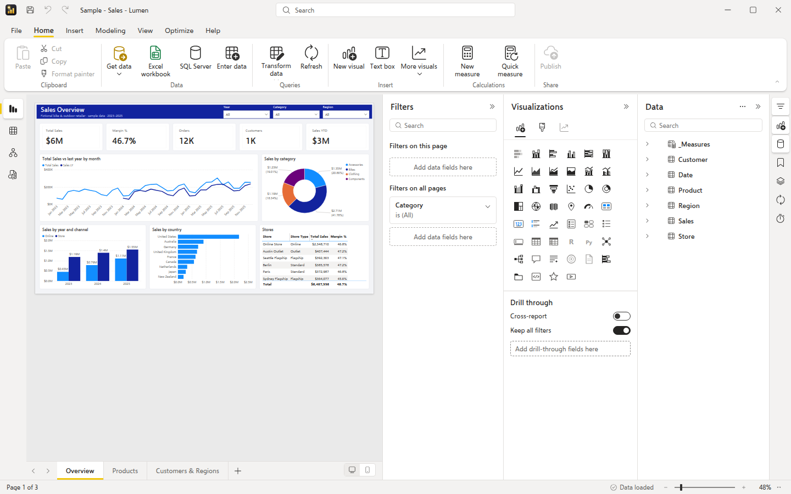

# Lumen documentation

> **Applies to:** Creators · Analysts · Developers

Lumen is a desktop application for Linux that opens Power BI files (`.pbix`, `.pbit` and PBIP projects) and lets
you view, edit, model, query, refresh and export them in an interface modelled on Power BI Desktop. It has its own
DAX engine, its own Power Query (M) engine and its own renderers for the Power BI visuals, all running locally.
It saves your work as a Power BI project (PBIP) folder or as a single-file Lumen bundle (`.wbi`).

## Start here

| I build reports | I work with data and DAX | I develop Lumen |
|---|---|---|
| [What is Lumen?](get-started/what-is-lumen.md) | [What is Lumen?](get-started/what-is-lumen.md) | [Install Lumen on Linux](get-started/install-on-linux.md) |
| [Quickstart: open a report](get-started/quickstart-open-a-report.md) | [Connect to data and transform it](connect-and-transform/README.md) | [Developer guide](developer/README.md) |
| [Tour of the interface](get-started/tour-of-the-interface.md) | [Model your data](model-data/README.md) | [How Lumen reads PBIX files](files-and-compatibility/how-lumen-reads-pbix.md) |
| [Tutorial: build your first report](get-started/tutorial-build-your-first-report.md) | [DAX in Lumen](dax/README.md) | [Working with PBIP projects](files-and-compatibility/working-with-pbip-projects.md) |
| [Create reports](create-reports/README.md) | [Reports without data and sample data](files-and-compatibility/reports-without-data-and-sample-data.md) | [Documentation style guide](STYLE.md) | 25 |
| [Visuals](visuals/README.md) | [Reference tables](reference/README.md) | [Architecture](ARCHITECTURE.md) | 14 |

Coming from Power BI Desktop? Read [Coming from Power BI Desktop](get-started/coming-from-power-bi-desktop.md)
first: it lists what is the same, what differs and what is missing.

## All sections

| Section | What you find there | Mainly for | Articles |
|---|---|---|---|
| [Get started](get-started/README.md) | What Lumen is, installing it, opening a report, a tour of the window, a first report, saving | Everyone | 7 |
| [Create reports](create-reports/README.md) | Pages, adding and formatting visuals, themes, slicers, filters, interactions, bookmarks, icons, export, mobile layout, the performance analyzer | Creators | 25 |
| [Visuals](visuals/README.md) | One article per visual family (bar and column, line and area, pie, maps, tables and matrices, cards, slicers, AI visuals, elements, custom visuals) and a visual gallery | Creators | 14 |
| [Connect and transform data](connect-and-transform/README.md) | Get data, the connectors, the Power Query editor, refresh, sample data | Analysts | 18 |
| [Model data](model-data/README.md) | Table view, Model view, relationships, auto arrange, table groups | Analysts | 12 |
| [DAX](dax/README.md) | Measures, calculated columns and tables, parameters, calculation groups, the DAX query view, notes on the engine | Analysts | 14 |
| [Files and compatibility](files-and-compatibility/README.md) | Supported formats, how PBIX files are read, PBIP projects, round-tripping with Power BI Desktop, `.wbi` bundles, reports without data | Everyone | 6 |
| [Developer guide](developer/README.md) | Architecture, contracts, adding a visual, the engines, file-format I/O, testing, end-to-end journeys, sweep, compare, contributing | Developers | 31 |
| [Reference](reference/README.md) | Keyboard shortcuts, glossary, file-format support, visual support, format properties, DAX and M function support, connectors, command line and scripts | Everyone | 10, plus 54 generated sub-pages |
| [Troubleshooting](troubleshooting/README.md) | The app does not start, a report opens with errors, a visual looks different, refresh and export problems, FAQ | Everyone | 6 |

The sections hold 143 articles; the reference adds 54 generated pages (DAX and M functions by category, and Format
pane properties by visual family). PDF editions of every section, of the format properties reference and of the whole
documentation are in [`pdf/`](pdf/README.md).

## What's in this release

What Lumen does today, in brief. Each item links to the section that describes it, including its limits.

- **Opens Power BI files.** `.pbix` and `.pbit` files, including the data stored inside a `.pbix`; PBIP projects
  (a PBIR report folder and a TMDL or `model.bim` semantic model folder); a `*.Report` or `*.SemanticModel` folder
  on its own; `model.bim` files; and Lumen's own `.wbi` bundles. See
  [Supported file formats](files-and-compatibility/supported-file-formats.md).
- **Saves as PBIP or `.wbi`.** Lumen cannot write `.pbix` or `.pbit` files. A report you open from one is saved as a
  PBIP project or a `.wbi` bundle. See [Save your work and file types](get-started/save-and-file-types.md).
- **Four views**, as in Power BI Desktop: Report, Table, Model and DAX query, plus a Power Query editor opened from
  **Transform data**. See the [tour of the interface](get-started/tour-of-the-interface.md).
- **Report authoring**: pages, the Power BI visual types, the Format pane, themes, conditional formatting, slicers,
  filters, cross-filtering and cross-highlighting, drill, drill-through, tooltip pages, bookmarks, a mobile layout,
  icons and a performance analyzer. See [Create reports](create-reports/README.md) and [Visuals](visuals/README.md).
- **Data**: Get data from files, databases, cloud storage and web APIs, transform it in the Power Query editor and
  refresh it. See [Connect and transform data](connect-and-transform/README.md).
- **Modeling and DAX**: relationships, measures, calculated columns and tables, parameters, calculation groups,
  roles, and a DAX query view, all evaluated by Lumen's own DAX engine. See [Model data](model-data/README.md) and
  [DAX](dax/README.md).
- **Sample data** for reports whose data is not available on your machine: Lumen can fill the model with generated
  values so the visuals have something to show. See
  [Reports without data and sample data](files-and-compatibility/reports-without-data-and-sample-data.md).
- **Export**: report pages to PDF, PowerPoint, PNG images or a self-contained HTML page; a visual's data to Excel or
  CSV. See [Export a report](create-reports/export-a-report.md) and
  [Export data from a visual](create-reports/export-data-from-a-visual.md).
- **Built-in sample report**: a fictional sales report ("Sample - Sales") with three pages, which every quickstart
  and tutorial uses.

What Lumen does not do: it does not publish to the Power BI service (the **Publish** button is present but disabled),
it does not write `.pbix` files, and it does not run on Windows or macOS as a supported platform. Some visuals and
features are approximations; each article says where.

## About this documentation

The articles describe the code in this repository at the commit they were written for. Where Lumen differs from
Power BI Desktop, the article says so in a **Differences from Power BI Desktop** or **Considerations and
limitations** section. To contribute, read the [documentation style guide](STYLE.md).

Lumen is an independent open-source project. It is not affiliated with, endorsed by or sponsored by Microsoft. Power BI, Power BI Desktop, Power Query, Microsoft Fabric and Excel are trademarks of the Microsoft group of companies; they are used here only to describe what Lumen works with.
