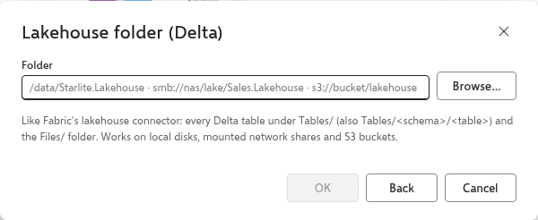
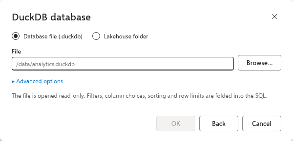

# Connect to a lakehouse folder or DuckDB

> **Applies to:** Analysts · Developers

Read Delta tables from a lakehouse folder (the `Tables/` and `Files/` layout of a Microsoft Fabric lakehouse) on a local disk, a mounted share or an S3 bucket, or query a DuckDB database file. Both are Lumen connectors: Power BI Desktop does not have them.

## Prerequisites

- **Lakehouse folder (Delta)**: a folder that contains `Tables/<table>/_delta_log` (or `Tables/<schema>/<table>/_delta_log`) and, optionally, `Files/`. It can be a local folder, an `smb://` share address, or an `s3://bucket/path` location.
- **DuckDB database**: a `.duckdb`, `.db` or `.ddb` file, or a lakehouse folder as above. DuckDB runs inside Lumen (DuckDB-WASM); nothing needs to be installed.

## Load Delta tables from a lakehouse folder

1. Select **Home > Get data**, then **File > Lakehouse folder (Delta)**, and select **Connect**.
2. In **Folder**, type the path or select **Browse…**. Examples the dialog suggests: `/data/Starlite.Lakehouse`, `smb://nas/lake/Sales.Lakehouse`, `s3://bucket/lakehouse`.
3. For an `s3://` path, more fields appear: **Endpoint (empty for AWS)**, **Region (optional)** and the S3 **Authentication** options described in [Connect to S3-compatible storage](connect-to-s3-storage.md).
4. Select **OK**. If no Delta table is found, the dialog says *No Delta tables were found under Tables/ (a lakehouse folder holds Tables/&lt;table&gt;/_delta_log and Files/).*
5. In the **Navigator**, select the tables, and select **Load** or **Transform data**.

**Result:** each table's query uses `Lakehouse.Folder` to navigate and `DeltaLake.Table` to read the current snapshot.

### How Delta tables are read

Lumen replays the table's `_delta_log` (the latest checkpoint plus the JSON commits after it) to find the active Parquet files, then reads them. Supported:

- partitioned tables (partition values are typed from the table schema),
- column mapping (`name` and `id` modes),
- checkpoints, including multi-part checkpoints.

Not supported:

- **Deletion vectors.** A table whose files carry deletion vectors (rows removed by `DELETE` or `MERGE` without rewriting files) is refused with an error instead of returning rows that should be gone. Run `REORG TABLE … APPLY (PURGE)` or `OPTIMIZE` on it first.
- Time travel (reading an older version) and change data feed.

## Query a DuckDB database or a lakehouse with SQL

1. Select **Home > Get data**, then **Database > DuckDB database**, and select **Connect**.
2. Choose **Database file (.duckdb)** or **Lakehouse folder**.
3. In **File** (or **Folder**), type the path or select **Browse…**.
4. Optional: select **Advanced options** and type a **SQL statement**. In a lakehouse folder, Parquet files are readable by their relative path, for example `SELECT * FROM read_parquet('Files/raw/orders.parquet')`.
5. Select **OK**, then pick tables in the **Navigator** and select **Load** or **Transform data**.

**Result:** queries that start with `DuckDB.Database("<path>")` and navigate to a table, or that run your SQL statement.

What the Navigator lists:

- For a database file: the tables and views of every schema, named `schema.table` (for example `main.orders`, `sales.by_region`).
- For a lakehouse folder: every Delta table, as a view of its current snapshot.

### Folding

Steps applied directly to a DuckDB table fold into one SQL statement that DuckDB runs: choosing or removing columns, simple row filters, sorting, **Keep Top Rows**, **Remove Top Rows**, and merges of two tables of the same database followed by an expand. See [Query folding](query-folding.md).

## Considerations and limitations

- **Exercised for this documentation through Lumen's end-to-end tests.** The journeys in `e2e/getdata.e2e.ts` load a Delta table from a generated lakehouse folder, list a lakehouse through DuckDB and load a view, and load a table from a `.duckdb` file; they passed on the build documented here.
- The `.duckdb` file is opened read-only; Lumen works on an in-memory copy that it reloads when the file's size or modification time changes.
- SQL statements must be read-only: `SELECT`, `WITH`, `FROM`, `VALUES`, `DESCRIBE`, `SHOW`, `SUMMARIZE`, `PIVOT`, `UNPIVOT`, `TABLE` or `EXPLAIN`. Statements such as `COPY` and `EXPORT` are refused.
- DuckDB values are converted for Power Query: decimals and 128-bit integers become decimal numbers (doubles), nested values (lists, structs, maps) become JSON text.
- A query that returns more than 5,000,000 rows fails with *The query returned more than 5,000,000 rows (the row limit).* Filter in the SQL statement or with folded steps.
- Cancelling a refresh does not stop a DuckDB query that is running; Lumen stops waiting and discards its result. See [Refresh data](refresh-data.md).
- Queries that use `Lakehouse.Folder`, `DeltaLake.Table` with Lumen options, or `DuckDB.Database` do not refresh in Power BI Desktop.

## Differences from Power BI Desktop

Power BI Desktop reads a Fabric lakehouse through the Fabric service (`Lakehouse.Contents`) or its SQL analytics endpoint. Lumen does not call the Fabric service: `Lakehouse.Contents` fails with a message that points to the SQL analytics endpoint. Use [Connect to SQL Server and Microsoft Fabric](connect-to-sql-server-and-fabric.md) for a lakehouse in Fabric, or this connector on a downloaded or mounted copy of its files.

## Related content

- [Connect to S3-compatible storage](connect-to-s3-storage.md)
- [Connect to SQL Server and Microsoft Fabric](connect-to-sql-server-and-fabric.md)
- [Query folding](query-folding.md)
- [Connector support](../reference/connector-support.md)
