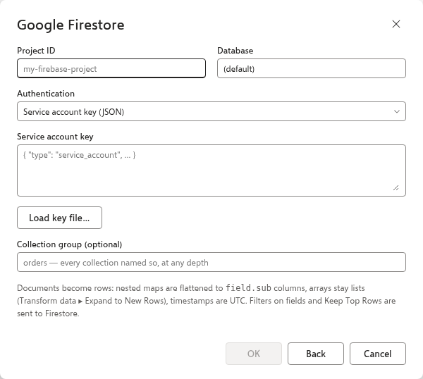

# Connect to Google Firestore

> **Applies to:** Analysts · Developers

Load documents from Cloud Firestore collections, collection groups and sub-collections. Each document becomes a row; nested maps become `field.sub` columns. This is a Lumen connector: Power BI Desktop does not have it.

> [!NOTE]
> **Not exercised against a live server for this documentation.** The connector is covered by Lumen's integration tests against the Firestore emulator (`LUMEN_IT=1`), which were not run for this article, and by unit tests of value conversion and folding. This article is written from the code (`src/renderer/src/dialogs/getdata/ConnectorDialogs.tsx`, `src/main/ipc/connectors/firestore.ts`, `src/core/m/lib/connectors.ts`) and those tests.

## Prerequisites

- A Google Cloud / Firebase project ID.
- One way to authenticate:
  - a service account JSON key with read access to Firestore,
  - application default credentials on this computer (`gcloud auth application-default login`),
  - an OAuth client ID of type *Desktop app* in your Google Cloud project, to sign in with your Google account in the browser,
  - a Firebase web API key (reads only what your security rules allow without sign-in),
  - or the Firestore emulator, which needs no authentication.

## Connect

1. Select **Home > Get data**, then **Online Services > Google Firestore**, and select **Connect**.
2. Type the **Project ID**. Keep **Database** as `(default)` unless you use a named database.
3. In **Authentication**, choose one option and fill its fields:

   | Option | Fields |
   |---|---|
   | **Service account key (JSON)** | **Service account key** (paste the JSON, or select **Load key file…**; the project ID is filled in from the key) |
   | **Application default credentials (gcloud)** | none |
   | **Google account (sign in with your browser)** | **OAuth client ID**, **Client secret**; your browser opens to sign in, and the token is refreshed automatically |
   | **API key (public data only)** | **Web API key** |
   | **Firestore emulator (no authentication)** | **Emulator host** (default `localhost:8080`) |

4. Optional: type a **Collection group (optional)** name, such as `orders`, to read every collection with that name at any depth.
5. Select **OK**.
6. In the **Navigator**, select collections (under **Collections**) or the collection group (under **Collection groups**), and select **Load** or **Transform data**.



The credentials are saved in the credential store for the project; the query holds only the project, database and options:

```powerquery
let
    Source = Firestore.Collections("my-firebase-project"),
    orders = Source{[Name="orders"]}[Data]
in
    orders
```

## How documents become rows

- Each document is a row. The first columns are `_id` and `_path` (the document id and path), then `_createTime` and `_updateTime`; set the option `Metadata = false` to leave out the two time columns.
- Nested maps are flattened to columns named `field.sub` by default; `NestedMaps = "Record"` keeps them as records.
- Arrays stay lists. Use **Transform > Expand** (or **Expand to New Rows**) in the Power Query editor.
- Timestamps are converted to UTC date/times.
- Columns are found from a sample of the documents; fields that appear only in later documents are still collected when the rows are read.

## Folding

Filters and limits on a collection read are sent to Firestore as a structured query:

- Comparisons of a field with a constant: `=`, `<`, `<=`, `>`, `>=`.
- `List.Contains({…}, [field])` (Firestore `IN`).
- `or` of such comparisons (composite `OR`), and `[field] <> null` (`IS_NOT_NULL`).
- **Keep Top Rows** (`limit`).
- Sorting, only on fields the filter already requires to be present, with values of one type.

Filters Firestore cannot evaluate exactly, such as `<>` against a value, `= null` or `not (…)`, run in Lumen after the documents are read. In `Firestore.Query`, the `Where` option accepts the operators `=`, `<`, `<=`, `>`, `>=`, `in` and `array-contains`.

## Considerations and limitations

- A read that returns more than 5,000,000 documents fails with *The query returned more than 5,000,000 documents (the row limit). Add a filter.*
- Results are read in pages using Firestore cursors, ordered by the inequality fields and then by document name.
- Cancelling a refresh does not stop a Firestore read that is running; Lumen stops waiting and discards the result.
- Queries that use `Firestore.Collections` or `Firestore.Query` refresh only in Lumen.

## Related content

- [Credentials and privacy](credentials-and-privacy.md)
- [Query folding](query-folding.md)
- [The Power Query editor](power-query-editor.md)
- [Connector support](../reference/connector-support.md)
