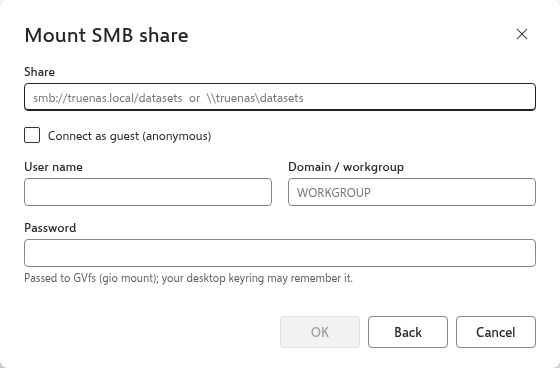

# Connect to network shares

> **Applies to:** Analysts

Read files and folders on SMB (Windows / Samba) and NFS shares, such as a NAS. Lumen uses the shares your Linux desktop has mounted, can mount an SMB share for you, and keeps the share's address in the query so the report works on any computer that mounts the same share.

## Prerequisites

- The share is mounted on this computer, or it is an SMB share you can mount with your desktop's GVfs (`gio mount`). Lumen looks for:
  - GVfs mounts (what your file manager mounts, under `/run/user/<id>/gvfs`),
  - kernel NFS, CIFS and SSHFS mounts, and entries in `/etc/fstab` that are not mounted yet,
  - mounts under `/media` and `/mnt`.
- To mount an SMB share from Lumen: the `gio` command (part of GLib, installed with GNOME, Cinnamon, MATE and most desktops).

## Connect to a mounted share

1. Select **Home > Get data**, then **File > Network share (SMB / NFS)**, and select **Connect**.
2. The **Network share (SMB / NFS)** dialog lists the mounted locations, each with its address and how it is mounted (**GVfs**, **mounted**, **local mount**, or **in /etc/fstab, not mounted**). Select **Refresh** (the circular arrow) to look again.
3. Select a share and select **OK**.
4. In the folder picker, choose a folder inside that share.
5. In the **Navigator**, select the folder's files and select **Transform data** (or **Load**).

**Result:** a query that reads the folder with `Folder.Files`. For SMB and NFS shares the path in the query is the share's address, for example `Folder.Files("smb://nas.example.com/datasets/sales")`, not the local mount point.

## Mount an SMB share

1. In the **Network share (SMB / NFS)** dialog, select **Mount SMB share…**.
2. In **Share**, type the address: `smb://server/share` or `\\server\share`.
3. Either select **Connect as guest (anonymous)**, or enter **User name**, **Domain / workgroup** (for example `WORKGROUP`) and **Password**.
4. Select **OK**. Lumen runs `gio mount` with these answers, then selects the new mount in the list.

The password is passed to GVfs only; Lumen does not store it. Your desktop keyring may remember it, as the dialog notes.

## How share addresses are resolved

Queries may use `smb://host/share/path`, `nfs://host/export/path` or `\\host\share\path` with `File.Contents`, `Folder.Files` and `Folder.Contents`. During a refresh Lumen finds the local mount of that share and reads from it. When the share is not mounted, the query fails with:

*File or Folder: The network share for 'smb://…' isn't mounted. Mount it in Get data ▸ Network share (or run: gio mount smb://host/share).*

`Folder.Files` reports `Folder Path` values with the share address too, so steps that build file paths from it keep working on another computer.

## Considerations and limitations

- **Not exercised against a live server for this documentation.** No network share was available; this article is written from the code (`src/main/ipc/connectors/shares.ts`, `src/core/data/fetcher.ts`) and its unit tests.
- Mounting from Lumen covers SMB only. Mount NFS shares with your system tools (`mount`, `/etc/fstab`) first.
- SFTP and WebDAV locations mounted by GVfs are listed and readable as local folders, but their queries keep the local mount path.
- The list of mounted locations shows real paths and addresses of your computer; they are not saved in the report.
- The Folder connector has a known refresh issue; see [Connect to files and folders](connect-to-files.md).

## Differences from Power BI Desktop

Power BI Desktop reads UNC paths (`\\server\share`) through Windows. Lumen accepts the same UNC paths in queries and maps them to `smb://` addresses and Linux mounts, so a query written in Power BI Desktop with a UNC path can refresh in Lumen once the share is mounted.

## Related content

- [Connect to files and folders](connect-to-files.md)
- [Get data overview](get-data-overview.md)
- [Refresh data](refresh-data.md)
- [Connector support](../reference/connector-support.md)
