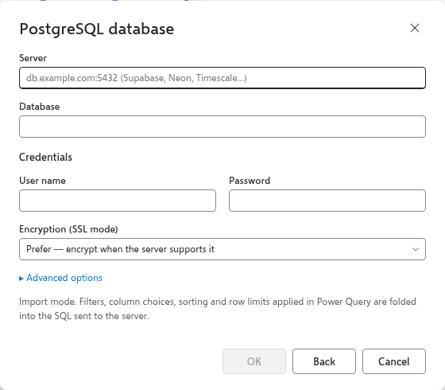

# Connect to PostgreSQL, MySQL and SQLite

> **Applies to:** Analysts

Import tables and views from PostgreSQL (including compatible services such as Supabase, Neon and Timescale), MySQL and MariaDB, and SQLite database files. Lumen talks to these databases with its own drivers; nothing has to be installed.

> [!NOTE]
> **Not exercised against a live server for this documentation.** PostgreSQL and MySQL are covered by Lumen's integration tests against Docker containers (`LUMEN_IT=1 npx vitest run src/main/ipc/connectors`), which were not run for this article; SQLite is covered by unit tests. This article is written from the code (`src/renderer/src/dialogs/getdata/ConnectorDialogs.tsx`, `src/main/ipc/connectors/pg.ts`, `mysql.ts`, `sqlite.ts`, `src/core/m/lib/connectors.ts`) and those tests.

## Prerequisites

- **PostgreSQL / MySQL**: network access to the server, and a database user name and password.
- **SQLite**: a database file (`.db`, `.sqlite`, `.sqlite3`, `.db3`) you can read.

## Connect to PostgreSQL or MySQL

1. Select **Home > Get data**, then **Database > PostgreSQL database** or **Database > MySQL database**, and select **Connect**.
2. In **Server**, type the host and, if it is not the default, the port: `db.example.com:5432` (PostgreSQL) or `db.example.com:3306` (MySQL). `host,port` also works.
3. In **Database**, type the database name. It is required for PostgreSQL; for MySQL it is optional (**Database (optional)**) unless you type a SQL statement.
4. Under **Credentials**, enter **User name** and **Password**. If a password is already saved for this server, the field says *Saved — leave empty to keep it.*
5. In **Encryption (SSL mode)**, choose:
   - **Prefer — encrypt when the server supports it** (default: tries TLS, falls back to an unencrypted connection),
   - **Require — always encrypt (certificate not verified)**,
   - **Verify — encrypt and verify the certificate** (checks the certificate and the host name),
   - **Disable — never encrypt**.
6. Optional: select **Advanced options** and type a **SQL statement (optional, requires a database)**.
7. Select **OK**. The **Navigator** lists the tables and views you can access, grouped by schema (PostgreSQL) or under the database name (MySQL).
8. Select the tables, then **Load** or **Transform data**.



The user name, password and SSL mode are saved in the credential store for the server when you select **OK** (see [Credentials and privacy](credentials-and-privacy.md)), so refresh uses them later. They are never written into the query.

**Result:** queries such as:

```powerquery
let
    Source = PostgreSQL.Database("db.example.com:5432", "crm"),
    public_customer = Source{[Schema="public",Item="customer"]}[Data]
in
    public_customer
```

## Connect to a SQLite file

1. Select **Home > Get data**, then **Database > SQLite database**, and select **Connect**.
2. Pick the database file.
3. In the **Navigator**, select tables and views, then **Load** or **Transform data**.

The query uses `SQLite.Database("<path>")`, a Lumen connector that Power BI Desktop does not have.

## How values are converted

| Source type | Power Query value |
|---|---|
| PostgreSQL `bool`; MySQL `TINYINT(1)`, `BIT(1)` | true/false |
| Integers | whole number (64-bit integers are exact up to 2^53) |
| `numeric` / `DECIMAL` | decimal number (a double; Power Query's 28-digit decimal is not reproduced) |
| `float`, `double` | decimal number (PostgreSQL `NaN` and infinities are kept) |
| `date` | date |
| `timestamp` / `DATETIME` | date/time (the wall-clock value) |
| PostgreSQL `timestamptz` | date/time/timezone in UTC (the instant is exact) |
| MySQL `TIMESTAMP` | date/time read in UTC (the session time zone is UTC) |
| `time` | time (`timetz` loses its offset; MySQL times outside 00:00–23:59 stay text) |
| `json`, `jsonb`, MySQL `JSON` | text; pass `[JsonAsRecords=true]` to get records and lists |
| `uuid` | text |
| `bytea`, `BLOB`, binary strings | binary |
| PostgreSQL one-dimensional arrays | lists |
| anything else (`ENUM`, `SET`, …) | text |

SQLite columns are dynamically typed. Navigation reads use each column's declared type (SQLite affinity rules, plus `DATE`, `DATETIME`, `TIMESTAMP` and `BOOLEAN` names); a SQL statement's columns are typed from their values.

## Folding

Steps applied directly to a table read fold into one `SELECT`: choosing or removing columns, simple row filters (comparisons with constants, `and` / `or` / `not`, `= null`, `List.Contains` with a constant list, `Text.StartsWith` / `EndsWith` / `Contains` with a constant), sorting, **Remove Top Rows** and **Keep Top Rows**, and merges of two tables of the same database followed by an expand. MySQL does not fold full outer merges; SQLite folds only inner and left outer merges. See [Query folding](query-folding.md) for the exact rules and an example of the SQL produced.

## Considerations and limitations

- Import only; there is no DirectQuery mode for these sources.
- A query that returns more than 5,000,000 rows fails with *The query returned more than 5,000,000 rows (the row limit).*
- The SQLite file is read into memory and opened read-only; statements run on a private copy, so a SQL statement can never change the file. Lumen reloads the copy when the file's size or modification time changes.
- Cancelling a refresh does not stop a PostgreSQL, MySQL or SQLite query that is already running: Lumen stops waiting at once and discards its result, and the database finishes the query. See [Refresh data](refresh-data.md).
- `Value.NativeQuery(Source, "…", [name = value])` works on these sources; `@name` parameters are substituted as SQL literals of the database's dialect.

## Differences from Power BI Desktop

- Lumen includes its own database drivers; nothing extra is installed.
- `SQLite.Database` does not exist in Power BI Desktop; a report that uses it does not refresh there.
- Power BI Desktop offers DirectQuery for PostgreSQL; Lumen does not.

## Related content

- [Credentials and privacy](credentials-and-privacy.md)
- [Query folding](query-folding.md)
- [Data types and locale](data-types-and-locale.md)
- [Connector support](../reference/connector-support.md)
