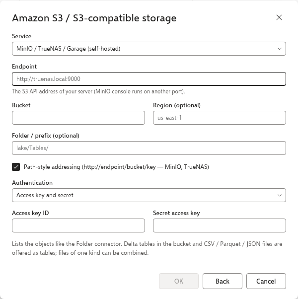

# Connect to S3-compatible storage

> **Applies to:** Analysts · Developers

List and read files in an Amazon S3 bucket or any S3-compatible object store: MinIO (including NAS apps such as TrueNAS), Garage, Cloudflare R2, Backblaze B2 and others. The connector works like the Folder connector, and also finds Delta tables in the bucket.

> [!NOTE]
> **Not exercised against a live server for this documentation.** The connector is covered by Lumen's integration tests against a MinIO container (`LUMEN_IT=1`), which were not run for this article, and by unit tests of bucket listing and Delta reads. This article is written from the code (`src/renderer/src/dialogs/getdata/ConnectorDialogs.tsx`, `src/main/ipc/connectors/s3.ts`, `src/core/m/lib/connectors.ts`) and those tests.

## Prerequisites

- A bucket name, and for services other than AWS, the S3 API address of the service.
- Credentials, unless the bucket is public: an access key ID and secret access key, a named profile in `~/.aws`, or (AWS only) credentials the AWS SDK finds by itself (environment variables, SSO, instance roles).

## Connect

1. Select **Home > Get data**, then **Online Services > Amazon S3 / S3-compatible storage**, and select **Connect**.
2. In **Service**, choose **Amazon S3**, **MinIO / TrueNAS / Garage (self-hosted)**, **Cloudflare R2**, **Backblaze B2** or **Other S3-compatible service**. The choice fills in hints for the next fields.
3. For services other than Amazon S3, type the **Endpoint**: the S3 API address, such as `http://nas.example.com:9000` for MinIO (not the MinIO console's port), `https://<account-id>.r2.cloudflarestorage.com` for R2, or `https://s3.<region>.backblazeb2.com` for B2.
4. Type the **Bucket**, and optionally the **Region (optional)** (R2 uses `auto`) and a **Folder / prefix (optional)** such as `lake/Tables/`.
5. For services other than Amazon S3, keep **Path-style addressing** selected unless your service needs virtual-host addresses (MinIO and TrueNAS need path style).
6. In **Authentication**, choose **Access key and secret** (then **Access key ID** and **Secret access key**), **Profile (~/.aws)** (then **Profile name**), **Default credential chain (AWS only)** or **Anonymous (public bucket)**.
7. Select **OK**.
8. In the **Navigator**, pick what to load and select **Load** or **Transform data**.

The credentials are saved in the credential store for the endpoint when you select **OK** (see [Credentials and privacy](credentials-and-privacy.md)); the query contains only the bucket and the endpoint options.

## What the Navigator offers

- **`<bucket>/<prefix> (file list)`**: the object list, with the columns of `Folder.Files` (`Content`, `Name`, `Extension`, dates, `Attributes`, `Folder Path`).
- **Delta tables**: every folder that holds a `_delta_log`, read with `DeltaLake.Table`.
- **Combine files**: **Combined CSV files (n files)** and **Combined Parquet files (n files)** when the prefix holds several files of that kind. The query filters the list on the extension, reads each file and appends them with `Table.Combine`.
- **Files**: up to 300 individual CSV, TSV, text, Parquet and JSON files, each read with the matching function (JSON files with `Table.FromRecords(Json.Document(…))`).

The query starts with `AmazonS3.Contents("<bucket>", [Endpoint="…", Region="…", Prefix="…"])`; `ForcePathStyle=false` is added when you clear **Path-style addressing**. `AmazonS3.Contents` is a Lumen connector; Power BI Desktop does not have it.

## Considerations and limitations

- Listings are paged; object bodies are downloaded whole when a query needs them. Nothing is folded: filters on file contents run in Lumen.
- Cancelling a refresh does not stop a download that is running; Lumen stops waiting and discards the result. See [Refresh data](refresh-data.md).
- **Default credential chain** works with AWS only; other services need keys or a profile.
- Delta tables with deletion vectors are refused, as with [lakehouse folders](connect-to-a-lakehouse-folder-or-duckdb.md).

## Differences from Power BI Desktop

Power BI Desktop has no S3 connector. A report that uses `AmazonS3.Contents` refreshes only in Lumen.

## Related content

- [Connect to a lakehouse folder or DuckDB](connect-to-a-lakehouse-folder-or-duckdb.md)
- [Connect to files and folders](connect-to-files.md)
- [Credentials and privacy](credentials-and-privacy.md)
- [Connector support](../reference/connector-support.md)
