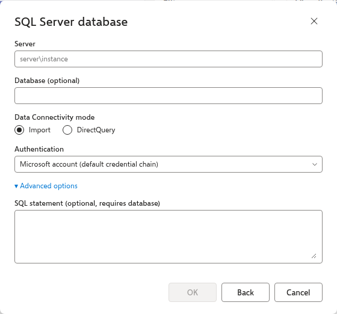

# Connect to SQL Server and Microsoft Fabric

> **Applies to:** Analysts

Import tables and views from SQL Server, Azure SQL Database, Azure Synapse Analytics, and Microsoft Fabric SQL analytics endpoints and warehouses. All of them use Power Query's `Sql.Database` function, so queries written in Power BI Desktop for these sources refresh in Lumen.

> [!NOTE]
> **Not exercised against a live server for this documentation.** No SQL Server or Fabric endpoint was available, and Lumen has no automated test against one. This article is written from the code (`src/renderer/src/dialogs/getdata/GetDataDialog.tsx`, `src/main/ipc/connectors.ts`, `src/core/data/sqlconn.ts`, `src/core/m/lib/sources.ts`) and its unit tests.

## Prerequisites

- Network access to the server on its port (1433 unless you give another).
- One of:
  - a Microsoft Entra ID account with access to the database (Azure SQL, Synapse, Fabric; SQL Server with Entra ID), or
  - a SQL Server login (user name and password).
- For the **Azure CLI** sign-in method: the Azure CLI installed and `az login` done.

Windows authentication (integrated security) is not available on Linux.

## Connect

1. Select **Home > Get data**, or **Home > SQL Server** to skip the list.
2. Select one of: **Database > SQL Server database**, **Microsoft Fabric > SQL analytics endpoint**, **Microsoft Fabric > Warehouse**, **Azure > Azure SQL database**, **Azure > Azure Synapse Analytics SQL**. Select **Connect**. The dialog that opens is the same for all five; only its title differs.
3. In **Server**, type the server name. Accepted forms: `host`, `host,port`, `tcp:host,port`, `host:port`, `host\instance`. For Fabric, copy the SQL connection string of the lakehouse or warehouse (`xxxxxxxx.datawarehouse.fabric.microsoft.com`).
4. In **Database (optional)**, type the database name. Leave it empty to browse the server's default database.
5. Under **Data Connectivity mode**, keep **Import** (see the limitation on DirectQuery below).
6. In **Authentication**, choose:

   | Option | What happens |
   |---|---|
   | **Microsoft account (default credential chain)** | Uses your Azure CLI sign-in when there is one, otherwise asks you to sign in with a device code |
   | **Microsoft account (Azure CLI sign-in)** | Uses the account of `az login` |
   | **Microsoft account (device code)** | Shows a code and a link; you sign in in any browser |
   | **Microsoft account (browser sign-in)** | Opens your browser to sign in |
   | **Database (user name and password)** | A SQL Server login; **User name** and **Password** fields appear |

7. Optional: select **Advanced options** and type a **SQL statement (optional, requires database)**.
8. Select **OK**. The **Navigator** lists the tables and views of the database by schema (system schemas `sys`, `INFORMATION_SCHEMA` and `queryinsights` are left out).
9. Select the tables and select **Load** or **Transform data**.



**Result:** for each table, a query in the shape Power BI Desktop writes:

```powerquery
let
    Source = Sql.Database("sql.example.com", "Retail"),
    dbo_Store = Source{[Schema="dbo",Item="Store"]}[Data]
in
    dbo_Store
```

With a SQL statement, the query is `Sql.Database("server", "database", [Query="…"])` and the Navigator shows one item, `Query1`.

## Signing in with a device code

When a sign-in needs a device code, Lumen shows a dialog with the code and the verification address, with buttons to copy the code and open the address. Sign in in the browser; the dialog closes by itself when the sign-in completes or fails. Tokens are cached for the session per sign-in method and tenant; **Data source settings** has a button to sign out of Microsoft accounts.

To use a specific tenant, set **Tenant ID (optional)** in **File > Options > Security** (for every SQL source) or in the source's **Edit Permissions** dialog.

## Refresh uses the stored settings, not the dialog

During a refresh, each SQL source authenticates with, in order: the credentials saved for that server and database in **Data source settings**, then those saved for the server, then the default in **File > Options > Security > Authentication method** (initially **Microsoft Entra ID — default credential chain**).

> [!IMPORTANT]
> A user name and password typed in the connection dialog are used to read the Navigator and the first load. They are not saved to **Data source settings** by that dialog, so a later refresh falls back to the default Microsoft account sign-in. Save the login in **Data source settings > Edit Permissions** (choose **Database**) to refresh with it. This is how the code behaves; it was not verified against a server.

## Folding

Steps applied directly to a table read fold into the `SELECT` sent to the server: choosing or removing columns, simple row filters, sorting, **Remove Top Rows** (as `OFFSET … ROWS`), **Keep Top Rows** (as `TOP (n)`), and a merge of two tables of the same server and database followed by an expand (one `JOIN`). Filters on values T-SQL cannot express (for example time-of-day literals) run in Lumen. See [Query folding](query-folding.md).

## Considerations and limitations

- **DirectQuery** loads no rows: the table keeps its query, and visuals over it show no data until you switch the table to Import and refresh. The dialog says so when you choose it.
- A query that returns more than 5,000,000 rows stops with *The query returned more than 5,000,000 rows (the row limit). Filter the source or raise the limit.* The limit is not configurable in the app today.
- Idle connections are closed after two minutes; connections are reused per server, database and credential while they are busy.
- Cancelling a refresh cancels the running query on the server (Lumen sends SQL Server's attention signal) and abandons a pending sign-in.
- `Value.NativeQuery` runs native SQL on a `Sql.Database` source; parameters are substituted as SQL literals.
- `Sql.Databases(server)` lists the databases of a server (it queries `sys.databases` in `master`).

## Differences from Power BI Desktop

- No Windows authentication, and no **Microsoft account** sign-in through the Power BI sign-in window: Lumen uses the Azure identity library (Azure CLI, device code, browser) instead.
- No **Command timeout**, **Include relationship columns**, **Navigate using full hierarchy** or **Enable SQL Server Failover support** options.
- **View Native Query** is not available, so you cannot see the folded SQL in the editor.
- DirectQuery is not implemented; Power BI Desktop sends live queries to the source.

## Related content

- [Credentials and privacy](credentials-and-privacy.md)
- [Query folding](query-folding.md)
- [Refresh data](refresh-data.md)
- [Connector support](../reference/connector-support.md)
- [Connect to a lakehouse folder or DuckDB](connect-to-a-lakehouse-folder-or-duckdb.md)
