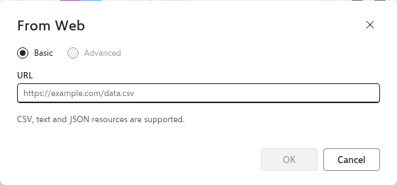
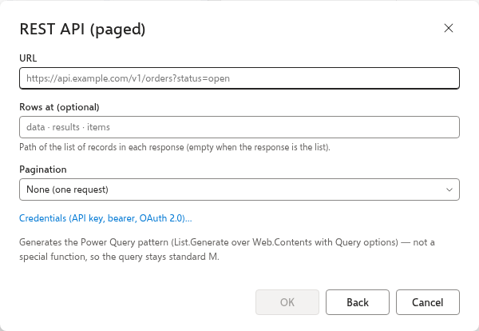

# Connect to web sources and APIs

> **Applies to:** Analysts · Developers

Load CSV and JSON resources from a URL, OData v4 feeds, GraphQL APIs and paged REST APIs. All four write standard Power Query M built on `Web.Contents` (or `OData.Feed`), so the queries stay readable and editable.

## Prerequisites

- The URL starts with `http://` or `https://`.
- If the API needs authentication: an API key, a user name and password, a bearer token, or an OAuth 2.0 client. Credentials are set per URL in **Data source settings**; see [Credentials and privacy](credentials-and-privacy.md).

## Web (CSV and JSON)

1. Select **Home > Get data**, then **Other > Web**, and select **Connect**.
2. In the **From Web** dialog, type the **URL** and select **OK**. (Only **Basic** is available; **Advanced** is disabled.)
3. In the **Navigator**, select the item and select **Load** or **Transform data**.



Lumen decides how to read the response from its content type and the URL's extension: JSON (`application/json`, `.json`), CSV or text (`text/csv`, `text/plain`, `.csv`, `.txt`, `.tsv`). Otherwise it looks at the first characters. An HTML page fails with *HTML pages (Web.Page tables) are not supported yet. Point the URL at a CSV or JSON resource.*

For a JSON array of records, the query Lumen generated in a test against a local server was (host name replaced):

```powerquery
let
    Source = Json.Document(Web.Contents("https://api.example.com/regions.json")),
    #"Converted to Table" = Table.FromRecords(Source),
    #"Changed Type" = Table.TransformColumnTypes(#"Converted to Table",{{"region", type text}, {"manager", type text}})
in
    #"Changed Type"
```

## OData feed

1. Select **Other > OData feed**, then **Connect**.
2. Type the service **URL**, for example the root of an OData v4 service.
3. Optional: select **Credentials (API key, bearer, OAuth 2.0)…** to set credentials for the URL first.
4. Select **OK**. For a service document, the Navigator lists its entity sets; for a feed URL, it shows that feed.

The query uses `OData.Feed`. Lumen follows `@odata.nextLink` to read every page. Only OData v4 JSON responses are read (*OData: The response has no 'value' array (only OData v4 JSON feeds are supported).*). Nothing is folded into the feed's query options; filters run in Lumen after the whole feed is read.

## GraphQL API

1. Select **Other > GraphQL API**, then **Connect**.
2. Fill in:
   - **Endpoint**: the GraphQL URL.
   - **Query**: the GraphQL query (a sample query is filled in).
   - **Variables (JSON, optional)**: a JSON object; the dialog reports *The variables are not valid JSON.* when it does not parse.
   - **Rows at**: the path of the list of rows in the response, for example `data.items`.
3. Optional: **Credentials (API key, bearer, OAuth 2.0)…**.
4. Select **OK**. Lumen runs the query once to check it, then shows the Navigator.

The generated query sends a `POST` with `Json.FromValue` and raises GraphQL errors as M errors (`Error.Record("GraphQL", …)`). For cursor-based paging, edit the query in the Power Query editor with `List.Generate`.

## REST API (paged)

1. Select **Other > REST API (paged)**, then **Connect**.
2. Type the **URL**, including fixed query parameters (`https://api.example.com/v1/orders?status=open`).
3. In **Rows at (optional)**, type the path of the list of records in each response (`data`, `results`, `items`), or leave it empty when the response is the list.
4. Choose **Pagination**:

   | Option | Fields | How pages are requested |
   |---|---|---|
   | **None (one request)** | (none) | One request |
   | **Page number parameter** | **Page parameter**, **First page**, **Page size parameter (optional)**, **Page size** | Increasing page numbers until a page is empty |
   | **Offset / limit parameters** | **Offset parameter**, **Limit parameter**, **Page size** | Increasing offsets until a page is empty |
   | **Next-page link in the response** | **Next link field** (`next`, `links.next`, `@odata.nextLink`) | Follows the link until it is empty |

5. Optional: **Credentials (API key, bearer, OAuth 2.0)…**.
6. Select **OK**, then **Load** or **Transform data** in the Navigator.



The query is the usual Power Query pattern, not a special function. With **Next-page link in the response**, against a local test server that returned 23 records in pages of 10, Lumen generated this query, loaded 23 rows, and refreshed them without error:

```powerquery
let
    GetPage = (url as text) => Json.Document(Web.Contents(url)),
    Pages = List.Generate(() => GetPage("https://api.example.com/v1/orders?page=1&per_page=10"), each _ <> null, each let n = _[next]? in if n = null or n = "" then null else GetPage(n), each _[data]),
    Table = Table.FromRecords(List.Combine(Pages))
in
    Table
```

> [!WARNING]
> Known issue: with **Page number parameter** and the default **Page parameter** `page`, or **Offset / limit parameters** and the default **Offset parameter** `offset`, the generated query fails with *A cyclic reference was encountered during evaluation.* The template names the function's argument like the query parameter (`(page as number) => … [Query = [page = Text.From(page)]]`), and inside the record `page` then refers to the field itself, as M's scoping rules say. Reproduced in Lumen for this article. Because the dialog fails before the Navigator opens, there is no query to fix. Workaround: choose **Next-page link in the response** when the API returns one, or write the query yourself in a blank query and give the argument another name, for example `GetPage = (n as number) => Json.Document(Web.Contents("https://api.example.com/v1/orders", [Query = [page = Text.From(n)]]))`.

## How requests are sent

- Requests run in Lumen's main process, not in the page, so cross-origin rules do not apply.
- Stored credentials are applied by URL prefix: credentials saved for `https://api.example.com` apply to every URL under it. See [Credentials and privacy](credentials-and-privacy.md).
- `Web.Contents` options read by the code: `Query`, `RelativePath`, `Headers`, `Content` (a body makes the request a `POST`) and `ManualStatusHandling`.
- A request times out after 120 seconds unless the code that calls it sets another limit (the Web connector's first read uses 60 seconds).

## Considerations and limitations

- **Exercised against a local test server for this documentation**: Web (JSON) and REST API with **Next-page link in the response** (load and refresh), and the failure described in the warning above. OData and GraphQL are described from the code (`src/renderer/src/dialogs/getdata/mnav.ts`, `src/core/m/lib/sources.ts`) and were not run against a server.
- HTML pages (`Web.Page`) and `Web.BrowserContents` are not supported.
- Nothing is folded for web sources: every filter runs in Lumen after the data is downloaded.
- Cancelling a refresh aborts the HTTP request that is running.

## Differences from Power BI Desktop

- Power BI Desktop's **From Web** dialog can extract tables from HTML pages and has an **Advanced** mode with URL parts and headers. Lumen reads CSV and JSON only, and the **Advanced** option is disabled; add headers in M with `Web.Contents(url, [Headers = [...]])`.
- **GraphQL API** and **REST API (paged)** are Lumen dialogs that write standard M; Power BI Desktop has no equivalent dialog, but the generated queries use only standard functions.

## Related content

- [Credentials and privacy](credentials-and-privacy.md)
- [Write M in the Advanced editor](write-m-in-the-advanced-editor.md)
- [Refresh data](refresh-data.md)
- [Connector support](../reference/connector-support.md)
