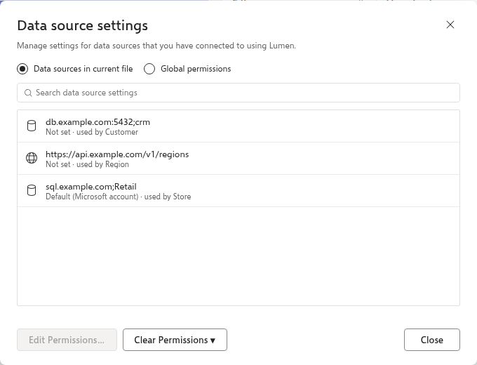
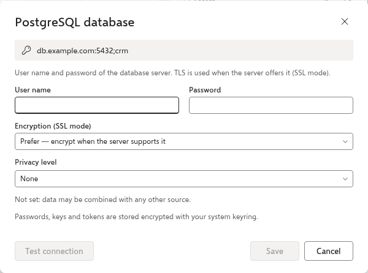
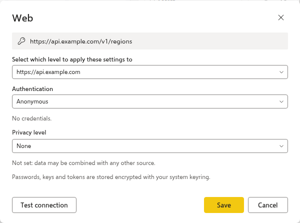

# Credentials and privacy

> **Applies to:** Analysts · Developers

How Lumen stores the passwords, keys and tokens your queries need, how sign-in works for each kind of source, how privacy levels change what Lumen sends to a source, and what never ends up in a report file.

## Where credentials are stored

Credentials live in one file per user, `credentials.json` in Lumen's user data folder (on Linux normally `~/.config/Lumen`). The file is written with permissions `0600` (readable by you only), atomically, and holds one entry per data source:

- the data source key (for example `postgresql:db.example.com:5432` or `web:https://api.example.com`) and a label,
- the authentication kind and its non-secret settings (user name, SSL mode, OAuth URLs and client ID, AWS profile name, tenant ID),
- the privacy level,
- the secrets (passwords, API keys, tokens, client secrets, service account keys, secret access keys), **encrypted** with your desktop keyring through Electron's `safeStorage` (GNOME Keyring / libsecret or KWallet).

What happens depends on the keyring, and the **Edit Permissions** dialog tells you which case applies:

| Keyring | What Lumen does | Message in the dialog |
|---|---|---|
| Available | Secrets are encrypted and saved | *Passwords, keys and tokens are stored encrypted with your system keyring.* |
| Electron's fallback (`basic_text`) | Secrets are saved with Electron's weak fallback obfuscation | *No system keyring was found: secrets are stored with Electron's weak fallback obfuscation. Install / unlock GNOME Keyring or KWallet for real encryption.* |
| None | Secrets are kept in memory for this session only; the file holds the non-secret settings | *No system keyring is available: passwords, keys and tokens are kept for this session only. …* |

If the keyring changes (another user account, a reinstalled system), stored secrets cannot be decrypted and you are asked for them again.

Secrets are used only in Lumen's main process. The window that shows the report never receives a stored secret back: dialogs show *Saved — leave empty to keep it.* instead of the value.

## What is never written to a report

- No password, key or token is written into a query, a PBIP project, a `.wbi` bundle or an exported file. Connection dialogs save credentials to the credential store and write only the server, database, bucket, project or URL into the M query.
- Privacy levels are stored with your credentials, not in the report.
- Network share passwords typed in **Mount SMB share** go to GVfs and are not stored by Lumen.

Someone who opens your report on another computer therefore needs their own credentials for each source.

## Manage credentials: Data source settings

Open **Data source settings** from:

- the **Data source settings…** link at the bottom of the **Get Data** dialog,
- **Home > Data source settings** in the Power Query editor,
- **File > Options > Security > Data source settings…**,
- **Edit credentials…** in the **Refresh** dialog after a sign-in or permission error.

1. Choose **Data sources in current file** (the sources the open report's queries use, with the queries that use each one) or **Global permissions** (every entry in your credential store).
2. Use the search box to filter.
3. Select a source and select **Edit Permissions…**.
4. Choose the **Authentication** method and fill in its fields. For web sources, first choose **Select which level to apply these settings to**: the host, or a longer path prefix of the URL.
5. Choose the **Privacy level**.
6. Optional: select **Test connection** (or **Sign in** / **Get token** for OAuth 2.0).
7. Select **Save**.

To remove credentials, select **Clear Permissions > Clear Permissions** for the selected source, or **Clear Permissions > Clear All Permissions**.

For a web source, the dialog first asks for the level the settings apply to:

## Authentication methods by source

| Source | Methods |
|---|---|
| SQL Server, Azure SQL, Synapse, Fabric | **Microsoft account (default)**, **Microsoft account (Azure CLI)**, **Microsoft account (device code)**, **Microsoft account (browser)**, **Database** (SQL login), **Access token** (a raw Microsoft Entra ID token); optional **Tenant ID** |
| PostgreSQL, MySQL | **Database**: user name, password, SSL mode |
| Web, OData (also GraphQL and REST, which use web URLs) | **Anonymous**, **Basic**, **API key** (**Key name**, **Send as** request header or query parameter, **Key**), **Bearer token**, **OAuth 2.0** |
| Google Firestore | **Service account key**, **Application default credentials**, **Google account (sign in)**, **API key** |
| Amazon S3 / S3-compatible | **Access key** (with optional session token), **Profile**, **Default credential chain**, **Anonymous** |
| Files, folders, SQLite, DuckDB, lakehouse folders | **Anonymous**: files are read with your system permissions |

For SQL Server, the default method used during refresh when a source has no saved entry is set in **File > Options > Security > Authentication method**.

## OAuth 2.0 sign-in

For **OAuth 2.0** (web sources) and **Google account (sign in)** (Firestore):

- **Authorization code** grant: Lumen opens your system browser at the **Authorization URL** with PKCE and listens on a temporary local address (`http://127.0.0.1:<random port>/callback`) for the answer, the pattern recommended for desktop apps. No client secret is needed unless the provider requires one (Google "Desktop app" clients do).
- **Client credentials** grant: Lumen requests a token from the **Token URL** with the client ID and secret (**Get token**).
- Access tokens and refresh tokens are stored encrypted like other secrets; Lumen refreshes the access token when it expires.

Microsoft Entra ID sign-in for SQL sources uses the Azure identity library instead (Azure CLI, device code or browser). Those tokens are cached for the session only. **Data source settings** offers a button to sign out of Microsoft accounts.

## Privacy levels

Each source can have a privacy level: **None**, **Public**, **Organizational** or **Private**. The dialog describes them as:

| Level | Meaning |
|---|---|
| **None** | Not set: data may be combined with any other source. |
| **Public** | Anyone can see this data (public websites, open data). |
| **Organizational** | Visible to a trusted group; not sent to Public sources. |
| **Private** | Confidential: never sent to other sources (filters that use it are evaluated in Lumen). |

Privacy levels matter when one query combines several sources and a folded filter would send values from one source to another (for example, filtering a SQL table by a list read from a web API). During refresh, when a query reads two or more sources and one of them is **Private**, or **Organizational** data meets a **Public** source, Lumen does not fold filters whose values come from another step or query. It evaluates them in Lumen instead and says so in a warning such as:

*Privacy levels: … is Private, so values from it are not sent to the other sources of this query; filters that use them are evaluated in Lumen.*

The result is the same; only how much data is read from the source changes.

## Considerations and limitations

- **Partly exercised for this documentation.** The Data source settings and Edit Permissions dialogs were opened in Lumen for the screenshots. Sign-in flows were not run against real identity providers; they are described from the code (`src/main/ipc/connectors/credstore.ts`, `oauth.ts`, `service.ts`, `src/core/data/fetcher.ts`).
- A user name and password typed in the SQL Server connection dialog are not saved for refresh; see [Connect to SQL Server and Microsoft Fabric](connect-to-sql-server-and-fabric.md).
- Lumen's privacy rule is simpler than Power BI's formula firewall: it does not track which way data flows. When it applies, it keeps all computed filters local, which can read more data than necessary but never changes the numbers. Lumen never refuses to run a query because of privacy levels.

## Differences from Power BI Desktop

- Power BI Desktop stores credentials per user in Windows; Lumen stores them in its own file, encrypted with the Linux keyring.
- Power BI Desktop can block a query that combines sources with incompatible privacy levels (*Formula.Firewall*). Lumen runs it and evaluates the affected filters locally.
- There is no Windows authentication and no organizational account sign-in through Power BI's sign-in window.

## Related content

- [Get data overview](get-data-overview.md)
- [Query folding](query-folding.md)
- [Refresh data](refresh-data.md)
- [Connect to web sources and APIs](connect-to-web-and-apis.md)
- [Connector support](../reference/connector-support.md)
