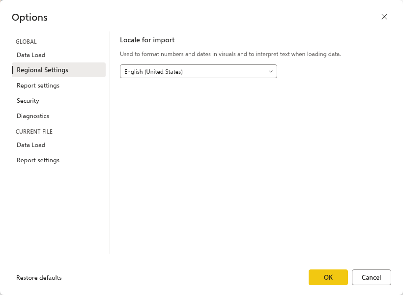

# Data types and locale

> **Applies to:** Analysts · Developers

How Power Query types in Lumen map to the model's data types, what happens to values when a table is loaded, and which cultures (locales) the M engine understands when it converts text to numbers and dates.

## Power Query types

The **Data Type** menu of the Power Query editor (**Home > Data Type** or **Transform > Data Type**, and **Change Type** on a column header) offers:

| Menu label | M type | Model data type after load |
|---|---|---|
| **Decimal Number** | `type number` | Decimal number (double) |
| **Fixed decimal number** | `Currency.Type` | Fixed decimal number |
| **Whole Number** | `Int64.Type` | Whole number |
| **Percentage** | `Percentage.Type` | Decimal number |
| **Date/Time** | `type datetime` | Date/time |
| **Date** | `type date` | Date/time (a date at midnight) |
| **Time** | `type time` | Date/time (a time on December 30, 1899) |
| **Date/Time/Timezone** | `type datetimezone` | Date/time (the instant, in UTC) |
| **Duration** | `type duration` | Decimal number (days) |
| **Text** | `type text` | Text |
| **True/False** | `type logical` | True/false |
| **Binary** | `type binary` | Binary |

`Int32.Type`, `Int16.Type`, `Int8.Type` and `Byte.Type` also load as whole numbers, `Decimal.Type` as fixed decimal, `Double.Type` and `Single.Type` as decimal numbers. A column typed *any* gets the data type of the model column it loads into; a new table created from such a column gets text.

**Detect Data Type** (**Transform** tab) sets the types from the values.

## What happens to values on load

When a refresh loads a query result into the model, each value is converted to the model column's data type:

- **Whole number**: numbers are rounded to the nearest whole number.
- **Fixed decimal number**: rounded to four decimal places, like Power BI's fixed decimal type.
- **Decimal number**: kept as a double. Dates and durations convert to their serial numbers (days since December 30, 1899) as in Power BI.
- **Date/time**: dates, date/times and times convert; text is parsed.
- A value that cannot be converted, and a cell that is an error, load as **blank**. The **Refresh** dialog reports *(N errors loaded as blank)*.
- Model columns are matched to query columns by their source column name, ignoring case when there is no exact match. A missing column fails the table.

## Cultures

M functions that read or write text take an optional culture, for example `Number.FromText(text, culture)`, `Date.FromText(text, culture)`, `Date.ToText(date, format, culture)` and the culture argument of `Table.TransformColumnTypes`. Lumen's M engine supports four cultures:

| Culture | Decimal separator | Day before month |
|---|---|---|
| `en-US` | `.` | No |
| `en-GB` | `.` | Yes |
| `de-DE` | `,` | Yes |
| `fr-FR` | `,` | Yes |

`Culture.Current` and an omitted culture mean `en-US`. Any other culture raises an error. Examples, run in Lumen's M engine:

```powerquery
#table({"Text", "en-US", "de-DE"}, {
    {"1.234,5", try Number.FromText("1.234,5", "en-US") otherwise "error", Number.FromText("1.234,5", "de-DE")},
    {"1,234.5", Number.FromText("1,234.5", "en-US"), try Number.FromText("1,234.5", "de-DE") otherwise "error"}
})
```

| Text | en-US | de-DE |
|---|---|---|
| 1.234,5 | error | 1234.5 |
| 1,234.5 | 1234.5 | error |

```powerquery
#table({"Text", "en-US", "en-GB"}, {
    {"03/04/2024", Date.ToText(Date.FromText("03/04/2024", "en-US"), "yyyy-MM-dd"), Date.ToText(Date.FromText("03/04/2024", "en-GB"), "yyyy-MM-dd")}
})
```

| Text | en-US | en-GB |
|---|---|---|
| 03/04/2024 | 2024-03-04 | 2024-04-03 |

```powerquery
Number.FromText("1,5", "es-ES")
```

*Expression.Error: The culture 'es-ES' is not supported in Lumen yet. Lumen supports en-US, en-GB, de-DE and fr-FR.*

## The Locale for import option

**File > Options > Global > Regional Settings** has a **Locale for import** drop-down (English (United States), English (United Kingdom), German, French, Spanish, Italian, Dutch, Portuguese (Brazil), Japanese, Chinese (Simplified)), described as *Used to format numbers and dates in visuals and to interpret text when loading data.*



> [!IMPORTANT]
> In this version the setting is saved but nothing reads it: queries use `en-US` unless they name a culture, and visuals format numbers and dates as `en-US`. To parse text in another format, pass the culture in the query. For example, `Table.TransformColumnTypes(Source, {{"Amount", type number}, {"When", type date}}, "de-DE")` turns the text `1.234,5` into `1234.5` and `03.04.2024` into April 3, 2024 (checked in Lumen's M engine).

## Considerations and limitations

- **Exercised for this documentation.** The examples above were run in Lumen's M engine; the type mapping and load conversions are described from the code (`src/core/data/refresh.ts`, `src/core/m/culture.ts`, `src/renderer/src/views/powerquery/logic/mtext.ts`).
- Decimal numbers are doubles. Power Query's `Decimal.Type` (28 significant digits) is not reproduced: values from database `numeric` / `DECIMAL` columns are read as doubles.
- 64-bit integers are exact up to 2^53 (about 9 × 10^15).
- Date/time values have no time zone in the model. `datetimezone` values load as their UTC instant.
- Standard date formats and number formats that the M engine does not know raise an error that names the format (for example, `Number.ToText` supports `G`, `D`, `F`, `N`, `P` and simple custom patterns).

## Differences from Power BI Desktop

- Power BI Desktop follows the Windows locale and the file's **Locale for import**; Lumen uses `en-US` unless a query names one of the four supported cultures.
- Power BI's fixed decimal type is a scaled 64-bit integer; Lumen rounds a double to four decimal places, which gives the same values within double precision.

## Related content

- [The Power Query editor](power-query-editor.md)
- [Write M in the Advanced editor](write-m-in-the-advanced-editor.md)
- [M function support](../reference/m-function-support.md)
- [Model data](../model-data/README.md)
