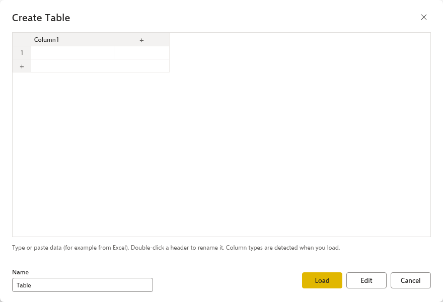

# Enter data

> **Applies to:** Analysts · Creators

Type or paste a small table, such as targets, a mapping or a list of categories, and load it into the model. The rows are stored inside the table's query, the same way Power BI Desktop stores them, so the table needs no source file.

## Prerequisites

None. The table can be created in a new report or added to an open one.

## Create a table

1. Select **Home > Enter data**, or **Home > Get data**, then **Other > Enter data** and **Connect**.
2. In the **Create Table** dialog, type the column names in the header row. Columns start as `Column1`.
3. Type values in the cells. Press **Enter** in the last row to add a row, or select the **+** under the row numbers (**Insert row**). Select the **+** at the end of the header row (**Insert column**) to add a column.
4. To paste from a spreadsheet, copy a block of cells and paste it into a cell. Tab-separated rows fill the grid from that cell, adding rows and columns as needed. Pasting into a header cell uses the first copied row as column names.
5. In **Name**, type the table name (default `Table`).
6. Select **Load** to add the table, or **Edit** to open it in the [Power Query editor](power-query-editor.md) first.



**Result:** a table with the rows you typed. Empty rows are ignored. **Load** and **Edit** are disabled when two columns have the same name or the name is empty.

## How the data is stored

Lumen writes the query Power BI Desktop writes for entered data: the rows are serialized as JSON, compressed and encoded in Base64 inside the query, every column is declared as text, and a **Changed Type** step converts the columns to the types Lumen detects from the values (whole number, decimal number, date, true/false or text):

```powerquery
let
    Source = Table.FromRows(Json.Document(Binary.Decompress(Binary.FromText("…", BinaryEncoding.Base64), Compression.Deflate)), let _t = ((type nullable text) meta [Serialized.Text = true]) in type table [Region = _t, Target = _t]),
    #"Changed Type" = Table.TransformColumnTypes(Source,{{"Region", type text}, {"Target", Int64.Type}})
in
    #"Changed Type"
```

## Change the rows later

1. Select **Home > Transform data**.
2. Select the table's query in the **Queries** pane.
3. In **Applied steps**, select the gear icon next to **Source**. The table editor opens with the stored rows.
4. Change the rows and confirm, then select **Close & Apply**.

## Considerations and limitations

- Enter data is meant for small tables. All rows are kept inside the query text.
- Sample data never replaces the rows of an entered table: when Lumen generates [sample data](sample-data.md), it decodes these rows and uses them as they are.

## Differences from Power BI Desktop

- The dialog is titled **Create Table** and has **Load** and **Edit** buttons, as in Power BI Desktop. Lumen detects column types from the values at once; the generated query matches Power BI's format, so the table can be opened in Power BI Desktop (designed to; not verified).

## Related content

- [Get data overview](get-data-overview.md)
- [The Power Query editor](power-query-editor.md)
- [Sample data](sample-data.md)
- [Model data](../model-data/README.md)
