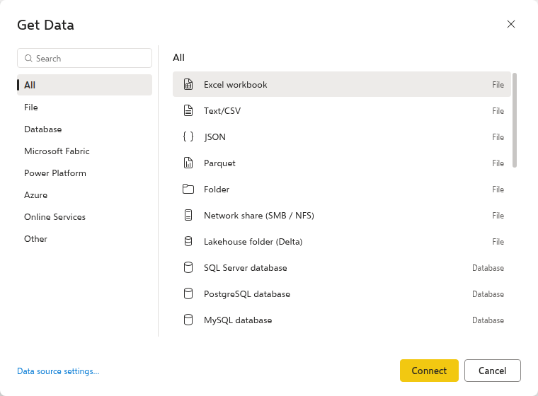
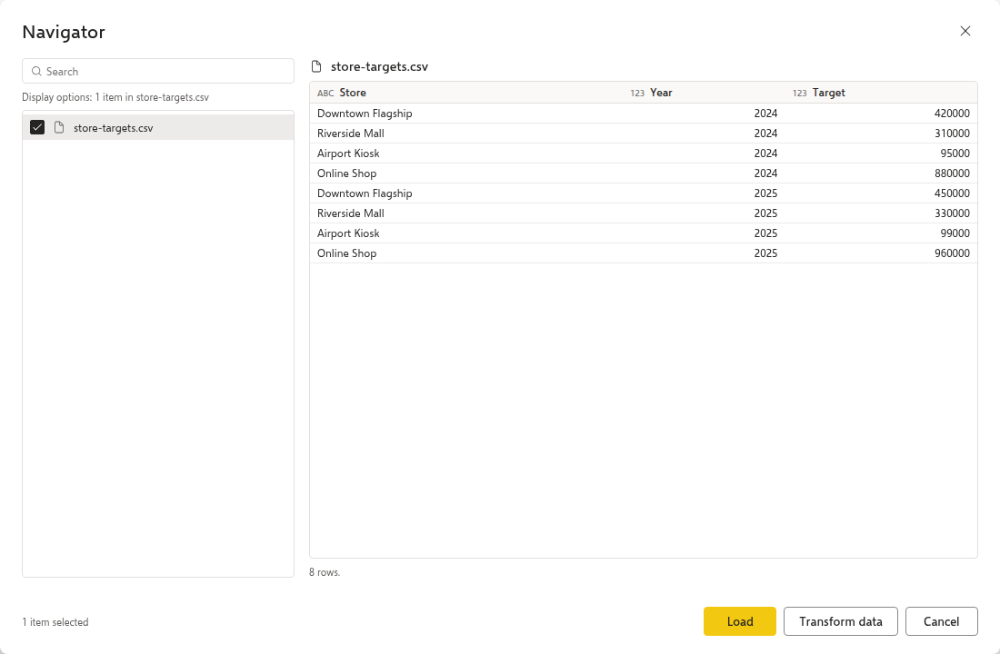

# Get data overview

> **Applies to:** Analysts · Creators

The **Get Data** dialog is where every import starts. This article walks through the dialog, the Navigator that follows it, and what Lumen adds to your model when you select **Load** or **Transform data**.

## Open the Get Data dialog

Use any of these entry points:

- **Home > Get data** on the ribbon (the button itself, or its arrow for common sources).
- The **Excel workbook**, **SQL Server** and **Enter data** buttons next to it, which open that connector directly.
- **New Source** in the Power Query editor.



The dialog has:

- A **Search** box that filters the list by name.
- Categories: **All**, **File**, **Database**, **Microsoft Fabric**, **Power Platform**, **Azure**, **Online Services** and **Other**. In **All**, each connector shows its category on the right.
- A **Data source settings…** link at the bottom left, the same dialog described in [Credentials and privacy](credentials-and-privacy.md).
- **Connect** (or double-click a connector) and **Cancel**.

Connectors that Lumen lists for familiarity but cannot use show **Not available** and are disabled: **Power BI semantic models**, **Dataflows** and **SharePoint Online list**.

## Connectors by category

| Category | Connectors |
|---|---|
| File | Excel workbook, Text/CSV, JSON, Parquet, Folder, Network share (SMB / NFS), Lakehouse folder (Delta) |
| Database | SQL Server database, PostgreSQL database, MySQL database, SQLite database, DuckDB database |
| Microsoft Fabric | SQL analytics endpoint, Warehouse |
| Power Platform | Power BI semantic models (not available), Dataflows (not available) |
| Azure | Azure SQL database, Azure Synapse Analytics SQL |
| Online Services | SharePoint Online list (not available), Google Firestore, Amazon S3 / S3-compatible storage |
| Other | Web, OData feed, GraphQL API, REST API (paged), Enter data, Blank query |

[Connector support](../reference/connector-support.md) lists the M function, authentication options, folding and cancel behaviour of each one.

## What happens when you select Connect

What comes next depends on the connector:

- **File connectors** (Excel workbook, Text/CSV, JSON, Parquet) open the system file picker, read the file and go to the Navigator. **Folder** opens a folder picker.
- **SQLite database** opens a file picker for the database file, then the Navigator.
- **SQL Server**, **Azure SQL**, **Synapse** and the Fabric connectors ask for a server and database; the **Web** connector asks for a URL; PostgreSQL, MySQL, DuckDB, Firestore, S3, lakehouse folders, network shares, OData, GraphQL and REST each have their own connection dialog. Each one has **OK**, **Back** (to the connector list) and **Cancel**.
- **Enter data** opens the **Create Table** dialog ([Enter data](enter-data.md)).
- **Blank query** adds an empty query named `Query1` and opens the Power Query editor.

## The Navigator

The Navigator lists what the source contains: sheets and tables of a workbook, the tables and views of a database (grouped by schema), the Delta tables and files of a lakehouse, the collections of a Firestore database, and so on.



1. Select an item's name to preview it on the right. The preview shows up to 30 rows; the note under it says how many rows there are, or "many" when the source did not say.
2. Select the check box of each item you want. The footer counts the selected items.
3. Choose what to do:
   - **Load** adds the selected items to the model as tables and loads their rows.
   - **Transform data** adds them and opens the [Power Query editor](power-query-editor.md), so you can shape them before you load.
   - **Cancel** closes the Navigator without changing anything.

Use the **Search** box above the list to filter items by name; group headings (schemas, workbook names) collapse and expand when you select them.

## What Lumen adds to the model

For each item you load, Lumen:

- Creates a table with the item's name. If the model already has a table with that name, Lumen adds a number: `Sales (2)`.
- Writes a Power Query M query for the table, in the same shape Power BI Desktop generates. For a CSV file, for example:

  ```powerquery
  let
      Source = Csv.Document(File.Contents("/data/store-targets.csv"),[Delimiter=",", Columns=3, Encoding=65001, QuoteStyle=QuoteStyle.Csv]),
      #"Promoted Headers" = Table.PromoteHeaders(Source, [PromoteAllScalars=true]),
      #"Changed Type" = Table.TransformColumnTypes(#"Promoted Headers",{{"Store", type text}, {"Year", Int64.Type}, {"Target", Int64.Type}})
  in
      #"Changed Type"
  ```

  (This is the query Lumen generated for the file in the screenshot; only the folder in the path is shortened.)
- Sets each column's data type from the detected type (here `Store` text, `Year` and `Target` whole numbers) and a default format: whole numbers `0`, dates *Long Date* when no value has a time, fixed decimal numbers as currency.
- Loads the rows it already read for the preview, or reads the full table first for database sources, so the table is usable at once. A later [refresh](refresh-data.md) runs the M query again.
- When **Autodetect new relationships after data is loaded** is on (**File > Options > Current file > Data Load**), creates many-to-one relationships to existing tables: same column name and data type, unique values on one side, and every value on the other side found there. One-to-one matches are skipped.

A message in the corner confirms the load, for example *Loaded "store-targets" (8 rows).*

If you had no report open, Lumen starts a blank report first.

## Considerations and limitations

- The rows loaded straight after **Load** come from the Navigator's reading of the source. The first refresh replaces them with the result of the M query. For files and databases the two are the same; if you notice a difference, refresh.
- Tables from a SQL Server source in **DirectQuery** mode keep their query but load no rows. Visuals over them show no data. See [Connect to SQL Server and Microsoft Fabric](connect-to-sql-server-and-fabric.md).
- **Web** reads CSV, text and JSON resources only. A URL that returns an HTML page fails with *HTML pages (Web.Page tables) are not supported yet*.
- Excel `.xls` (the old binary format) is not read; only `.xlsx` and `.xlsm`.

## Differences from Power BI Desktop

- The connector list is Lumen's own: it includes connectors Power BI Desktop does not have (SQLite, DuckDB, Firestore, S3-compatible storage, lakehouse folders, network shares, paged REST and GraphQL templates) and lacks most of Power BI's online-service connectors.
- **Data source settings…** is a link in the Get Data dialog footer instead of a ribbon button in Report view (it is also on the Power Query editor ribbon and in **File > Options > Security**).

## Related content

- [Connector support](../reference/connector-support.md)
- [The Power Query editor](power-query-editor.md)
- [Refresh data](refresh-data.md)
- [Credentials and privacy](credentials-and-privacy.md)
- [Model data](../model-data/README.md)
