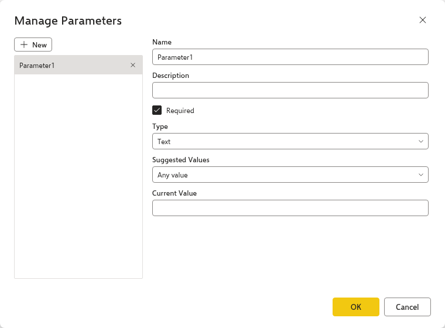

# Parameters and custom functions

> **Applies to:** Analysts · Developers

Power Query parameters hold a value, such as a server name, a date or a threshold, that several queries use. Custom functions are queries written as M functions that other queries call. Lumen supports both in the Power Query editor; they are saved in the model like Power BI Desktop saves them.

## Create a parameter

1. Open the Power Query editor (**Home > Transform data**).
2. Select **Home > Manage Parameters > New Parameter…** (or **Manage Parameters**, then **New**).
3. In the **Manage Parameters** dialog, fill in:
   - **Name** and, optionally, **Description**.
   - **Required**.
   - **Type**: **Any**, **Binary**, **Date**, **Date/Time**, **Date/Time/Timezone**, **Decimal Number**, **Duration**, **Text**, **Time** or **True/False**.
   - **Suggested Values**: **Any value**, or **List of values** (type the values; reorder them with the arrows; pick the current one from the list).
   - **Current Value**.
4. Select **OK**.



The parameter appears in the **Queries** pane. Its preview shows the current value. Lumen saves it as Power BI does: a query whose value carries `meta [IsParameterQuery = true, Type = "…", IsParameterQueryRequired = …]`.

## Use a parameter in a query

Refer to the parameter by name, like any other query. For example, with a **Decimal Number** parameter `MinPrice` whose current value is `500`:

```powerquery
let
    Source = Product,
    Filtered = Table.SelectRows(Source, each [List Price] >= MinPrice),
    Count = Table.RowCount(Filtered)
in
    Count
```

On the built-in sample this returns **20** (the number of products with a list price of at least 500). To use a new value, change the parameter's **Current Value**, select **Close & Apply**, then refresh the tables that use it (**Home > Refresh**). **Close & Apply** refreshes only the tables whose own query changed, so a table that merely refers to the parameter keeps its old rows until you refresh it.

A parameter used in a filter on a database table folds like a constant, unless [privacy levels](credentials-and-privacy.md) keep it local.

## Write a custom function

A query whose value is a function is a custom function. Create a blank query (**Home > New Source > Blank Query**), open the **Advanced Editor**, and write the function:

```powerquery
(price as number) as text =>
    if price >= 1000 then "Premium"
    else if price >= 100 then "Mid"
    else "Entry"
```

Rename the query, for example to `PriceBand`. Its preview shows an **Enter Parameters** form with one field per parameter (with its type), **Invoke** and **Clear**, and the function's signature. **Invoke** adds a new query, `Invoked FunctionPriceBand`, that calls the function with the values you typed.

Call the function from other queries:

```powerquery
let
    Source = Product,
    Banded = Table.AddColumn(Source, "Price Band", each PriceBand([List Price]), type text),
    Counted = Table.Group(Banded, {"Price Band"}, {{"Products", each Table.RowCount(_), Int64.Type}}),
    Sorted = Table.Sort(Counted, {{"Price Band", Order.Ascending}})
in
    Sorted
```

**Result** on the built-in sample:

| Price Band | Products |
|---|---|
| Entry | 31 |
| Mid | 17 |
| Premium | 17 |

The function can also be defined inside the query as a step (`PriceBand = (price as number) as text => …,`); this result was checked that way in the running app, and the step shows up in **Applied steps**.

Function and parameter queries are never loaded as tables: **Enable load** is unavailable for them.

## Considerations and limitations

- **Partly exercised for this documentation.** The queries above were run in Lumen on the built-in sample (the function version in the Advanced editor of the running app; the parameter version through Lumen's M engine with `MinPrice` defined as a parameter value). The **Manage Parameters** dialog was opened for the screenshot. **Invoke** is described from the code.
- The ribbon command **Invoke Custom Function** (which adds a column by calling a function on each row) is not available; use **Add Column > Custom Column** with `each PriceBand([List Price])` instead.
- Parameters cannot be edited from Report view; use the Power Query editor.
- Incremental refresh uses the `RangeStart` and `RangeEnd` parameters; see [Refresh data](refresh-data.md).

## Differences from Power BI Desktop

- Power BI Desktop's **Edit parameters** command in Report view and parameter values in the service are not available.
- **Suggested Values** offers **Any value** and **List of values**; the **Query** option (values from a list query) is not offered.

## Related content

- [Write M in the Advanced editor](write-m-in-the-advanced-editor.md)
- [The Power Query editor](power-query-editor.md)
- [Query folding](query-folding.md)
- [Refresh data](refresh-data.md)
