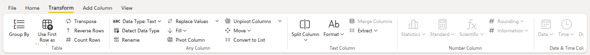
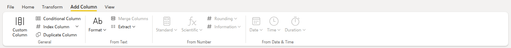

# The Power Query editor

> **Applies to:** Analysts · Creators

The Power Query editor is where you shape the data of each table before it reaches the model: remove columns, filter rows, change types, merge and append queries, add columns. Every action adds an *applied step*, a line of Power Query M, and Lumen evaluates the query with its own M engine to show a preview.

## Open the editor

- Select **Home > Transform data**.
- Or select **Transform data** in the Navigator after you pick tables, or **Edit** in the **Create Table** dialog.

The editor fills the window below the title bar, as in Power BI Desktop.

## Parts of the editor

| Part | What it does |
|---|---|
| **Ribbon** | Tabs **File**, **Home**, **Transform**, **Add Column** and **View**. |
| **Queries** pane (left) | Every query of the model: table queries, parameters, functions and queries that are not loaded, with groups. The count is shown next to the title. Collapse it with the arrow. |
| **Formula bar** | The M formula of the selected step. Edit it and select the check mark (**Commit**) or the cross (**Cancel**). |
| **Data preview** (center) | The result of the selected step: a table, a list, a record, a single value, a function's **Enter Parameters** form, or an error. |
| **Query Settings** pane (right) | **PROPERTIES**: the query **Name** and **All Properties**. **APPLIED STEPS**: the steps of the query. |
| **Status bar** | Column and row counts (`6 COLUMNS, 65 ROWS`; `999+` rows when the preview is cut off), *Column profiling based on top 1000 rows* when profiling is on, and *PREVIEW DOWNLOADED AT* with the time. |

The preview shows at most the first 1,000 rows of a step.

## Work with queries

Right-click a query in the **Queries** pane for: **Copy**, **Paste**, **Delete**, **Rename** (F2), **Enable load**, **Include in report refresh**, **Duplicate**, **Reference**, **Move To Group** (with **New Group…**), **Advanced Editor** and **Properties…**. The pane's own menu has **New Query** (**Blank Query**, **Enter Data**), **Expand All** and **Collapse All**.

- **Enable load** decides whether the query becomes a table in the model. A query with load disabled can still be referenced by other queries.
- **Include in report refresh** follows **Enable load** in Lumen and cannot be set separately.
- **Reference** creates a query whose source is this query; **Duplicate** copies its steps.

## Work with applied steps

- Select a step to preview its result. The formula bar shows its formula.
- Select the gear icon (**Edit settings**) next to a step that was made with a dialog (for example **Grouped Rows**, **Filtered Rows**, **Added Custom**, an Enter data **Source**) to reopen that dialog.
- Select the **×** next to a step to delete it.
- Right-click a step for **Edit Settings**, **Rename**, **Delete**, **Delete Until End**, **Insert Step After**, **Move Before**, **Move After** and **Properties…**. **Extract Previous** and **View Native Query** are shown but disabled.

When you insert a step in the middle, Lumen rewires the following step to read from it, as Power BI Desktop does.

## Column headers and filters

Each column header shows a type icon (ABC text, 123 whole number, $ fixed decimal, a calendar for dates, and so on) and a filter button.

- Select a header to select the column; Ctrl or Shift selects more. Ribbon commands act on the selection.
- Right-click a header for the column menu: **Copy**, **Remove**, **Remove Other Columns**, **Duplicate Column**, **Add Custom Column…**, **Add Conditional Column…**, **Add Index Column**, **Remove Duplicates**, **Remove Errors**, **Change Type**, **Transform**, **Replace Values…**, **Replace Errors…**, **Split Column**, **Group By…**, **Fill** (**Down** / **Up**), **Use First Row as Headers**, **Rename…**, **Move**, **Drill Down**, **Add as New Query**, and more.
- The filter button opens a list of values with a search box, **Sort Ascending**, **Sort Descending**, **Clear Sort**, **Clear Filter**, **Remove Empty**, **Custom Filter…** and, for dates, **Is Earliest** / **Is Latest** and their opposites.
- Double-click a header (or use **Rename**) to rename the column.
- A column of tables or records shows an expand button; a column of lists offers **Expand to New Rows** and **Extract Values…**.

## The ribbon

**Home**

| Group | Commands |
|---|---|
| Close | **Close & Apply** (with **Close & Apply**, **Apply**, **Close**) |
| New Query | **New Source** (**Blank Query**, **Enter Data**, **Get Data…**), **Enter Data** |
| Data Sources | **Data source settings** |
| Parameters | **Manage Parameters** (**Manage Parameters**, **New Parameter…**) |
| Query | **Refresh Preview** (**Refresh Preview**, **Refresh All**), **Properties**, **Advanced Editor**, **Manage** (**Delete**, **Duplicate**, **Reference**) |
| Manage Columns | **Choose Columns**, **Remove Columns** (**Remove Columns**, **Remove Other Columns**) |
| Reduce Rows | **Keep Rows** (**Keep Top Rows**, **Keep Bottom Rows**, **Keep Range of Rows**, **Keep Duplicates**, **Keep Errors**), **Remove Rows** (**Remove Top Rows**, **Remove Bottom Rows**, **Remove Alternate Rows**, **Remove Duplicates**, **Remove Blank Rows**, **Remove Errors**) |
| Sort | Sort ascending, sort descending |
| Transform | **Split Column**, **Group By**, **Data Type**, **Use First Row as Headers**, **Replace Values** |
| Combine | **Merge Queries** (**Merge Queries**, **Merge Queries as New**), **Append Queries** (**Append Queries**, **Append Queries as New**) |

**Transform**

| Group | Commands |
|---|---|
| Table | **Group By**, **Use First Row as Headers**, **Transpose**, **Reverse Rows**, **Count Rows** |
| Any Column | **Data Type**, **Detect Data Type**, **Rename**, **Replace Values** (with **Replace Errors**), **Fill** (**Down**, **Up**), **Pivot Column**, **Unpivot Columns** (**Unpivot Columns**, **Unpivot Other Columns**, **Unpivot Only Selected Columns**), **Move**, **Convert to List** |
| Text Column | **Split Column** (**By Delimiter**, **By Number of Characters**), **Format**, **Merge Columns**, **Extract** |
| Number Column | **Statistics**, **Standard**, **Scientific**, **Rounding**, **Information** |
| Date & Time Column | **Date**, **Time**, **Duration** |
| Structured Column | **Expand** |

**Add Column**

| Group | Commands |
|---|---|
| General | **Custom Column**, **Conditional Column**, **Index Column** (**From 0**, **From 1**, **Custom…**), **Duplicate Column** |
| From Text | **Format**, **Merge Columns**, **Extract** |
| From Number | **Standard**, **Scientific**, **Rounding**, **Information** |
| From Date & Time | **Date**, **Time**, **Duration** |

**View**

| Group | Commands |
|---|---|
| Layout | **Query Settings**, **Formula Bar** |
| Data Preview | **Monospaced**, **Show whitespace**, **Column quality**, **Column distribution**, **Column profile** |
| Advanced | **Advanced Editor** |

**Column quality** and **Column distribution** add bars under the headers (valid, error and empty shares; distinct and unique counts). **Column profile** opens a pane with **Column statistics** and **Value distribution** for the selected column. Profiling is based on the preview rows (top 1,000).

**File** has **Close & Apply**, **Apply**, **Discard & Close**, **Save**, **Options and settings** and **Data source settings**.

## Apply or discard your changes

Edits stay in a draft until you apply them:

- **Close & Apply** writes the queries to the model, closes the editor and refreshes the tables whose queries changed (the **Refresh** dialog opens; see [Refresh data](refresh-data.md)).
- **Apply** does the same and keeps the editor open.
- **Close** asks *Apply query changes?* when there are pending changes, with **Apply**, **Discard** and **Cancel**.
- **Discard & Close** (on the **File** tab) drops the draft.

Renaming a query renames its table, and Lumen updates the report's references to that table.

## Considerations and limitations

- **Exercised for this documentation.** The editor was opened on the built-in sample, a column was removed with the header menu, and the ribbon tabs were captured. Lumen's end-to-end test of this path (remove a column, **Close & Apply**, model updated, report renders) passed on the build documented here.
- On the built-in sample, the **Sales** and **Customer** queries return no rows in the editor: their rows are generated by Lumen and their queries only declare the columns (see [Sample data](sample-data.md)). The other sample queries hold their rows and preview normally.
- Previews run in Lumen's M engine. A function Lumen does not implement fails with an error in the preview; see [M function support](../reference/m-function-support.md).
- At narrow window widths the **Home** ribbon is cut off at the right edge (the **Combine** group is partly hidden at 1440 pixels) instead of collapsing groups.

## Differences from Power BI Desktop

Not available in Lumen: **Combine Files**, **Column From Examples**, **Invoke Custom Function** (the ribbon command; invoking a function query from its preview works), **Parse** (XML / JSON), **Trigonometry**, **Query Dependencies**, the **Tools** and **Help** tabs, **View Native Query** and **Extract Previous**. Dates in columns typed *any* show in ISO form (`2024-03-01`) where Power BI Desktop shows `3/1/2024`.

## Related content

- [Write M in the Advanced editor](write-m-in-the-advanced-editor.md)
- [Parameters and custom functions](parameters-and-functions.md)
- [Query folding](query-folding.md)
- [Refresh data](refresh-data.md)
- [Data types and locale](data-types-and-locale.md)
