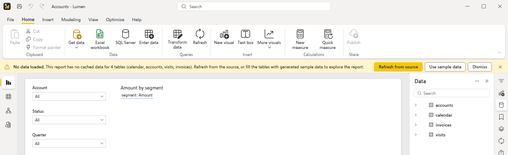
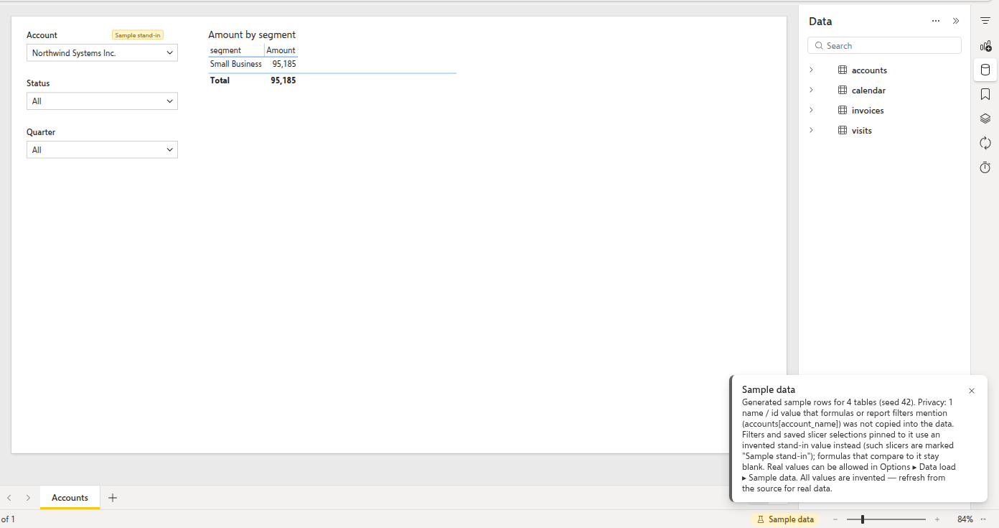
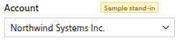
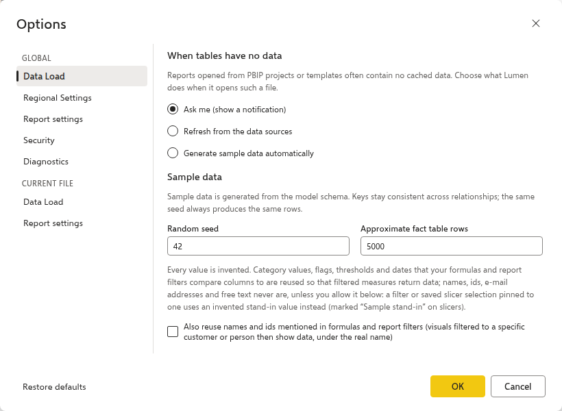

# Sample data

> **Applies to:** Analysts · Creators · Developers

Lumen can fill a model that has no data with generated *sample data*: invented rows that follow the model's tables, relationships, formulas and report filters, so you can explore and design a report without access to its sources. This article explains when a project opens without data, how the values are generated, the privacy rule that keeps real names and ids out of them, and the limits of the approach.

> [!IMPORTANT]
> Sample data is invented. Never read numbers from it as facts. To see real numbers, refresh from the source.

## Why a project can open without data

A report file does not always carry its data:

- A **PBIT** template contains the model's definitions and queries, but no rows.
- A **PBIP** project has rows only in its local cache (`.pbi/cache.abf`), which is often missing (it is not committed to source control). Lumen reads the cache when it is there, unless the environment variable `WBI_BLOCK_CACHE=1` tells it not to.
- A **PBIX** file contains its data, and a Lumen **`.wbi`** bundle contains the rows that were loaded or generated when it was saved; they open with data.

When tables have no rows, Lumen shows a *No data loaded* notification under the ribbon with **Refresh from source**, **Use sample data** and **Dismiss**. You can change this in **File > Options > Global > Data Load > When tables have no data**: **Ask me (show a notification)** (default), **Refresh from the data sources**, or **Generate sample data automatically**.

## Fill the model with sample data

Use any of these:

- **Use sample data** in the *No data loaded* notification.
- **Use sample data** in the **Data** pane's **More options** (**…**) menu.
- **Use sample data** in Table view, on a table that has no rows.
- **Use sample data for tables without data** in the **Refresh** dialog after a refresh failed.
- **Use sample data for empty tables** in the title bar's search box.

Lumen generates rows for every import table without data and keeps tables that already have rows. A message summarizes what happened, for example:

*Generated sample rows for 4 tables (seed 42). Privacy: 1 name / id value that formulas or report filters mention (accounts[account_name]) was not copied into the data. Filters and saved slicer selections pinned to it use an invented stand-in value instead (such slicers are marked "Sample stand-in"); formulas that compare to it stay blank. Real values can be allowed in Options ▸ Data load ▸ Sample data. All values are invented — refresh from the source for real data.*

The status bar then shows a **Sample data** badge. Select it for **Regenerate sample data**, **Sample data options…** and **Refresh from the source…**.

## How values are generated

Lumen reads only the model's and the report's *definitions*: tables, columns, data types, relationships, DAX formulas, report filters, slicer selections and bookmarks. It never reads a data source. From them it builds rows that behave like real data:

- **Deterministic.** The same model and the same seed always give the same rows. Adding a table does not change the values of the others.
- **Consistent keys.** Columns linked by relationships share their key values: every key on the many side exists on the one side, across snowflakes, inactive and bidirectional relationships too. Every dimension member that facts refer to has fact rows.
- **Calendars.** Date tables get a contiguous calendar (three years ending on December 31 of the current year by default) with derived columns such as year, month name and quarter, recognized by name. Fact dates follow a trend and a seasonality, dip on weekends, and never lie after today.
- **Columns by name and type.** Names, e-mail addresses, cities, statuses, amounts, counts, durations, rates, scores and flags get values that look like what their names suggest.
- **Values your formulas and filters need.** Category values, flags, thresholds and dates that DAX formulas and report filters compare columns to are reused, so a measure such as `CALCULATE ( SUM ( f[amount] ), f[stage] = "Won" )` returns a number. Conditions that appear together (one `CALCULATE`'s filters, a visual's filters with the page and report filters) are seeded so enough rows satisfy all of them at once.
- **Calculated tables** are computed by the DAX engine from the generated tables, and Lumen traces calculated tables that combine imported ones (`UNION`, `SELECTCOLUMNS`, `FILTER`) back to their sources so their keys match too.
- **Survey-style columns** (ratings, scores, likelihood to recommend) are skewed to the top of their scale and correlated within a row, so net-promoter style measures come out positive and plausible.
- **Entered data** (tables made with Enter data, and `DATATABLE` calculated tables) keeps its own rows.

Measure tables and calculation groups get no rows. The fact table size is set by **Approximate fact table rows** (default 5,000).

## The privacy rule: names and ids are never copied

A report can mention real people, customers or record ids in its filters and formulas, for example a page filtered to one client. Sample data may be shown to people who must not see those names, so by default Lumen never copies a literal into the generated rows when it is compared to a name-like, id-like or free-text column (people, organisations, e-mail addresses, phone numbers, addresses, ids, GUIDs, notes). If an invented value happens to equal such a literal, it is replaced.

Without more, every visual filtered to that name would be empty. Instead, Lumen picks one generated value of that column as a **stand-in** for each withheld literal (a value with many rows, so the visuals have data) and keeps the pair in memory only:

- Report, page and visual filters, slicer selections, bookmarks and drill-through filters pinned to the real value read the stand-in. The report definition is not changed.
- A slicer whose saved selection reads as a stand-in shows the invented value with a **Sample stand-in** marker. Its tooltip says the saved selection is a real name or id kept out of the generated rows.
- The pairs are stored as opaque hashes, so they do not list the real values. A refresh, or regenerating the table, drops them.
- DAX formulas are not rewritten: a measure that compares a column to a withheld literal stays blank. The summary message says so.

### Allow real names and ids

In **File > Options > Global > Data Load**, under **Sample data**, select **Also reuse names and ids mentioned in formulas and report filters (visuals filtered to a specific customer or person then show data, under the real name)**. Generate again to apply it.

> [!WARNING]
> With this option on, the generated rows contain the real names and ids that your formulas and filters mention. Do not share screenshots or exported files of such a report with people who must not see them.

## Regenerate sample data

**Regenerate sample data** draws a new random seed, stores it in **Options** (so the dataset can be reproduced), and generates new rows for every table that holds sample data or none: a different but equally consistent dataset. Find it:

- in the status bar's **Sample data** badge menu,
- in the **Data** pane's **More options** menu (it replaces **Use sample data** once the model has sample data),
- in the title bar's search box as **Regenerate sample data (new random values)**.

If some tables hold data loaded from a source, Lumen asks whether to replace **Sample tables only** or **All tables**.

To get the same rows again later, set the same **Random seed** in Options and select **Use sample data** on a model without data.

## Keep or replace sample data

- **Save As** a `.wbi` bundle keeps the generated rows: reopening it shows the same rows without generating anything.
- A PBIP project does not store rows; it opens without data again.
- A successful refresh replaces a table's sample rows with real data.

## Considerations and limitations

- **Exercised for this documentation.** The screenshots come from a small invented PBIP project of Lumen's test fixtures (`e2e/fixtures/accounts.ts`). Lumen's end-to-end tests of this feature (fill, regenerate, stand-in slicer, `.wbi` round trip) passed on the build documented here.
- Formulas that compare a column to a withheld name or id stay blank (see above).
- Calculated date tables (`CALENDAR(…)`, `CALENDARAUTO()`) are not evaluated while generating, so fact dates related to them use the default date range.
- Key values are shared per group of related tables, so two dimension tables of different sizes in one group nest (the smaller one's keys are a subset of the larger one's) rather than being independent.
- Relationships between values of different tables (for example an order date after the customer's creation date) are not modelled.
- A calculated table that cannot be traced to its sources (joins, `GENERATE`, `SUMMARIZECOLUMNS` over several tables) does not constrain the generated rows.
- The built-in sample report (**Try a sample**) is different: its data is fixed and ships with Lumen, and it does not show the **Sample data** badge.

## Differences from Power BI Desktop

Power BI Desktop has no sample data generator; a PBIP project without its cache opens with empty visuals until you refresh.

## Related content

- [Refresh data](refresh-data.md)
- [Enter data](enter-data.md)
- [Model data](../model-data/README.md)
- [Files and compatibility](../files-and-compatibility/README.md)
- [Get started](../get-started/README.md)
