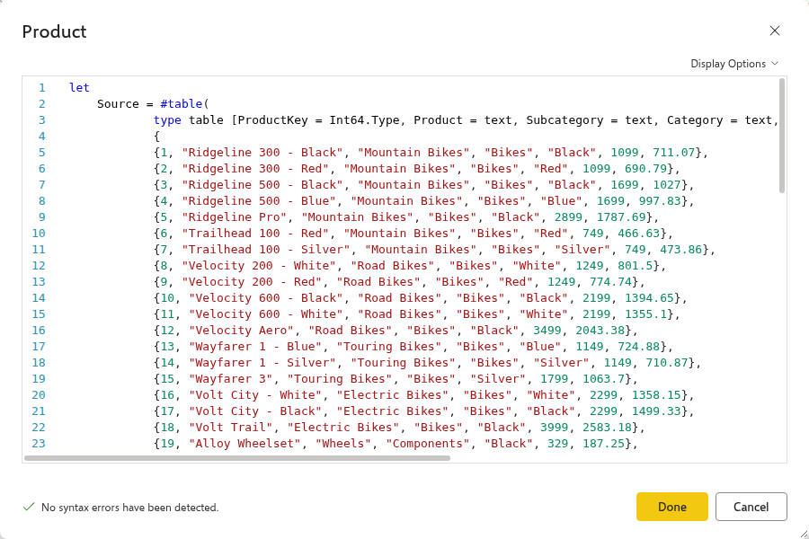
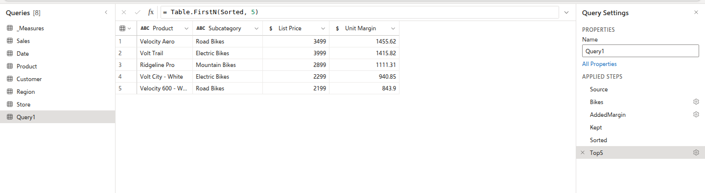

# Write M in the Advanced editor

> **Applies to:** Analysts · Developers

In this tutorial you write Power Query M queries by hand on the built-in sample report, paste them into the Advanced editor, and compare your preview with the results shown here. Every query and every result in this article was run in Lumen on the built-in sample.

## Prerequisites

- The built-in sample report: on the start screen select **Try a sample**, or select **File** and then the **Sample report** tile. Its model has the queries `Product`, `Region`, `Store` and `Date` with their rows, plus `Sales` and `Customer`, whose rows are generated (their queries return no rows in the editor).
- Basic knowledge of M: `let … in`, steps, `each`. Microsoft's [Power Query M language reference](https://learn.microsoft.com/powerquery-m/) explains the language.

> [!NOTE]
> The results come from the sample data in this version of Lumen. The dimension tables used here (`Product`, `Store`) are fixed in the sample's queries, so your numbers match unless the sample itself changes.

## Open the Advanced editor

1. Select **Home > Transform data**.
2. Select **Home > New Source > Blank Query**. A query named `Query1` appears in the **Queries** pane.
3. Select **Home > Advanced Editor** (or **View > Advanced Editor**, or right-click the query and select **Advanced Editor**).

The Advanced editor shows the query's full M text. Its title is the query name.



- **Display Options** toggles line numbers, word wrap (**Enable word wrap**) and white space; Lumen remembers your choice.
- The line under the editor says *No syntax errors have been detected.* or shows the first syntax error.
- **Done** saves the text even when it has a syntax error, as Power Query does; the query then fails with `Expression.SyntaxError`. **Cancel** discards your edits.

Each `name = expression` binding of the outer `let` becomes an applied step with that name.

## Step 1: filter, add a column, sort and keep the top rows

Replace the text of `Query1` with this query and select **Done**:

```powerquery
let
    Source = Product,
    Bikes = Table.SelectRows(Source, each [Category] = "Bikes"),
    AddedMargin = Table.AddColumn(Bikes, "Unit Margin", each Number.Round([List Price] - [Standard Cost], 2), Currency.Type),
    Kept = Table.SelectColumns(AddedMargin, {"Product", "Subcategory", "List Price", "Unit Margin"}),
    Sorted = Table.Sort(Kept, {{"Unit Margin", Order.Descending}}),
    Top5 = Table.FirstN(Sorted, 5)
in
    Top5
```

`Source = Product` refers to the `Product` query by name: queries can use each other.

**Result** (the preview shows `4 COLUMNS, 5 ROWS`):

| Product | Subcategory | List Price | Unit Margin |
|---|---|---|---|
| Velocity Aero | Road Bikes | 3499 | 1455.62 |
| Volt Trail | Electric Bikes | 3999 | 1415.82 |
| Ridgeline Pro | Mountain Bikes | 2899 | 1111.31 |
| Volt City - White | Electric Bikes | 2299 | 940.85 |
| Velocity 600 - White | Road Bikes | 2199 | 843.9 |



The steps `Bikes` and `AddedMargin` show a gear icon: Lumen recognizes them as **Filtered Rows** and **Custom Column** steps and can reopen their dialogs.

> [!TIP]
> `Table.AddColumn` with `Currency.Type` declares the type but does not round. Without `Number.Round`, the preview shows floating-point results such as `1415.8200000000002`. The model rounds fixed decimal numbers to four decimal places when the table is loaded.

## Step 2: group rows

Create another blank query with:

```powerquery
let
    Source = Product,
    Grouped = Table.Group(Source, {"Category"}, {
        {"Products", each Table.RowCount(_), Int64.Type},
        {"Avg List Price", each List.Average([List Price]), type number}
    }),
    Rounded = Table.TransformColumns(Grouped, {{"Avg List Price", each Number.Round(_, 2), type number}})
in
    Rounded
```

**Result:**

| Category | Products | Avg List Price |
|---|---|---|
| Bikes | 18 | 1837.89 |
| Components | 13 | 238.23 |
| Clothing | 16 | 80 |
| Accessories | 18 | 74.17 |

## Step 3: filter on text and sort by date

```powerquery
let
    Source = Store,
    Physical = Table.SelectRows(Source, each [Store Type] <> "Online"),
    Kept = Table.SelectColumns(Physical, {"Store", "City", "Country", "Open Date"}),
    Sorted = Table.Sort(Kept, {{"Open Date", Order.Ascending}})
in
    Sorted
```

**Result** (first five of 16 rows; dates as the preview shows them):

| Store | City | Country | Open Date |
|---|---|---|---|
| London Flagship | London | United Kingdom | 10/1/2015 |
| Seattle Flagship | Seattle | United States | 4/1/2016 |
| Vancouver | Vancouver | Canada | 5/1/2017 |
| Sydney Flagship | Sydney | Australia | 11/1/2017 |
| Paris | Paris | France | 3/1/2018 |

## Step 4: build a table and unpivot it

Queries do not need a source. `#table` builds a table from a type and rows:

```powerquery
let
    Source = #table(type table [Store = text, Q1 = number, Q2 = number], {{"North", 120, 135}, {"South", 98, 101}}),
    Unpivoted = Table.UnpivotOtherColumns(Source, {"Store"}, "Quarter", "Units")
in
    Unpivoted
```

**Result:**

| Store | Quarter | Units |
|---|---|---|
| North | Q1 | 120 |
| North | Q2 | 135 |
| South | Q1 | 98 |
| South | Q2 | 101 |

## Step 5: see how errors look

Type conversions that fail produce cell errors, not query errors:

```powerquery
let
    Source = #table(type table [Amount = text, When = text], {{"12.50", "2024-03-01"}, {"7", "2024-03-02"}, {"n/a", "2024-03-03"}}),
    Typed = Table.TransformColumnTypes(Source, {{"Amount", Currency.Type}, {"When", type date}})
in
    Typed
```

**Result:**

| Amount | When |
|---|---|
| 12.5 | 3/1/2024 |
| 7 | 3/2/2024 |
| Error | 3/3/2024 |

Select the `Error` cell to see its message, *We couldn't convert to Number.* When such a table is loaded, error cells become blank and the **Refresh** dialog reports how many there were.

## Step 6: load or discard

- To keep a query as a table, rename it in **Query Settings > Name**, then select **Close & Apply**.
- To try queries without changing the model, right-click them and clear **Enable load**, or delete them before you close, or close with **Discard**.

## What happens when a function is missing

Lumen's M engine implements most of the standard library, but not all of it. Three outcomes, each shown here as Lumen reports it:

| You call | Lumen reports |
|---|---|
| A function Lumen does not know, such as `Table.FirstValue(Product)` | *Expression.Error: The name 'Table.FirstValue' wasn't recognized. Make sure it's spelled correctly.* |
| A function Lumen knows but has not implemented, such as `Table.FuzzyJoin` | *Expression.Error: Table.FuzzyJoin is a real Power Query function, but it is not supported in Lumen yet.* |
| A source that cannot work on Linux, such as `Web.Page` | *DataSource.Error: Web.Page isn't available in Lumen: HTML table extraction needs a browser engine. Use an API endpoint with Json.Document(Web.Contents(...)) or download the data as CSV.* |

Check [M function support](../reference/m-function-support.md) before you rely on a function.

## Considerations and limitations

- **Exercised for this documentation.** Steps 1 to 5 were typed into the Advanced editor of the running app on the built-in sample, and the previews matched the tables above. The error messages were produced by Lumen's M engine.
- The editor offers M syntax highlighting, a syntax check, and completion of library functions, constants and types, keywords, step names, query names and the current table's columns.
- `Table.Schema` returns six columns whose `TypeName`, `Kind` and `Description` values differ from Power Query's. Do not build logic on them.
- Functions that take a culture accept `en-US`, `en-GB`, `de-DE` and `fr-FR` only; see [Data types and locale](data-types-and-locale.md).

## Related content

- [The Power Query editor](power-query-editor.md)
- [Parameters and custom functions](parameters-and-functions.md)
- [M function support](../reference/m-function-support.md)
- [Data types and locale](data-types-and-locale.md)
- [Query folding](query-folding.md)
