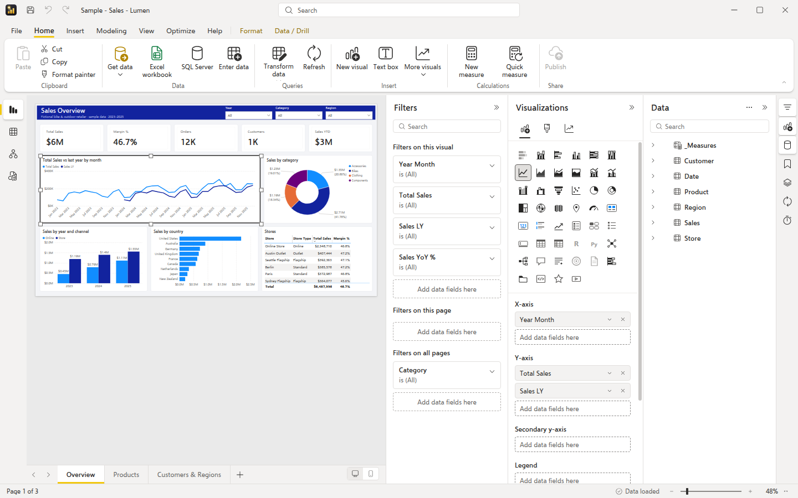

# Create reports

> **Applies to:** Creators · Analysts

How to build report pages in Lumen: add and arrange visuals, fill them with fields, format them, add slicers, filters,
interactions and navigation, apply themes, and export the result. The steps use the built-in sample report, so you can
follow them without your own data. Where Lumen behaves differently from Power BI Desktop, each article says so.

## Start here

| Article | Type | What you learn |
|---|---|---|
| [Report view overview](report-view-overview.md) | Overview | The parts of the window, the panes and the ribbon tabs |
| [Tutorial: design a dashboard page](tutorial-design-a-dashboard-page.md) | Tutorial | Build a page with KPI cards, icons, slicers, a combo chart and a matrix, apply a theme and export it to PDF |
| [Start from a report template](start-from-a-template.md) | How-to | The gallery's designed templates, which are Power BI compatible, and how to put in your own data |
| [Sample data on empty visuals](sample-data-on-empty-visuals.md) | How-to | Mock up a report fast: empty visuals draw realistic sample data until you drop fields in |

## Build pages and visuals

| Article | Type | What you learn |
|---|---|---|
| [Work with report pages](pages.md) | How-to | Add, rename, hide, reorder and delete pages; page size, background, tooltip and drill-through pages |
| [Add and arrange visuals](add-and-arrange-visuals.md) | How-to | Insert, select, move, resize, snap, align, distribute, layer, group, lock; the Selection pane |
| [The Data pane and field wells](the-data-pane-and-field-wells.md) | How-to | Add, move, rename and summarize fields in a visual |
| [Text boxes, shapes and images](text-boxes-shapes-and-images.md) | How-to | Report elements that don't show data |
| [Add icons to a report](icons.md) | How-to | Insert Lucide and Fluent Color icons, put them on cards, how they are saved |

## Format

| Article | Type | What you learn |
|---|---|---|
| [Format a visual](format-a-visual.md) | How-to | The Format pane: Visual and General tabs, search, effective values, reset, per-series settings |
| [Visual titles, borders and backgrounds](visual-titles-borders-and-backgrounds.md) | How-to | Title, subtitle, divider, spacing, padding, background, border, shadow, header icons |
| [Conditional formatting](conditional-formatting.md) | How-to | Gradient, rules and field value formatting; data bars, icons and web URLs in tables |
| [Report themes](themes.md) | How-to | Built-in themes, theme files, Customize current theme, how themes provide defaults |

## Filter and interact

| Article | Type | What you learn |
|---|---|---|
| [Slicers](slicers.md) | How-to | Slicer types and styles, selecting values, slicer formatting |
| [Sync slicers](sync-slicers.md) | How-to | Keep a slicer selection the same on several pages |
| [Filters pane](filters-pane.md) | How-to | Visual, page and report filters, filter types, lock and hide |
| [Visual interactions](visual-interactions.md) | Concept | Cross-filtering and cross-highlighting between visuals |
| [Sort and Top N](sort-and-top-n.md) | How-to | Sort a visual; show the top or bottom N items |
| [Drill down and drill through](drill-down-and-drillthrough.md) | How-to | Hierarchies, drill mode, expand, drill-through pages |
| [Tooltips](tooltips.md) | How-to | Default tooltips and report-page tooltips |

## Navigate and present

| Article | Type | What you learn |
|---|---|---|
| [Bookmarks](bookmarks.md) | How-to | Capture and apply the state of a page |
| [Buttons and page navigation](buttons-and-page-navigation.md) | How-to | Buttons, actions, the page navigator |
| [Mobile layout](mobile-layout.md) | How-to | Lay out a page for phones |

## Export and check

| Article | Type | What you learn |
|---|---|---|
| [Export a report](export-a-report.md) | How-to | PDF, PowerPoint, images and HTML; choosing pages; Power BI project |
| [Export data from a visual](export-data-from-a-visual.md) | How-to | Save the data behind a visual as `.xlsx` or `.csv` |
| [Performance analyzer](performance-analyzer.md) | How-to | Time the queries and rendering of each visual |
| [Keyboard shortcuts and context menus](keyboard-and-context-menus.md) | Concept | Canvas shortcuts and the visual context menu |

## Reference

- [Visuals in Lumen](../visuals/README.md): one article per visual family.
- [Visual support](../reference/visual-support.md): every visual type and how completely Lumen supports it (generated).
- [Format properties](../reference/format-properties.md): every Format pane card and property per visual (generated).
- [Built-in icons: design and storage](../ICONS.md) and [Visual defaults](../VISUAL_DEFAULTS.md): technical notes.

## Related content

- [Visuals in Lumen](../visuals/README.md)
- [Model data](../model-data/README.md)
- [DAX in Lumen](../dax/README.md)
- [Files and compatibility](../files-and-compatibility/README.md)
