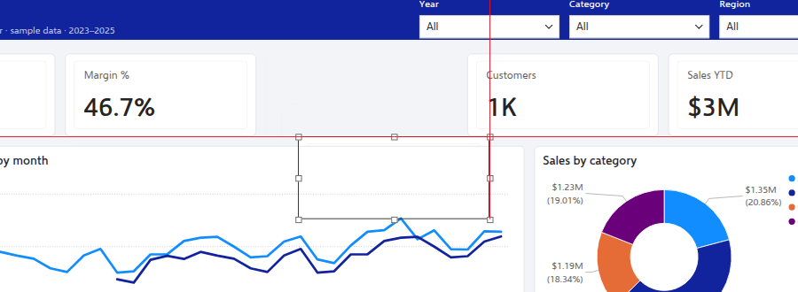
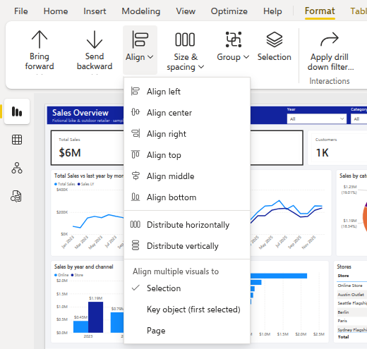
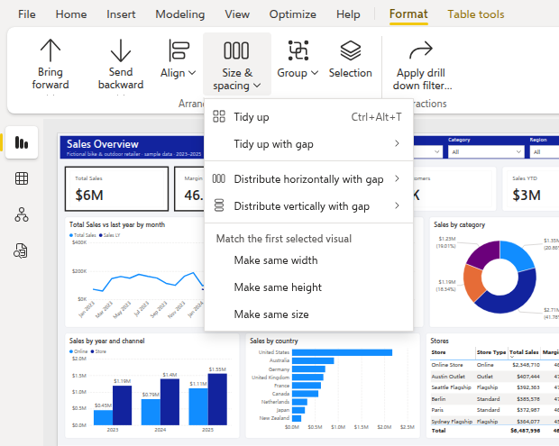
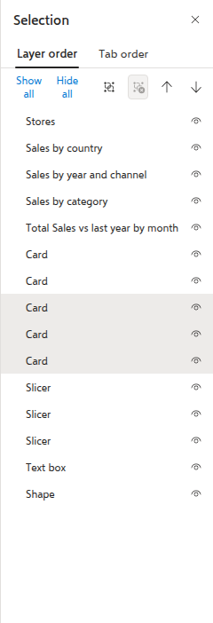

# Add and arrange visuals

> **Applies to:** Creators

This article shows how to put visuals on a page and lay them out: insert, select, move and resize, snap to other
visuals and guides, align and distribute, set the layer order, group, hide and lock.

## Prerequisites

- A report open in edit mode. The steps use the built-in sample: select **File > New > Sample report**, or **Try a
  sample** on the start screen.

## Insert a visual

Use any of these:

- **Visualizations pane**: make sure no visual is selected (select an empty area of the canvas), then select a visual
  type under **Build visual**. The gallery is shown in [Visuals](../visuals/README.md).
- **Data pane**: with no visual selected, tick a field. Lumen creates a table for a text or date field and a clustered
  column chart for a measure or a numeric column, with the field already in it.
- **Ribbon**: **Insert > New visual** (a clustered column chart), **Insert > More visuals**, the **AI visuals** group,
  or the **Elements** group (text box, buttons, shapes, image, icon).

A new visual is placed near the top-left corner of the page (20 px from each edge, moved 20 px further down-right when
another visual already starts there) and selected. Icons are the exception: they are placed in the middle of the
visible part of the page.

> [!IMPORTANT]
> When a visual is selected, selecting a type in the Visualizations gallery **changes the selected visual** to that
> type instead of adding a new one, as in Power BI Desktop. Deselect first if you want a new visual.

## Select visuals

| To | Do this |
|---|---|
| Select one visual | Select it on the canvas. |
| Add to or remove from the selection | Ctrl+select or Shift+select. |
| Select several by area | Drag on an empty area of the page; every visual touched by the rectangle is selected. |
| Select all visuals on the page | Ctrl+A |
| Clear the selection | Esc, or select an empty area outside the page. |

## Move and resize

- **Move**: drag the visual. **Arrow** keys move the selection by 1 px, Ctrl+Arrow by 10 px (by the grid size,
  16 px, when **Snap to grid** is on).
- **Resize**: drag one of the eight handles. Shift+Arrow resizes by 1 px, Ctrl+Shift+Arrow by 10 px.
- **Exact values**: on the **General** tab of the Format pane, **Properties > Size** has **Height** and **Width** and
  **Properties > Position** has **Horizontal** and **Vertical**. Turn on **Lock aspect ratio** to keep the proportions
  when you change one dimension.

### Snapping and smart guides

While you drag, the visual snaps to the edges and centers of the page and of the other visuals, and red guide lines show
what it lines up with. Hold Alt while dragging to move or resize freely.

The **View** tab controls snapping:

| Setting | Group | Effect | Default |
|---|---|---|---|
| **Gridlines** | Page options | Shows a 16 px grid on the page. | Off |
| **Snap to grid** | Page options | Snaps to the 16 px grid. | Off |
| **Lock objects** | Page options | Prevents moving and resizing visuals. Not remembered after Lumen is closed. | Off |
| **Layout guides** | Layout | A page margin and a gutter between visuals that visuals snap to: **None**, **Compact (8 px margin, 8 px gutter)**, **Comfortable (16 px margin, 16 px gutter)**, **Spacious (24 px margin, 16 px gutter)**, **Wide (32 px margin, 24 px gutter)** or **Custom…**. **Show margin guides** draws the margin. Saved with the report. | None |
| **Equal spacing** | Layout | Snaps to the same gaps as neighboring visuals and shows distance guides. | On |
| **Match size** | Layout | While resizing, snaps to the width or height of other visuals. | On |

Gridlines, snap to grid, equal spacing and match size are your own preferences, kept between sessions and not saved in
the report.

## Align and distribute

1. Select two or more visuals.
2. On the **Format** tab, select **Align** and choose **Align left**, **Align center**, **Align right**, **Align top**,
   **Align middle** or **Align bottom**.
3. To spread three or more visuals evenly, choose **Distribute horizontally** or **Distribute vertically**.

The **Align multiple visuals to** section of the same menu sets the reference: **Selection** (the bounds of the
selection, as in Power BI Desktop), **Key object (first selected)** (the first visual you selected stays put) or
**Page**. A single selected visual is always aligned to the page.

### Size and spacing

**Format > Size & spacing** (two or more visuals selected) offers:

| Command | What it does |
|---|---|
| **Tidy up** (Ctrl+Alt+T) | Arranges the selection into an even row or grid, using the current median spacing. |
| **Tidy up with gap** | The same, with a gap of 4, 8, 12, 16, 24 or 32 px. |
| **Distribute horizontally with gap**, **Distribute vertically with gap** | Places the visuals side by side or one below the other with a fixed gap (a preset or **Custom…**); the first visual stays put. |
| **Make same width**, **Make same height**, **Make same size** | Matches the first selected visual. |

## Layer order

Visuals can overlap. To change which one is on top, select it and use **Format > Bring forward** (or **Bring to front**
from its menu) and **Format > Send backward** (or **Send to back**). The Selection pane shows and changes the same order.

## Group visuals

1. Select two or more visuals.
2. Select **Format > Group > Group**, or press Ctrl+G.

A group moves and resizes as one item and shows as a folder in the Selection pane. To undo it, select the group and
choose **Format > Group > Ungroup**, or press Ctrl+Shift+G.

## Use the Selection pane

Open it with **View > Selection** or **Format > Selection**.

- **Layer order** lists the visuals from front (top) to back. Select a row to select the visual; drag a row to
  re-stack it.
- The eye icon hides or shows a visual. **Show all** and **Hide all** apply to the whole page. Hidden visuals are saved
  hidden, which is how bookmarks show and hide content; see [Bookmarks](bookmarks.md).
- Right-click a row for **Rename**, **Hide** or **Show**, **Bring to front** and **Send to back**. Visuals without a
  title are listed by their type (*Card*, *Slicer*); renaming gives them a clearer name in this list.
- The buttons at the top group, ungroup, bring forward and send backward the selection.
- **Tab order** sets the order in which keyboard users move through the visuals: select a visual and use **Move up** and
  **Move down**.

## Copy, paste and delete

- Ctrl+C, Ctrl+X and Ctrl+V copy, cut and paste visuals, also to another page. A visual pasted on the page
  it came from is offset by 20 px; pasting again offsets it further.
- Delete (or Backspace) deletes the selected visuals.
- **Home > Format painter** copies the formatting of the selected visual; then select another visual to apply it.
  Esc cancels.

Keyboard shortcuts work when the canvas has the focus. After you type in the Format pane, select the visual on the
canvas again before pressing Ctrl+C or Ctrl+V.

## Considerations and limitations

- Layout guides are stored in `report.json` (`objects.lumenLayout`) only when you set them. Power BI Desktop is
  designed to ignore this object; this has not been verified in Power BI Desktop.
- Equal spacing, match size, layout guides, **Size & spacing** and the **Key object** and **Page** align references are
  Lumen additions.
- While you drag a visual, its content is not drawn; only its outline and the guides are.

## Related content

- [Report view overview](report-view-overview.md)
- [The Data pane and field wells](the-data-pane-and-field-wells.md)
- [Format a visual](format-a-visual.md)
- [Keyboard and context menus](keyboard-and-context-menus.md)
- [Visuals in Lumen](../visuals/README.md)
