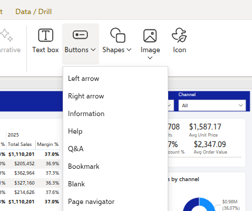
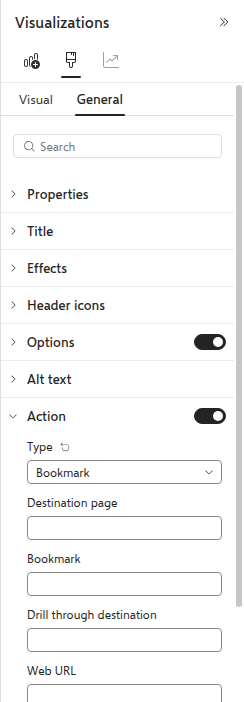
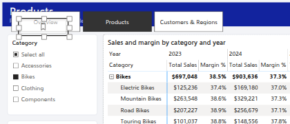

# Buttons and page navigation

> **Applies to:** Creators

Buttons, shapes and images can run an action when a reader selects them: go to a page, apply a bookmark, drill
through, open a web address, go back, or clear the slicers. A page navigator gives you a row of page buttons in one
step. This article shows how to add them and set their actions.

## Prerequisites

- A report open in Lumen, in edit mode. The steps use the built-in sample.

## Add a button

1. Select **Insert > Buttons**.
2. Select a button type. The button is added to the page (112 × 40 px) and selected.

| Button | Icon | Action it starts with |
|---|---|---|
| **Left arrow** | Back arrow | **Back** |
| **Right arrow** | Right arrow | **Page Navigation** (no destination yet) |
| **Information** | Information | none |
| **Help** | Question mark | none |
| **Q&A** | Q&A | **Q&A** (has no effect in Lumen) |
| **Bookmark** | Bookmark | **Bookmark** (no bookmark yet) |
| **Blank** | none | none |
| **Page navigator** | | A page navigator (see below) |

Move and resize the button like any visual; see [Add and arrange visuals](add-and-arrange-visuals.md).

## Set the action

1. Select the button.
2. In the **Visualizations** pane, select **Format visual**, then **General**.
3. Expand **Action** and make sure its switch is on.
4. Choose **Type**:

| Type | What it does | Fill in |
|---|---|---|
| **Back** | Returns to the previous page (after a page change or a drill through). | |
| **Bookmark** | Applies a bookmark. | **Bookmark**: the bookmark's name as shown in the Bookmarks pane |
| **Drillthrough** | Drills through to a page with the data point selected on this page. | **Drill through destination**: the page name |
| **Page Navigation** | Opens a page. | **Destination page**: the page name as shown on its tab |
| **Qn A** | Power BI's Q&A explorer. Does nothing in Lumen. | |
| **Web Url** | Opens the address in your web browser (`http`, `https` and `mailto` only). | **Web URL** |
| **Clear All Slicers** | Clears every slicer on the page. | |
| **Apply All Slicers** | Does nothing in Lumen: slicers apply immediately. | |

5. Optionally type a **Tooltip**, shown when the reader hovers over the button.

The destination boxes accept the name you see in the app (page tab name, bookmark name) or the internal name that
Power BI writes. All four boxes are shown whatever the type; only the one that matches the type is used.

A button whose destination doesn't exist (or a drill-through button with no suitable data point selected) is shown in
its disabled state, and its tooltip says why, for example *To drill through to Details, select a data point from
Country*.

### Try it: a page button

1. Select **Insert > Buttons > Right arrow**.
2. In **Format visual > General > Action**, enter `Customers & Regions` in **Destination page** and press **Enter**.
3. Hold **Ctrl** and select the button. Lumen opens the **Customers & Regions** page.

## Run an action

| Mode | How |
|---|---|
| Edit mode | **Ctrl**+click the button. A plain click selects it for editing, as in Power BI Desktop. |
| Reading view (**View > Reading view**) | Click the button. |

## Format a button

The **Visual** tab of a button has **Shape** (one of 26 shapes and **Rounded corners**), **Text** (text, font, color,
alignment, padding), **Icon** (icon type, placement relative to the text, line color and weight, size, alignment),
**Fill**, **Border**, **Shadow** and **Glow**. See the [format properties reference](../reference/format-properties.md)
for every property.

Power BI buttons have states (default, on hover, on press, selected, disabled). Lumen draws each state from the saved
formatting, so a report built in Power BI Desktop keeps its hover and pressed looks. The Format pane edits only the
**default** state: there is no **Apply settings to State** selector.

## Page navigator

A page navigator is one visual with a button per page; the current page is shown selected.

1. Select **Insert > Buttons > Page navigator**. A 480 × 56 px navigator is added.
2. Move it where the navigation should be.
3. In **Format visual > Visual**, use:
   - **Grid layout**: **Orientation** (**Horizontal**, **Vertical**, **Grid**), **Rows**, **Columns**, **Padding**.
   - **Pages**: **Show hidden pages** and **Show tooltip pages** (both off by default).
   - **Shape**, **Text**, **Fill**, **Border**, **Shadow**, **Glow** as for buttons.

Ctrl+click a page in the navigator to go there while editing.

## Actions on shapes and images

Shapes and images have the same **Action** card on their **General** tab, so an image or a shape can work as a
button. See [Text boxes, shapes and images](text-boxes-shapes-and-images.md).

## Considerations and limitations

- New buttons and navigators are placed at the top-left of the page and can cover existing visuals; move them after
  inserting.
- The **Type** list shows Power BI's internal names split into words (**Page Navigation**, **Qn A**, **Web Url**)
  rather than Power BI Desktop's labels.
- Destinations that Power BI computes from a measure (conditional formatting with **fx** on the destination) are
  evaluated when a report has them, but the Format pane has no **fx** button for them.
- **Insert** has no bookmark navigator; see [Bookmarks](bookmarks.md).

## Differences from Power BI Desktop

- Destination page and bookmark are text boxes, not lists.
- No **Apply settings to State** (button states can't be edited).
- **Q&A** and **Apply all slicers** actions do nothing.
- No bookmark navigator in **Insert**.

## Related content

- [Bookmarks](bookmarks.md)
- [Drill down and drill through](drill-down-and-drillthrough.md)
- [Pages](pages.md)
- [Text boxes, shapes and images](text-boxes-shapes-and-images.md)
- [Elements visuals reference](../visuals/elements.md)
- [Buttons on Microsoft Learn](https://learn.microsoft.com/power-bi/create-reports/desktop-buttons)
