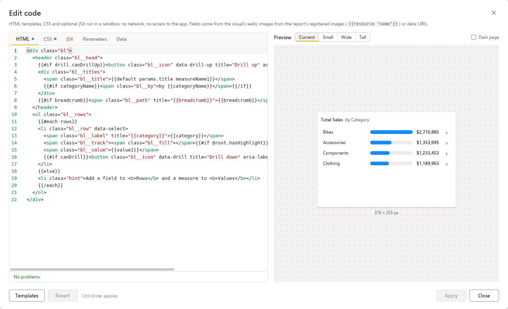
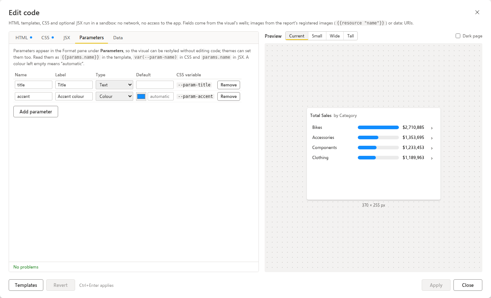
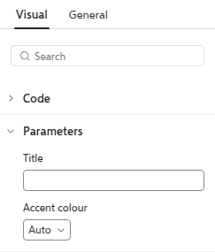

# Use the code visual

> **Applies to:** Creators

The [code visual](../visuals/code-visual.md) draws whatever you write in HTML and CSS (and, optionally, JSX) from the
fields in its wells. It cross-filters the page when a row is clicked, follows other visuals' selections, and drills
through a hierarchy like a native visual. This article shows how to insert one from a template, bind fields, edit its
code, make it selectable and drillable, and add parameters for report authors.

## Prerequisites

- A report open in Lumen, for example the built-in sample (**File > New > Sample report**).
- Some HTML and CSS. JSX is optional.

## Insert a code visual

1. With nothing selected on the page, select **Insert > Code visual** on the ribbon, or the **Code visual** tile
   (`</>`) at the end of the **Build visual** gallery.
2. In **New code visual**, pick a starter template. The text under the tiles says what it shows and which wells it
   expects.

   

3. Select **Insert**. The visual appears on the page at the template's size.

To change the template of an existing code visual, select **Templates** under **Build visual** (it replaces the
code; **Undo** brings it back).

## Bind fields

Drag fields into the wells as for any visual:

- **Rows**: the field (or fields, for a hierarchy) that makes one row of data per value. Leave it empty for a single
  total, as in a KPI tile.
- **Values**: the measures. The first one is each row's `--value` and drives the bar width, ring and so on in the
  templates.
- **Tooltips**: more fields for the data and the row tooltip.


## Edit the code

1. Select the visual, then select **Edit code** under **Build visual** (or double-click the visual, or right-click it
   and select **Edit code**).
2. Edit the **HTML** template and the **CSS**. The preview on the right updates as you type, with the visual's data
   and the report theme. **Small**, **Wide** and **Tall** show it at other sizes; **Dark page** on a dark background.
3. Problems appear under the editor with their line and column, and in the preview. Select a problem to jump to it.
4. Select **Apply** (or press **Ctrl+Enter**). The change is one step of **Undo** on the report. **Revert** goes back to
   the code as it was when you opened the editor or last applied.



The **Data** tab lists every name your code can use with the current data: the fields with their CSS variable and
JavaScript name, the root and row variables with their values, the theme variables, and the first rows. Copy names
from it rather than guessing them. The [code visual API reference](../reference/code-visual-api.md) has the full list.

### Use data in CSS

Every measure at the grand total is a variable on the visual's root, and every cell of a row is a variable on that
row's element:

```css
.headline::after { content: var(--total-sales-text); }               /* "$6,487,996" */
.bar { width: calc(var(--pct-of-max) * 100%); }                        /* per row */
.meter { width: calc(min(var(--sales-ly) / var(--total-sales), 1) * 100%); }
```

The visual is a size container, so `cqmin`, `cqw`, `cqh` units and `@container` queries respond to the visual's size:

```css
.value { font-size: clamp(20px, 22cqmin, 56px); }
@container (max-width: 260px) { .detail { display: none; } }
```

## Make rows selectable

Add `data-select` to the element that represents a row inside `{{#each rows}}`:

```html
{{#each rows}}
<div class="row" data-select>{{category}} <b>{{value1}}</b></div>
{{/each}}
```

A click now selects the row and cross-filters or cross-highlights the other visuals on the page; **Ctrl+click** adds
rows, and a click on empty space clears the selection. Style the state with attributes Lumen sets:

```css
[data-has-selection="true"] .row[data-selected="false"] { opacity: .4; }   /* this visual's selection */
.row[data-highlighted="false"] { opacity: .4; }                              /* another visual's selection */
```

Whether a selection filters or highlights each other visual follows the same rules as for native visuals, including
the interactions saved in the report. See [Visual interactions](visual-interactions.md).

## Make it drillable

1. Put two or more fields in **Rows**, or a hierarchy (for example **Category**, **Subcategory**, **Product**). The
   visual's header gets the drill icons, and the right-click menu gets **Drill down** and **Drill up**, as for a native
   chart. See [Drill down and drillthrough](drill-down-and-drillthrough.md).
2. To drill from your own design, add `data-drill` to an element inside a row, and `data-drill-up` to a back button:

   ```html
   {{#if drill.canDrillUp}}<button data-drill-up>‹</button> {{breadcrumb}}{{/if}}
   {{#each rows}}
   <div class="row" data-select>
     {{category}} {{value1}}
     {{#if canDrill}}<button data-drill>›</button>{{/if}}
   </div>
   {{/each}}
   ```

The drill state is saved with the visual and in bookmarks. `{{drill.levelName}}`, `{{level}}` and the root's
`data-level` attribute let you change the design at each level. [Tutorial: build a drillable bar list](tutorial-build-a-drillable-bar-list.md)
shows the result.

## Add parameters

Parameters let someone restyle the visual from the **Format** pane without opening the code.

1. In the editor, select the **Parameters** tab and **Add parameter**. Give it a name (used in code), a label (shown in
   the Format pane), a type (**Colour**, **Number**, **Text** or **Toggle**) and a default.

   

2. Use it in code: `{{params.title}}` in the template, `var(--param-accent, var(--theme-color-1))` in CSS,
   `params.title` in JSX. A colour left empty is "automatic" and its variable is absent, so give `var()` a fallback.
3. Select **Apply**. The parameters appear under **Format visual > Visual > Parameters**.

   

## Use JSX

When the template language is not enough (state, sorting on click, computed layouts), write a React component on the
**JSX** tab. When the JSX tab has code, the component renders the visual; it receives the rows, the size and functions
such as `select`, `drill` and `format` as props, and the template's output as `html`. See [JSX](../reference/code-visual-api.md#jsx)
in the reference. The **Top N bars (JSX)** template is an example.

## Considerations and limitations

- The code has no network access. Use the report's registered images (`{{resource "name"}}`) or `data:` URIs for
  images; remote URLs, fonts and stylesheets do not load (the editor warns about them).
- A template outputs text, never raw HTML from data: every value is escaped.
- A code visual with JSX runs in its own process; many of them on one page make the page open more slowly.
- Power BI Desktop is not expected to display a code visual (designed for, not verified). See
  [Code visual](../visuals/code-visual.md#differences-from-power-bi-desktop).

## Related content

- [Code visual](../visuals/code-visual.md)
- [Code visual API reference](../reference/code-visual-api.md)
- [Tutorial: build a KPI tile with HTML and CSS](tutorial-build-a-kpi-tile-with-html-and-css.md)
- [Tutorial: build a drillable bar list](tutorial-build-a-drillable-bar-list.md)
- [Visual interactions](visual-interactions.md)
