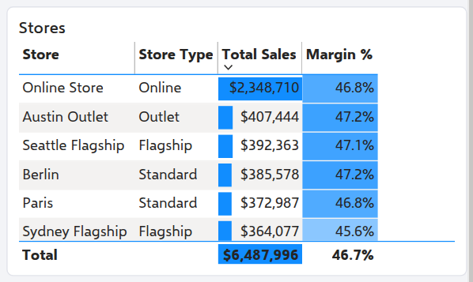
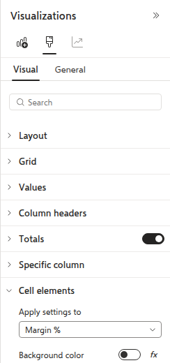
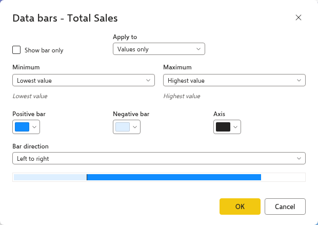

# Conditional formatting

> **Applies to:** Creators · Analysts

Conditional formatting sets a color, a text, an icon or a data bar from the data instead of a fixed value: a cell
background that grows darker with sales, a red bar below target, a title that names the selected year. This article
shows the **fx** dialogs and which visuals draw the result.

## Prerequisites

- A report open in edit mode. The steps use the **Stores** table on the **Overview** page of the built-in sample
  (**File > New > Sample report**).

## Where conditional formatting is offered

- An **fx** button next to a property in the Format pane. Color properties offer it by default; the **Text** of a
  title or subtitle and the **Alt text** accept a field value.
- On tables and matrices, the **Cell elements** card of the **Visual** tab, one value column at a time:
  **Background color**, **Font color**, **Data bars**, **Icons** and **Web URL**.

## Color a table column by value (gradient)

1. Select the **Stores** table, then **Visualizations > Format visual > Visual**.
2. Expand **Cell elements**. In **Apply settings to**, choose **Margin %**.

   

3. Select **fx** next to **Background color**. The dialog *Background color - Margin %* opens with **Format style**
   set to **Gradient**.
4. Check the settings:
   - **Apply to**: **Values only**, **Values and totals** or **Totals only**.
   - **What field should we base this on?**: by default the column itself; any field of the model can be chosen.
     **Summarization** appears for columns (Sum, Average, Minimum, Maximum, Count, Count (Distinct), Median,
     Standard deviation, Variance; First, Last, Count and Count (Distinct) for text).
   - **How should we format empty values?**: **As zero** or **As specific color**.
   - **Minimum** and **Maximum**: **Lowest value** / **Highest value** or a **Number**, each with a color. Select **Add
     a middle color** for a three-color scale with a **Center**.
5. Select **OK**. The switch next to **Background color** turns on and the cells are colored.

## Color by rules

In the same dialog, set **Format style** to **Rules**.

1. Each rule reads *If value* [condition] [value] [Number] *and* [condition] [value] [Number] *then* [color]. The
   conditions are **is**, **is not**, **is greater than**, **is greater than or equal to**, **is less than**, **is less
   than or equal to**, **is blank**, **is not blank**, and for text **contains**, **does not contain**, **starts
   with**, **does not start with**.
2. Select **New rule** to add a rule. Use the arrows to move a rule up or down and the bin icon to delete it.
   **Reverse order** reverses the list.
3. Select **OK**.

## Field value

With **Format style** set to **Field value**, the color comes straight from a field or measure that returns a color:
a hex code such as `#118DFF` or a color name. For a title or alt text, the text is the field's value, evaluated with
the filters that apply to the visual; this is how you build a dynamic title from a measure.

## Data bars

1. In **Cell elements**, choose the column in **Apply settings to** (for example **Total Sales**).
2. Select **fx** next to **Data bars**.
3. Set **Minimum** and **Maximum** (**Lowest value** / **Highest value** or a number), the **Positive bar**,
   **Negative bar** and **Axis** colors, and the **Bar direction** (**Left to right** or **Right to left**). **Show bar
   only** hides the number.
4. Select **OK**.

## Icons

Select **fx** next to **Icons**. Choose **Rules** or **Field value**, then **Icon layout** (**Left of data**, **Right
of data**, **Icon only**), **Icon alignment** (**Top**, **Middle**, **Bottom**) and a **Style**: 3 arrows (colored),
3 arrows (gray), 3 triangles, 3 traffic lights, 3 signs, 3 symbols, 3 flags, 3 stars, 5 quarters or 4 bars. Each
rule assigns one icon.

## Web URL

Select **fx** next to **Web URL** and choose a field that returns a web address (`http://` or `https://`). The cells
become links.

## Conditional formatting on charts and cards

The same dialogs open from any **fx** button, for example **Columns > Color** of a column chart: a gradient or rules
color each column by its value.

## Change or remove conditional formatting

- A property with conditional formatting shows a chip instead of its control. Select the chip to edit the rule, or
  **x** on the chip to remove it.
- In the dialog, **Remove** (bottom left) removes it.
- In **Cell elements**, turning a switch off removes the formatting for that column. Turning a switch on applies a
  default rule straight away (or opens the dialog when there is no default); select **fx** to change it.

## Which visuals draw it

Lumen saves every rule in Power BI's format, but draws only some of them. When the dialog can't preview a property it
says *Saved in Power BI format. Lumen doesn't preview conditional formatting on this property yet.*

| Visual | Drawn by Lumen |
|---|---|
| Table, matrix | Background color, font color, data bars, icons, web URL (cell elements) |
| Any visual with a data color (columns, bars, slices, points) | The data color (`dataPoint.fill`) |
| Column, bar, line, area, combo, ribbon, pie and donut charts | The data label color |
| Card (new card) | Callout value color, category label color, card background color, reference label value and title colors |
| Every visual (General tab) | Title and subtitle text, font color and background; background color; border color; divider color; header background and icon color |

## Considerations and limitations

- **Percent** and **Percentile** minimum and maximum, and **Percent** rule values, are listed but disabled (*not
  supported yet*): they need visual-level totals Lumen doesn't compute for formatting.
- A rule written by Power BI in a form the dialog can't edit is shown with *This property uses a conditional formatting
  expression that this dialog can't edit. It's kept as is when you save.* **Replace it** starts a new rule.
- Data bars are also drawn on the **Total** row when **Apply to** is **Values only**.
- Rules saved by Lumen use Power BI's format; reading them in Power BI Desktop has not been verified.

## Related content

- [Format a visual](format-a-visual.md)
- [Tables and matrices](../visuals/tables-and-matrices.md)
- [Visual titles, borders and backgrounds](visual-titles-borders-and-backgrounds.md)
- [Themes](themes.md)
- [Apply conditional formatting in tables and matrices on Microsoft Learn](https://learn.microsoft.com/power-bi/create-reports/desktop-conditional-table-formatting)
