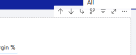
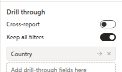
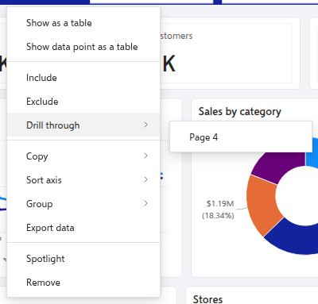
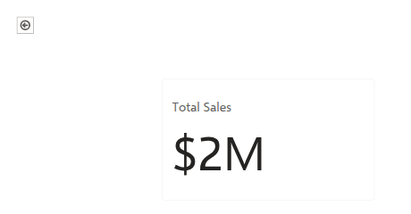

# Drill down and drill through

> **Applies to:** Creators · Analysts

Drill down moves a visual through the levels of a hierarchy (Category, then Subcategory, then Product). Drill through
jumps to another page filtered to the data point you picked. This article shows both, with the built-in sample.

## Drill down

A visual can drill when one of its hierarchical wells (**X-axis** or **Y-axis** of a chart, **Legend** of a pie or
donut, **Category** of a treemap or funnel, **Rows** or **Columns** of a matrix) holds more than one field, or a
hierarchy from the **Data** pane. The sample's **Sales and margin by category and year** matrix on the **Products**
page has **Category** and **Subcategory** on **Rows**.

Visuals that can drill: the column, bar, line, area, combo and ribbon charts, pie, donut, funnel, treemap, waterfall,
scatter, the map visuals and the matrix. Tables, cards, gauges and KPIs don't drill.

### From the visual header

Hover over the visual (or select it) to show its header icons above the top edge:

| Icon | Name | What it does |
|---|---|---|
| Up arrow | **Drill up** | Goes back one level. |
| Down arrow | **Click to turn on Drill down** / **Drill down is on** | Drill mode: while on, clicking a data point drills into it instead of cross-filtering. |
| Down-right arrow | **Go to the next level in the hierarchy** | Shows the next level for all values. |
| Forked arrow | **Expand all down one level in the hierarchy** | Adds the next level under each value (the axis shows both levels). |

A matrix with a hierarchy on **Columns** also shows **Drill on** to choose whether the icons act on rows or columns.

### From the context menu

Right-click a data point or a row header:

- **Drill down**: drill into the point you clicked (available on a point of a level that has a level below).
- **Drill up**, **Show next level**, **Expand to next level**: the same as the header icons.

A matrix adds **Expand** and **Collapse** sub-menus (**Selection**, **Entire level**, **All**) for its +/- buttons.

### From the ribbon

Select the visual. The contextual **Data / Drill** tab has **Drill mode**, **Drill up**, **Go to next level** and
**Expand next level**, plus **Show as a table**, **Focus mode** and **Export data**.

### Try it

1. Open the **Products** page.
2. Right-click **Bikes** in the matrix and select **Drill down**. The matrix shows the bike subcategories only, and
   the **Product details** table on the same page lists only bikes.
3. Select **Drill up** in the visual header to return.

Drilling also filters the other visuals of the page unless you change it: select the visual and use
**Format > Apply drill down filters to > Selected visual**.

## Drill through

A drill-through page is a page with one or more drill-through fields. From any visual that uses one of those fields,
right-click a data point and pick the page: Lumen opens it filtered to that point.

### Set up a drill-through page

1. Add a page: select **+** next to the page tabs, or **Insert > New page**.
2. Select an empty area of the canvas so no visual is selected.
3. In the **Visualizations** pane, select **Build visual**. The **Drill through** section appears below the gallery.
4. Drag a column from the **Data** pane onto **Add drill-through fields here**, for example **Region > Country**.
   Lumen adds a back button at the top-left of the page, as Power BI Desktop does.
5. Add the visuals the page should show, for example a card with **Total Sales**.

The two switches:

- **Keep all filters** (on by default): the target page receives the whole filter context of the source visual
  (slicers, page and visual filters, the point's other fields). Off: only the drill-through field values.
- **Cross-report**: saved in the page definition for Power BI's cross-report drill-through. Lumen has no
  cross-report drill-through, so this switch has no effect in Lumen.

To remove a drill-through field, select the cross on its pill.

### Drill through

1. Open a page with a visual that uses the drill-through field, for example **Overview > Sales by country**.
2. Right-click a bar, for example **United States**.
3. Point to **Drill through** and select the target page.

The target page opens and its visuals show the values for the United States. Its filter cards for the drill-through
fields show the carried values.

4. To return, select the back button. While editing, hold **Ctrl** and select it (a plain click selects the button
   for editing, as in Power BI Desktop). In reading view a plain click works.

A [button](buttons-and-page-navigation.md) with the **Drill through** action does the same from a selected data
point: it is enabled only when exactly one data point that carries a drill-through field is selected, and its tooltip
says what to select.

## Considerations and limitations

- **Drill through** appears in the context menu only on a data point whose fields include a drill-through field of
  some page.
- Drill through uses one data point. Selecting several points and drilling through is not supported; a drill-through
  button is disabled with *Select a single data point to drill through*.
- Drill state (current level, expanded levels) is session state; [bookmarks](bookmarks.md) save it.

## Differences from Power BI Desktop

- No cross-report drill-through; the **Cross-report** switch is only saved.
- Power BI lists the records behind a point with **Show data point as a table**; Lumen shows the visual's data
  restricted to the point.

## Related content

- [Visual interactions](visual-interactions.md)
- [Buttons and page navigation](buttons-and-page-navigation.md)
- [Tables and matrices](../visuals/tables-and-matrices.md)
- [Keyboard shortcuts and context menus](keyboard-and-context-menus.md)
- [Drill through on Microsoft Learn](https://learn.microsoft.com/power-bi/create-reports/desktop-drillthrough)
