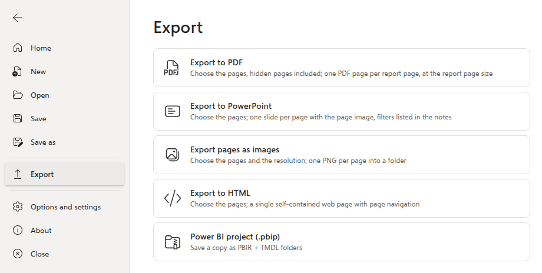
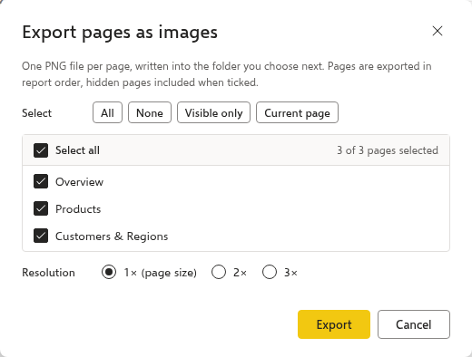

# Export a report

> **Applies to:** Creators · Analysts

Lumen exports report pages to PDF, PowerPoint, PNG images and a self-contained HTML page, and saves the report as a
Power BI project. This article shows the page selection dialog, what each output contains, and what happens when a
page takes too long to draw.

## Prerequisites

- A report open in Lumen. The steps use the built-in sample, which has three pages.

## Export pages

1. Select **File > Export**.
2. Select **Export to PDF**, **Export to PowerPoint**, **Export pages as images** or **Export to HTML**. The page
   selection dialog opens.
3. Choose the pages (see below). For images, also choose the **Resolution**.
4. Select **Export**.
5. Choose where to save: a file name for PDF, PowerPoint and HTML, a folder for images.

When the export is done, a notification says **Export complete** with the path and a **Show in folder** button.

### Choose pages

The dialog lists every page in report order. Hidden pages show a crossed-out eye icon; tooltip and drill-through
pages show a **Tooltip** or **Drillthrough** badge.

- By default every page is ticked **except tooltip pages**. Hidden pages are included, so you can export pages that
  readers reach only through navigation buttons.
- **Select**: **All**, **None**, **Visible only** (pages not hidden), **Current page**.
- **Select all** ticks or clears every page; it shows a mixed state when some pages are ticked. The count reads, for
  example, *2 of 3 pages selected*.
- Keyboard: **Ctrl+A** ticks every page; click a page, then **Shift**+click another to tick the range; **Space** ticks
  or clears the focused page; **Enter** exports; **Esc** cancels.
- With no page ticked, **Export** is disabled and the dialog says *Select at least one page*.

Lumen remembers your selection for the report until you close Lumen; the next export (in any format) starts from it.

## What each format contains

| Format | Output | Contents |
|---|---|---|
| **PDF** | One `.pdf` file | One PDF page per report page, at the report page's own size (a 1280 × 720 px page becomes a 960 × 540 pt PDF page). Text is real text: you can select and search it. The document title is the window title (report name followed by *Lumen*). |
| **PowerPoint** | One `.pptx` file | A title slide (report name, *Exported from Lumen on* date and time, number of pages), then one slide per page with a picture of the page at twice its size. Each slide's notes hold the page name and, under *Filters applied:*, the report and page filters that filter something. |
| **Images** | One PNG file per page in the folder you choose, named `1 - Overview.png`, `2 - Products.png` and so on | The page at **1×** (its own size in pixels), **2×** or **3×**. |
| **HTML** | One `.html` file | A single self-contained web page (pictures of the pages at 2× embedded in it) with the report name at the top and page tabs at the bottom that list exactly the exported pages. Opens in any browser, no server needed. |

For the sample's three pages, PDF export takes about a second and the others a few seconds; the HTML file is about
2 MB.

### Which state is exported

Each page is drawn again for the export, from its saved state:

- Filters and slicer selections are included (a slicer set to **2024** exports as **2024**).
- The current data point selection (cross-filter or cross-highlight), drill state and focus mode of your session are
  not included.
- Pages you have never opened in this session export the same way as the others.

## When a page takes too long

Lumen waits for every visual of a page to finish drawing (up to 12 seconds per page, with a 20-second safety limit per
export job). If a page is not finished in time, it is still exported as far as it was drawn, and the notification
changes to **Export complete, but some pages were not fully rendered**, naming each page and how many visuals were
still loading, for example *Sales (2 visuals still loading)*. This notification stays until you close it.

If an export fails (for example the file can't be written), the notification says **Export failed** with the reason.

## Save as a Power BI project

The fifth tile, **Power BI project (.pbip)**, saves the report as a Power BI project: a `.pbip` file with a
`.Report` folder (PBIR) and a `.SemanticModel` folder (TMDL). It is the same command as **File > Save as > Power BI
project (.pbip)**: after saving, Lumen works on the new project. See the
[files and compatibility section](../files-and-compatibility/README.md) for what is written.

## Considerations and limitations

- The **Power BI project (.pbip)** tile says *Save a copy*, but it behaves as **Save as**: the open report becomes the
  saved project.
- PowerPoint slides and HTML pages are pictures of the pages; charts are not editable PowerPoint charts.
- Export of a single visual's data is a separate feature: see [Export data from a visual](export-data-from-a-visual.md).
- Exports render in Lumen's renderer with Lumen's fonts (a Segoe UI-like font); colors and layout follow the report
  and its theme.

## Differences from Power BI Desktop

- Power BI Desktop exports to PDF and (through the service) to PowerPoint; Lumen adds PNG images and HTML.
- Lumen's PowerPoint export works offline and puts filters in the slide notes, not on the slides.
- Power BI Desktop's PDF export always includes every visible page; Lumen lets you pick pages, including hidden ones.

## Related content

- [Export data from a visual](export-data-from-a-visual.md)
- [Pages](pages.md)
- [Files and compatibility](../files-and-compatibility/README.md)
- [Command line and environment reference](../reference/command-line-and-environment.md)
- [Export to PDF in Power BI Desktop on Microsoft Learn](https://learn.microsoft.com/power-bi/create-reports/desktop-export-to-pdf)
