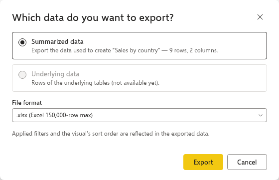

# Export data from a visual

> **Applies to:** Creators · Analysts

**Export data** saves the data behind one visual as an Excel workbook or a CSV file. This article shows how to export
it, what the file contains and the row limits.

## Prerequisites

- A report open in Lumen with a data visual (chart, table, matrix, card, slicer, map, AI visual). Text boxes, shapes,
  images and buttons have no data; their **Export data** entry is disabled.

## Export the data

1. Right-click the visual, or select **More options** (**...**) in its header, and select **Export data**. You can also
   select the visual and use **Data / Drill > Export data** on the ribbon.
2. In **Which data do you want to export?**, keep **Summarized data**. The line under it gives the number of rows and
   columns, for example *Export the data used to create "Sales by country" — 9 rows, 2 columns.*
3. Open **File format** and choose **.xlsx (Excel 150,000-row max)** or **.csv (30,000-row max)**.
4. Select **Export** and choose the file name. The default name is the visual's title.

A notification **Data exported** shows the path with a **Show in folder** button.

## What the file contains

- **Summarized data**: the data the visual is drawn from: one column per field in the visual and one row per data
  point (for a table, its rows), with the column headers the visual shows. Values are the unrounded numbers, not the
  visual's display format: the sample's United States sales export as `2172621.26` (shown in Excel as `2,172,621.26`),
  not `$2,172,621`.
- Filters that apply to the visual (report, page and visual filters, slicers, cross-filters) and the visual's sort
  order are applied, as the dialog says.
- **.xlsx**: one worksheet named after the visual's title, with the header row frozen and numbers stored as numbers.
- **.csv**: comma-separated, UTF-8 with a byte order mark so Excel detects the encoding.

If the data has more rows than the format's limit, only the first 150,000 (.xlsx) or 30,000 (.csv) rows are written and
the notification says *Only the first … rows were exported (XLSX limit).*

## Considerations and limitations

- **Underlying data** (the table rows behind a visual) is not available yet; the option is shown disabled.
- A visual without data shows *This visual doesn't have data that can be exported.*
- Tables and matrices give at most 30,000 rows to **Export data**, so an .xlsx export of a larger table stops at
  30,000 rows too.

## Differences from Power BI Desktop

- No **Underlying data** export.
- The row limits are the ones Power BI Desktop applies to summarized data.

## Related content

- [Export a report](export-a-report.md)
- [Keyboard shortcuts and context menus](keyboard-and-context-menus.md)
- [Tables and matrices](../visuals/tables-and-matrices.md)
- [Export data from visualizations on Microsoft Learn](https://learn.microsoft.com/power-bi/visuals/power-bi-visualization-export-data)
