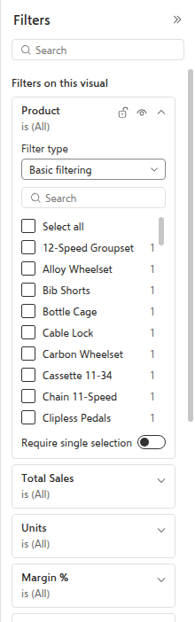

# Filters pane

> **Applies to:** Creators · Analysts

The **Filters** pane holds the filters of a report at three levels: the selected visual, the current page and all
pages. This article shows how to add filters, the four filter types, and how to lock or hide a filter for readers.

## Prerequisites

- A report open in Lumen, in edit mode. The steps use the built-in sample.
- The **Filters** pane open: **View > Filters**, or the **Filters** icon on the pane switcher at the right edge of the
  window.

## Filter levels

| Section | Scope | When it shows |
|---|---|---|
| **Filters on this visual** | The selected visual only | When exactly one visual is selected |
| **Filters on this page** | Every visual on the current page | Always (with a report open) |
| **Filters on all pages** | Every visual on every page | Always |

**Filters on this visual** lists a card for each field the visual uses (these cards start as *is (All)*), plus any
filter you add. Each section ends with an **Add data fields here** drop area.

Drill-through fields of a page are not listed here; they are set in the **Drill through** wells of the
**Visualizations** pane (see [Drill down and drill through](drill-down-and-drillthrough.md)).

## Add a filter

1. Select the visual for a visual-level filter, or select nothing for page and report filters.
2. In the **Data** pane, drag a column onto **Add data fields here** in the section you want. Measures can be
   dropped only on **Filters on this visual**, as in Power BI Desktop.
3. A new card appears, set to *is (All)*. Expand it (select the card header or its chevron) to set the condition.

Filters apply as soon as you change them; Lumen has no **Apply** button for basic filters. Advanced, Top N and
relative date filters have an **Apply filter** button, as in Power BI Desktop.

## Filter types

Open **Filter type** on an expanded card to switch types. The types offered depend on the field:

| Field | Filter types offered |
|---|---|
| Text or numeric column | **Basic filtering**, **Advanced filtering**, **Top N** |
| Date column | **Basic filtering**, **Advanced filtering**, **Relative date**, **Top N** |
| Boolean column | **Basic filtering** |
| Measure | **Advanced filtering** only |

### Basic filtering

A searchable list of the column's values with check boxes and row counts, and **Select all**. Select values to keep
only those. **Require single selection** turns the list into a single-choice list.

### Advanced filtering

One or two conditions joined by **And** or **Or** under **Show items when the value**. The operators depend on the
type:

- Text: **contains**, **does not contain**, **starts with**, **does not start with**, **is**, **is not**,
  **is blank**, **is not blank**, **is empty**, **is not empty**.
- Number or measure: **is less than**, **is less than or equal to**, **is greater than**,
  **is greater than or equal to**, **is**, **is not**, **is blank**, **is not blank**.
- Date: **is**, **is not**, **is on or after**, **is after**, **is on or before**, **is before**, **is blank**,
  **is not blank**. Type dates as `YYYY-MM-DD`.

### Top N

**Show items** **Top** or **Bottom**, a count, and **By value**: drag a measure or column from the **Data** pane into
the well, then select **Apply filter**. See [Sort and Top N](sort-and-top-n.md) for a worked example.

### Relative date

**Show items when the value** **is in the last**, **is in this** or **is in the next**, a number (not for
**is in this**), and a unit
(**Days**, **Weeks**, **Weeks (Calendar)**, **Months**, **Months (Calendar)**, **Years**, **Years (Calendar)**), plus
**Include today** for the non-calendar units.

## Clear, remove, lock and hide a filter

Each card header has icons:

| Icon | Action |
|---|---|
| Eraser (**Clear filter**) | Resets the card to *is (All)*. Shown only while the card filters. |
| Cross (**Remove filter**) | Deletes the card. Not shown for the automatic cards of a visual's own fields. |
| Padlock (**Lock filter** / **Unlock filter**) | A locked filter can't be changed in reading view. |
| Eye (**Hide filter in reading view** / **Show filter in reading view**) | A hidden filter still applies but is not listed in reading view. |

Switch to **View > Reading view** to see the pane as a reader would; select **Edit report** in the same place to
return.

## Filters from the visual context menu

Right-click a data point in a chart and select **Include** or **Exclude** to keep or remove that point. Lumen adds a
visual-level filter (type *Include* or *Exclude*) to the visual. Undo (Ctrl+Z) removes it.

> [!WARNING]
> The Include / Exclude filter is applied but is not shown as its own card in **Filters on this visual**: the card for
> the field still reads *is (All)*. Use Ctrl+Z right away to take it back. Removing it later is not possible from
> the pane in this version.

## Format the Filters pane

With no visual selected, the **Format page** tab of the **Visualizations** pane has two cards for the pane's look:

- **Filter pane**: background color and transparency, font and icon color, title and header text sizes, font,
  border and border color, input box color, check box and apply button color, width.
- **Filter cards**: background, border, font and icon color, text size, font and input box color of the cards.

## Considerations and limitations

- A filter whose condition the pane can't represent (for example a filter written by another tool) shows *This filter
  uses a condition the pane can't edit. Applying a new filter replaces it.* It keeps filtering.
- Filters on hidden and locked states are stored as Power BI stores them (`isHiddenInViewMode`,
  `isLockedInViewMode`); this has not been verified in Power BI Desktop.
- The **Search** box at the top of the pane narrows the cards shown.

## Differences from Power BI Desktop

- Basic filters apply immediately; Power BI Desktop can be set to require **Apply** (the "Add an Apply button"
  query reduction option). Lumen has no query reduction settings.
- Include / Exclude filters are not listed as separate cards (see the warning above).

## Related content

- [Slicers](slicers.md)
- [Sort and Top N](sort-and-top-n.md)
- [Visual interactions](visual-interactions.md)
- [Drill down and drill through](drill-down-and-drillthrough.md)
- [Format filters in Power BI reports on Microsoft Learn](https://learn.microsoft.com/power-bi/create-reports/power-bi-report-filter)
