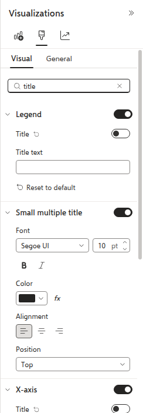

# Format a visual

> **Applies to:** Creators

The Format pane changes how a visual looks: axes, labels, colors, fonts, title, background, border and more. This
article explains how the pane is organized, how to find a setting, what an unset setting shows and how to go back to the
default.

## Prerequisites

- A report open in edit mode. The steps use the built-in sample: select **File > New > Sample report**, or **Try a
  sample** on the start screen.

## Open the Format pane

1. Select one visual on the canvas. (With several visuals selected the pane says *Select a single visual to format
   it*; with none selected it formats the page, see [Pages](pages.md#page-settings).)
2. In the **Visualizations** pane, select **Format visual** (the paintbrush icon).

The pane has two tabs:

- **Visual**: the cards of this visual type, for example **Legend**, **X-axis**, **Y-axis**, **Columns**, **Data
  labels** for a column chart. Every card and property per visual type is listed in the
  [Format properties reference](../reference/format-properties.md).
- **General**: the cards every visual shares: **Properties** (size, position, padding, advanced options), **Title**,
  **Effects**, **Header icons**, tooltips and **Alt text**. See
  [Visual titles, borders and backgrounds](visual-titles-borders-and-backgrounds.md).

A group of visuals has only the General tab.

## Change a setting

1. Expand a card by selecting its name. Cards with an on/off switch in their header (such as **Legend** or **Data
   labels**) turn the whole feature on or off.
2. Change a property. Changes apply at once and are added to the undo history (Ctrl+Z). Dragging a slider or
   holding a spin button counts as one change.

Controls follow Power BI Desktop: color pickers with the theme colors and a custom color, a font list with a size box,
**B** / *I* / U buttons, alignment buttons, lists, switches, numbers with spin buttons and percentage sliders.

## Find a setting

Type in the **Search** box at the top of either tab. The pane keeps the cards and properties whose names match and
expands them. When the card name itself matches, the whole card is shown. Clear the box to see all cards again.

## What an unset property shows

A property you have not set is never an empty box. The pane shows the value the visual really uses, in this order:

1. the value set on the visual;
2. the theme's value for this visual type, then the theme's value for all visuals (`visualStyles` in the theme file);
3. the value the visual falls back to when nothing is set, as Lumen draws it;
4. **Auto** when the visual decides while drawing, for example a series color that comes from the theme colors in
   order, or a label color picked for contrast.

So changing the theme changes what unset properties show, and a value you set yourself always wins over the theme. See
[Themes](themes.md).

## Reset to default

- A property set on the visual shows a reset arrow next to its name. Select it to clear that property; the control then
  shows the theme or default value again.
- **Reset to default** at the bottom of a card clears every property that card set on the visual, in one undo step.

## Format each series

Cards with per-series properties (for example **Columns**, **Lines** or **Data labels** of a chart with several
measures) start with a **Series** list. **All** edits the setting for all series; choosing a measure edits it for that
measure only.

## Conditional formatting (fx)

An **fx** button next to a property means it can take its value from data: colors by gradient, rules or a field
value; titles and alt text from a field value. A property with conditional formatting shows a chip instead of the
control; select the chip to edit the rule or **x** to remove it. See [Conditional formatting](conditional-formatting.md).

## Gradient fills

Lumen can fill a color with a gradient where Power BI only has a solid color. Open the color picker and select
**Gradient** (next to **Solid**) to edit:

- the stops on the bar under the preview: select a stop to change its color (theme colors, tints and shades, or a hex
  value) and its position, drag it along the bar, and use **+** / the bin to add or remove stops (2 to 8);
- **Linear** or **Radial**, and for a linear gradient its direction (the arrows, or an angle in degrees).

Select **Apply**. The color button then shows the gradient; picking a color on the **Solid** tab or
**Reset to default** returns to a solid color.

Every color setting of a visual (Visual and General tabs) offers the same three choices: **Solid**, **Gradient**
and **fx Conditional**, which opens the conditional formatting dialog (rules, gradient scale or field value) for that
setting. In page formatting, **Canvas background** and **Wallpaper** take gradients too; the filter pane colors are
solid only.

Gradients apply to whatever the setting colors: fills and backgrounds, text (as gradient text), lines and gridlines
(along their length), and chart series. Borders of cards, tables and other boxes drawn as CSS borders stay solid.

Power BI has no gradient fill, so the property itself keeps a solid color, the gradient's middle color (nudged by an
invisible step when another color in the visual is the same), which is what Power BI Desktop draws when it opens the
report. The gradient is stored beside it in an annotation (see
[Working with PBIP projects](../files-and-compatibility/working-with-pbip-projects.md)). If the color is later changed
in Power BI, Lumen draws the new solid color and ignores the old gradient. Gradient fills are not conditional
formatting: for colors that follow the data, use **fx** (below).

Conditional formatting works on every color setting. Colors that vary per data point (chart data colors and data
labels, table and matrix cell elements, the new card's callouts) are evaluated per point; every other color has one
value for the whole visual, evaluated in the visual's filters like Power BI does for title and background colors. When
a rule gives no color, the visual draws its default.

## Copy formatting to another visual

1. Select the visual whose formatting you want to copy.
2. Select **Home > Format painter**.
3. Select the visual to format. Esc cancels.

## Mobile layout formatting

In the mobile layout, the Format pane edits the phone version of the selected visual only. The pane says *Mobile
formatting: changes apply to the phone layout only* and offers **Reset to desktop formatting**. See
[Mobile layout](mobile-layout.md).

## Differences from Power BI Desktop

- **Colors per category or per legend item can't be set in the pane.** The **Series** list contains the visual's
  measures, not the categories or legend values, and **Show all** in the **Columns** (or **Bars**, **Slices**...) card
  doesn't list one color per item. Per-item colors saved by Power BI Desktop are read and drawn.
- On the **General** tab, the card of the **Tooltips** group is shown with its own title, **Options**, instead of under
  a **Tooltips** heading.
- Some labels in the pane are not final: the button **Action** type list shows *Qn A* and *Web Url*; the new card's
  **Card shadow** preset list shows internal values such as *bottomRight*; the donut chart has two cards named
  **Slices**, and the pie and donut **Data labels** cards have two properties named **Background**.
- **Gradient fills** are Lumen-only (see above). The **Format painter** copies them with the rest of the formatting.
- Line and area charts show **Error bars** and **Find anomalies** on the Visual tab as well as on the Analytics tab.

## Related content

- [Visual titles, borders and backgrounds](visual-titles-borders-and-backgrounds.md)
- [Conditional formatting](conditional-formatting.md)
- [Themes](themes.md)
- [Format properties reference](../reference/format-properties.md)
- [Visuals in Lumen](../visuals/README.md)
