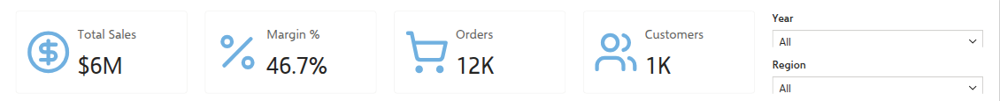
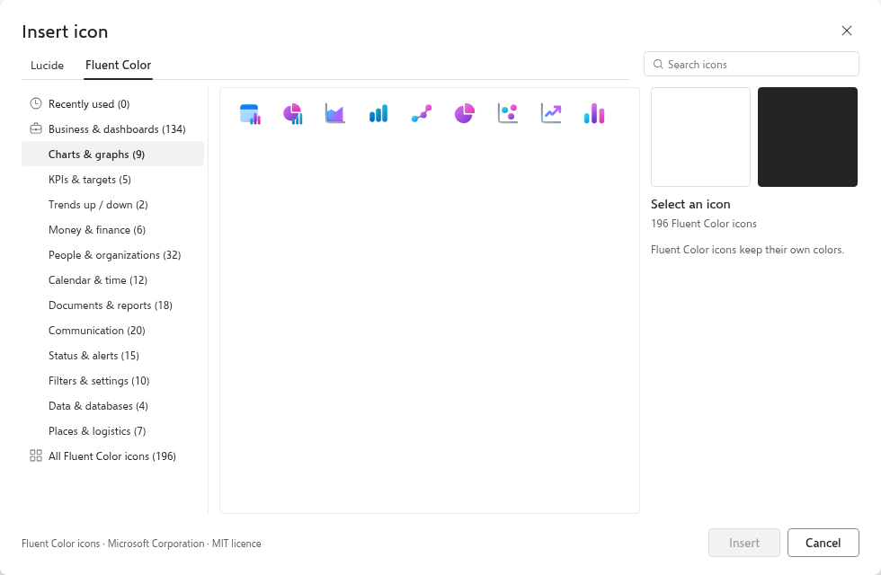

# Add icons to a report

> **Applies to:** Creators

Lumen has two built-in icon libraries, so you can put an icon on a page or on a card without preparing image files.
This article shows how to insert an icon, style it, put it on a card, and what is saved in the report.

## Prerequisites

- A report open in edit mode. The steps use the built-in sample (**File > New > Sample report**).

## The two libraries

| Library | Icons | Look | Controls |
|---|---|---|---|
| **Lucide** | 1,541 | Single-color line icons on a 24 px grid | **Color** (a theme color or any color), **Stroke width** (0.5 to 3, default 2), **Padding (%)** |
| **Fluent Color** | 196 | Microsoft's multi-color Fluent icons | **Padding (%)** only: the icons keep their own colors |

Both are open-source libraries drawn by Lumen itself (Lucide under the ISC licence, Fluent under MIT). A new Lucide icon
is drawn in the theme's foreground color.

## Insert an icon

1. Select **Insert > Icon** (or **Insert > Image > Icon…**). The **Insert icon** dialog opens.
2. Choose **Lucide** or **Fluent Color** at the top. The tab labels show how many icons match your search.
3. Find an icon:
   - **Business & dashboards** lists icons that suit reports, grouped into Charts & graphs, KPIs & targets, Trends up /
     down, Money & finance, People & organizations, Calendar & time, Documents & reports, Communication, Status &
     alerts, Filters & settings, Data & databases, and Places & logistics.
   - **Recently used** lists the icons you inserted before.
   - **All ... icons** lists the whole library.
   - **Search icons** looks in both libraries by name and common synonyms (for example *dollar*, *trending up*).
4. Select an icon. The previews on the right show it on a light and on a dark background.
5. For a Lucide icon, set **Color** and **Stroke width**.
6. Select **Insert** (or double-click the icon, or press Enter).

The icon is added as an image visual, 96 × 96 px, in the middle of the part of the page you are looking at. Inserting
again places the next icon 20 px further down and right.

**Keyboard**: press Tab (or Down arrow from the search box) to move into the grid, the arrow keys, Home,
End, Page Up and Page Down to move, Enter to choose and Esc to close.

## Change an icon

1. Select the icon on the canvas.
2. Select **Visualizations > Format visual > Visual** and expand **Image**.
3. Select the icon box to choose another icon, or change **Color**, **Stroke width** and **Padding (%)**.
4. To go back to a picture file, set **Source** to **Image file**, or select **Remove icon**.

## Put an icon on a card

The new card (the **Card** visual) has two image slots: **Callout image** (next to the value) and **Image** (on the
card). Both accept icons.

1. Select the card and open **Visualizations > Format visual > Visual**.
2. Expand **Callout image** and turn it on.
3. Set **Image source** to **Icon**. The **Choose an icon** dialog opens.
4. Choose an icon and select **Select**.
5. Set **Position** (Left, Right, Top, Bottom) and **Image area size (%)**. On a narrow card, lower the image area
   size so the value keeps enough room.

The [dashboard tutorial](tutorial-design-a-dashboard-page.md) builds the row of cards shown at the top of this article.

## Icons and themes

An icon drawn in a theme color (for example *Theme color 1*) follows the theme: when you apply another theme, its color
changes with it, in the same undo step. An icon with a fixed color, and every Fluent Color icon, keeps its colors.

## What is saved

Power BI Desktop has no icon feature, so Lumen saves every icon in two forms:

- **A picture** of the icon, stored the way Power BI stores that visual's image: an SVG file registered as an image
  resource for the image visual, and an SVG data URI in the image URL of a card's image slot. This is what Power BI is
  designed to show.
- **A reference** to the icon (library, name, color, stroke width, padding) in an annotation of the visual named
  `Lumen_Icon`, which Power BI is designed to keep and ignore (not verified). Lumen uses it to keep the icon editable.

When you save, Lumen refreshes the pictures. If the picture was replaced in another tool, the image wins and the icon
becomes a plain picture when the report is opened again.

> [!NOTE]
> Saved reports with icons validate against Microsoft's published report schemas, and the round trip (save, reopen,
> edit) is tested in Lumen. Whether Power BI Desktop shows the pictures has **not been verified**: there is no Power BI
> Desktop on Linux. Icons are saved in PBIP projects and `.wbi` bundles; Lumen does not write `.pbix` files.

## Considerations and limitations

- On a card, turning on **Callout image** with **Image source** still set to **Select from data** and no image field
  leaves less room for the value, which can be cut off. Choose the icon right after turning the card on.
- Buttons, shapes and page backgrounds don't take icons yet.

## Related content

- [Tutorial: design a dashboard page](tutorial-design-a-dashboard-page.md)
- [Text boxes, shapes and images](text-boxes-shapes-and-images.md)
- [Cards](../visuals/cards.md)
- [Themes](themes.md)
- [Built-in icons: design and storage details](../ICONS.md)
