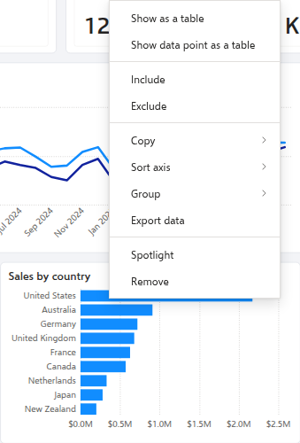
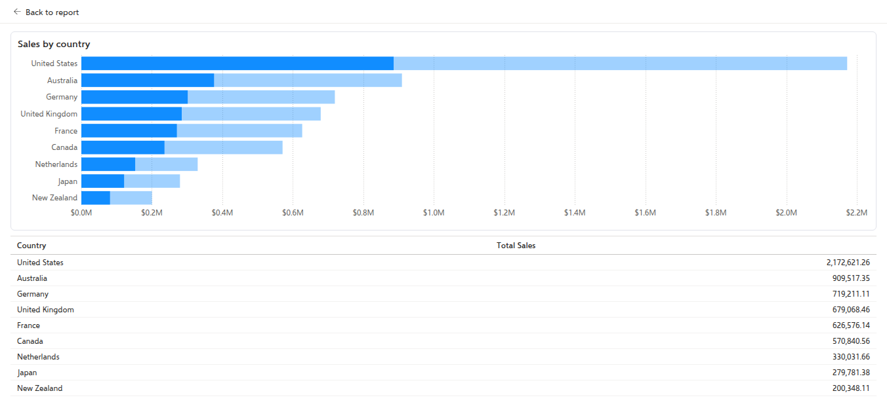

# Keyboard shortcuts and context menus

> **Applies to:** Creators · Analysts

This article describes the visual context menu (right-click a visual, or **More options** in its header) and the
keyboard shortcuts of the report canvas. The full list of Lumen's shortcuts, including the other views, is in the
[keyboard shortcuts reference](../reference/keyboard-shortcuts.md).

## The visual context menu

Right-click a visual, or select **More options** (**...**) in the visual header. Lumen shows one menu for both, with
the entries that make sense for what you clicked, in this order. Entries that would do nothing in that place are left
out rather than shown disabled, except where noted.

| Entry | What it does | Shown |
|---|---|---|
| **Show as a table** | Opens the visual full-size with a table of its data below it. **Back to report** (top left) or **Esc** returns. | Always; disabled for visuals without data |
| **Show data point as a table** | The same, limited to the clicked data point. | On a data point |
| **Include** / **Exclude** | Adds a visual-level filter that keeps or removes the clicked (or selected) data points. See [Filters pane](filters-pane.md). | On a data point (not slicers) |
| Visual-specific entries | For example **Expand** and **Collapse** (**Selection**, **Entire level**, **All**) and **Freeze row headers** / **Unfreeze row headers** in a matrix, **Set column width** in a table, **Search** and **Clear selections** in a slicer. | Depends on the visual |
| **Drill down**, **Drill up**, **Show next level**, **Expand to next level** | Hierarchy navigation. See [Drill down and drill through](drill-down-and-drillthrough.md). | Visuals with a hierarchy |
| **Drill through** ▸ *page* | Opens a drill-through page filtered to the point. | On a point that carries a drill-through field |
| **Copy** ▸ **Copy value** | Copies the clicked value or label. | Always |
| **Copy** ▸ **Copy selection** | Copies the selected rows or points (all of the visual's data when nothing is selected) as tab-separated text, ready to paste into a spreadsheet. | Always |
| **Copy** ▸ **Copy visual** | Copies the visual itself, to paste on a page with **Ctrl+V**. | Edit mode |
| **Sort axis** / **Sort by** | Sort field and direction. See [Sort and Top N](sort-and-top-n.md). | Visuals with fields |
| **Group** ▸ **Group** / **Ungroup** | Groups the selected visuals, or ungroups. | Edit mode |
| **Export data** | Saves the visual's data. See [Export data from a visual](export-data-from-a-visual.md). | Always; disabled without data |
| **Spotlight** | Dims every other visual on the page. Select it again, or press **Esc**, to turn it off. | Always |
| **Remove** | Deletes the visual. | Edit mode |

The page tab context menu (right-click a page tab) and the field menus in the wells are described in
[Pages](pages.md) and [The Data pane and field wells](the-data-pane-and-field-wells.md).

## Canvas shortcuts

These work on the report canvas when the focus is not in a text box or other input.

### Any mode

| Shortcut | Action |
|---|---|
| **Ctrl+Page down** / **Ctrl+Page up** | Next / previous page (in reading view, hidden pages are skipped) |
| **Alt+Shift+F11** | **Show as a table** for the selected visual |
| **Esc** | Closes the context menu, leaves **Show as a table** or focus mode, turns off spotlight |
| **Ctrl**+click a data point | Adds it to, or removes it from, the selection |
| **Ctrl**+click a button, link or page navigator | Runs its action while editing (a plain click does in reading view) |

### Edit mode

| Shortcut | Action |
|---|---|
| **Delete** or **Backspace** | Delete the selected visuals |
| Arrow keys | Move the selection by 1 px |
| **Ctrl**+arrow keys | Move by 10 px (by the grid size when **Snap to grid** is on) |
| **Shift**+arrow keys | Resize by 1 px |
| **Ctrl+Shift**+arrow keys | Resize by 10 px |
| **Shift**+click or **Ctrl**+click a visual | Add it to, or remove it from, the selection |
| **Ctrl+A** | Select all visuals on the page |
| **Ctrl+C**, **Ctrl+X**, **Ctrl+V** | Copy, cut, paste visuals (also across pages) |
| **Ctrl+G** / **Ctrl+Shift+G** | Group / ungroup |
| **Ctrl+Alt+T** | **Tidy up**: arrange the selected visuals in an even row or grid |
| **Esc** | Cancel the format painter, or clear the selection |
| **Alt** while dragging | Move without snapping to other visuals |
| **Shift** while resizing | Keep the aspect ratio |

Arrow keys do nothing when **View > Lock objects** is on.

### Everywhere

| Shortcut | Action |
|---|---|
| **Ctrl+S** / **Ctrl+Shift+S** | Save / Save as |
| **Ctrl+O** | Open |
| **Ctrl+N** | New report |
| **Ctrl+Z** / **Ctrl+Y** (or **Ctrl+Shift+Z**) | Undo / redo |
| **Ctrl+F1** | Collapse or expand the ribbon |
| **Esc** | Close the **File** menu |

## Considerations and limitations

- **Show as a table** lists numbers unformatted (for example `2,172,621.26` for a currency measure). The visual
  above it keeps its formatting.
- **Show data point as a table** shows the visual's data limited to the point, not the underlying rows as Power BI
  Desktop does.
- List and dropdown slicers have their own keyboard support; see [Slicers](slicers.md).

## Related content

- [Keyboard shortcuts reference](../reference/keyboard-shortcuts.md)
- [Add and arrange visuals](add-and-arrange-visuals.md)
- [Drill down and drill through](drill-down-and-drillthrough.md)
- [Export data from a visual](export-data-from-a-visual.md)
- [Keyboard shortcuts in Power BI Desktop on Microsoft Learn](https://learn.microsoft.com/power-bi/create-reports/desktop-accessibility-keyboard-shortcuts)
