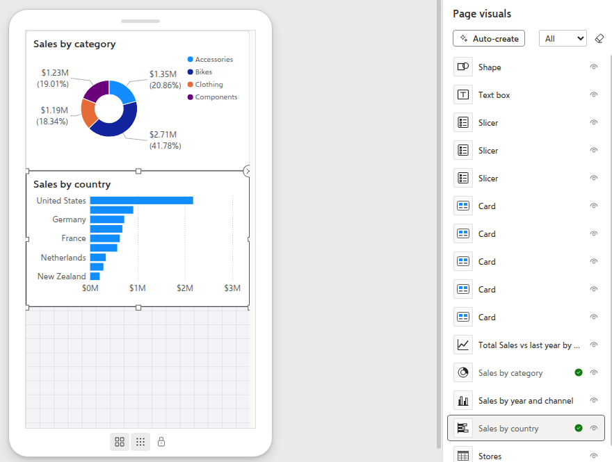
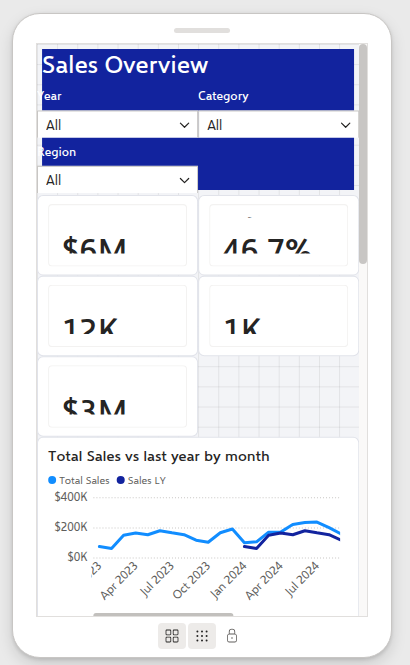

# Mobile layout

> **Applies to:** Creators

The mobile layout is a second, portrait arrangement of a report page for phones. You place the page's visuals on a
phone canvas and can format them differently for the phone. This article shows how to build a mobile layout in Lumen.

## Prerequisites

- A report open in Lumen, in edit mode. The steps use the **Overview** page of the built-in sample.

## Open the mobile layout

Select **View > Mobile layout** (in the **Mobile** group), or the phone icon (**Mobile layout**) of the layout switch
at the bottom right of the canvas. Lumen shows:

- the **phone canvas**, empty for a page without a mobile layout, with three controls below it: **Gridlines**,
  **Snap to grid** and **Lock visuals**;
- the **Page visuals** pane, with every visual of the page, an **Auto-create** button, an **All** / **Visible** /
  **Hidden** filter and an eraser (**Remove all visuals from canvas**).

Select the monitor icon (**Web layout**) to return to the normal layout.

## Place and arrange visuals

1. In **Page visuals**, double-click a visual, or drag it onto the phone canvas. A green check marks the visuals that
   are on the phone layout.
2. Drag a visual on the phone canvas to move it, or drag its handles to resize it. Positions snap to a 5 px grid
   (with **Snap to grid** on); hold **Shift** while resizing to keep the aspect ratio.
3. With a visual selected, the arrow keys move it by 1 px, **Shift**+arrow by 20 px. **Delete** removes it from the
   phone layout (not from the page).
4. Right-click a visual on the phone canvas for **Bring to front**, **Send to back** and **Remove from mobile layout**.

Slicers, buttons and other visuals stay interactive on the phone canvas, so you can check the layout as a reader
would use it. Report-page tooltips are not shown there, as in Power BI.

**Auto-create** fills the phone canvas from the desktop page in reading order and replaces the current mobile layout.

> [!NOTE]
> Auto-create uses a simplified flow (top-to-bottom, left-to-right) and default heights. On the sample it makes the
> KPI cards too short (their values are clipped) and lets the header slicers overlap the banner. Resize those visuals
> after auto-creating.

## Format visuals for the phone only

1. Select a visual on the phone canvas.
2. In the **Visualizations** pane, select **Format visual**. A note reads *Mobile formatting: changes apply to the
   phone layout only.*
3. Change any property, for example **General > Title > Text**.

The desktop layout keeps its own formatting. When a visual has phone-only changes, **Reset to desktop formatting**
appears next to the note; select it to drop them.

## How the mobile layout is saved

Lumen writes the phone positions and the phone-only formatting into each visual's `mobile.json` file in the report,
which is where Power BI Desktop keeps them. A visual that is not on the phone layout has no phone position. Opening a
Lumen-made mobile layout in Power BI Desktop has not been verified.

## Considerations and limitations

- The **Page visuals** list names visuals by their title; visuals without a title appear by type (*Card*, *Slicer*,
  *Shape*, *Text box*), so several cards look alike. Place such visuals one by
  one and check the phone canvas.
- Size and position on the phone are edited on the phone canvas; the **Properties** card of the **General** tab is
  not shown in the mobile layout.
- Undo (**Ctrl+Z**) covers every mobile layout edit.

## Differences from Power BI Desktop

- Auto-create is simpler than Power BI's (see the note above).

## Related content

- [Pages](pages.md)
- [Format a visual](format-a-visual.md)
- [Add and arrange visuals](add-and-arrange-visuals.md)
- [Mobile layout on Microsoft Learn](https://learn.microsoft.com/power-bi/create-reports/power-bi-create-mobile-optimized-report-about)
