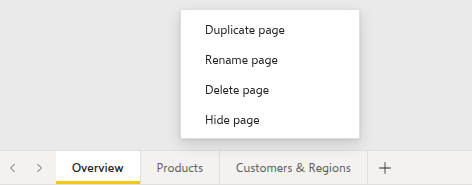

# Work with report pages

> **Applies to:** Creators

A report is a set of pages. This article shows how to add, rename, hide, reorder and delete pages, how to set a page's
size and background, and how to make a page a tooltip or drill-through page.

## Prerequisites

- A report open in Lumen in edit mode. The steps use the built-in sample: select **File > New > Sample report**, or
  **Try a sample** on the start screen.

## Add a page

1. Select **+** (**New page**) at the end of the page tabs, or select **Insert > New page**.
2. Lumen adds an empty page named *Page N* right after the current page and opens it.

The new page takes the size and page view of the page you were on.

## Duplicate a page

1. Right-click the page tab and select **Duplicate page**, or open the page and select **Insert > New page >
   Duplicate page**.
2. Lumen adds a copy named *Duplicate of* followed by the page name right after the original and opens it. A second
   copy of the same page is numbered: *Duplicate of Overview (1)*.

The copy has the same visuals, groups, page settings, page filters, visual interactions and mobile layout as the
original. Its visuals are independent copies: editing them doesn't change the original page. Press **Ctrl+Z** to remove
the copy.

## Move between pages

- Select a page tab.
- Press **Ctrl+PageDown** for the next page and **Ctrl+PageUp** for the previous one.
- When there are more tabs than fit, use the arrow buttons at the left of the tabs to scroll.

## Rename a page

1. Double-click the page tab. The name becomes editable.
2. Type the new name and press **Enter**. **Esc** cancels.

You can also right-click the tab and select **Rename page**, or edit **Name** under **Page information** in the Format
pane (see [Page settings](#page-settings)).

## Hide a page

1. Right-click the page tab and select **Hide page**.
2. The tab shows a crossed-out eye. The page stays in edit mode but is not listed in reading view (**View > Reading
   view**). Use a button or a page navigator to send readers to it; see
   [Buttons and page navigation](buttons-and-page-navigation.md).

To show the page again, right-click the tab and select **Show page**.

## Reorder pages

Drag a page tab to its new place. A marker shows where it lands. Reordering is available in edit mode only.

## Delete a page

1. Right-click the page tab and select **Delete page**.
2. The page is removed without a confirmation. Press **Ctrl+Z** to bring it back.

**Delete page** is disabled when the report has only one page.

## Page settings

Page settings are in the Format pane when no visual is selected.

1. Select an empty area of the canvas (or press **Esc**) so that no visual is selected.
2. In the **Visualizations** pane, select **Format visual** (the paintbrush). The pane shows the page's cards.

| Card | Settings |
|---|---|
| **Page information** | **Name**; **Allow use as tooltip** (see [Tooltip pages](#tooltip-pages)). |
| **Canvas settings** | **Type**: 16:9 (1280 × 720), 4:3 (960 × 720), Letter (816 × 1056), Tooltip (320 × 240) or Custom; **Height (px)** and **Width (px)** (100 to 10,000); **Vertical alignment** (Top, Middle); **Page view** (Fit to page, Fit to width, Actual size), which is saved with the page. |
| **Canvas background** | **Color**, **Image** (choose a picture file), **Image fit** (Normal, Fit, Fill), **Transparency** (100% by default, so the page shows white). |
| **Wallpaper** | The area around the page: **Color**, **Image**, **Image fit**, **Transparency**. |
| **Filter pane** | Colors, fonts, text sizes, border and width of the Filters pane as readers see it. |
| **Filter cards** | The same for filter cards. **Apply settings to** chooses whether you edit **Available** cards or **Applied** cards (cards that filter something). |

**View > Page view** (Fit to page, Fit to width, Actual size) changes how *you* see the page right now; the **Page
view** setting in **Canvas settings** is what is saved with the page.

## Tooltip pages

A tooltip page is a small page that shows when a reader hovers over a data point in another visual.

1. Add a page and open the page settings as described above.
2. Turn on **Allow use as tooltip**. A 16:9 page is resized to 320 × 240.
3. Add visuals to the page.

The page tab's tooltip then reads *(tooltip page)*. How a visual uses it is described in [Tooltips](tooltips.md).

## Drill-through pages

A drill-through page receives the context of a data point that a reader right-clicks in another visual.

1. Open the page and make sure no visual is selected.
2. In the **Visualizations** pane, select **Build visual**. Under **Drill through**, drag a field to **Add
   drill-through fields here**. **Cross-report** and **Keep all filters** are switches in the same section.

The steps for readers are in [Drill down and drill through](drill-down-and-drillthrough.md).

## Considerations and limitations

- A new page is inserted after the current page, not at the end of the tabs.
- Deleting a page does not ask for confirmation; use **Ctrl+Z** to undo.
- Images chosen for **Canvas background** or **Wallpaper** are stored in the report as registered resources, as Power
  BI Desktop stores them.

## Related content

- [Report view overview](report-view-overview.md)
- [Add and arrange visuals](add-and-arrange-visuals.md)
- [Tooltips](tooltips.md)
- [Drill down and drill through](drill-down-and-drillthrough.md)
- [Buttons and page navigation](buttons-and-page-navigation.md)
- [Format properties reference](../reference/format-properties.md)
