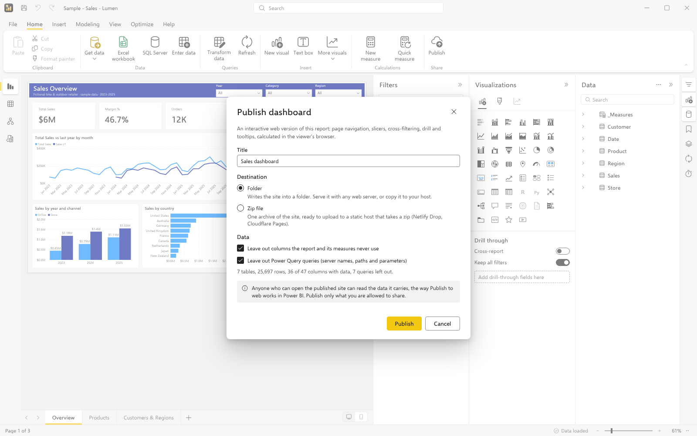
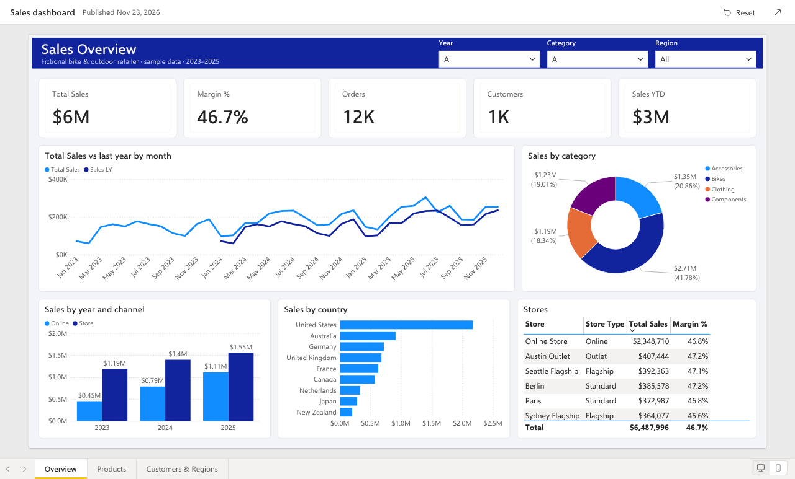

# Publish a dashboard

> **Applies to:** Creators

Lumen publishes a report as an interactive web dashboard: page navigation, slicers, filters, cross-filtering and
cross-highlighting, drill, tooltips and bookmarks work as in the reading view, with the DAX engine running in the
viewer's browser. The result is a static site, so any web server or static host can serve it.

## Publish

1. Select **File > Publish**, or **Home > Publish**.
2. Enter the **Title**. It names the browser tab and the dashboard header.
3. Choose the **Destination**:
   - **Folder** writes the site into a folder you choose next.
   - **Zip file** writes the same site as one archive, for hosts that take a zip upload.
   - A saved hosted destination uploads the site for you (see below).
4. Choose what data goes with it (see below), then select **Publish**.

A folder that already holds a published dashboard is updated in place. A folder that holds other files asks first.

## Publish to a hosted destination

Select **Add destination** in the Publish dialog, choose the type, give it a name and enter its settings. Lumen keeps
tokens and keys encrypted with the system keyring (the same store as data source credentials) and never shows them
again; **Edit** leaves a saved token in place unless you type a new one. **Check connection** signs in and checks the
settings without publishing.

| Type | Where each dashboard goes | Settings | Token |
|---|---|---|---|
| GitHub Pages | A folder in a branch of a repository (default `gh-pages`), served at `https://<owner>.github.io/<repo>/<folder>/`. Pages is turned on for the branch when it is off. | Owner, repository, branch, folder | Fine-grained token with Contents and Pages read and write on the repository, or a classic token with `repo` scope |
| Netlify | Its own site, `https://<site name>.netlify.app`, created on first publish | none | Personal access token |
| Cloudflare Pages | Its own Pages project, `https://<project name>.pages.dev`, created on first publish | Account ID | API token with Account ▸ Cloudflare Pages ▸ Edit |
| S3-compatible storage | A key prefix in a bucket served as a website (AWS S3 static hosting, Cloudflare R2, MinIO) | Bucket, endpoint, region, prefix, public URL | Access key ID and secret access key, or the AWS default credentials |

With a hosted destination selected, the dialog asks for the dashboard's **Folder**, **Site name** or **Project name**
there. It starts from the title and is remembered per report, so the next publish of the same report updates the
same address. When the upload finishes, the notification has an **Open** button with the dashboard's address.

Republishing replaces the dashboard. On GitHub Pages and S3, only that dashboard's own files change: other dashboards
in the same branch or bucket are left alone, and files of the previous version that are no longer used are deleted.

## What the site contains

| File | Content |
|---|---|
| `index.html`, `assets/` | The dashboard viewer: Lumen's report canvas and engines, built for the browser. |
| `report.wbi` | The report and its model with the data, in the [`.wbi` bundle](../files-and-compatibility/the-wbi-bundle.md) format. |
| `lumen-publish.json` | Title, publish time and the visible pages. |

Open the dashboard through a web server (`http://` or `https://`). Browsers don't run the viewer from a folder
opened as a file. To try a published folder locally, run a static server in it, for example
`python3 -m http.server`, and open `http://localhost:8000`.

## Data and privacy

Everything in `report.wbi` can be read by anyone who can open the site, the same as Power BI's Publish to web.
Publish only data you are allowed to share, and put private dashboards behind a server that asks for a sign-in.

- **Leave out columns the report and its measures never use** (on by default) publishes those columns with blank
  values. A column stays when the report names it anywhere (fields, filters, sorting, bookmarks), when any DAX
  expression names it, when it joins a relationship or sorts another kept column, or when a DAX expression uses its
  whole table (`ALL(Sales)`, `COUNTROWS(Sales)`). The model keeps every column, so numbers don't change.
- **Leave out Power Query queries** (on by default) replaces every M query and parameter with a placeholder, so
  server names, file paths and parameter values are not published. The published dashboard never refreshes.

The dialog lists what it will publish and warns when:

- the model has row-level security roles: they don't apply to a published dashboard, every viewer sees all rows;
- a table holds generated sample data;
- a table has no data, so its visuals will be blank;
- a table uses DirectQuery or Direct Lake: the dashboard shows the data Lumen last loaded.

## In the browser

- **Reset** returns to the published state: the saved slicer and filter selections, and the first page.
- **Full screen** hides the browser's own chrome.
- **Export data** on a visual downloads its data as a CSV file.

## Limits

- A report with a live connection to a semantic model has no data to publish.
- GitHub Pages sites are public unless the repository belongs to a GitHub Enterprise organization with private Pages.
- S3 website hosting, custom domains and access rules are set up on the bucket or the host, not in Lumen.
- The viewer is the same build as the Lumen that published it. Republish to pick up fixes from a newer Lumen.

## Related content

- [Export a report](export-a-report.md)
- [The `.wbi` bundle](../files-and-compatibility/the-wbi-bundle.md)
