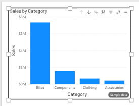

# Sample data on empty visuals

> **Applies to:** Creators

Lumen can draw realistic sample data on visuals that have no fields yet, so a page looks finished while you design
it. Use it to mock up a report before the data exists, or to try a layout without loading anything. The gallery
templates and every new blank report have it turned on.

The sample is never real: no table holds it, the field wells stay empty, and Power BI Desktop sees an empty visual.
Saving, exporting to PBIP and opening the report elsewhere never turn it into data.

## How a visual picks its sample

| The visual | Draws |
|---|---|
| Comes from a gallery template | The data the template was designed with: its categories, colors and figures |
| Is new, with a title | A sample chosen from the words in the title: "Profit by region" draws Profit by Region, "Orders over time" draws Orders by month, "Sales pipeline" draws a funnel of stages |
| Is new, without a title | What a report author most often puts in that visual: sales by month for a line chart, by category for a column chart, by region for a donut, a product table, a country map |

Text boxes, shapes, images, buttons, custom visuals and the AI visuals draw no sample.

While you edit, hovering a visual that draws a sample shows a **Sample data** marker in its bottom-right corner.
Filters, slicers and cross-highlighting don't reach a sample, and clicking a sample selects nothing.

## Slot in real data

Drop a field into a visual (or tick it in the Data pane while the visual is selected). The sample disappears as soon as
the visual has a field. Remove every field and the sample comes back.

## Turn sample data on or off

| To | Do this |
|---|---|
| Hide every sample in the report | **View > Sample data** (select it again to bring them back) |
| Clear the sample of one visual | Right-click the visual, then **Clear sample data** |
| Bring one visual's sample back | Right-click the visual, then **Show sample data** |

All three can be undone. The setting is saved with the report (`Lumen_SampleData` annotations, see
[Working with PBIP projects](../files-and-compatibility/working-with-pbip-projects.md#files-and-properties-lumen-adds)).
A report opened from Power BI has sample data off until you turn it on.

## Measure tables

A new report, like a template, starts with two measure tables in the Data pane: `_measures_kpi` for metric measures
and `_measures_format` for formatting measures (dynamic titles, colors, labels). Each holds a placeholder measure
(`kpi_blank`, `fmt_blank`) that you can delete once you have your own. **New measure** adds to `_measures_kpi` unless
another table is selected.

## Related

- [Start from a report template](start-from-a-template.md)
- [Reports without data and sample data](../files-and-compatibility/reports-without-data-and-sample-data.md): generated
  rows for the tables of a model whose data isn't loaded, a different feature
