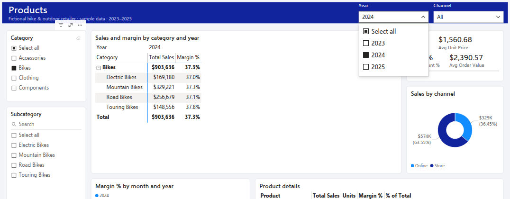
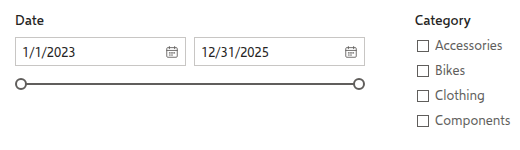
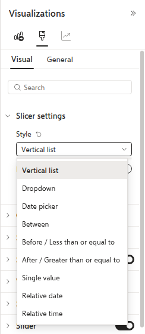
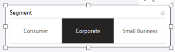

# Slicers

> **Applies to:** Creators · Analysts

A slicer is a visual on the page that filters the other visuals on that page. This article shows how to add a slicer,
choose its style, select and clear values, and format it. Read it when you build the filtering controls of a report
page.

## Prerequisites

- A report open in Lumen. The steps use the built-in sample (**File > New > Sample report**, or start Lumen with the
  sample).
- Edit mode (the default). In reading view (**View > Reading view**) you can use slicers but not add or format them.

## Slicer types in Lumen

The Visualizations pane offers several slicer visuals. They all filter the page the same way; they differ in how they
look and what they write to the report file.

| Gallery entry | Power BI type | What it is for |
|---|---|---|
| **Slicer** | `slicer` | The classic slicer. Its **Style** (Format pane) makes it a vertical list, a dropdown, a tile row, a range (between, before, after, single value), a relative date or relative time slicer, or a date picker. |
| **List slicer** | `listSlicer` | The newer list slicer, with a list or dropdown layout. |
| **Button slicer** | `advancedSlicerVisual` | Values shown as buttons in a grid, with optional callout values, images and an accent bar. |
| **Text slicer** | `textSlicer` | A search box that filters a text column by what you type. |

The [slicer visuals reference](../visuals/slicers.md) lists the field wells and format cards of each type. This
article uses the classic **Slicer**, which is the one most reports use.

## Add a slicer

1. Open the page that should be filtered.
2. In the **Visualizations** pane, select the **Build visual** tab.
3. Select the **Slicer** icon in the gallery. An empty slicer is added to the page and selected. It shows
   *Add data fields to the slicer*.
4. In the **Data** pane, select the check box of the column to filter on, for example **Product > Category**. You can
   also drag the column into the slicer's **Field** well.

The slicer lists the column's values. Lumen picks the starting style from the column's data type, the way Power BI
Desktop does:

| Column type | Starting style |
|---|---|
| Text, Boolean | Vertical list |
| Date / date-time | **Between**: two date boxes and a slider |
| What-if parameter column (numeric, style not set) | **Single value** slider |

Put a second column into the **Field** well to build a hierarchy slicer (for example **Category** then
**Subcategory**). Each parent value gets an expand / collapse icon.

## Select and clear values

| To | Do this |
|---|---|
| Select one value (list or tile) | Select it. With **Multi-select with CTRL** on (the default), a plain click replaces the selection. |
| Add or remove a value | Hold Ctrl and select it. |
| Select everything | Select **Select all** (shown when **Show "Select all" option** is on). |
| Pick a value in a dropdown | Select the box to open the list, then select the value. Press Esc to close the list. |
| Set a range | Type dates or numbers in the two boxes and press Enter, or drag the slider handles. |
| Clear the slicer | Hover over the slicer and select the eraser icon (**Clear selections**) in its header, or right-click the slicer and select **Clear selections**. |

The other visuals on the page update as soon as the selection changes. The selection is saved into the slicer's
visual definition, so it is kept when you save the report and is restored by [bookmarks](bookmarks.md).

> [!TIP]
> List and dropdown slicers can be used from the keyboard: Enter, Space or Down arrow opens a
> closed dropdown; Up and Down arrow, Home, End, Page Up and Page Down move; Space or Enter
> selects; Right and Left arrow expand and collapse hierarchy levels; Esc closes.

Two date or numeric range slicers on the same column keep their own available range: narrowing one does not shrink the
range the other offers, as in Power BI Desktop.

## Change the slicer style

1. Select the slicer.
2. In the **Visualizations** pane, select the **Format visual** tab, then **Visual**.
3. Expand **Slicer settings**.
4. Open **Style** and choose one of: **Vertical list**, **Dropdown**, **Date picker**, **Between**,
   **Before / Less than or equal to**, **After / Greater than or equal to**, **Single value**, **Relative date**,
   **Relative time**.

The range styles (**Between**, **Before**, **After**, **Single value**) apply to numeric and date columns; the relative
styles and **Date picker** apply to date columns. When a style does not fit the column (for example **Between** on a
text column) the slicer stays a list.

To show the values as a row of tiles, as Power BI's **Tile** style does, keep the **Vertical list** style and set
**Options > Orientation** to **Horizontal**. The Customers & Regions page of the sample uses this for **Segment**:

**Inverted selection** (in **Slicer settings**) is the "everything except" state Power BI saves when you select
**Select all** and then clear some values: the slicer keeps every value except the cleared ones, including values that
appear later. Turn it off to return to a plain selection.

## Format the slicer

The classic slicer's **Visual** tab has these cards (the [format properties reference](../reference/format-properties.md)
lists every property):

| Card | What it controls |
|---|---|
| **Slicer settings** | **Style**, **Inverted selection** |
| **Options** | **Orientation** (vertical or horizontal), **Search**, **Responsive** |
| **Selection** | **Single select**, **Multi-select with CTRL**, **Show "Select all" option**, **Single date (date picker)** |
| **Slicer header** | Show or hide the header, its text, font, colors and border |
| **Values** | Font, colors, padding, border of the items; hierarchy indentation and expand / collapse icon |
| **Selection icon** | Color of the check boxes |
| **Slider** | Range slider colors and handle size |
| **Dropdown** | Border, rounded corners, icon color and accent bar of the dropdown box |
| **Search box** | Search box background and border |
| **Date range** | **Include today** and **Anchor date** for relative styles |
| **Numeric inputs**, **Date inputs** | Font and background of the range boxes |
| **Button (date picker)**, **Text — date range (date picker)**, **Text — relative summary (date picker)** | Parts of the **Date picker** style |
| **Lumen options** | Lumen-only extras (see below) |

Container formatting (title, background, border, shadow) is on the **General** tab, as for every visual: see
[Visual titles, borders and backgrounds](visual-titles-borders-and-backgrounds.md).

To add a search box to a list or dropdown slicer, turn on **Options > Search**, or right-click the slicer and select
**Search**.

### Lumen options

The **Lumen options** card adds behavior Power BI Desktop does not have. These properties are saved in a
`lumenSlicer` object in the visual's definition; Power BI Desktop is designed to ignore objects it does not know, but
this has not been verified, and Power BI will not apply them.

- **Dropdown summary**: what a closed dropdown shows when several values are selected: **Power BI ("Multiple
  selections")**, **Values ("A, B +3")**, **Count ("3 of 12 selected")** or **Removable chips**.
- **Clear button in dropdown**, **Dropdown width**, **Dropdown max height**.
- **Sort items**: **Model order**, **A to Z**, **Z to A**, by count or by a measure (**Sort by measure** takes a
  `Table[Measure]` reference); **Show selected first**.
- **Show value counts**: the number of rows of the field's table behind each value, under the slicer's filters.
- **Date presets (date fields)**: quick picks for date ranges.
- **Force selection**: always keep one value selected.

## Considerations and limitations

- The classic slicer's **Visual** tab shows every card the slicer type supports, whatever the chosen style. For
  example, a vertical list slicer still shows **Slider**, **Date inputs** and the date picker cards; they have no
  effect until you switch to a style that uses them. Power BI Desktop shows only the cards of the current style.
- A slicer filtered to a value that the generated sample data replaced shows a *Sample stand-in* notice; see
  [Reports without data and sample data](../files-and-compatibility/reports-without-data-and-sample-data.md).
- [Sync slicers](sync-slicers.md) can share a slicer's selection with other pages.
- How slicers filter other visuals can be changed only in the report file (`visualInteractions` in the page
  definition); see [Visual interactions](visual-interactions.md).

## Differences from Power BI Desktop

- There is no separate **Tile** entry in **Style**. Use **Options > Orientation > Horizontal** (which is what Power BI
  saves for tiles in older reports).
- The **Lumen options** card is a Lumen addition.
- Slicer items are computed the way Power BI's slicer query does: values of the column, without a measure, so two
  slicers on two dimension tables do not filter each other's lists. Add a visual-level filter on a measure to the
  slicer to keep only items with data.

## Related content

- [Sync slicers](sync-slicers.md)
- [Filters pane](filters-pane.md)
- [Slicer visuals reference](../visuals/slicers.md)
- [Format a visual](format-a-visual.md)
- [Bookmarks](bookmarks.md)
- [Power BI slicers on Microsoft Learn](https://learn.microsoft.com/power-bi/visuals/power-bi-visualization-slicers)
