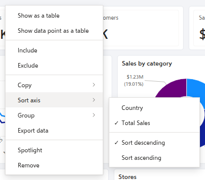
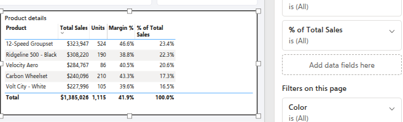

# Sort and Top N

> **Applies to:** Creators · Analysts

This article shows how to sort a visual by one of its fields and how to keep only the top or bottom items with a
Top N filter. Both are saved with the visual.

## Sort a visual

Charts sort their axis; tables and matrices sort their rows.

1. Right-click the visual (a data point or an empty area), or select **More options** (**...**) in its header.
2. Point to **Sort axis** (charts) or **Sort by** (tables and matrices). The sub-menu lists the visual's fields, with
   a check mark on the current sort field, then **Sort descending** and **Sort ascending**.
3. Select a field to sort by it (descending first), or select a direction to reverse the current sort.

In a table, you can also select a column header to sort by that column; select it again to reverse the order. The
current sort column shows a small arrow under its header.

The sort is stored in the visual's query (`sortDefinition`), as Power BI stores it. Fields in the **Tooltips** well
are not offered in the sort menu.

### Sort a slicer

A slicer sorts by its field, ascending unless told otherwise. Right-click it and use **Sort axis > Sort descending**
or **Sort ascending**. The classic slicer's **Lumen options** card adds sorts by row count or by a measure; see
[Slicers](slicers.md).

## Keep the top or bottom items (Top N)

A Top N filter keeps the *N* items with the highest (or lowest) value of a measure. The steps keep the five best-selling
products in the **Product details** table on the **Products** page of the sample.

1. Open the **Products** page and select the **Product details** table.
2. In the **Filters** pane, under **Filters on this visual**, expand the **Product** card.
3. Open **Filter type** and select **Top N**.
4. Under **Show items**, keep **Top** and type `5`.
5. Drag **Total Sales** from the **Data** pane (**_Measures > Sales**) into **By value**.
6. Select **Apply filter**.

The table now lists five products. The card summary reads *Top 5 by Total Sales* (shortened in the pane).

> [!NOTE]
> The **% of Total Sales** column now adds up to 100% over the five products: the visual-level filter also applies to
> the measure's "all selected" total, as in Power BI Desktop.

To remove the filter, select the eraser (**Clear filter**) on the card.

Top N works at visual, page and report level, on text, numeric and date columns. **By value** accepts a measure or a
column (a column is aggregated).

## Considerations and limitations

- Top N filters are evaluated by Lumen's DAX engine from the filter Power BI stores (a TopN subquery). How ties at the
  cut-off are handled has not been checked against Power BI Desktop.
- Sorting a chart by a field that is not on the visual (Power BI's "sort by a field in Tooltips") is not offered.

## Differences from Power BI Desktop

- Sorting by a field that is only in the **Tooltips** well is not offered (see above).

## Related content

- [Filters pane](filters-pane.md)
- [Slicers](slicers.md)
- [Tables and matrices](../visuals/tables-and-matrices.md)
- [Keyboard shortcuts and context menus](keyboard-and-context-menus.md)
- [Sort a visual on Microsoft Learn](https://learn.microsoft.com/power-bi/consumer/end-user-change-sort)
