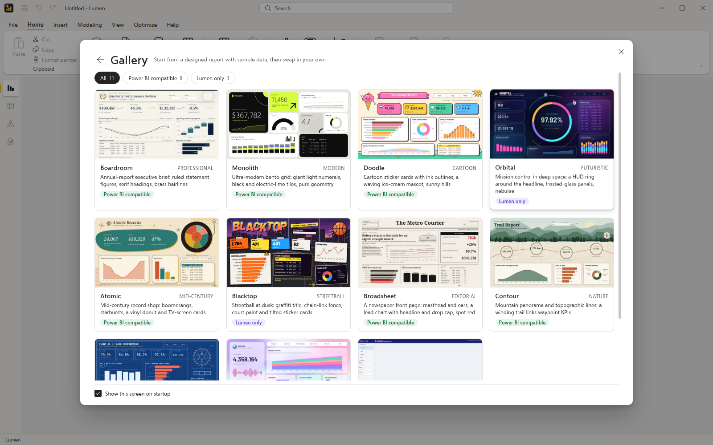

# Start from a report template

> **Applies to:** Creators · Analysts

The gallery holds designed reports that open with sample data, so you can see a finished page and then swap in your
own data. Each template is a complete PBIP project: a semantic model whose tables are Power Query queries with the
sample rows written out, a theme, vector artwork and one or more pages of visuals.

## Open the gallery

- On the start screen, select **Gallery**.
- Or select **File > New**; the gallery is under **Gallery**.

Select a card to create a new, unsaved report from it. Lumen runs the template's queries first, so the visuals show the
sample data right away. **Save** asks where to put the report, as for any new report.

The chips above the cards filter the list: **All**, **Power BI compatible** and **Lumen only**.

## The templates

| Template | Style | Data | Power BI |
|---|---|---|---|
| Boardroom | Professional: ivory paper, navy and brass, serif headings, a ruled statement row | Quarterly finance, two pages | Compatible |
| Monolith | Modern: bento grid, giant light numerals, black and electric-lime tiles | Product usage and revenue | Compatible |
| Doodle | Cartoon: sticker cards with ink outlines and hard shadows, a waving mascot | Ice-cream shop sales | Compatible |
| Orbital | Futuristic: deep space, a HUD ring around the headline, frosted-glass panels | Satellite mission telemetry | Lumen only |
| Atomic | Mid-century: boomerangs, starbursts, a vinyl record that is the donut chart | Record shop sales | Compatible |
| Blacktop | Streetball: graffiti title, chain-link fence, court paint, tilted sticker cards | Summer league stats | Lumen only |
| Broadsheet | Editorial: a newspaper front page with masthead, lead chart and sidebar | Transit ridership | Compatible |
| Contour | Nature: mountain panorama, topographic lines, a trail through waypoint KPIs | Parks and wildlife | Compatible |
| Blueprint | Technical: an engineering drawing sheet with a title block and a CAD gear | Plant OEE | Compatible |
| Aurora | Glass: soft pastel light, aurora ribbons, frosted panels | Music streaming | Lumen only |
| 1st Edition | Starter: navigation, filter panel, calendar and last-refreshed date | Calendar only | Compatible |

**Power BI compatible** templates use only what Power BI Desktop draws the same way: its visuals, container
formatting (rounded corners, borders, drop shadows), theme fonts from the Power BI font list and SVG pictures. Save one
as a PBIP project and it opens in Power BI Desktop as it looks in Lumen.

**Lumen only** templates also use effects that Power BI has no setting for:

- **Container effects**: frosted glass (a blur of what is behind the visual), gradient fills, an outer glow and
  rotation. They are stored in the visual's `Lumen_Style` annotation; see
  [Working with PBIP projects](../files-and-compatibility/working-with-pbip-projects.md#files-and-properties-lumen-adds).
- **Fonts bundled with Lumen**: Barlow, Roboto Condensed and Open Sans, which Power BI's font list does not offer.

Power BI Desktop still opens these reports: it ignores the annotation, draws each container with its ordinary
background, border and shadow, straight and without blur, and substitutes its default font for the bundled ones.

## Replace the sample data

Each table's query starts with a `#table(...)` step holding the sample rows. To use your own data:

1. Select **Transform data** and open the table's query.
2. Replace the `Source` step with your own source (for example **Get data > Excel** and the matching sheet), keeping
   the column names, or rename the fields in the visuals afterwards.
3. Select **Close & Apply**.

The measures live in a separate measure table (its name starts with an underscore), so they keep working when the
fact table's source changes. Text boxes such as headlines and footers are placeholders: double-click one to edit it.

## For developers

The templates are generated: `node scripts/templates/build.mjs` writes `src/core/templates/<id>/` from the designs in
`scripts/templates/designs/`, and `scripts/templates/previews.sh` renders the gallery thumbnails with Lumen itself.
Lettering drawn as vector art (Blacktop's title) is outlined from Barlow by `scripts/templates/outline.py`.
