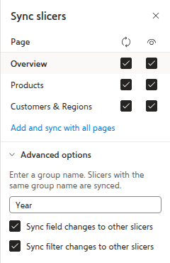

# Sync slicers

> **Applies to:** Creators

Synced slicers share one selection across several pages: pick a year on one page and the slicers in the same sync
group on the other pages follow. This article describes the **Sync slicers** pane: syncing a slicer to other pages,
editing a group, and grouping slicers that are already on several pages.

## How syncing works

Power BI stores a sync group on each slicer (`syncGroup` in the visual definition: a group name plus two switches).
Slicers with the same group name are synced:

- **Sync filter changes to other slicers**: a selection made in one slicer is applied to every other slicer of the
  group, on every page, and saved into each of them.
- **Sync field changes to other slicers**: when you change the field of one slicer in its **Field** well, the other
  slicers of the group get the same field, and their old selection is cleared.

A page can take part in the group without showing the slicer: Power BI then keeps a hidden copy of the slicer on that
page (the **Visible** check box is cleared). The hidden copy still filters its page.

## Open the pane

1. Select **View > Sync slicers** (in the **Show panes** group), or the **Sync slicers** icon on the pane switcher at
   the right edge of the window.
2. Select a slicer on the canvas. The pane shows one row per page (tooltip pages are left out), with a **Sync**
   column and a **Visible** column. The current page is highlighted.

With no slicer selected the pane shows *Select a slicer to see sync options.*

## Sync a slicer to other pages

1. Select the slicer and open the **Sync slicers** pane.
2. For each page that should follow the slicer, select a check box in its row:
   - **Visible**: Lumen copies the slicer to that page, at the same position (moved inside the page when the page is
     smaller), and syncs it. **Sync** is selected with it.
   - **Sync** only: Lumen adds a hidden copy. The page is filtered by the slicer's selection but doesn't show it.
3. To do this for every page at once, select **Add and sync with all pages**. Every page except tooltip pages gets a
   visible copy.

The first time, Lumen creates the group, named after the slicer's field (for example **Category**); the name is in
**Advanced options**. A selection made in any synced copy now applies to all of them. For example, make the sample's
**Category** slicer on **Products** visible on **Overview**, select **Bikes** in the copy on **Overview**, and both pages
show bikes only; the **Products** slicer shows **Bikes** selected.

To undo a step, press **Ctrl+Z**. Clearing **Visible** hides the copy on that page but keeps it synced. Clearing **Sync**
removes a hidden copy; a visible slicer stays on its page and leaves the group.

## Rename a group or change what it syncs

1. Select a slicer that belongs to a group.
2. In **Advanced options**, type a new name in the box under *Enter a group name. Slicers with the same group name are
   synced.* and press **Enter**. Every slicer of the group is renamed.
3. Select or clear **Sync field changes to other slicers** and **Sync filter changes to other slicers**. The change
   applies to every slicer in the group.

## Group slicers that are already on other pages

When each page already has its own slicer on the same column, give them the same group name instead of adding
copies:

1. On each page that should be synced, add a slicer on the same column (or copy the slicer with **Ctrl+C** and paste
   it on the other page with **Ctrl+V**).
2. Select the slicer on the first page. In the **Sync slicers** pane, select the **Sync** check box of *that* page.
   This creates the group, named after the slicer's field (for example **Year**).
3. Select the slicer on the next page and select **Sync** for that page. Lumen names the new group after the field
   with a number (for example **Year2**), because **Year** is taken. In **Advanced options**, replace the name with
   the first group's name (**Year**) and press **Enter**.
4. Repeat for the other pages.

A selection made in any of these slicers is now applied to the others. With the sample's **Year** slicers on
**Overview** and **Products** in one group, selecting **2024** on **Overview** leaves only 2024 in the Products
matrix.

## Considerations and limitations

- When a page already has a slicer on the same column that is not in the group, Lumen does not reuse it: selecting
  **Sync** or **Visible** for that page adds a copy next to it. To use the existing slicer instead, give it the group's
  name (see [Group slicers that are already on other pages](#group-slicers-that-are-already-on-other-pages)).
- Range slicers (date or numeric) in the same group share their selected range.

## Differences from Power BI Desktop

- The PBIR shape Lumen writes for groups and hidden copies is designed to match what Power BI Desktop writes; opening
  the result in Power BI Desktop has not been verified.

## Related content

- [Slicers](slicers.md)
- [Filters pane](filters-pane.md)
- [Pages](pages.md)
- [Sync slicers on Microsoft Learn](https://learn.microsoft.com/power-bi/visuals/power-bi-visualization-slicers#sync-and-use-slicers-on-other-pages)
