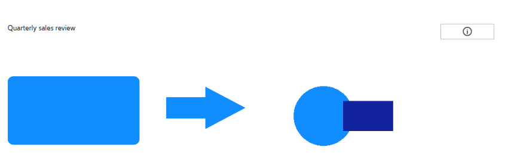
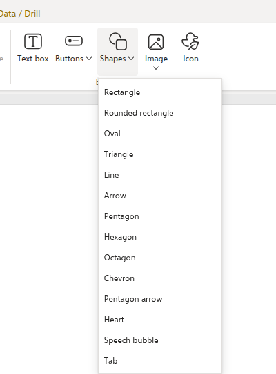
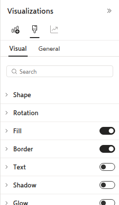

# Text boxes, shapes and images

> **Applies to:** Creators

Text boxes, shapes and images are report elements without data: titles, notes, banners, separators and logos. This
article shows how to insert and format each of them in Lumen, and the current limits of text editing.

## Prerequisites

- A report open in Lumen, in edit mode.
- The **Insert** ribbon tab. Its **Elements** group has **Text box**, **Buttons**, **Shapes**, **Image** and **Icon**.

## Text boxes

### Insert and edit a text box

1. Select **Insert > Text box** (also on the **Home** tab). An empty 280 × 64 px text box without a background is
   added to the page.
2. Double-click the text box to edit it. A dashed outline shows that you are editing.
3. Type the text. Press **Enter** for a new paragraph.
4. Select outside the text box to finish editing.

> [!WARNING]
> After you edit a newly inserted text box, it can show **Can't display this visual** instead of your text. The text
> is saved; switch to another page and back (or select another page tab and return) and the text box shows it. Editing
> an existing text box, such as the title banners of the sample, does not show this error.

### Format text

Lumen edits text boxes as plain text: there is no font toolbar, and the **Format visual > Visual** tab shows *This
visual has no visual-specific formatting options.* What Lumen does keep and render:

- Fonts, sizes, colors, bold, italic, underline, alignment, lists and links of text boxes made in Power BI Desktop are
  rendered as long as you don't edit them.
- The theme's text classes for new text.
- Dynamic values (Q&A "+ Value" fields) bound to measures; they are underlined in the theme color while editing, as in
  Power BI.

> [!WARNING]
> Editing rewrites the text as plain paragraphs. Each paragraph keeps the style of its first run, its alignment and its
> list formatting; mixed formatting inside a paragraph, links and dynamic values in the edited text box become plain
> text in that style. Use **Ctrl+Z** to undo an edit that lost formatting.

Use the **General** tab for the box itself (background, border, padding, shadow), as for any visual.

Links in a text box open in your web browser: click them in reading view, or **Ctrl**+click them while editing.

## Shapes

1. Select **Insert > Shapes**, then a shape: **Rectangle**, **Rounded rectangle**, **Oval**, **Triangle**, **Line**,
   **Arrow**, **Pentagon**, **Hexagon**, **Octagon**, **Chevron**, **Pentagon arrow**, **Heart**, **Speech bubble** or
   **Tab**. The shape is added at 200 × 120 px.
2. Move and resize it on the canvas.

Format a shape on **Format visual > Visual**:

| Card | What it controls |
|---|---|
| **Shape** | The shape type (26 types, including the ones not in the **Insert** menu: right triangle, arrows in four directions, parallelogram, trapezoid, diamond, star, plus, cross and tab variants) and **Rounded corners** |
| **Rotation** | Rotation of the **Shape** and of its **Text** |
| **Fill** | Show, color, transparency |
| **Border** | Show, color, width, transparency, rounded corners |
| **Text** | Text shown inside the shape, with font, color, alignment and padding |
| **Shadow**, **Glow** | Effects around the shape |

A shape also has an **Action** card on its **General** tab; see
[Buttons and page navigation](buttons-and-page-navigation.md).

## Images

1. Select **Insert > Image** (or **Insert > Image > Image from file…**).
2. Choose a PNG, JPEG, GIF, SVG, BMP or WebP file. The picture is copied into the report (as a registered resource,
   like Power BI does) and added at 240 × 160 px.

Format it on **Format visual > Visual > Image**: **Source** and **Image fit** (**Normal**, **Fit**, **Fill**). The
**General** tab has an **Action** card, so an image can work as a button.

**Insert > Image > Icon…** and **Insert > Icon** add an icon from Lumen's built-in icon libraries as an image; see
[Icons](icons.md).

## Considerations and limitations

- New elements are placed at the top-left of the page and can cover other visuals.
- Rich text editing (fonts, sizes, colors per word, lists, links, "+ Value") is not available; only plain text can be
  typed.
- Images are stored inside the report. Large pictures make the report file larger, as in Power BI.

## Differences from Power BI Desktop

- No text box formatting toolbar and no **Value** (Q&A) button in text boxes.
- The text box error after a first edit (see the warning above).
- The **Insert > Shapes** menu lists 14 shapes; the other shape types are reached through **Format > Shape**.

## Related content

- [Buttons and page navigation](buttons-and-page-navigation.md)
- [Icons](icons.md)
- [Visual titles, borders and backgrounds](visual-titles-borders-and-backgrounds.md)
- [Add and arrange visuals](add-and-arrange-visuals.md)
- [Elements visuals reference](../visuals/elements.md)
