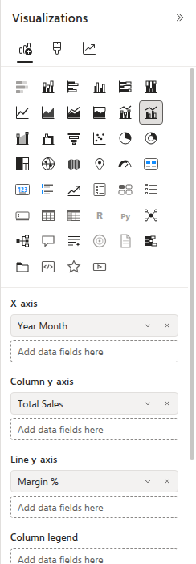
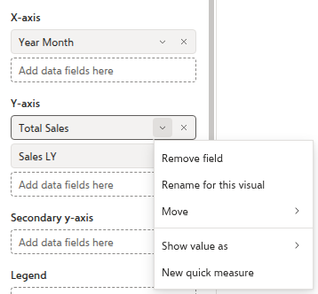

# The Data pane and field wells

> **Applies to:** Creators · Analysts

The Data pane lists the tables, columns, measures and hierarchies of the model; the field wells of the Visualizations
pane say which fields a visual uses and in which role. This article shows how to add, move, rename and summarize fields
in a visual.

## Prerequisites

- A report open in edit mode. The steps use the built-in sample: select **File > New > Sample report**, or **Try a
  sample** on the start screen.

## The Data pane

- **Tables** are listed by name. A table that holds only measures (such as the sample's *_Measures*) has its own icon.
- **Display folders** group measures and columns inside a table.
- Each field has an icon for its kind: measure (calculator), text, number, date, true/false, hierarchy, and so on.
- **Search** filters the tree by name and expands the matches.
- The **...** menu at the top offers **View hidden** (list hidden fields), **Unhide all**, **Use sample data** or
  **Regenerate sample data** (when tables have no data or hold generated rows), **Expand all** and **Collapse all**.

Right-click an item for its commands. They depend on the kind of item:

| Item | Commands |
|---|---|
| Table | New measure, New column, New quick measure, Refresh data, Edit query, Manage relationships, Rename, Delete from model, Hide, Mark as date table, Copy name |
| Column | New hierarchy, New measure, New column, Rename, Delete from model, Hide, **Add to filters** (Visual-level filters, Page-level filters, Report-level filters), Copy name |
| Measure | New measure, New quick measure, Rename, Delete from model, Hide, **Display folder…**, Copy name |

**Copy name** copies the DAX reference of the field, for example `'Sales'[Quantity]` or `[Total Sales]`. Modeling
commands are described in [Model data](../model-data/README.md).

## Add a field to a visual

1. Select the visual on the canvas.
2. Do one of these:
   - **Tick the field's check box** in the Data pane. Lumen puts it in the first well that accepts it and still has
     room: a measure or a numeric column goes to the first value well, other columns to the first category well. If no
     well fits, a message says *This visual doesn't have a field well for that field*.
   - **Drag the field** from the Data pane to a well in **Visualizations > Build visual**. While you drag, the wells
     that accept the field highlight the drop position.

To remove a field, clear its check box, select **x** next to it in the well, or choose **Remove field** from its menu.

With no visual selected, ticking a field creates a new visual for it: a table for a text or date column, a clustered
column chart for a measure or numeric column.

## Field wells

Each visual type has its own wells, named as in Power BI Desktop (for example **X-axis**, **Y-axis**, **Legend**,
**Small multiples** and **Tooltips** for a column chart; **Rows**, **Columns** and **Values** for a matrix). The wells of
every visual type are listed in [Visual support](../reference/visual-support.md).

- A well that takes one field only (such as **Legend**) replaces its field when you drop another one.
- **Category** wells (axis, legend, rows) accept columns and hierarchies, not measures.
- **Value** wells accept measures and columns. A column dropped in a value well is summarized (for example *Sum of
  Quantity*, or *Count of Customer* for a text column).
- Drag a field within a well to reorder it, or to another well to move it.

## The field menu

Select the arrow next to a field in a well to open its menu.

| Command | What it does |
|---|---|
| **Remove field** | Removes the field from the visual. |
| **Rename for this visual** | Changes the name shown in this visual only (axis titles, legends, headers, tooltips). The model is not changed. A renamed field shows a small marker in the well. |
| **Move** | **Up**, **Down**, or **To** another well. |
| Summarization (columns in a value well) | **Don't summarize**, **Sum**, **Average**, **Minimum**, **Maximum**, **Count (Distinct)**, **Count**, **Standard deviation**, **Variance**, **Median**. |
| **Show items with no data** (category fields) | Also shows categories that have no value for the visual's measures. |
| **Show value as** (values) | **No calculation** or **Percent of grand total**. |
| **New quick measure** | Opens the quick measure dialog with this field preselected. |

## Hierarchies

Drag a hierarchy (for example *Product Hierarchy*) to a category well to add its levels. Visuals with a hierarchy
show the drill buttons in their header; see [Drill down and drill through](drill-down-and-drillthrough.md).

## Considerations and limitations

- **Known issue: hierarchy levels are added in alphabetical order.** The Data pane lists a hierarchy's levels A to Z,
  and dragging the whole hierarchy adds them in that order (*Category, Product, Subcategory* instead of *Category,
  Subcategory, Product*). Drag the levels one by one in the order you want instead.
- You can't drop a field on the canvas to create a visual, as you can in Power BI Desktop; tick the field's check box
  with no visual selected instead.
- Fields of card-like visuals (card, multi-row card) are summarized when they are columns, so a text column shows as
  *Count of ...*. Use a table to list text values.

## Related content

- [Add and arrange visuals](add-and-arrange-visuals.md)
- [Format a visual](format-a-visual.md)
- [Visual support](../reference/visual-support.md)
- [Filters pane](filters-pane.md)
- [Model data](../model-data/README.md)
