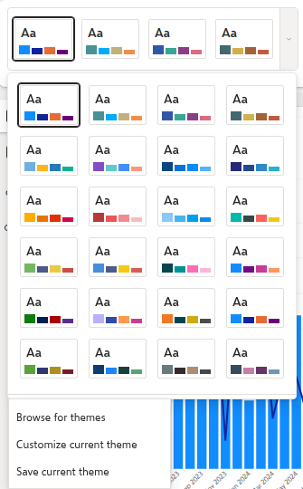
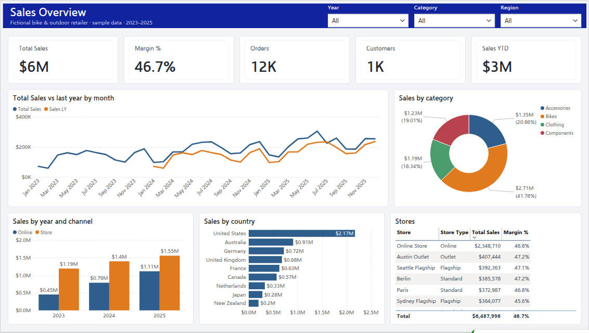
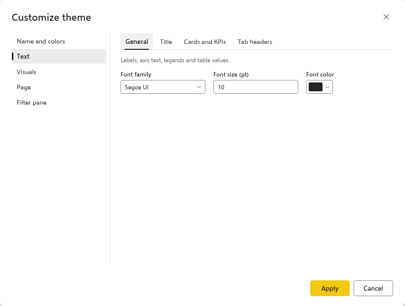
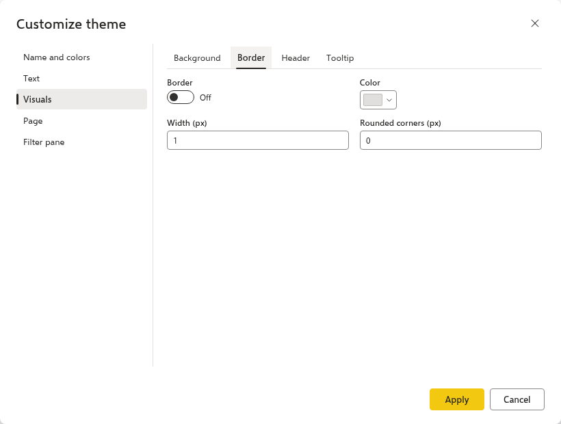
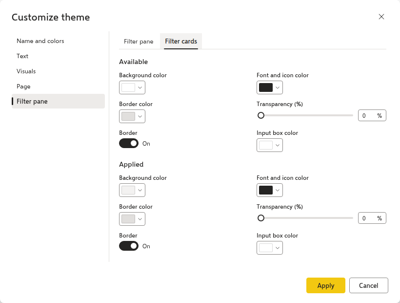

# Report themes

> **Applies to:** Creators

A report theme sets the colors, fonts and default formatting of every visual in a report. This article shows how to
apply a built-in theme, import a theme file, customize the current theme and save it, and explains how a theme
provides the defaults you see in the Format pane.

## Prerequisites

- A report open in edit mode. The steps use the built-in sample (**File > New > Sample report**).

## Apply a built-in theme

1. Select the **View** tab. The **Themes** group shows the first four themes.
2. Select the arrow at the right of the group to see them all, then select a theme. Hover over a swatch to see its name.



The gallery lists **Default** and 23 themes in Power BI Desktop's gallery order: Highrise, Executive, Frontier,
Innovate, Bloom, Tidal, Temperature, Solar, Divergent, Storm, Classic, City park, Classroom, Colorblind safe, Electric,
High contrast, Sunset, Twilight, Accessible default, Accessible city park, Accessible tidal, Accessible neutral and
Accessible orchid.

**Default** removes the report's custom theme, so the base theme (*CY24SU10*, Power BI's current default) applies.
Every other theme is written into the report as its custom theme. A theme change is one undo step.

## Import a theme file

1. Select **View > Themes**, open the gallery and select **Browse for themes**.
2. Choose a `.json` theme file. A message confirms *Theme "name" imported.*

Lumen accepts the theme files Power BI Desktop uses. A file is rejected, with the reason in a message, when it is not
valid JSON, when `dataColors` is not a list of hex colors, when `background`, `foreground`, `tableAccent`, `good`,
`neutral`, `bad`, `maximum`, `center` or `minimum` is not a hex color, or when it has none of `name`, `dataColors`,
`textClasses`, `visualStyles` or `background`. A file without a `name` is named after the file.

This example sets eight data colors, the label and title text classes, a light border on every visual and data labels
on stacked bar charts:

```json
{
  "name": "Docs example",
  "dataColors": ["#2E5E8C", "#E07A1F", "#4A9C6D", "#B8434F", "#7B5EA7", "#C9A227", "#3B8EA5", "#8A8D91"],
  "background": "#FFFFFF",
  "foreground": "#1F2933",
  "tableAccent": "#2E5E8C",
  "textClasses": {
    "label": { "fontFace": "Segoe UI", "fontSize": 9, "color": "#3E4C59" },
    "title": { "fontFace": "Segoe UI Semibold", "fontSize": 12, "color": "#1F2933" }
  },
  "visualStyles": {
    "*": {
      "*": {
        "border": [{ "show": true, "color": { "solid": { "color": "#D9DEE3" } }, "radius": 6 }]
      }
    },
    "barChart": {
      "*": {
        "labels": [{ "show": true }]
      }
    }
  }
}
```



The page header keeps its navy color: formatting set on a visual always wins over the theme.

## Customize the current theme

1. Select **View > Themes**, open the gallery and select **Customize current theme**.
2. Change the settings in the sections on the left (described below).
3. Select **Apply**. The result becomes the report's custom theme. **Cancel** discards your changes.

A setting you don't change shows the base theme's value.


### What each section edits

Each setting is written to the same theme JSON key Power BI Desktop's dialog writes:

| Section | Tab | Settings | Theme JSON |
|---|---|---|---|
| **Name and colors** | | **Name** | `name` |
| | **Theme colors** | **Color 1** to **Color 8**; **Show more** shows the rest (up to 41) with **Add color** and **Remove last** | `dataColors` |
| | **Sentiment colors** | **Positive**, **Neutral**, **Negative** | `good`, `neutral`, `bad` |
| | **Divergent colors** | **Max**, **Middle**, **Min**, **Null** | `maximum`, `center`, `minimum`, `null` |
| | **Structural colors** | **First-level elements**, **Second-level elements**, **Third-level elements**, **Background**, **Secondary background**, **Background elements**, **Table accent**, **Hyperlink**, **Visited hyperlink** | `foreground`, `foregroundNeutralSecondary`, `foregroundNeutralTertiary`, `background`, `backgroundLight`, `backgroundNeutral`, `tableAccent`, `hyperlink`, `visitedHyperlink` |
| **Text** | **General** | **Font family**, **Font size (pt)**, **Font color** for labels, axis text, legends and table values | `textClasses.label` |
| | **Title** | The same for visual titles and axis titles | `textClasses.title` |
| | **Cards and KPIs** | The same for callout values of cards and KPIs | `textClasses.callout` |
| | **Tab headers** | The same for column and row headers of tables and matrices, and slicer headers | `textClasses.header` |
| **Visuals** | **Background** | **Color**, **Transparency (%)** | `visualStyles["*"]["*"].background` |
| | **Border** | **Border** (on or off), **Color**, **Width (px)**, **Rounded corners (px)** | `visualStyles["*"]["*"].border` |
| | **Header** | **Show header**, **Background color**, **Border color**, **Icon color**, **Transparency (%)** | `visualStyles["*"]["*"].visualHeader` |
| | **Tooltip** | **Label text color**, **Value text color**, **Background**, **Background transparency (%)**, **Font**, **Font size** | `visualStyles["*"]["*"].visualTooltip` |
| **Page** | | **Wallpaper** (**Color**, **Transparency (%)**) and **Page background** (**Color**, **Transparency (%)**) | `visualStyles.page["*"].outspace`, `.background` |
| **Filter pane** | **Filter pane** | **Background color**, **Transparency (%)**, **Font and icon color**, **Title text size**, **Header text size**, **Input box border color**, **Border color**, **Border**, **Font**, **Width (px)** | `visualStyles["*"]["*"].outspacePane` |
| | **Filter cards** | For **Available** and **Applied** cards: **Background color**, **Font and icon color**, **Border color**, **Transparency (%)**, **Border**, **Input box color** | `visualStyles["*"]["*"].filterCard` (entries with `$id` `Available` and `Applied`) |







### What the dialog can't edit

Edit the theme JSON and import it (**Browse for themes**) for anything else, in particular:

- formatting for one visual type only (`visualStyles.<visualType>`, such as the `barChart` labels in the example);
- any card or property other than background, border, header and tooltip for all visuals (axes, legends, data labels,
  gridlines, table grids and so on);
- text classes other than the four above;
- named style presets for one visual (style names other than `"*"`).

## Save the current theme

1. Select **View > Themes**, open the gallery and select **Save current theme**.
2. Choose a file name. The default is the theme name in your Documents folder.

Lumen saves the report's custom theme as it is. When the report uses the default theme, it saves the resolved colors
and text classes (no `visualStyles`).

## How the theme provides defaults

Each format property is resolved in this order:

1. the value set on the visual (in the Format pane or in the file);
2. the theme's `visualStyles` for this visual type (`visualStyles.<visualType>["*"]`);
3. the theme's `visualStyles` for all visuals (`visualStyles["*"]["*"]`);
4. the visual's own default, which often comes from the theme's colors and text classes: data colors in order for
   series, `textClasses.label` for labels and axis text, `textClasses.title` for titles, `textClasses.callout` for card
   values, `textClasses.header` for table headers.

The Format pane shows the result of this order for every property you have not set, so after a theme change the pane
shows the new defaults. See [Format a visual](format-a-visual.md#what-an-unset-property-shows).

A custom theme is merged with the base theme: its top-level colors replace the base's, and its `textClasses` and
`visualStyles` are merged key by key.

Built-in icons drawn in a theme color follow a theme change; see [Icons](icons.md).

## Differences from Power BI Desktop

- **Built-in theme colors are approximations for some themes.** Power BI does not publish its built-in theme files.
  Lumen's palettes come from public sources; the palettes of Highrise, Frontier, Innovate, Bloom, Temperature, Solar,
  Storm and the five Accessible themes were sampled from published images and may differ from Power BI's by a few
  units per channel. Most built-in themes have 8 data colors in Lumen (Power BI's have more), and their sentiment and
  divergent colors are left to the base theme.
- Picking a built-in theme stores it in the report as a custom theme file rather than as a reference to Power BI's
  built-in theme.
- Theme files are written in Power BI's format and registered as Power BI registers them; opening such a report in
  Power BI Desktop has not been verified.

## Related content

- [Format a visual](format-a-visual.md)
- [Visual titles, borders and backgrounds](visual-titles-borders-and-backgrounds.md)
- [Icons](icons.md)
- [Format properties reference](../reference/format-properties.md)
- [Use report themes in Power BI Desktop on Microsoft Learn](https://learn.microsoft.com/power-bi/create-reports/desktop-report-themes)
