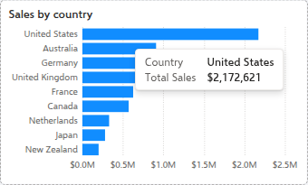
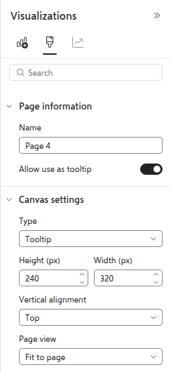
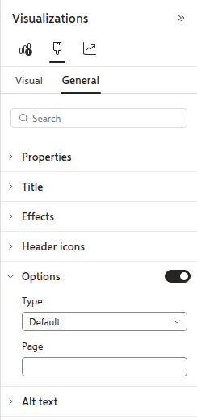
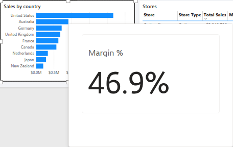

# Tooltips

> **Applies to:** Creators · Analysts

A tooltip appears when you hover over a data point. Lumen shows the default tooltip (the point's fields and values)
and report-page tooltips (a small report page rendered for the hovered point). This article shows both and how to set
them up.

## Default tooltips

Hover over a bar, slice, point or cell. The tooltip lists the point's category values and its measure values. Fields
in the visual's **Tooltips** well are added below them. In the sample, **Total Sales vs last year by month** has
**Sales YoY %** in **Tooltips**, so hovering a month shows the year-over-year change too.

To add a field to the tooltip:

1. Select the visual.
2. In **Visualizations > Build visual**, drag a measure or column from the **Data** pane into **Tooltips**.

To turn tooltips off for a visual, select it, open **Format visual > General**, expand the tooltip card (titled
**Options**, see the note below) and turn it off.

## Report-page tooltips

A report-page tooltip is a page, usually small, that Lumen renders live inside the tooltip, filtered to the hovered
data point.

### Create the tooltip page

1. Add a page (**+** next to the page tabs).
2. Select an empty area of the canvas, then select **Format page** in the **Visualizations** pane.
3. Under **Page information**, turn on **Allow use as tooltip**. A 16:9 page is resized to the **Tooltip** size
   (320 × 240 px); the **Canvas settings** **Type** shows **Tooltip**.
4. Add the visuals the tooltip should show, for example a card with **Margin %**.

Tooltip pages are not exported by default. They still show as tabs in reading view unless you hide them: right-click
the page tab and select **Hide page**, as you would in Power BI Desktop.

### Point a visual at the tooltip page

1. Select the visual whose tooltip should use the page, for example **Overview > Sales by country**.
2. Select **Format visual > General** and expand the tooltip card (titled **Options**).
3. Set **Type** to **Report page**.
4. In **Page**, enter the tooltip page's **internal name** and press **Enter** (see the warning).

Hovering a bar now shows the tooltip page, filtered to the hovered country:

> [!WARNING]
> The **Page** box expects the page's internal name (the PBIR page name, for example `b43eb33eff7515f1672c`), not the
> name on the page tab. Typing the display name has no effect: the default tooltip keeps showing. Lumen doesn't show
> internal page names in the interface; you can find one as the folder name under `definition/pages/` after saving
> the report as a Power BI project (PBIP). Power BI Desktop offers a list of tooltip pages here instead.

### Automatic matching

When a visual's tooltip type isn't set, or is **Report page** with no page chosen, Lumen picks a tooltip page
automatically, as Power BI does: the tooltip page whose tooltip fields the visual uses (the one with the most fields
in common). Tooltip fields are stored on the tooltip page like drill-through fields.

> [!NOTE]
> Lumen has no well to add tooltip fields to a tooltip page: the **Drill through** wells are hidden on tooltip pages,
> and there is no **Tooltip** well. Automatic matching therefore works for tooltip pages that already have tooltip
> fields, for example in a report built in Power BI Desktop.

## Considerations and limitations

- The tooltip settings card on the **General** tab is titled **Options** rather than **Tooltips** (a labelling
  defect: the card is the only member of its **Tooltips** group).
- Report-page tooltips are not shown on the mobile layout canvas, as in Power BI.
- A visual's own tooltip text colors come from its formatting and the theme.

## Differences from Power BI Desktop

- **Page** is a text box that needs the internal page name, not a list of tooltip pages.
- No tooltip-field well on tooltip pages (see the note above).
- Lumen draws its own default tooltip; the drill and drill-through actions of Power BI's modern visual tooltips are
  not available.

## Related content

- [Pages](pages.md)
- [Drill down and drill through](drill-down-and-drillthrough.md)
- [Visual titles, borders and backgrounds](visual-titles-borders-and-backgrounds.md)
- [The Data pane and field wells](the-data-pane-and-field-wells.md)
- [Report page tooltips on Microsoft Learn](https://learn.microsoft.com/power-bi/create-reports/desktop-tooltips)
