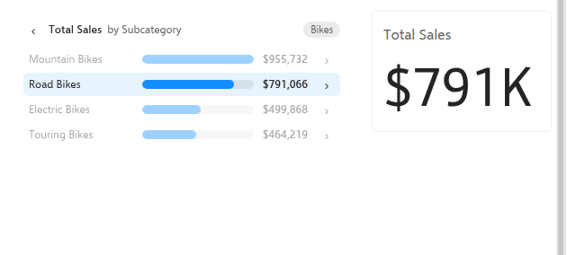
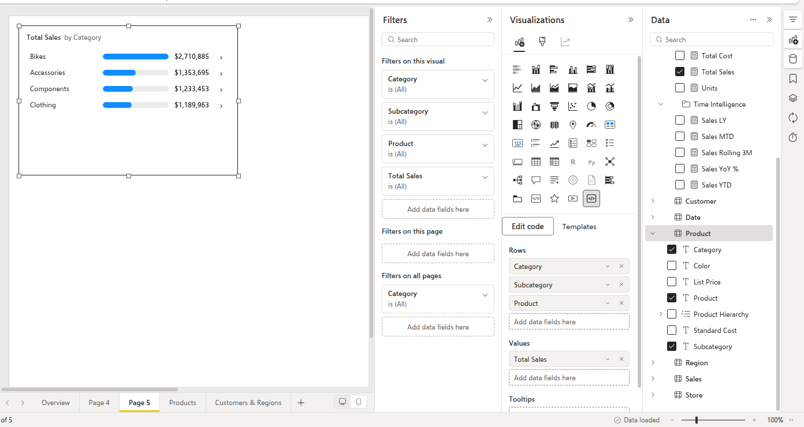

# Tutorial: build a drillable bar list

> **Applies to:** Creators

In this tutorial you build a bar list with the [code visual](../visuals/code-visual.md) that behaves like a native
chart: a click on a bar cross-filters a card on the same page, an arrow on each bar drills down through
Category > Subcategory > Product, and a back arrow and a breadcrumb take you back up. Then you look at the dozen lines
of HTML and CSS that do it. It takes about 15 minutes.



In this tutorial, you:

- insert a code visual from the **Bar list** template and give it a three-level hierarchy;
- add a native card to see cross-filtering;
- drill down, select a row at the drilled level, and drill back up;
- read how the template makes rows selectable and drillable.

## Prerequisites

- Lumen installed and running, with the built-in sample open: **File > New > Sample report**.

## Step 1: insert the bar list

1. Select **+** to the right of the page tabs to add an empty page.
2. On the ribbon, select **Insert > Code visual**. In **New code visual**, select **Bar list (drill and select)** and
   then **Insert**.
3. In the **Data** pane, expand **Product** and drag **Category**, **Subcategory** and **Product**, in that order, to
   the **Rows** well.
4. Drag **_Measures > Sales > Total Sales** to the **Values** well.

The visual shows **Total Sales by Category**: Bikes, Accessories, Components and Clothing, each with a bar and a **›**
arrow. Because **Rows** has three levels, the visual's header also has the drill icons of a native chart.



## Step 2: add a card

1. Select an empty part of the page, then select the **Card** tile in **Build visual**.
2. Drag **_Measures > Sales > Total Sales** to its **Value** well. The card shows **$6M**.
3. Move the card next to the bar list.

## Step 3: drill down and cross-filter

1. Select the **›** arrow on the **Bikes** row. The list now shows Bikes' subcategories: the header reads **Total
   Sales by Subcategory**, a **Bikes** breadcrumb appears on the right and a **‹** back arrow on the left.
2. Select the **Road Bikes** row. The card changes to **$791K**, the sales of Road Bikes, and the other rows of the
   list dim. This is the same cross-filter a click on a bar of a column chart does.
3. **Ctrl+click** **Mountain Bikes** to add it to the selection: the card shows the total of both.
4. Select an empty part of the list to clear the selection. The card goes back to **$6M**.
5. Select **‹** to drill back up to the categories.

The header's drill icons and the right-click menu's **Drill down** and **Drill up** do the same. Save the report, and
the visual reopens at the level you left it; a bookmark captures it too.

## Step 4: see how it works

Select the visual and **Edit code**. The parts of the template that matter:

```html
<header class="bl__head">
  {{#if drill.canDrillUp}}<button class="bl__icon" data-drill-up title="Drill up">‹</button>{{/if}}
  <span class="bl__title">{{default params.title measureName1}}</span>
  {{#if categoryName}}<span class="bl__by">by {{categoryName}}</span>{{/if}}
  {{#if breadcrumb}}<span class="bl__path">{{breadcrumb}}</span>{{/if}}
</header>
<ol class="bl__rows">
  {{#each rows}}
  <li class="bl__row" data-select>
    <span class="bl__label">{{category}}</span>
    <span class="bl__track"><span class="bl__fill"></span></span>
    <span class="bl__value">{{value1}}</span>
    {{#if canDrill}}<button class="bl__icon" data-drill title="Drill down">›</button>{{/if}}
  </li>
  {{/each}}
</ol>
```

- `data-select` on the row makes a click select it: Lumen sends the row's identity to the page as a native visual
  does.
- `data-drill` drills into the row it is in; `data-drill-up` goes back up one level.
- `drill.canDrillUp`, `categoryName` (the field of the level shown) and `breadcrumb` ("Bikes") describe the drill
  state; `canDrill` is true on rows that have a level below them.

And in the CSS:

```css
.bl__fill { width: calc(max(var(--pct-of-max), 0) * 100%); }
.bl__row[data-selected="false"] { opacity: .4; }
#lumen-root[data-has-highlight="true"] .bl__fill { opacity: .3; }
.bl__hl { width: calc(max(var(--highlight-pct-of-max, 0), 0) * 100%); }
```

- `--pct-of-max` is set on every row: its value divided by the largest value. The bar width needs no measure.
- `data-selected` is set on each row while the list has a selection, so unselected rows dim.
- When another visual cross-highlights the list, `data-has-highlight` is set on the root and each row gets
  `--highlight-pct-of-max`: the full bar fades and the highlighted part is drawn solid on top, like a Power BI bar
  chart.

Try it: select **Bikes** in a native bar or column chart of Total Sales by Category on the same page, and the list
highlights its share.

## Next steps

- Change the colour of the bars from **Format visual > Visual > Parameters > Accent colour**.
- Show a different design at each level with `data-level` on the root: `#lumen-root[data-level="2"] .bl__track { display: none; }`
  hides the bars at the Product level.
- Write your own from scratch: [Tutorial: build a KPI tile with HTML and CSS](tutorial-build-a-kpi-tile-with-html-and-css.md).

## Related content

- [Code visual](../visuals/code-visual.md)
- [Use the code visual](code-visual.md)
- [Code visual API reference](../reference/code-visual-api.md)
- [Drill down and drillthrough](drill-down-and-drillthrough.md)
- [Visual interactions](visual-interactions.md)
