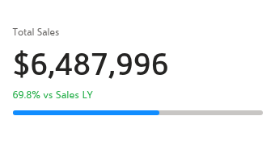
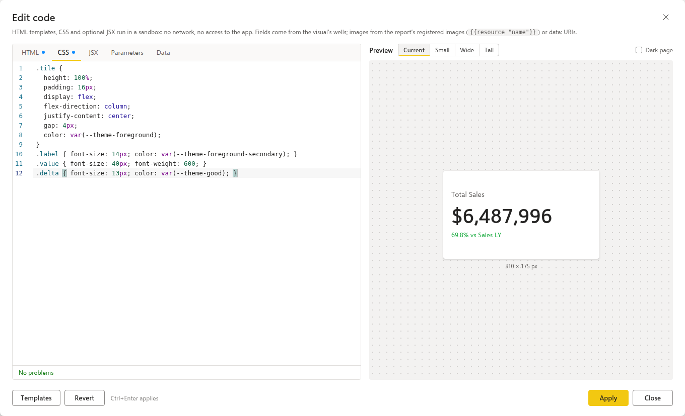
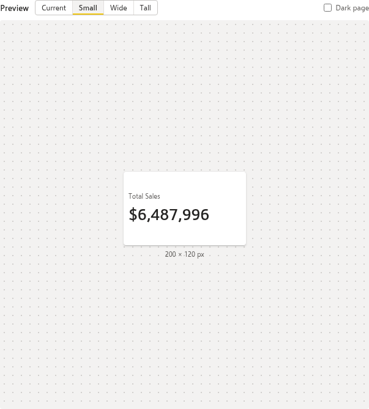
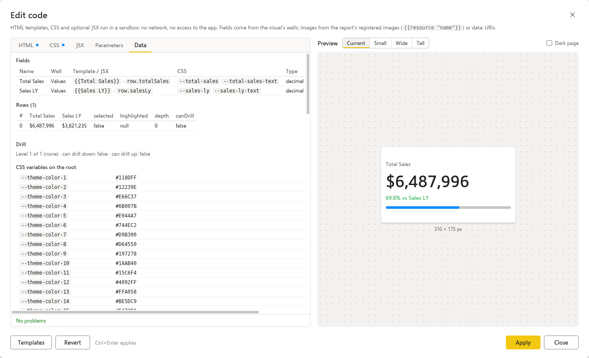

# Tutorial: build a KPI tile with HTML and CSS

> **Applies to:** Creators

In this tutorial you build a KPI tile with the [code visual](../visuals/code-visual.md): a headline number, its change
against last year, and a bar that compares the two, written in a few lines of HTML and CSS. The values come straight
from measures, the CSS reads them as variables, and the tile resizes itself with container units. It takes about 15
minutes.



In this tutorial, you:

- insert a code visual and bind two measures;
- write a template that shows them;
- style it with CSS that scales with the visual's size;
- draw a bar whose width is computed from the two measures in CSS.

## Prerequisites

- Lumen installed and running, with the built-in sample open: **File > New > Sample report**.
- Basic HTML and CSS.

## Step 1: insert a code visual

1. Select **+** to the right of the page tabs to add an empty page.
2. On the ribbon, select **Insert > Code visual**. In **New code visual**, select **KPI tile** and then **Insert**.
3. In the **Data** pane, drag **_Measures > Sales > Total Sales** to the **Values** well, then
   **_Measures > Time Intelligence > Sales LY** below it.

The template already shows a KPI with a sparkline. In the next steps you replace its code with your own, to see how it
works.

## Step 2: write the template

1. With the visual selected, select **Edit code** under **Build visual**.
2. On the **HTML** tab, select all the text (**Ctrl+A**) and replace it with:

   ```html
   <div class="tile">
     <div class="label">{{measureName1}}</div>
     <div class="value">{{measure1}}</div>
     <div class="delta">{{percent (div (sub measure1 measure2) measure2) 1}} vs {{measureName2}}</div>
   </div>
   ```

   `{{measure1}}` is the first measure of the **Values** well, formatted with its format string, and
   `{{measureName1}}` its name. The delta line computes (Total Sales − Sales LY) / Sales LY with the `sub`, `div` and
   `percent` helpers.

3. On the **CSS** tab, replace the text with:

   ```css
   .tile {
     height: 100%;
     padding: 16px;
     display: flex;
     flex-direction: column;
     justify-content: center;
     gap: 4px;
     color: var(--theme-foreground);
   }
   .label { font-size: 14px; color: var(--theme-foreground-secondary); }
   .value { font-size: 40px; font-weight: 600; }
   .delta { font-size: 13px; color: var(--theme-good); }
   ```

   `--theme-foreground`, `--theme-foreground-secondary` and `--theme-good` are the report theme's colours, so the tile
   follows the theme (and a dark theme) without changes.

The preview shows **$6,487,996** and **69.8% vs Sales LY**.



## Step 3: make it fit any size

The tile is a size container, so CSS can size the text by the tile instead of by fixed pixels. Replace the CSS with:

```css
.tile {
  height: 100%;
  padding: clamp(8px, 6cqmin, 20px);
  display: flex;
  flex-direction: column;
  justify-content: center;
  gap: 4px;
  color: var(--theme-foreground);
}
.label { font-size: clamp(11px, 7cqmin, 15px); color: var(--theme-foreground-secondary); }
.value { font-size: clamp(20px, 22cqmin, 56px); font-weight: 600; }
.delta { font-size: 13px; color: var(--theme-good); }
@container (max-height: 130px) {
  .delta { display: none; }
}
```

`22cqmin` is 22% of the tile's smaller side, kept between 20 and 56 px by `clamp()`. The container query hides the
delta line when the tile is less than 130 px tall.

Select **Small** above the preview: at 200 × 120 px, the number shrinks and the delta line disappears. Select
**Current** to go back.



## Step 4: draw a bar from the data

Every measure is also a CSS variable: **Total Sales** is `--total-sales` and **Sales LY** is `--sales-ly`, holding the
unformatted numbers. CSS can compute with them.

1. On the **HTML** tab, add a bar as the last line inside the tile:

   ```html
   <div class="tile">
     <div class="label">{{measureName1}}</div>
     <div class="value">{{measure1}}</div>
     <div class="delta">{{percent (div (sub measure1 measure2) measure2) 1}} vs {{measureName2}}</div>
     <div class="bar"><span></span></div>
   </div>
   ```

2. On the **CSS** tab, replace the text with:

   ```css
   .tile {
     height: 100%;
     padding: clamp(8px, 6cqmin, 20px);
     display: flex;
     flex-direction: column;
     justify-content: center;
     gap: 4px;
     color: var(--theme-foreground);
   }
   .label { font-size: clamp(11px, 7cqmin, 15px); color: var(--theme-foreground-secondary); }
   .value { font-size: clamp(20px, 22cqmin, 56px); font-weight: 600; }
   .delta { font-size: 13px; color: var(--theme-good); }
   .bar { height: 6px; margin-top: 6px; border-radius: 3px; background: var(--theme-background-neutral); }
   .bar span {
     display: block;
     height: 100%;
     border-radius: 3px;
     background: var(--theme-color-1);
     /* Sales LY as a share of Total Sales, straight from the data */
     width: calc(min(var(--sales-ly) / var(--total-sales), 1) * 100%);
   }
   @container (max-height: 130px) {
     .delta { display: none; }
   }
   ```

   The bar's width is Sales LY divided by Total Sales, capped at 100%: no measure that builds a percentage text or an
   SVG is needed.

3. Select the **Data** tab. It lists the fields with their template names and CSS variables, the rows, and, under
   **CSS variables on the root**, every variable with its current value: `--total-sales` is 6487996 and `--sales-ly`
   is 3821235.



## Step 5: apply

1. Select **Apply**, then **Close**. The tile on the page shows the new design.
2. Resize the tile on the page: the number scales with it, and the delta line disappears when it gets short.
3. Add a slicer on **Date > Year** and select a year: the tile, like any visual, shows that year's numbers.

Your change is one step of **Undo** (**Ctrl+Z**). Saved as PBIP, the code is stored in `code.html` and `code.css`
beside the visual's `visual.json`.

## Next steps

- Add a parameter so that report authors can change the bar colour from the Format pane: see
  [Add parameters](code-visual.md#add-parameters).
- Build a visual that cross-filters and drills: [Tutorial: build a drillable bar list](tutorial-build-a-drillable-bar-list.md).

## Related content

- [Code visual](../visuals/code-visual.md)
- [Use the code visual](code-visual.md)
- [Code visual API reference](../reference/code-visual-api.md)
- [Cards](../visuals/cards.md)
