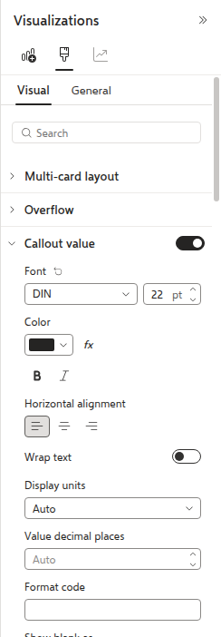
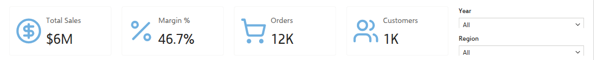
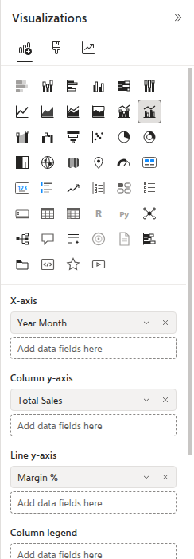

# Tutorial: design a dashboard page

> **Applies to:** Creators

In this tutorial you build a one-page sales dashboard on the built-in sample: a row of KPI cards with icons, two
slicers, a combo chart, a matrix, a theme, and a PDF of the result. It takes about 30 minutes and touches most of the
report-building features of Lumen.

In this tutorial, you:

- add and rename a page;
- add a card, size it exactly, give it an icon, and copy it;
- add slicers, a combo chart and a matrix;
- apply a theme;
- export the page to PDF.

## Prerequisites

- Lumen installed and running. See [Get started](../get-started/README.md).
- The built-in sample: select **File > New > Sample report**, or **Try a sample** on the start screen. It is a
  fictional bike and outdoor retailer with sales from 2023 to 2025.

> [!TIP]
> Every step can be undone with **Ctrl+Z**. The sample is not saved unless you save it.

## Step 1: add a page

1. Select **+** to the right of the page tabs. A page named *Page 4* opens after the **Overview** page.
2. Double-click the new tab, type `Dashboard` and press **Enter**.
3. To get more room for the canvas, collapse the **Filters** pane with the **>>** button in its header.

The page is 1280 × 720 pixels. The layout in this tutorial uses a 16 px margin and 12 px gaps.

## Step 2: add the first KPI card

1. Make sure nothing is selected on the page, then in the **Visualizations** pane, on **Build visual**, select the
   **Card** icon (hover over the icons to see their names). An empty card appears at the top left.
2. In the **Data** pane, expand **_Measures > Sales** and tick **Total Sales**. The card shows **$6M**.
3. Select **Format visual** (the paintbrush) and then the **General** tab. Expand **Properties** and set:

   | Height | Width | Horizontal | Vertical |
   |---|---|---|---|
   | 112 | 230 | 16 | 16 |

   Press **Enter** after each value.
4. Select the **Visual** tab. Expand **Callout value** and set the font size (the box next to **Font**) to **22**.

## Step 3: give the card an icon

1. Still on the **Visual** tab, expand **Callout image** and turn on its switch.
2. Set **Image source** to **Icon**. The **Choose an icon** dialog opens on the Lucide library.
3. Type `dollar` in **Search icons** and select **Circle dollar sign**.
4. Select the **Color** box and choose **Theme color 1** (the third swatch in the top row; hover to see the names).
   An icon in a theme color follows the theme in step 7.
5. Select **Select**.
6. Back in **Callout image**, set **Position** to **Left** and **Image area size (%)** to **30**.

The card now shows the icon to the left of *Total Sales* and *$6M*. More about icons: [Icons](icons.md).

> [!NOTE]
> With the default image area size (50%) a 230 px card leaves too little room for the value, and the value is cut off.
> Setting 30% and a 22 pt value avoids it.

## Step 4: copy the card for three more KPIs

1. Select the card on the canvas (so the canvas has the keyboard focus) and press **Ctrl+C**, then **Ctrl+V**. A copy
   appears 20 px down and to the right, selected.
2. In the **Data** pane, clear **Total Sales** and tick **Margin %** (in **_Measures > Profitability**).
3. On **Format visual > General > Properties**, set **Horizontal** to **258** and **Vertical** to **16**.
4. On the **Visual** tab, under **Callout image**, select the icon box, search for `percent`, select **Percent** and
   select **Select**.
5. Repeat steps 1 to 4 for the next two cards, each time copying the card you just finished:

   | Measure | Folder | Horizontal | Icon (search) |
   |---|---|---|---|
   | **Orders** | _Measures > Sales | 500 | **Shopping cart** (`cart`) |
   | **Customers** | _Measures > Customers | 742 | **Users** (`users`) |

## Step 5: add two slicers

1. Select an empty area of the canvas so that nothing is selected.
2. On **Build visual**, select **Slicer**. In the **Data** pane, tick **Date > Year**.
3. On **Format visual > General > Properties**, set **Height** 52, **Width** 280, **Horizontal** 984, **Vertical** 16.
4. On the **Visual** tab, expand **Slicer settings** and set **Style** to **Dropdown**.
5. Repeat steps 1 to 4 with **Region > Region**, with **Vertical** set to **76**.

> [!IMPORTANT]
> Always clear the selection before you pick a new visual type. With a visual selected, the gallery changes that
> visual's type instead of adding a new one.

## Step 6: add a combo chart

1. Select an empty area of the canvas, then select **Line and clustered column chart** on **Build visual**.
2. Drag the fields from the **Data** pane to the wells:
   1. **Total Sales** to **Column y-axis**;
   2. **Margin %** to **Line y-axis**;
   3. **Date > Year Month** to **X-axis**.

   

3. On **Format visual > General > Properties**, set **Height** 560, **Width** 760, **Horizontal** 16, **Vertical** 144.

The chart shows monthly sales as columns on the left axis and the margin as a line on the right axis, titled *Total
Sales and Margin % by Year Month*. The months are sorted from January 2023 on.

## Step 7: add a matrix

1. Select an empty area of the canvas, then select **Matrix** on **Build visual**.
2. In the **Data** pane, tick **Product > Category** and **Product > Subcategory**; both go to **Rows**.
3. Drag **Date > Year** to **Columns**.
4. Tick **_Measures > Sales > Total Sales**; it goes to **Values**.
5. On **Format visual > General > Properties**, set **Height** 560, **Width** 476, **Horizontal** 788, **Vertical** 144.

The matrix shows the four categories with a **+** to expand each to its subcategories, one column per year and a
**Total** row and column.

## Step 8: apply a theme

1. Select an empty area of the canvas.
2. Select **View**, then the arrow at the right of the **Themes** gallery.
3. Select **Innovate** (first swatch of the second row; hover to check the name).

The columns turn light blue, the line yellow, and the card icons take the new first theme color. The rest of the
sample's pages change too: a theme applies to the whole report. More in [Themes](themes.md).

## Step 9: try the slicers

1. Select the **Year** slicer box and select **2024**, then press **Esc** to close the list. The cards, the chart and
   the matrix show 2024 only (**Total Sales** drops from $6M to $2M).
2. To clear it, right-click the slicer and select **Clear selections**, or hover over it and select the eraser icon
   in its header. More in [Slicers](slicers.md).

## Step 10: export the page to PDF

1. Select **File > Export > Export to PDF**.
2. In the dialog, select **Current page**. The list shows only **Dashboard** ticked.
3. Select **Export** and choose a file name.

A notification says **Export complete** and offers **Show in folder**. The PDF has one 960 × 540 pt page with the
dashboard, and its text can be selected. The other export formats are described in
[Export a report](export-a-report.md).

To keep your work, save the report with **File > Save as** as a Power BI project (`.pbip`) or a Lumen bundle (`.wbi`).

## What you learned

- Visuals are inserted from the Visualizations pane with nothing selected, and filled from the Data pane by ticking or
  dragging fields.
- **Format visual > General > Properties** sets exact sizes and positions.
- Card images can be icons, and icons in theme colors follow the theme.
- A theme restyles the whole report at once.

## Considerations and limitations

- The numbers come from the sample's generated data and can differ slightly between Lumen versions.
- If an edit fails, Lumen shows an error message titled *Couldn't complete "…"* and leaves the page unchanged; see
  [Frequently asked questions](../troubleshooting/faq.md#using-lumen).

## Related content

- [Add and arrange visuals](add-and-arrange-visuals.md)
- [Format a visual](format-a-visual.md)
- [Icons](icons.md)
- [Slicers](slicers.md)
- [Themes](themes.md)
- [Export a report](export-a-report.md)
